# ActivaFit — Informe de ISS (Django + DRF)

**Estudiante:** Elkin Zaith Medina Martinez\
**Programa:** Ingeniería de Sistemas — Universidad de La Guajira\
**Proyecto:** ActivaFit — Sistema de gestión de gimnasio

------------------------------------------------------------------------

## Introducción

ActivaFit es un sistema de gestión para gimnasios. Su objetivo es centralizar en una sola API el registro de clientes, entrenadores y planes, el control de membresías y pagos, la asistencia, las rutinas de ejercicio y el seguimiento de medidas corporales de cada cliente.

Este informe cuenta, unidad por unidad (ISS), cómo se fue construyendo el backend con Django y Django REST Framework: qué se hizo en cada paso, por qué se hizo así y qué evidencia demuestra que quedó funcionando. Cada unidad cierra con un GATE, una tabla de criterios que confirma que se puede pasar a la siguiente.

## Modelo de datos de ActivaFit

Tablas: `clients`, `trainers`, `plans`, `memberships`, `payments`, `attendances`, `exercises`, `routines`, `routine_exercises`, `measurements`.

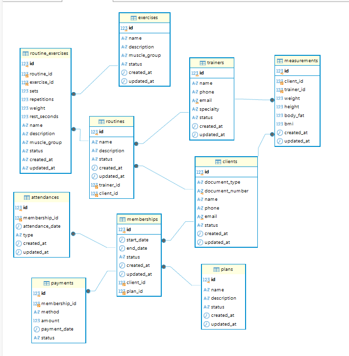

------------------------------------------------------------------------

### ISS-00 — Entorno y proyecto Django

### Narrativa

Todo proyecto empieza por el terreno donde se va a construir. Antes de escribir una sola línea de ActivaFit se preparó un entorno aislado, para que las librerías del sistema no se mezclaran con las del proyecto, y se generó el esqueleto de Django que sostendrá el resto del trabajo. En esta unidad todavía no existe ningún modelo ni ningún endpoint: solo el cimiento sobre el cual se levantará todo lo demás.

### Objetivo

Crear el entorno aislado y el proyecto Django `config` de ActivaFit, sin modelos todavía.

### Requisitos

- Python 3.12.
- El directorio del proyecto vacío.
- Red para instalar Django 5.2.17.

### Construcción

Primero se creó el entorno virtual y se activó. Dentro de él se instaló una versión fija de Django (5.2.17), de modo que cualquier persona que repita el proceso obtenga exactamente el mismo resultado. Después se generó el proyecto con `startproject config .`: el punto final hace que `manage.py` quede en la raíz y el paquete de configuración en `config/`, sin una carpeta duplicada. Por último, se guardaron las dependencias en `requirements.txt`.

``` bash
python3 -m venv .venv
source .venv/bin/activate
python -m pip install "Django==5.2.17"
django-admin startproject config .
python -m pip freeze > requirements.txt
python -m django --version
```

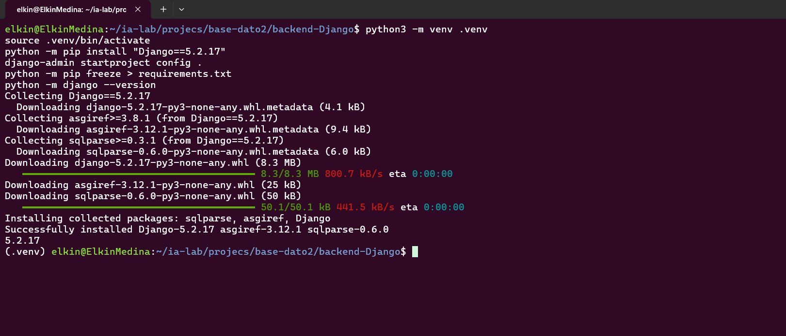

Creación del `.gitignore`:

Django no crea un `.gitignore`, así que se añadió a mano. Su función es evitar que el entorno virtual, los secretos del `.env`, las bases de datos locales y los archivos temporales lleguen al repositorio.

``` bash
cat > .gitignore <<'EOF'
.venv/
__pycache__/
*.py[cod]
.env
db.sqlite3
*.log
.idea/
.vscode/
staticfiles/
media/
.pytest_cache/
htmlcov/
.coverage
EOF
```

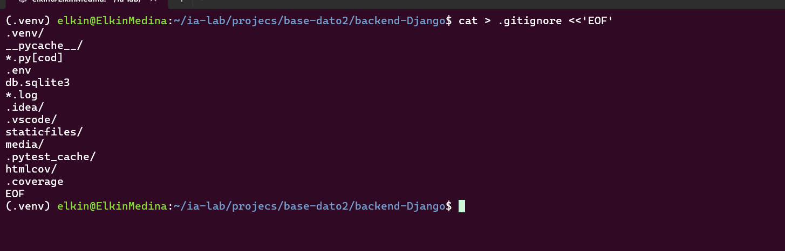

### Explicación

- **Django 5.2.17:** única librería de este ISS; trae el ORM, el admin, `startproject` y `manage.py`.
- **`.venv`:** aísla pip del sistema; el prompt queda `(.venv)`.
- **`django-admin startproject config .`:** deja `manage.py` en la raíz y el paquete de configuración en `config/`.
- **`.gitignore`:** archivo nuevo; deja fuera `.venv/` y `.env` del repositorio.
- `pip` siempre se usa con el entorno activo y como `python -m pip`.

### Criterios de aceptación

- AC-00-01: `python -m django --version` imprime 5.2.17.
- AC-00-02: existen `manage.py` y `config/urls.py`.
- AC-00-03: no hay modelos de negocio.

### Verificación

Para cerrar la unidad se comprobó la versión instalada y se ejecutó el chequeo del proyecto, que confirma que la estructura es válida aunque todavía no tenga lógica de negocio.

``` bash
python -m django --version
python manage.py check
```

#### 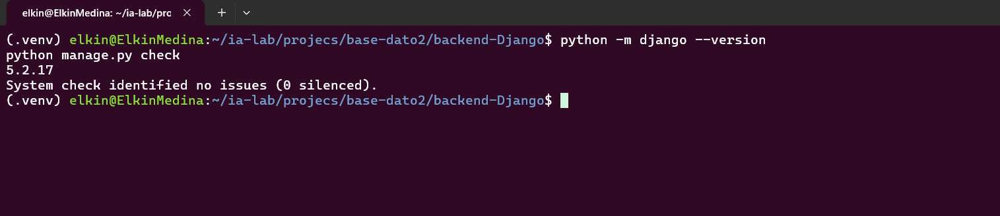

### GATE

| AC       | Verificación                   | Evidencia | Resultado |
|----------|--------------------------------|-----------|-----------|
| AC-00-01 | versión de Django              | EVI-00-01 | PASS      |
| AC-00-02 | archivos del proyecto          | EVI-00-02 | PASS      |
| AC-00-03 | ausencia de modelos de negocio | EVI-00-02 | PASS      |

## ISS-01 — Settings y selección del motor

### Narrativa

Con el cimiento listo, ActivaFit necesita saber dónde guardar sus datos. En lugar de escribir esa decisión dentro del código, se optó por que el motor de base de datos se elija desde el archivo `.env`: cambiar de PostgreSQL a MySQL, SQL Server u Oracle pasa a ser cuestión de modificar una variable, sin tocar una sola línea de Python. La regla es simple: un solo motor por ejecución. En esta unidad se construyó esa pieza de configuración y se dejó el proyecto leyendo su entorno de forma ordenada y segura.

### Objetivo

Elegir un solo motor de base de datos por proceso, desde `.env`, sin escribir SQL.

### Requisitos

- ISS-00 superado y la terminal con `(.venv)` activo.
- Variables separadas para PostgreSQL, MySQL, SQL Server y Oracle. \### Construcción

**1. Confirmar el entorno**

Antes de instalar nada se verificó que `python` apuntara al entorno virtual. Instalar con el Python del sistema habría dejado los paquetes fuera del proyecto y `manage.py` no los habría encontrado.

``` bash
source .venv/bin/activate
which python
```

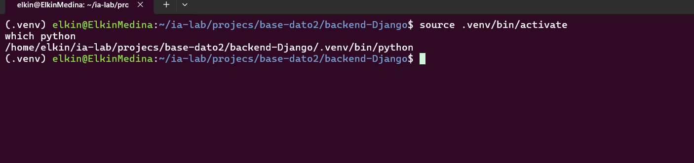

**2. Instalar `python-dotenv` y los drivers de cada motor**

Se instaló `python-dotenv`, que permite leer el `.env`, y un driver por cada motor soportado. Django no trae esos drivers; sin ellos, `migrate` falla al importar el backend, aunque la configuración esté bien escrita.

``` bash
python -m pip install "python-dotenv==1.2.3"
python -m pip install "psycopg[binary]==3.3.6"
python -m pip install "mysqlclient==2.3.0"
python -m pip install "mssql-django==2.0.0"
python -m pip install "oracledb==26.0.1"
python -m pip freeze > requirements.txt
```

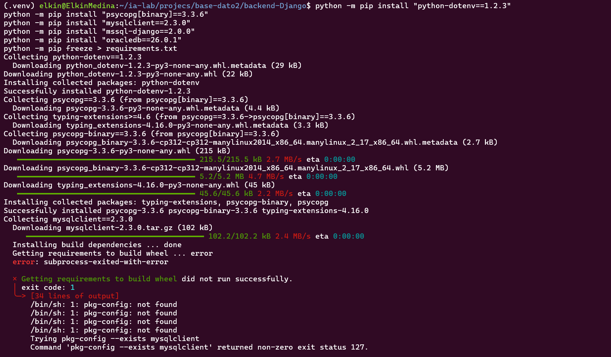

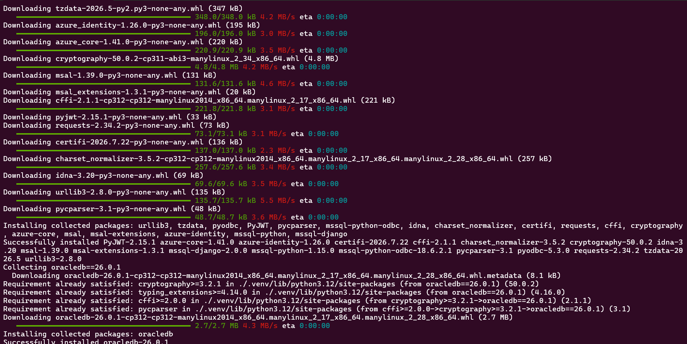

**Incidencia durante la instalación de `mysqlclient`**

Al ejecutar `python -m pip install "mysqlclient==2.3.0"`, la instalación falló. Este paquete no es solo Python: necesita compilar una extensión en C y, para eso, requiere las librerías de desarrollo de MySQL y algunas herramientas de compilación en el sistema, que no estaban instaladas. El error indicaba que no se encontraba `pkg-config` o `mysql_config`.

Para solucionarlo se instalaron las dependencias del sistema con el siguiente comando:

> ``` bash
> sudo apt update 
> sudo apt install build-essential pkg-config default-libmysqlclient-dev python3.12-dev  
> ```
>
> 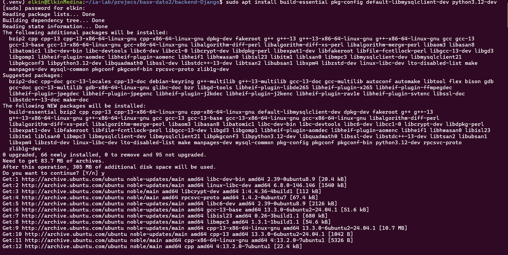

> Luego se repitió la instalación del paquete, esta vez con éxito:
>
> ``` bash
> python -m pip install "mysqlclient==2.3.0"   
> ```
>
> 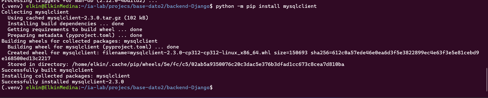

**3. Convertir `settings.py` en paquete**

`startproject` genera `settings.py` como archivo, pero se necesita un paquete con ese mismo nombre. Como un archivo y un paquete no pueden llamarse igual, se eliminó el archivo y se creó la carpeta.

``` bash
rm config/settings.py
mkdir -p config/settings
```

**4. Crear `.env.example` y copiarlo a `.env`**

Se creó `.env.example` como plantilla pública: solo contiene los nombres de las variables, sin secretos. Luego se copió a `.env`, que es donde van los valores reales y que nunca se versiona.

``` bash
cat > .env.example <<'EOF'
# Copie este archivo a .env y complete los valores.
# .env no se versiona.
 
DJANGO_SECRET_KEY=
DJANGO_DEBUG=True
DJANGO_ALLOWED_HOSTS=localhost,127.0.0.1,testserver
 
# Motor activo. Uno solo por ejecución: postgresql | mysql | mssql | oracle
DB_ENGINE=postgresql
 
POSTGRES_DB=
POSTGRES_USER=
POSTGRES_PASSWORD=
POSTGRES_HOST=127.0.0.1
POSTGRES_PORT=5432
 
MYSQL_DB=
MYSQL_USER=
MYSQL_PASSWORD=
MYSQL_HOST=127.0.0.1
MYSQL_PORT=3306
 
MSSQL_DB=
MSSQL_USER=
MSSQL_PASSWORD=
MSSQL_HOST=127.0.0.1
MSSQL_PORT=1433
 
ORACLE_DB=
ORACLE_USER=
ORACLE_PASSWORD=
ORACLE_HOST=127.0.0.1
ORACLE_PORT=1521
ORACLE_SERVICE_NAME=
 
# Laboratorio académico. En producción liste orígenes explícitos.
CORS_ALLOW_ALL_ORIGINS=True
EOF
cp .env.example .env
```

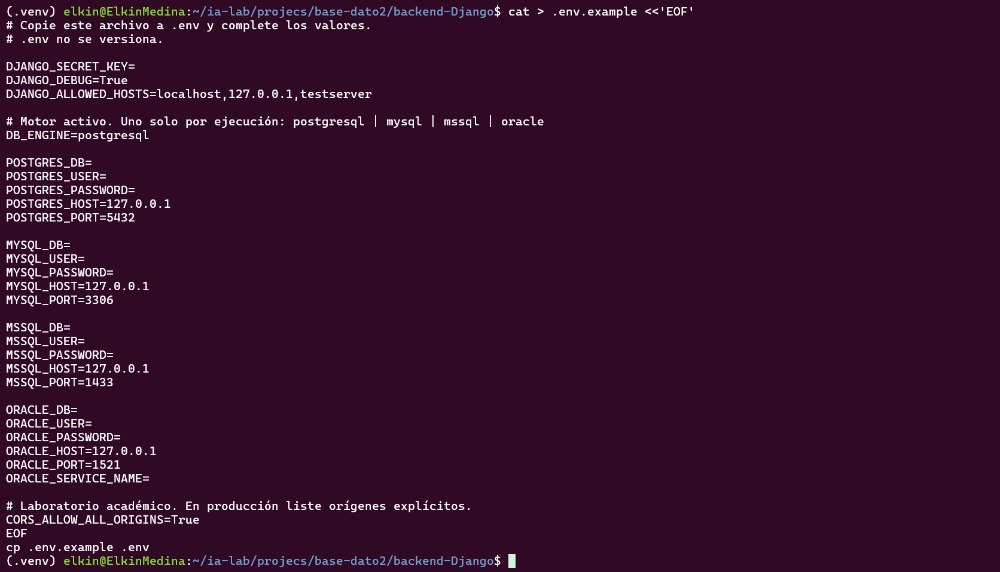

### Modificacion del .env

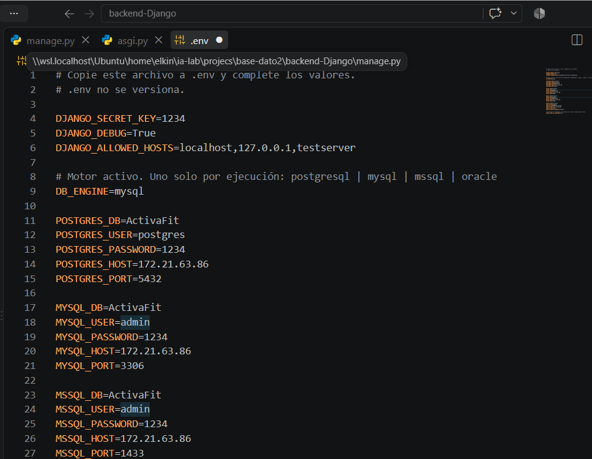

**5. Crear `config/database.py`**

Se escribió el traductor entre el entorno y Django. Lee `DB_ENGINE` y devuelve un único `DATABASES["default"]`. Si el motor no es válido o falta una variable obligatoria, falla antes de intentar conectarse y con un mensaje claro.

``` bash
cat > config/database.py <<'EOF'
"""Selección del motor de base de datos a partir del entorno.
 
Un solo alias, default, queda activo en cada ejecución.
"""
 
from django.core.exceptions import ImproperlyConfigured
 
ALLOWED_ENGINES = ("postgresql", "mysql", "mssql", "oracle")
 
 
def database_from_environ(env):
    engine = str(env.get("DB_ENGINE", "postgresql")).strip().lower()
    if engine not in ALLOWED_ENGINES:
        allowed = ", ".join(ALLOWED_ENGINES)
        raise ImproperlyConfigured(
            f"DB_ENGINE='{engine}' no es válido. Valores permitidos: {allowed}."
        )
    builders = {
        "postgresql": _postgresql,
        "mysql": _mysql,
        "mssql": _mssql,
        "oracle": _oracle,
    }
    return {"default": builders[engine](env)}
 
 
def _required(env, key):
    value = env.get(key)
    if value is None or str(value).strip() == "":
        raise ImproperlyConfigured(
            f"Falta la variable de entorno {key} para DB_ENGINE={env.get('DB_ENGINE')}."
        )
    return str(value).strip()
 
 
def _postgresql(env):
    return {
        "ENGINE": "django.db.backends.postgresql",
        "NAME": _required(env, "POSTGRES_DB"),
        "USER": _required(env, "POSTGRES_USER"),
        "PASSWORD": _required(env, "POSTGRES_PASSWORD"),
        "HOST": _required(env, "POSTGRES_HOST"),
        "PORT": _required(env, "POSTGRES_PORT"),
    }
 
 
def _mysql(env):
    return {
        "ENGINE": "django.db.backends.mysql",
        "NAME": _required(env, "MYSQL_DB"),
        "USER": _required(env, "MYSQL_USER"),
        "PASSWORD": _required(env, "MYSQL_PASSWORD"),
        "HOST": _required(env, "MYSQL_HOST"),
        "PORT": _required(env, "MYSQL_PORT"),
        "OPTIONS": {"charset": "utf8mb4"},
    }
 
 
def _mssql(env):
    return {
        "ENGINE": "mssql",
        "NAME": _required(env, "MSSQL_DB"),
        "USER": _required(env, "MSSQL_USER"),
        "PASSWORD": _required(env, "MSSQL_PASSWORD"),
        "HOST": _required(env, "MSSQL_HOST"),
        "PORT": _required(env, "MSSQL_PORT"),
        "OPTIONS": {
            "driver": "ODBC Driver 18 for SQL Server",
            "extra_params": "TrustServerCertificate=yes",
        },
    }
 
 
def _oracle(env):
    host = _required(env, "ORACLE_HOST")
    port = _required(env, "ORACLE_PORT")
    service = _required(env, "ORACLE_SERVICE_NAME")
    dsn = (
        f"(DESCRIPTION=(ADDRESS=(PROTOCOL=TCP)(HOST={host})(PORT={port}))"
        f"(CONNECT_DATA=(SERVICE_NAME={service})))"
    )
    return {
        "ENGINE": "django.db.backends.oracle",
        "NAME": dsn,
        "USER": _required(env, "ORACLE_USER"),
        "PASSWORD": _required(env, "ORACLE_PASSWORD"),
        "HOST": host,
        "PORT": "",
    }
EOF
```

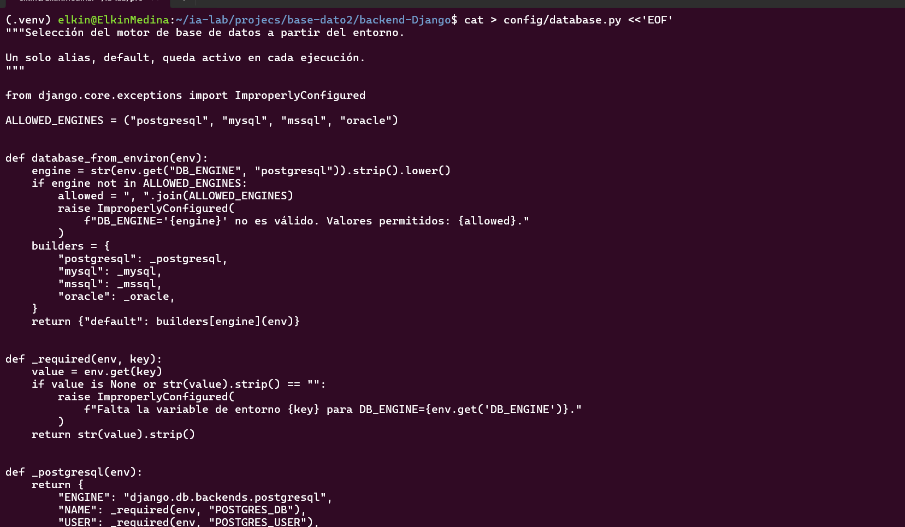

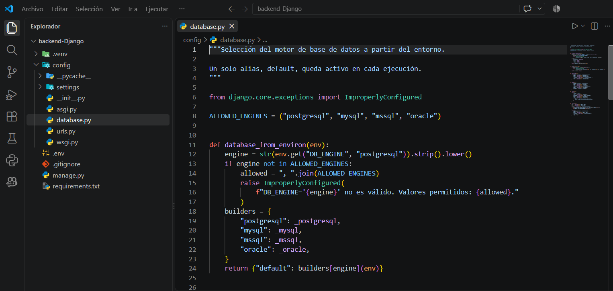

**6. Crear `config/settings/__init__.py`**

Se armó el paquete de configuración: carga el `.env`, exige la `SECRET_KEY` y delega la base de datos a `database.py`. Por ahora no incluye las apps de ActivaFit, DRF ni JWT; cada uno se añadirá en la unidad que lo necesite.

``` bash
cat > config/settings/__init__.py <<'EOF'
"""Configuración de ActivaFit.
 
El paquete sustituye al settings.py generado por startproject.
DJANGO_SETTINGS_MODULE sigue siendo config.settings.
"""
 
import os
from pathlib import Path
 
# python-dotenv, instalado en este ISS. Lee .env antes de SECRET_KEY y DATABASES.
from dotenv import load_dotenv
 
from config.database import database_from_environ
 
BASE_DIR = Path(__file__).resolve().parent.parent.parent
load_dotenv(BASE_DIR / ".env")
 
SECRET_KEY = os.environ.get("DJANGO_SECRET_KEY", "").strip()
if not SECRET_KEY:
    from django.core.exceptions import ImproperlyConfigured
 
    raise ImproperlyConfigured("Defina DJANGO_SECRET_KEY en el archivo .env.")
 
DEBUG = os.environ.get("DJANGO_DEBUG", "False").strip().lower() in {"1", "true", "yes", "on"}
 
ALLOWED_HOSTS = [
    host.strip()
    for host in os.environ.get("DJANGO_ALLOWED_HOSTS", "localhost,127.0.0.1").split(",")
    if host.strip()
]
 
INSTALLED_APPS = [
    "django.contrib.admin",
    "django.contrib.auth",
    "django.contrib.contenttypes",
    "django.contrib.sessions",
    "django.contrib.messages",
    "django.contrib.staticfiles",
]
 
MIDDLEWARE = [
    "django.middleware.security.SecurityMiddleware",
    "django.contrib.sessions.middleware.SessionMiddleware",
    "django.middleware.common.CommonMiddleware",
    "django.middleware.csrf.CsrfViewMiddleware",
    "django.contrib.auth.middleware.AuthenticationMiddleware",
    "django.contrib.messages.middleware.MessageMiddleware",
    "django.middleware.clickjacking.XFrameOptionsMiddleware",
]
 
ROOT_URLCONF = "config.urls"
 
TEMPLATES = [
    {
        "BACKEND": "django.template.backends.django.DjangoTemplates",
        "DIRS": [],
        "APP_DIRS": True,
        "OPTIONS": {
            "context_processors": [
                "django.template.context_processors.request",
                "django.contrib.auth.context_processors.auth",
                "django.contrib.messages.context_processors.messages",
            ],
        },
    },
]
 
WSGI_APPLICATION = "config.wsgi.application"
ASGI_APPLICATION = "config.asgi.application"
 
DATABASES = database_from_environ(os.environ)
 
AUTH_PASSWORD_VALIDATORS = [
    {"NAME": "django.contrib.auth.password_validation.UserAttributeSimilarityValidator"},
    {"NAME": "django.contrib.auth.password_validation.MinimumLengthValidator"},
    {"NAME": "django.contrib.auth.password_validation.CommonPasswordValidator"},
    {"NAME": "django.contrib.auth.password_validation.NumericPasswordValidator"},
]
 
LANGUAGE_CODE = "es"
TIME_ZONE = "America/Bogota"
USE_I18N = True
USE_TZ = True
 
STATIC_URL = "static/"
DEFAULT_AUTO_FIELD = "django.db.models.BigAutoField"
EOF
```

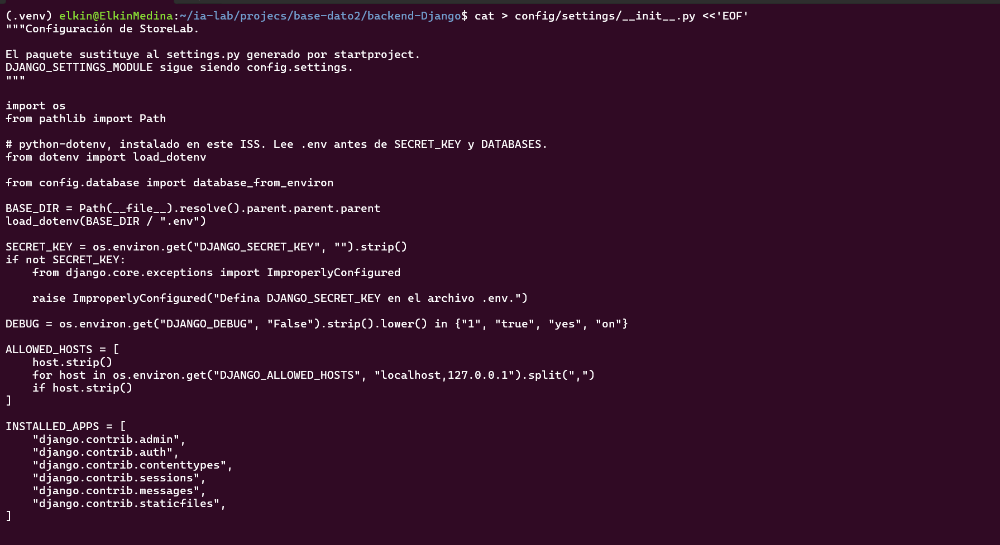

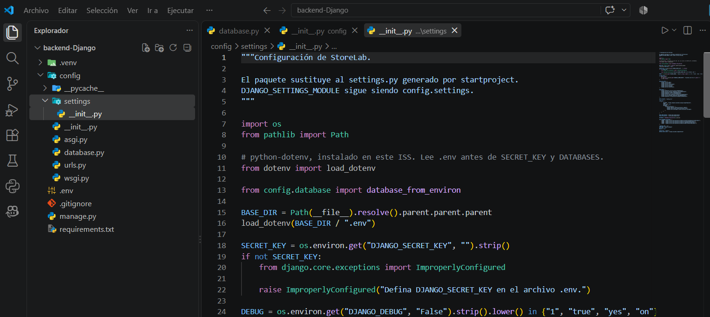

**7. Crear `config/project_python.py`**

Para que `python3 manage.py` funcione aunque no se haya activado el entorno, se añadió un pequeño ayudante que vuelve a lanzar el comando con el Python de `.venv`.

``` bash
cat > config/project_python.py <<'EOF'
"""Intérprete del proyecto.
 
Los paquetes se instalan dentro de .venv. El comando python3 manage.py
usa el Python del sistema y no ve esos paquetes.
use_project_python() vuelve a lanzar el mismo comando con .venv/bin/python.
"""
 
import os
import sys
from pathlib import Path
 
PROJECT_ROOT = Path(__file__).resolve().parent.parent
 
 
def use_project_python():
    """Reejecuta el proceso con el Python de .venv si aún no es ese intérprete."""
    venv_root = PROJECT_ROOT / ".venv"
    venv_python = venv_root / "bin" / "python"
    if not venv_python.is_file():
        return
    try:
        if Path(sys.prefix).resolve() == venv_root.resolve():
            return
    except OSError:
        return
    os.execv(venv_python, [str(venv_python), *sys.argv])
EOF
```

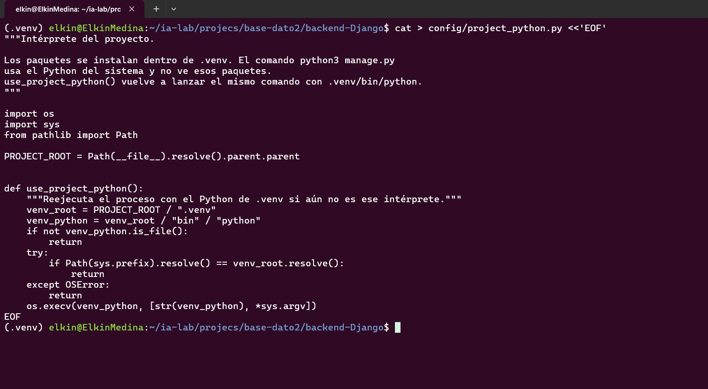

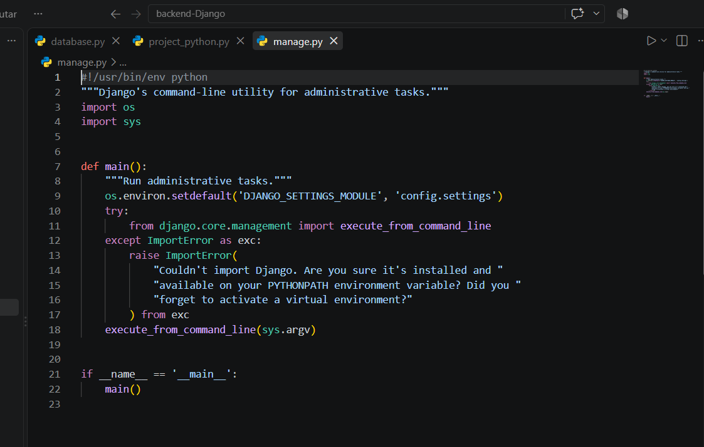

**8. Parchear `manage.py`, `config/wsgi.py` y `config/asgi.py`**

Para terminar, se editaron los tres puntos de entrada del proyecto para que carguen el `.env` antes de que Django lea la configuración. Sin ese paso, `SECRET_KEY` y las credenciales aparecerían vacías.

Estos archivos ya existen; no se regeneran, se editan.

**Evidencia EVI-01-05.** Esta es la evidencia del reemplazo realizado anteriormente en los puntos de entrada del proyecto (`manage.py`, `config/wsgi.py` y `config/asgi.py`), donde se agregó la carga del archivo `.env` con `load_dotenv()`.

``` text
ARCHIVO: manage.py
 
UBICAR:
import os
import sys
 
REEMPLAZAR POR:


import sys
from pathlib import Path
 
_ROOT = Path(__file__).resolve().parent
if str(_ROOT) not in sys.path:
    sys.path.insert(0, str(_ROOT))
 
from config.project_python import use_project_python
 
use_project_python()
 
import os
 
# python-dotenv se instaló en este ISS, dentro de .venv.
from dotenv import load_dotenv
 
DEBAJO DE:
    """Run administrative tasks."""
 
AGREGAR:
    load_dotenv()
```

**Evidencia EVI-01-05a.** Reemplazo realizado anteriormente en `manage.py`: se agregó la ruta del proyecto, `use_project_python()` y `load_dotenv()`.

#### Antes del Reemplazo:


#### Despues del Reemplazo:

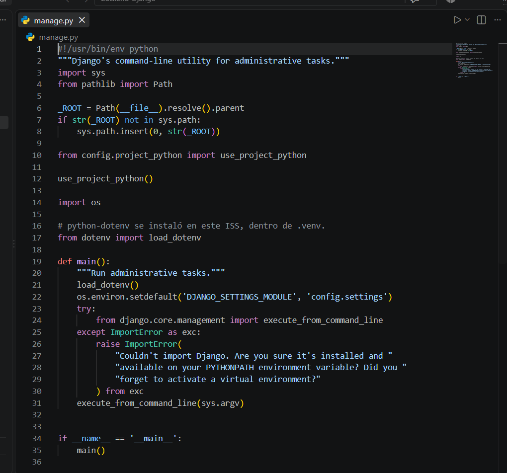

**Evidencia EVI-01-05b.** Reemplazo realizado anteriormente en `config/wsgi.py`: se agregó `load_dotenv()` antes de definir `DJANGO_SETTINGS_MODULE`.

``` text
ARCHIVO: config/wsgi.py
 
UBICAR:
import os
 
from django.core.wsgi import get_wsgi_application
 
os.environ.setdefault("DJANGO_SETTINGS_MODULE", "config.settings")
 
REEMPLAZAR POR:
import os
 
# python-dotenv (este ISS) carga .env en el intérprete que arrancó el proceso.
from dotenv import load_dotenv
 
from django.core.wsgi import get_wsgi_application
 
load_dotenv()
os.environ.setdefault("DJANGO_SETTINGS_MODULE", "config.settings")
```

El mismo parche en `config/asgi.py`, cambiando `wsgi` por `asgi` y `get_wsgi_application` por `get_asgi_application`.

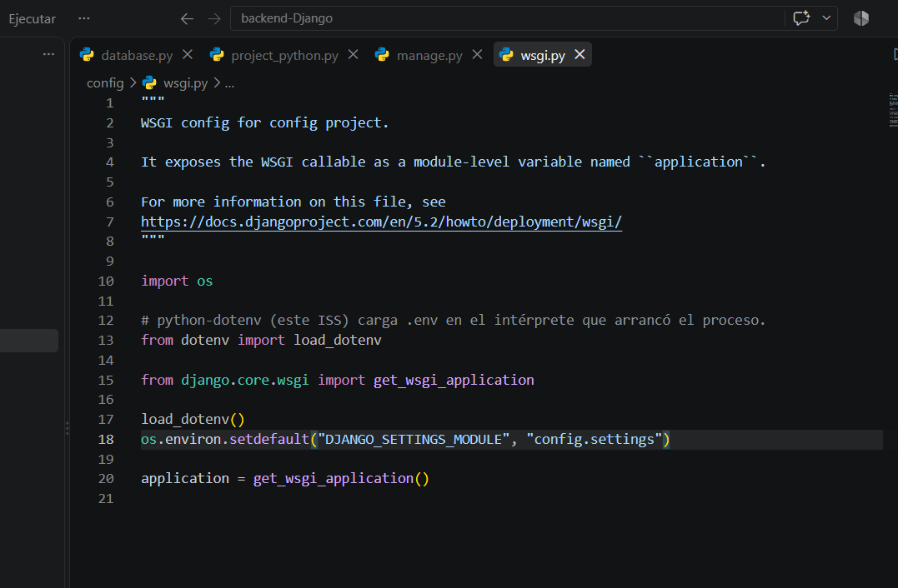

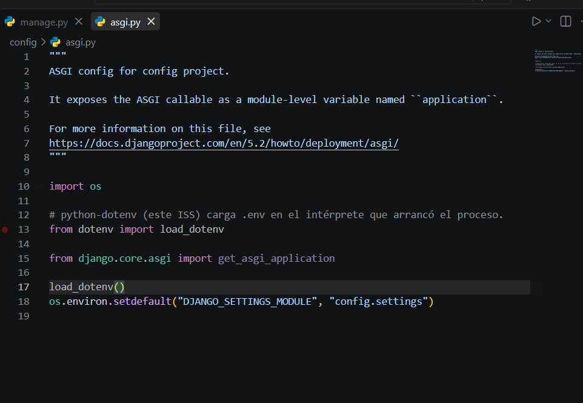

### Explicación

Con esto, ActivaFit quedó configurado para cambiar de motor con una sola variable. Cómo funciona cada pieza:

- **Intérprete:** `use_project_python()` permite `python3 manage.py runserver` sin activar el entorno. `pip` sigue exigiendo `source .venv/bin/activate`.
- **Lectura del entorno:** `load_dotenv()` no pisa variables ya existentes. Por eso `DB_ENGINE=mysql python manage.py test` cambia el motor sin editar `.env`.
- **Un alias:** solo existe `DATABASES["default"]`; el ORM no necesita saber qué motor responde.
- **Oracle:** el DSN se arma con `SERVICE_NAME` y `PORT` queda vacío; el driver es `oracledb`.
- **SQL Server:** `ENGINE` es `mssql`, el valor que registra `mssql-django`. Requiere ODBC Driver 18 instalado en la máquina.
- **Zona e idioma:** `LANGUAGE_CODE = "es"`, `TIME_ZONE = "America/Bogota"`, `USE_TZ = True`.

``` text
.env → DB_ENGINE → database_from_environ → DATABASES["default"] → ORM
```

### Criterios de aceptación

- AC-01-01: `postgresql`, `mysql`, `mssql` y `oracle` producen el `ENGINE` documentado.
- AC-01-02: un motor desconocido falla con `ImproperlyConfigured`.
- AC-01-03: si falta una variable obligatoria, la configuración falla antes de conectar.
- AC-01-04: el DSN de Oracle contiene `SERVICE_NAME`. \### Verificación

### GATE

| AC       | Verificación            | Evidencia | Resultado |
|----------|-------------------------|-----------|-----------|
| AC-01-01 | test por motor          | EVI-01-06 |  PASS     |
| AC-01-02 | test de motor inválido  | EVI-01-06 |  PASS     |
| AC-01-03 | test de variable vacía  | EVI-01-06 |  PASS     |
| AC-01-04 | aserción `SERVICE_NAME` | EVI-01-06 |  PASS     |

------------------------------------------------------------------------

## ISS-02 — Apps de ActivaFit

### Narrativa

Con el motor de base de datos configurado, ActivaFit necesita un lugar donde vivirá su lógica. En Django ese lugar son las apps: cada una agrupa un dominio del negocio. En esta unidad se crearon las apps del gimnasio dentro de un paquete `apps/`, para que la raíz del proyecto no se llene de carpetas sueltas. Todavía no se escribe ningún modelo: solo se levanta la estructura y se registra en la configuración.

### Objetivo

Crear las apps de negocio de ActivaFit con la CLI de Django y registrarlas dentro del paquete `apps`.

### Requisitos

- ISS-01 superado.

- Terminal con el entorno virtual (.venv) activo.

- Todavía no se escriben modelos. El Custom User del ISS-03 debe existir antes de ejecutar la primera migración.

### Construcción

Antes de ejecutar cualquier comando de este ISS se activó el entorno virtual y se confirmó que python apuntara a .venv. Así los comandos de Django usan las librerías instaladas en el proyecto y no las del sistema.

``` bash
    source .venv/bin/activate
    which python
```

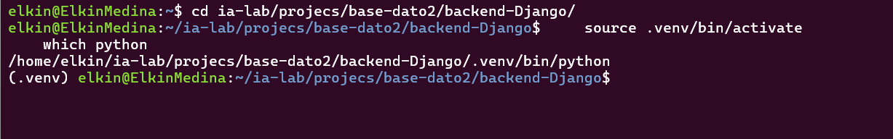

**1. Crear los directorios y las apps con `startapp`**

`startapp` exige que el directorio destino ya exista. Por eso primero se crean las carpetas y luego se genera cada app. No se copian `models.py`, `admin.py` ni `views.py` a mano: la CLI los deja listos. El archivo `urls.py` no lo crea; aparecerá cuando haya endpoints.

``` bash
mkdir -p apps/client apps/trainer apps/plan apps/membership apps/routine apps/measurement  
python manage.py startapp client apps/client 
python manage.py startapp trainer apps/trainer 
python manage.py startapp plan apps/plan 
python manage.py startapp membership apps/membership  
python manage.py startapp routine apps/routine 
python manage.py startapp measurement apps/measurement 
```

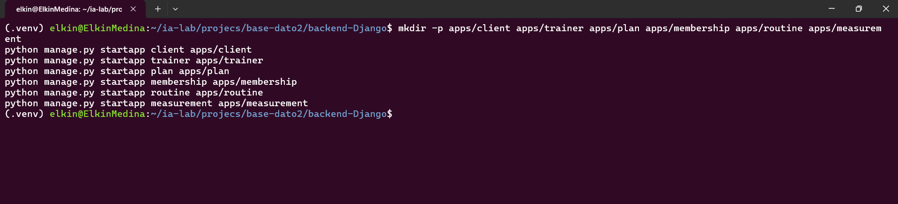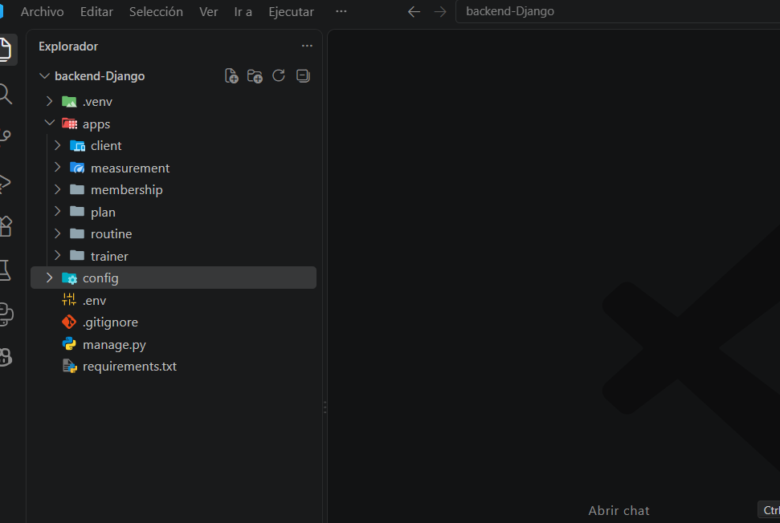

**2. Convertir `apps` en paquete**

Se creó `apps/__init__.py`, vacío, para que Python trate la carpeta `apps` como un paquete.

``` bash
mkdir -p apps cat > apps/__init__.py <<'EOF' EOF 
```

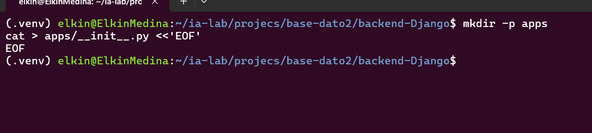

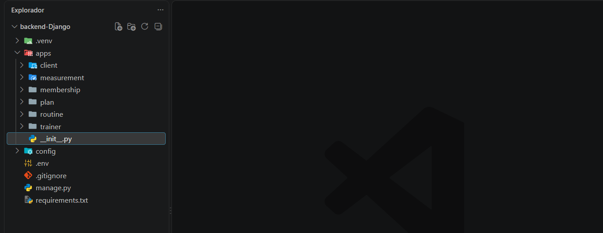

**3. Parchear el `apps.py` de cada app**

Cada `apps.py` ya existe, generado por `startapp`. Como las apps viven dentro de `apps/`, hay que indicarle a Django la ruta completa del paquete. Se mantiene el `label` corto para que las migraciones no arrastren el prefijo `apps.`.

``` bas
ARCHIVO: apps/client/apps.py  UBICAR:     name = "client"  REEMPLAZAR POR:     name = "apps.client"     label = "client" 
```

El mismo parche se repite en las demás apps:

| Archivo                    | `name`             | `label`       |
|----------------------------|--------------------|---------------|
| `apps/trainer/apps.py`     | `apps.trainer`     | `trainer`     |
| `apps/plan/apps.py`        | `apps.plan`        | `plan`        |
| `apps/membership/apps.py`  | `apps.membership`  | `membership`  |
| `apps/routine/apps.py`     | `apps.routine`     | `routine`     |
| `apps/measurement/apps.py` | `apps.measurement` | `measurement` |

: La clase de cada archivo conserva su nombre (`ClientConfig`, `TrainerConfig`, `PlanConfig`, `MembershipConfig`, `RoutineConfig`, `MeasurementConfig`).

**4. Registrar las apps en `config/settings/__init__.py`**

El archivo ya existe. Se agregan las apps al final de `INSTALLED_APPS`, todavía sin la app `security`, que llega en el ISS-03.

text

```         
ARCHIVO: config/settings/__init__.py

DEBAJO DE:
    "django.contrib.staticfiles",

AGREGAR:
    "apps.client.apps.ClientConfig",
    "apps.trainer.apps.TrainerConfig",
    "apps.plan.apps.PlanConfig",
    "apps.membership.apps.MembershipConfig",
    "apps.routine.apps.RoutineConfig",
    "apps.measurement.apps.MeasurementConfig",
```

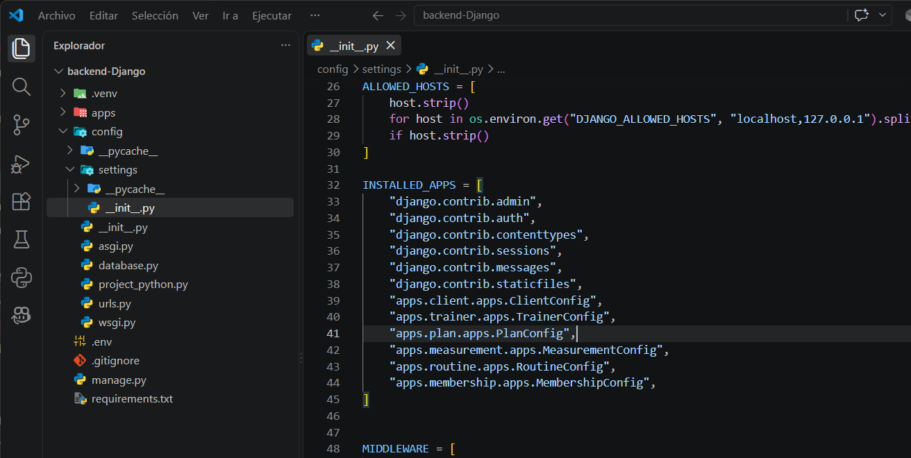

#### Explicación

Django supone que una app está en la raíz del proyecto. Como en ActivaFit viven dentro de `apps/`, el `AppConfig.name` debe ser la ruta completa, por ejemplo `apps.client`. El `label` se deja en `client` para que las migraciones no arrastren el nombre del paquete. Cada app conserva un solo nombre, igual al dominio que representa.

``` text
apps/
├── client/        clientes del gimnasio
├── trainer/       entrenadores
├── plan/          planes de membresía
├── membership/    membresías, pagos y asistencias
├── routine/       ejercicios, rutinas y rutina-ejercicio
└── measurement/   medidas corporales
```

#### Criterios de aceptación

- AC-02-01: las apps fueron creadas con `startapp`.

- AC-02-02: `python manage.py check` no reporta apps mal registradas.

- AC-02-03: en este ISS todavía no hay modelos de negocio.

### Verificación

```         
python manage.py check 
```

Para el GATE, además, puedes mostrar el árbol de las apps:

```         
tree apps -I "__pycache__" 
```

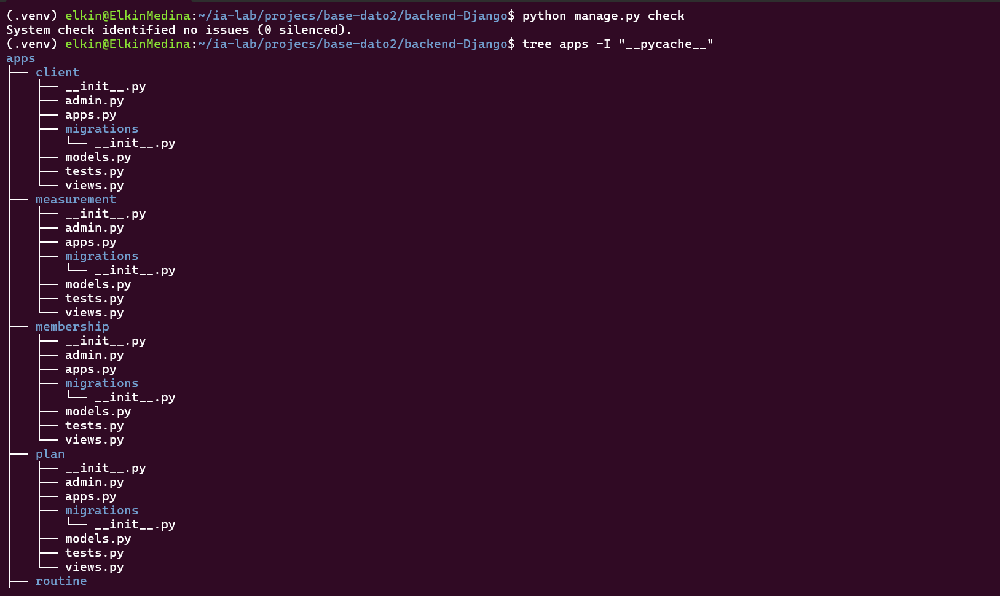

### GATE

| AC | Verificación | Evidencia | Resultado |
|----|----|----|----|
| AC-02-01 | directorios de las apps | árbol de `apps/` (EVI-02-01) | PASS |
| AC-02-02 | `manage.py check` | EVI-02-04 | PASS |
| AC-02-03 | este ISS no escribe modelos | revisión de los `models.py` vacíos |  PASS |

## ISS-03 — Custom User antes de la primera migración

Hasta aquí ActivaFit tiene su configuración y sus apps, pero todavía no ha tocado la base de datos. Antes de la primera migración hay que tomar una decisión que no se puede deshacer fácilmente: definir el modelo de usuario propio del sistema. Django trae uno por defecto, pero cambiarlo después de migrar obliga a borrar tablas. Por eso, en esta unidad se creó el usuario personalizado de ActivaFit sobre `django.contrib.auth`, se declaró en la configuración y solo entonces se hizo la primera migración. Así, las credenciales del sistema quedan en una tabla propia (`users`), separada de los clientes del gimnasio.

**Objetivo**

Definir el usuario de ActivaFit sobre `django.contrib.auth` y fijar `AUTH_USER_MODEL` antes de migrar.

**Requisitos**

- ISS-02 superado.

- Terminal con el entorno virtual `.venv` activo.

- Decisión explícita entre `AbstractUser` y `AbstractBaseUser`: se eligió `AbstractUser`.

### Construcción

**Paso 0. Activar el entorno virtual**

Antes de ejecutar los comandos se activó el entorno y se confirmó que `python` apuntara a `.venv`.

``` bash
source .venv/bin/activate which python 
```


**Paso 1. Crear el paquete `apps/common` con `RecordStatus`**

El estado "activo / inactivo" lo usarán el usuario y, desde el ISS-04, las tablas del negocio. Por eso se guardó en un paquete compartido. `apps/common` no es una app: no se registra en `INSTALLED_APPS` ni se crea con `startapp`.

Archivo `apps/common/status.py`:

```         
mkdir -p apps/common
cat > apps/common/__init__.py <<'EOF'
EOF
cat > apps/common/status.py <<'EOF'

from django.db import models


class RecordStatus(models.TextChoices):
    ACTIVE = "active", "Active"
    INACTIVE = "inactive", "Inactive"
EOF
```

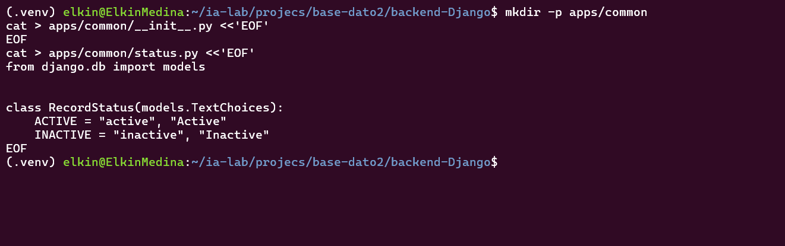

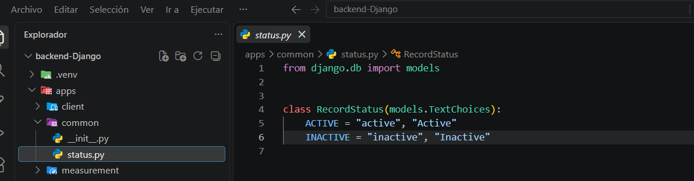

**Paso 2. Crear la app `security` con la CLI**

Como el directorio destino debe existir, primero se crea.

```         
mkdir -p apps/security
python manage.py startapp security apps/security 
```

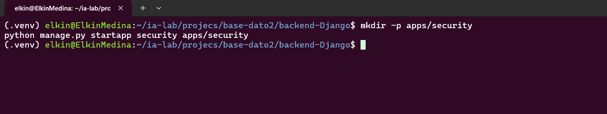

Luego se parchea `apps/security/apps.py`, igual que en las demás apps. Se busca la línea `name = "security"` y se reemplaza por estas dos:

```         
    name = "apps.security"     label = "security" 
```

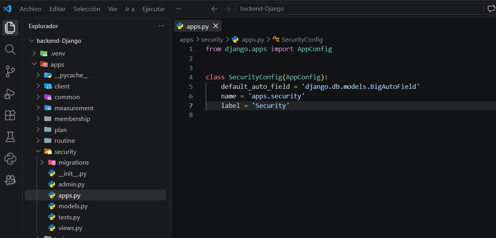

**Paso 3. Escribir el modelo de usuario**

El archivo `apps/security/models.py` ya existe y solo tiene un comentario. Se reemplaza todo su contenido por esto. En este ISS contiene únicamente el usuario; los demás modelos de seguridad se agregan después, en la fase de autenticación.

``` python
from django.contrib.auth.models import AbstractUser, UserManager
from django.db import models

from apps.common.status import RecordStatus


class ActivaFitUserManager(UserManager):
    def create_user(self, username, email=None, password=None, **extra_fields):
        extra_fields.setdefault("status", RecordStatus.INACTIVE)
        return super().create_user(username, email, password, **extra_fields)

    def create_superuser(self, username, email=None, password=None, **extra_fields):
        extra_fields.setdefault("status", RecordStatus.ACTIVE)
        extra_fields.setdefault("is_staff", True)
        extra_fields.setdefault("is_superuser", True)
        return super().create_superuser(username, email, password, **extra_fields)


class User(AbstractUser):
    email = models.EmailField("correo electrónico", max_length=150, unique=True)
    status = models.CharField(
        max_length=8,
        choices=RecordStatus.choices,
        default=RecordStatus.INACTIVE,
    )
    created_at = models.DateTimeField(auto_now_add=True)
    updated_at = models.DateTimeField(auto_now=True)

    objects = ActivaFitUserManager()

    class Meta:
        db_table = "users"
        verbose_name = "usuario"
        verbose_name_plural = "usuarios"
        constraints = [
            models.CheckConstraint(
                condition=models.Q(status__in=RecordStatus.values),
                name="users_status_valid",
            )
        ]

    def save(self, *args, **kwargs):
        if self.email:
            self.email = self.email.strip().lower()
        self.is_active = self.status == RecordStatus.ACTIVE
        super().save(*args, **kwargs)
```

`create_user` deja `status` en `inactive` si nadie lo indica. `create_superuser` lo fuerza a `active`, para que `save()` no desactive al superusuario.

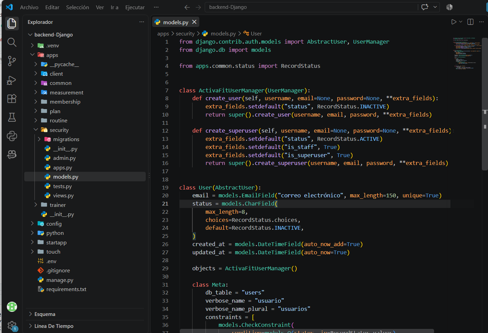

**Paso 4. Registrar la app y fijar `AUTH_USER_MODEL`**

En `config/settings/__init__.py`, la app de seguridad va delante de las de negocio. Se agrega esta línea justo encima de `"apps.client.apps.ClientConfig",`:

```         
    "apps.security.apps.SecurityConfig", 
```

Y debajo de la línea `DATABASES = database_from_environ(os.environ)` se agrega:

```         
AUTH_USER_MODEL = "security.User" 
```

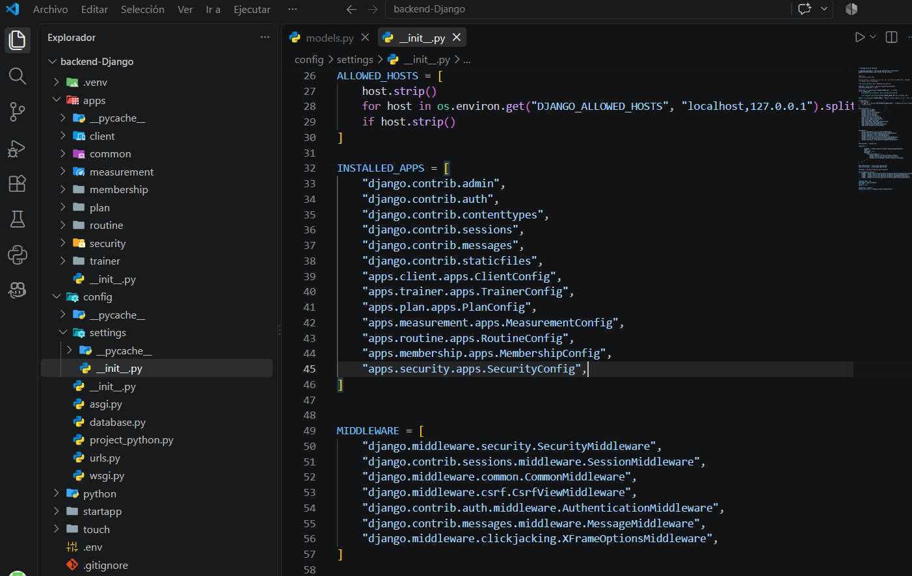

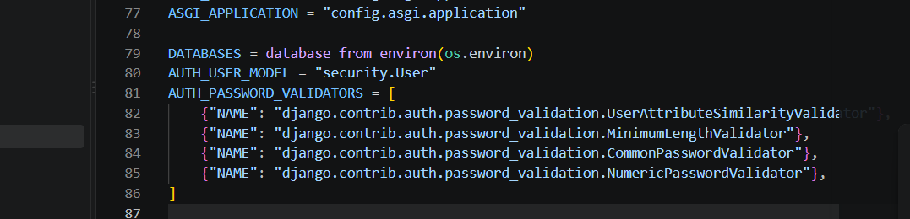

**Paso 5. Escribir el test de selección del motor**

El test prometido en el ISS-01 reemplaza el `tests.py` vacío que dejó `startapp`. Todavía no hay login, así que solo valida la selección del motor. Archivo `apps/security/tests.py`:

``` python
from django.core.exceptions import ImproperlyConfigured
from django.test import SimpleTestCase

from config.database import database_from_environ


class DatabaseSelectionTests(SimpleTestCase):
    def _env(self, engine):
        return {
            "DB_ENGINE": engine,
            "POSTGRES_DB": "activafit",
            "POSTGRES_USER": "activafit",
            "POSTGRES_PASSWORD": "activafit",
            "POSTGRES_HOST": "127.0.0.1",
            "POSTGRES_PORT": "5432",
            "MYSQL_DB": "activafit",
            "MYSQL_USER": "activafit",
            "MYSQL_PASSWORD": "activafit",
            "MYSQL_HOST": "127.0.0.1",
            "MYSQL_PORT": "3306",
            "MSSQL_DB": "activafit",
            "MSSQL_USER": "activafit",
            "MSSQL_PASSWORD": "activafit",
            "MSSQL_HOST": "127.0.0.1",
            "MSSQL_PORT": "1433",
            "ORACLE_DB": "activafit",
            "ORACLE_USER": "activafit",
            "ORACLE_PASSWORD": "activafit",
            "ORACLE_HOST": "127.0.0.1",
            "ORACLE_PORT": "1521",
            "ORACLE_SERVICE_NAME": "FREEPDB1",
        }

    def test_postgresql_engine(self):
        config = database_from_environ(self._env("postgresql"))
        self.assertEqual(config["default"]["ENGINE"], "django.db.backends.postgresql")

    def test_mysql_engine(self):
        config = database_from_environ(self._env("mysql"))
        self.assertEqual(config["default"]["ENGINE"], "django.db.backends.mysql")
        self.assertEqual(config["default"]["OPTIONS"]["charset"], "utf8mb4")

    def test_mssql_engine(self):
        config = database_from_environ(self._env("mssql"))
        self.assertEqual(config["default"]["ENGINE"], "mssql")

    def test_oracle_uses_service_name(self):
        config = database_from_environ(self._env("oracle"))
        self.assertIn("SERVICE_NAME=FREEPDB1", config["default"]["NAME"])
        self.assertEqual(config["default"]["PORT"], "")

    def test_invalid_engine(self):
        with self.assertRaises(ImproperlyConfigured):
            database_from_environ({"DB_ENGINE": "sqlite"})

    def test_missing_variable(self):
        env = self._env("postgresql")
        env["POSTGRES_DB"] = ""
        with self.assertRaises(ImproperlyConfigured):
            database_from_environ(env)
```

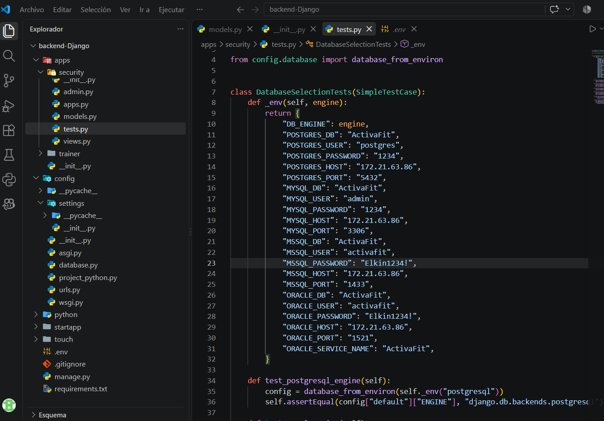

**Paso 6. Generar la migración, migrar y probar**

Ahora sí se migra. La CLI escribe la migración; no se copia a mano.

```         
python manage.py makemigrations security
python manage.py migrate
python manage.py test apps.security.tests.DatabaseSelectionTests 
```

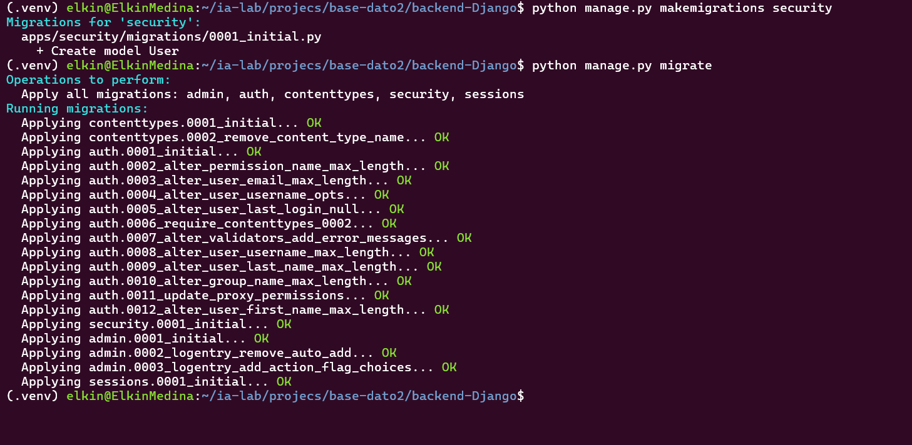

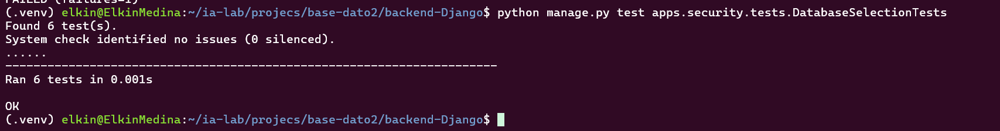

Al ejecutar `createsuperuser`, Django te pide:

- **Username**

- **Email:** es obligatorio y único en ActivaFit, porque lo definimos así en el modelo.

- **Password:** se escribe dos veces y no se ve en pantalla.

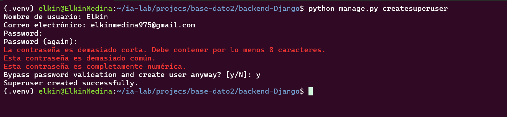

### Explicación

Se prefirió `AbstractUser` sobre `AbstractBaseUser` porque ya resuelve el hash de contraseñas, los validadores, `set_password()`, `check_password()` y el admin. Reconstruir eso a mano sería rehacer el sistema de contraseñas.

El campo `status` manda sobre `is_active`. La columna `is_active` se conserva porque DRF y SimpleJWT deciden con ella si el usuario puede autenticarse. Los clientes del gimnasio (tabla `clients`) no tienen contraseña: no son usuarios del sistema

## Criterios de aceptación

- AC-03-01: `AUTH_USER_MODEL` apunta a `security.User`.

- AC-03-02: `Client` no tiene password.

- AC-03-03: un usuario `inactive` no inicia sesión.

- AC-03-04: una clave incorrecta responde 401 y la correcta no devuelve el hash.

## Verificación

`AuthFlowTests`.

## Evidencias

- EVI-03-01: migración `security.0001_initial` aplicada en MySQL.

- EVI-03-02: login por username y por email PASS.

## GATE

| **AC**   | **Verificación** | **Evidencia**                 | **Resultado** |
|:---------|:-----------------|:------------------------------|:--------------|
| AC-03-01 | settings         | `config/settings/__init__.py` | PASS          |
| AC-03-02 | modelo Client    | sin campo password            | PASS          |
| AC-03-03 | usuario inactivo | test 401                      | PASS          |
| AC-03-04 | `check_password` | test de login                 | PASS          |

.
