**Narrativa**

Con el backend terminado, empecé la parte que ve el usuario. En esta primera unidad no conecté nada con la API todavía: solo preparé la base sobre la que se va a construir todo lo demás. Creé el proyecto de Angular, le instalé Tailwind para los estilos y PrimeNG para los componentes ya hechos, y armé el esqueleto de la pantalla con las cuatro zonas de siempre: encabezado, menú lateral, contenido y pie de página. Al final puse en el menú lateral los módulos de ActivaFit. Los CRUD y el login llegan en las unidades siguientes.

**Objetivo**

Dejar el frontend de ActivaFit con estilos, tema de PrimeNG y un esqueleto de pantalla con su menú.

**Requisitos**

- Node.js, npm y Angular CLI instalados.

- Una terminal abierta en VS Code.

#### Construcción

**Paso 0. Comprobar las herramientas**

```         
node -v 
npm -v 
python3 --version   
ng version
```

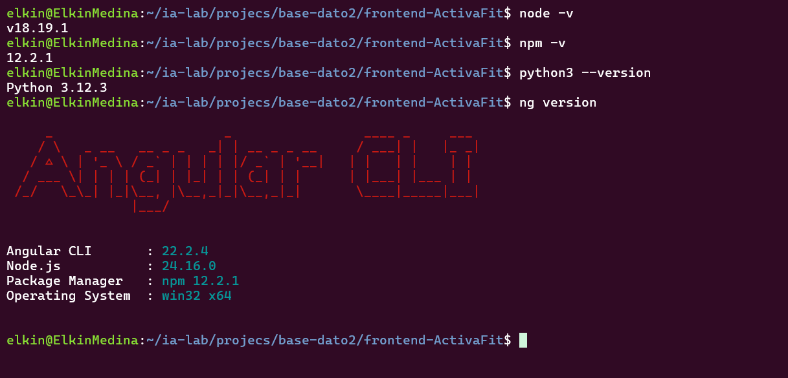

**Paso 1. Crear el proyecto**

Lo creé al lado del backend, en la misma carpeta del proyecto:

``` bash
cd ~/ia-lab/projecs/base-dato2
ng new frontend-ActivaFit
cd frontend-ActivaFit
npm start
```

.Abre la página en [`http://localhost:4200`](http://localhost:4200). La detuve con `Ctrl + C` para seguir con la instalación de Tailwind.

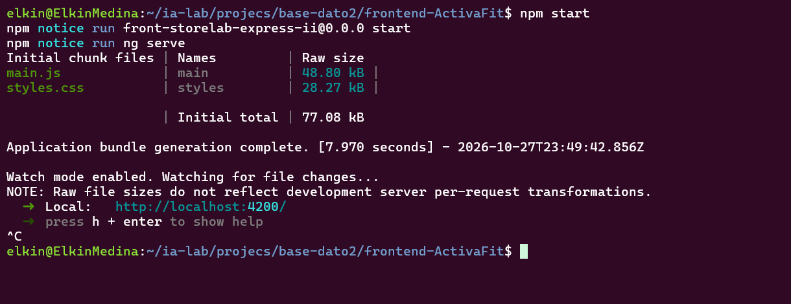

**Paso 2. Instalar Tailwind CSS**

```         
npm install tailwindcss @tailwindcss/postcss postcss --force
```

El `--force` es de la guía. Después creé el archivo `.postcssrc.json` en la raíz de `frontend` (al lado de `package.json`) con este contenido:

``` json
{
  "plugins": {
    "@tailwindcss/postcss": {}
  }
}
```

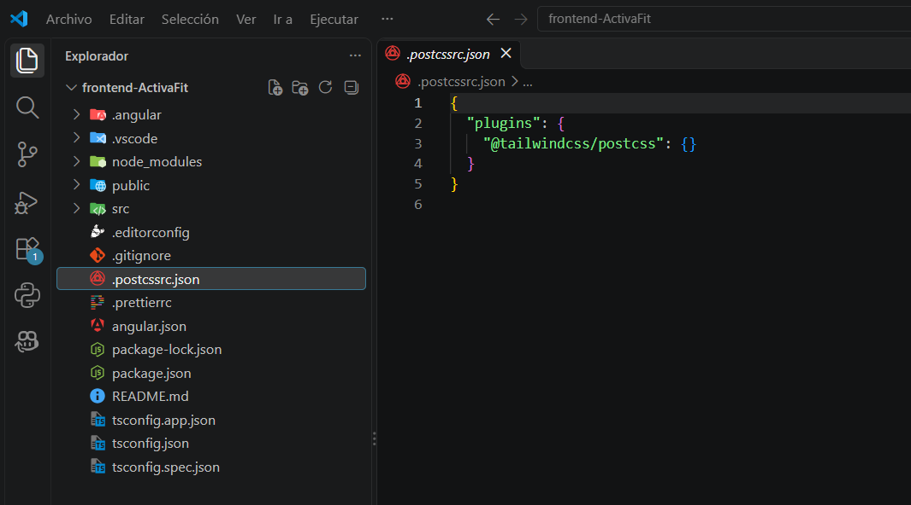

Y agregué esta línea en `src/styles.css`:

``` css
@import "tailwindcss";
```

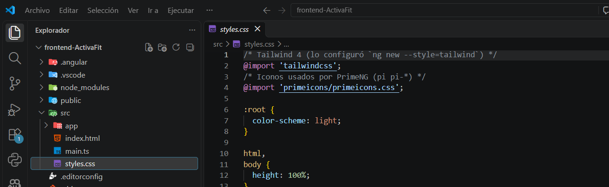

**Paso 3. Probar que Tailwind funciona**

Reemplacé el contenido de `src/app/app.html` por esto:

``` html
  <h1>ActivaFit</h1>
  
  <router-outlet />
```

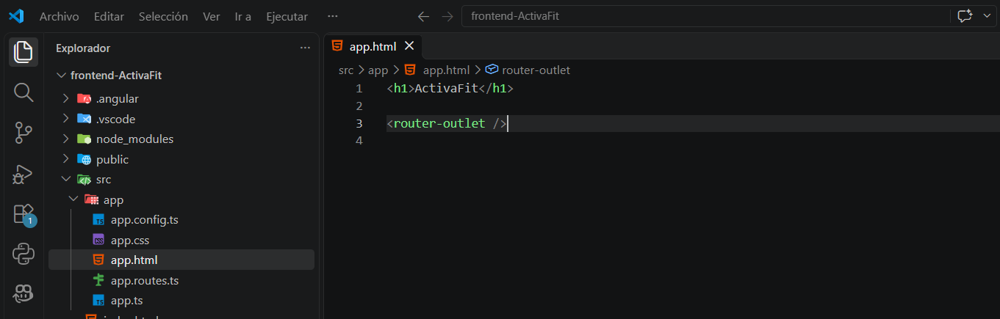

Levanté el servidor con `npm start`. Si el título se ve en texto simple, sin el tamaño grande ni el estilo de un título normal, y con la fuente sin serifas, Tailwind está funcionando.

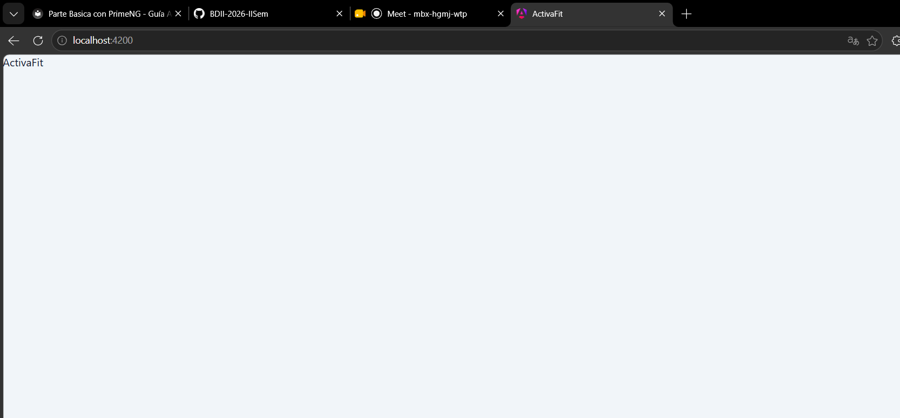

**Paso 4. Instalar PrimeNG y activar el tema**

```         
npm install primeng @primeuix/themes
```

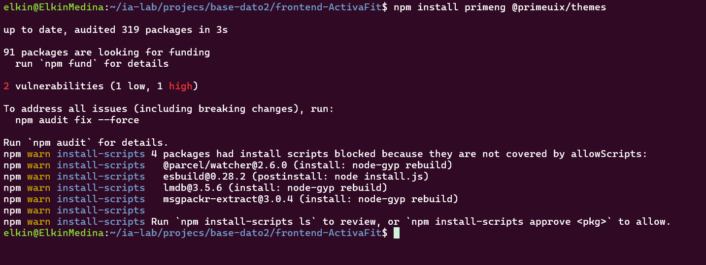

Reemplacé `src/app/app.config.ts` por este archivo, que registra el tema Aura:

``` typescript
import {
  ApplicationConfig,
  provideBrowserGlobalErrorListeners,
} from '@angular/core';
import {
  provideRouter,
  withComponentInputBinding,
  withInMemoryScrolling,
} from '@angular/router';
import { ConfirmationService, MessageService } from 'primeng/api';
import { providePrimeNG } from 'primeng/config';
import Aura from '@primeuix/themes/aura';

import { routes } from './app.routes';

export const appConfig: ApplicationConfig = {
  providers: [
    provideBrowserGlobalErrorListeners(),

    provideRouter(
      routes,
      withComponentInputBinding(),
      withInMemoryScrolling({ scrollPositionRestoration: 'top' }),
    ),

    // PrimeNG 22: tema Aura. El modo oscuro se activa con la clase .app-dark.
    providePrimeNG({
      ripple: true,
      inputVariant: 'outlined',
      theme: {
        preset: Aura,
        options: {
          darkModeSelector: '.app-dark',
          cssLayer: false,
        },
      },
    }),

    MessageService,
    ConfirmationService,
  ],
};
```

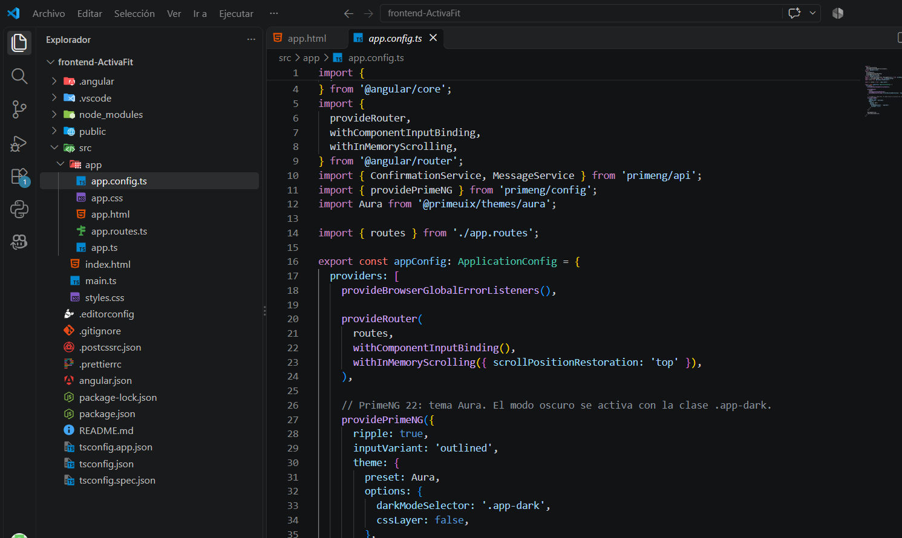

**Paso 5. Crear los componentes del esqueleto**

``` bash
  npx ng g c components/layout/header
  npx ng g c components/layout/aside
  npx ng g c components/layout/footer
```

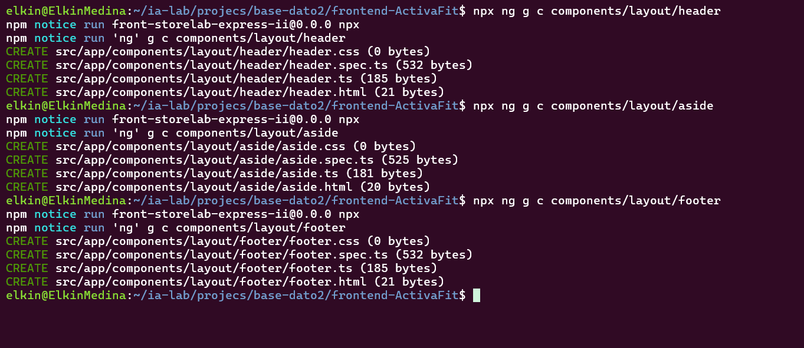

Esto crea tres carpetas en `src/app/components/layout/`, cada una con su `.ts`, `.html` y `.css`. En los tres archivos `.ts` (más el `app.ts` principal) agregué `standalone: true,` debajo de la línea `selector`. La guía lo pide; en Angular 20 los componentes ya son standalone por defecto, así que es redundante pero no estorba.

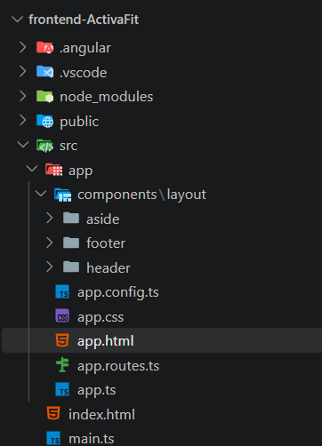

**Paso 6. Armar el esqueleto en `app`**

Reemplacé `src/app/app.ts`. Importa los tres componentes. La guía incluía `RouterOutlet` dos veces en esa lista y `CommonModule`, que no se usan; los quité.

``` typescript
import { Component, signal } from '@angular/core';
import { RouterOutlet } from '@angular/router';
import { Aside } from './components/layout/aside/aside';
import { Footer } from './components/layout/footer/footer';
import { Header } from './components/layout/header/header';

@Component({
  selector: 'app-root',
  standalone: true,
  imports: [RouterOutlet, Header, Footer, Aside],
  templateUrl: './app.html',
  styleUrl: './app.css'
})
export class App {
  protected readonly title = signal('frontend-ActivaFit');
}
```

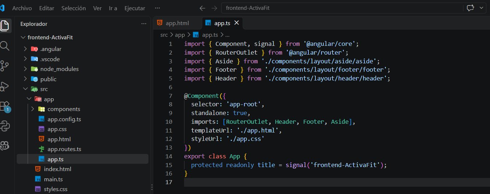

Y reemplacé `src/app/app.html`. Los bordes de colores son solo para ver las cuatro zonas mientras armo la pantalla; los puedo quitar al final.

``` html
<main class="min-h-screen flex flex-col border-4 border-red-500">
  <!-- HEADER -->
  <header class="h-16 bg-white border-2 border-blue-500 flex items-center justify-center font-bold text-blue-600">
    <app-header></app-header>
  </header>

  <!-- CONTENEDOR CENTRAL (ASIDE + CONTENIDO) -->
  <div class="flex flex-1">
    <!-- ASIDE -->
    <aside class="w-64 bg-white border-2 border-blue-500 flex items-start justify-start font-bold text-blue-400">
      <app-aside></app-aside>
    </aside>

    <!-- CONTENIDO -->
    <section class="flex-1 bg-white border-2 border-blue-500 flex items-center justify-center font-bold text-blue-600">
      <router-outlet />
    </section>
  </div>

  <!-- FOOTER -->
  <footer class="h-16 bg-white border-2 border-blue-500 flex items-center justify-center font-bold text-blue-600 mt-auto">
    <app-footer></app-footer>
  </footer>
</main>
```

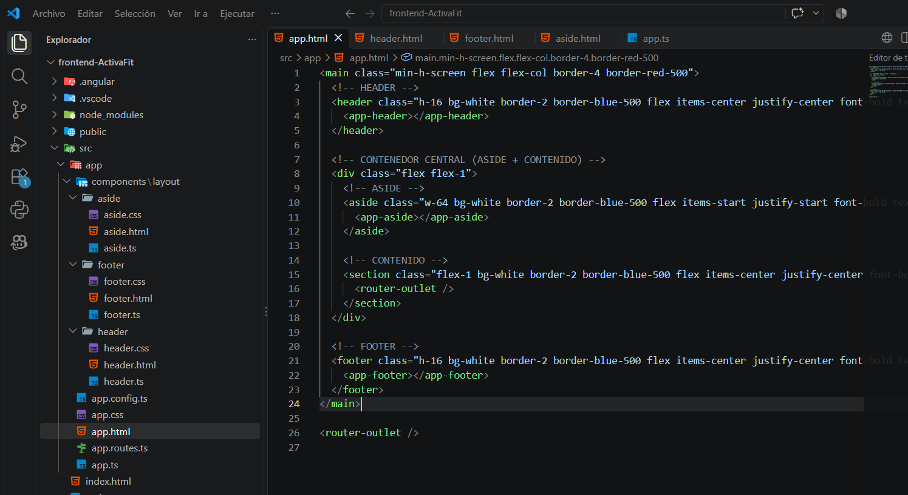

**Paso 7. Poner texto en el encabezado y el pie**

La guía no dice qué poner aquí, así que lo agregué yo. En `header/header.html`:

``` html
<h1 class="text-xl">ActivaFit · Gestión de gimnasio</h1>
```

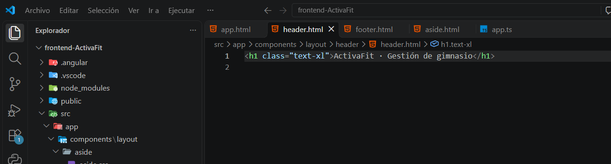

Y en `footer/footer.html`:

``` html
<p class="text-sm">© 2026 ActivaFit</p>
```

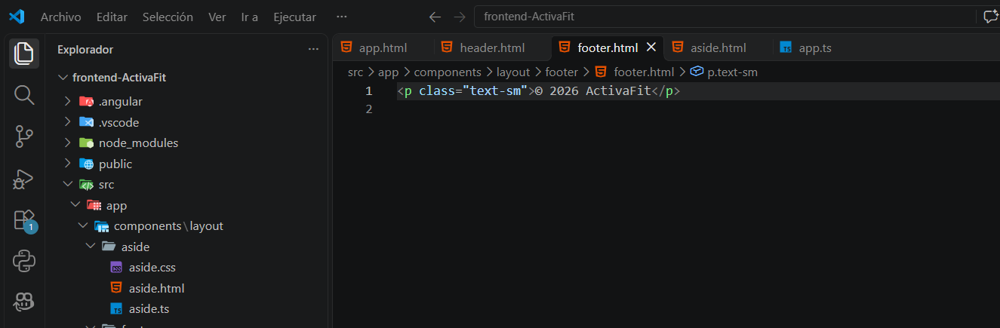

**Paso 8. Poner el menú en el aside**

En `aside/aside.html` usé el componente `PanelMenu` de PrimeNG:

``` html
<div class="card flex justify-center">
  <p-panelmenu [model]="items" class="w-full md:w-80" />
</div>
```

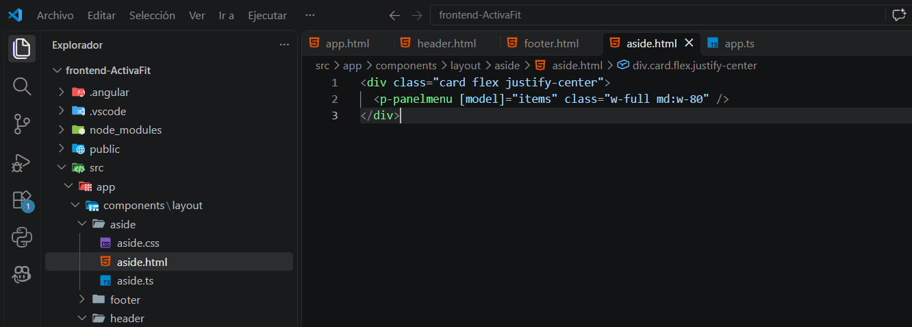

Y reemplacé `aside/aside.ts`. Cada opción lleva un ícono de PrimeIcons. Los módulos son los de mi proyecto. En lugar de llenar la lista en `ngOnInit`, como hace la guía, la definí directamente al declarar la propiedad, que da el mismo resultado con menos código.

``` typescript
import { Component } from '@angular/core';
import { MenuItem } from 'primeng/api';
import { PanelMenu } from 'primeng/panelmenu';

@Component({
  selector: 'app-aside',
  standalone: true,
  imports: [PanelMenu],
  templateUrl: './aside.html',
  styleUrl: './aside.css'
})
export class Aside {
  items: MenuItem[] = [
    { label: 'Clientes', icon: 'pi pi-fw pi-users' },
    { label: 'Entrenadores', icon: 'pi pi-fw pi-id-card' },
    { label: 'Planes', icon: 'pi pi-fw pi-tags' },
    { label: 'Ejercicios', icon: 'pi pi-fw pi-bolt' },
    { label: 'Rutinas', icon: 'pi pi-fw pi-list' },
    { label: 'Medidas', icon: 'pi pi-fw pi-chart-line' },
    { label: 'Membresías', icon: 'pi pi-fw pi-credit-card' },
    { label: 'Asistencias', icon: 'pi pi-fw pi-calendar' }
  ];
}
```

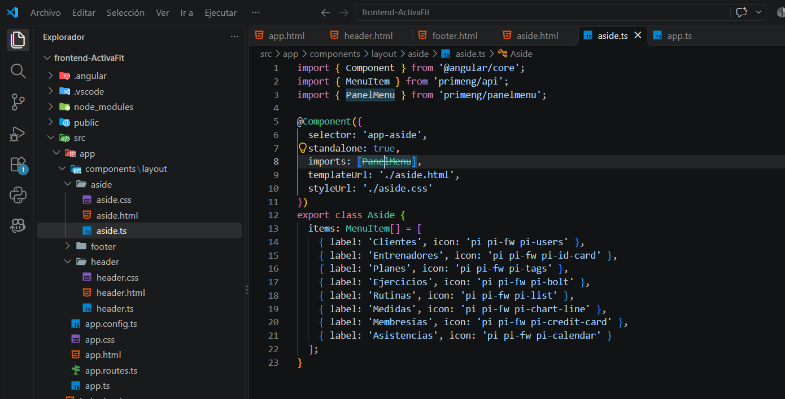

#### Explicación

Angular organiza la pantalla en componentes, y por eso el encabezado, el menú lateral y el pie son cada uno el suyo. El componente principal, `app`, solo los acomoda con una cuadrícula hecha con clases de Tailwind, y deja un espacio, `<router-outlet />`, donde más adelante aparecerán las pantallas de cada módulo. Tailwind se encarga de los espacios y la disposición. PrimeNG pone los componentes ya listos, como el menú desplegable, y el tema Aura les da su aspecto. Las opciones del menú todavía no llevan ruta: se las agrego en cada CRUD.

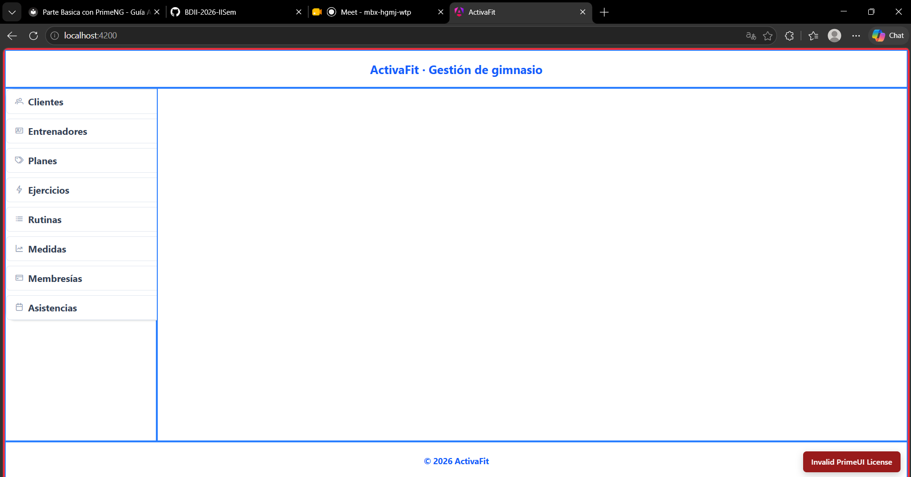

### Navegación entre rutas de Angular: ActivaFit

**Narrativa**

Con el esqueleto de la pantalla listo, esta unidad la volvió navegable. Una aplicación de Angular es de una sola página, así que cambiar de módulo no recarga el navegador: el enrutador cambia el contenido del centro según la dirección. Para cada módulo de ActivaFit creé los cuatro componentes de un CRUD (listar, crear, editar y eliminar), les asigné una dirección a cada uno y conecté las opciones del menú lateral con esas direcciones. Por ahora los componentes están vacíos: solo quiero comprobar que, al pulsar una opción del menú, el contenido y la URL cambian.

**Objetivo**

Crear los componentes de cada CRUD, asignarles rutas y enlazarlos con el menú del aside.

**Requisitos**

- Parte básica con PrimeNG terminada (esqueleto y menú con las 8 opciones).

- Terminal abierta en la raíz de `frontend-ActivaFit`, donde está `angular.json`.

#### Construcción

**Paso 0. Comprobar que `npx ng g c` funciona**

``` bash
cd ~/ia-lab/projecs/base-dato2/frontend-ActivaFit
ls angular.json
npx ng g c components/client/getall
```

Debe mostrar líneas `CREATE ...`. .

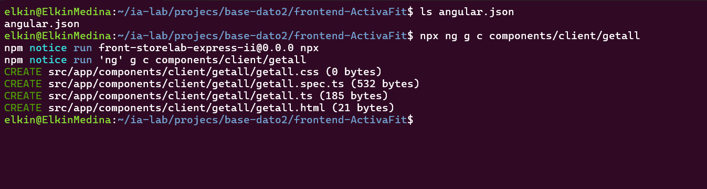

**Paso 1. Crear los componentes de cada módulo**

Cada módulo lleva cuatro componentes, uno por operación del CRUD. Los ocho módulos son los del menú: `client`, `trainer`, `plan`, `exercise`, `routine`, `measurement`, `membership` y `attendance`. Para no escribir 32 comandos a mano, usé un bucle. El componente `client/getall` del paso anterior no se repite: `ng` solo avisa que ya existe.

```         
for e in client trainer plan exercise routine measurement membership attendance; do
  for v in getall create update delete; do
    npx ng g c components/$e/$v
  done
done
```

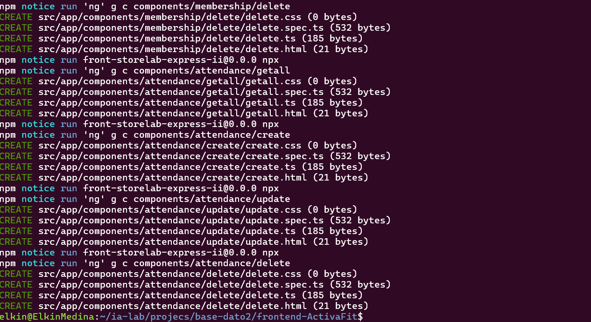

Después comprobé el nombre de la clase generada, porque las rutas dependen de él:

```         
grep -n "export class" src/app/components/client/getall/getall.ts
```

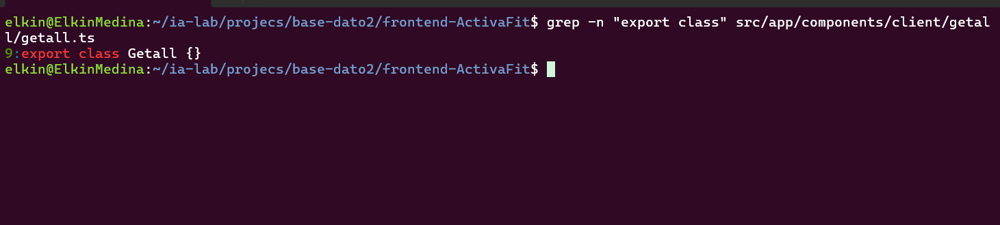

Debe mostrar `export class Getall`. Si muestra `GetallComponent`, tu versión del CLI usa otro nombre y las importaciones de los pasos siguientes hay que ajustarlas.

**Paso 2. Poner un texto temporal en cada listado**

Los componentes nuevos dicen todos `getall works!`, y así no distingo un módulo de otro. Con este bucle les puse un texto con el nombre del módulo. Es temporal: lo reemplazo cuando construya cada pantalla.

```         
for e in client trainer plan exercise routine measurement membership attendance; do
  echo "<p>Listado de $e</p>" > src/app/components/$e/getall/getall.html
done
```

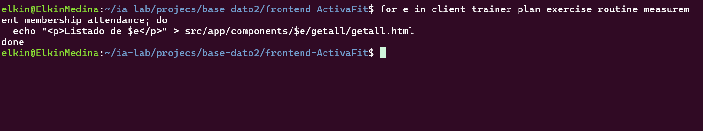

**Paso 3. Crear las rutas de cada módulo**

La guía pone todas las rutas en un solo archivo y usa alias (`Getall as ClientGetall`), porque los cuatro componentes de cada módulo se llaman igual. Yo evité ese choque de nombres dando a cada módulo su propio archivo de rutas, donde los nombres no se repiten. Este bucle crea los ocho archivos, uno por módulo, como `src/app/components/client/client.routes.ts`:

```         
for e in client trainer plan exercise routine measurement membership attendance; do
  name=$(echo "$e" | tr '[:lower:]' '[:upper:]')_ROUTES
  cat > src/app/components/$e/$e.routes.ts <<EOF
import { Routes } from '@angular/router';
import { Getall } from './getall/getall';
import { Create } from './create/create';
import { Update } from './update/update';
import { Delete } from './delete/delete';

export const $name: Routes = [
  { path: '', component: Getall },
  { path: 'new', component: Create },
  { path: 'edit/:id', component: Update },
  { path: 'delete/:id', component: Delete },
];
EOF
done
```

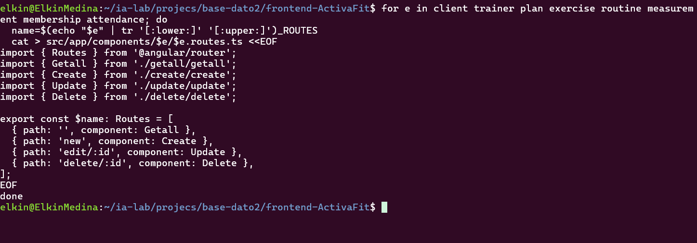

Por ejemplo, el de clientes queda con la constante `CLIENT_ROUTES`. Revísalo con `cat src/app/components/client/client.routes.ts`.

**Paso 4. Conectar los módulos en `app.routes.ts`**

Reemplacé `src/app/app.routes.ts`. Cada módulo cuelga de su dirección (`clients`, `trainers`...) y carga sus rutas hijas solo cuando se visita. Así quedan las mismas direcciones que usa la guía: `/clients`, `/clients/new`, `/clients/edit/:id` y `/clients/delete/:id`. La guía agrega también una redirección de `''` a `/`; la quité, porque redirige la raíz a sí misma, y el enrutador puede tomarla por un bucle infinito.

``` java
import { Routes } from '@angular/router';

export const routes: Routes = [
  {
    path: 'clients',
    loadChildren: () => import('./components/client/client.routes').then(m => m.CLIENT_ROUTES),
  },
  {
    path: 'trainers',
    loadChildren: () => import('./components/trainer/trainer.routes').then(m => m.TRAINER_ROUTES),
  },
  {
    path: 'plans',
    loadChildren: () => import('./components/plan/plan.routes').then(m => m.PLAN_ROUTES),
  },
  {
    path: 'exercises',
    loadChildren: () => import('./components/exercise/exercise.routes').then(m => m.EXERCISE_ROUTES),
  },
  {
    path: 'routines',
    loadChildren: () => import('./components/routine/routine.routes').then(m => m.ROUTINE_ROUTES),
  },
  {
    path: 'measurements',
    loadChildren: () => import('./components/measurement/measurement.routes').then(m => m.MEASUREMENT_ROUTES),
  },
  {
    path: 'memberships',
    loadChildren: () => import('./components/membership/membership.routes').then(m => m.MEMBERSHIP_ROUTES),
  },
  {
    path: 'attendances',
    loadChildren: () => import('./components/attendance/attendance.routes').then(m => m.ATTENDANCE_ROUTES),
  },
];
```

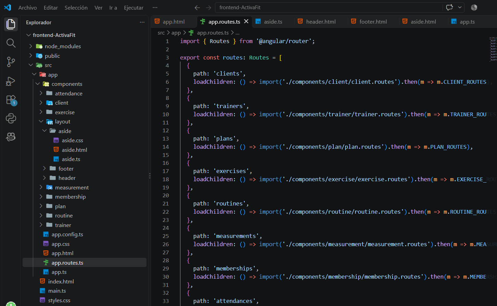

**Paso 5. Enlazar el menú con las rutas**

Reemplacé `src/app/components/layout/aside/aside.ts`. La única diferencia con el de la parte básica es que cada opción lleva su `routerLink`.

``` javascript
import { Component } from '@angular/core';
import { MenuItem } from 'primeng/api';
import { PanelMenu } from 'primeng/panelmenu';

@Component({
  selector: 'app-aside',
  standalone: true,
  imports: [PanelMenu],
  templateUrl: './aside.html',
  styleUrl: './aside.css'
})
export class Aside {
  items: MenuItem[] = [
    { label: 'Clientes', icon: 'pi pi-fw pi-users', routerLink: '/clients' },
    { label: 'Entrenadores', icon: 'pi pi-fw pi-id-card', routerLink: '/trainers' },
    { label: 'Planes', icon: 'pi pi-fw pi-tags', routerLink: '/plans' },
    { label: 'Ejercicios', icon: 'pi pi-fw pi-bolt', routerLink: '/exercises' },
    { label: 'Rutinas', icon: 'pi pi-fw pi-list', routerLink: '/routines' },
    { label: 'Medidas', icon: 'pi pi-fw pi-chart-line', routerLink: '/measurements' },
    { label: 'Membresías', icon: 'pi pi-fw pi-credit-card', routerLink: '/memberships' },
    { label: 'Asistencias', icon: 'pi pi-fw pi-calendar', routerLink: '/attendances' }
  ];
}
```

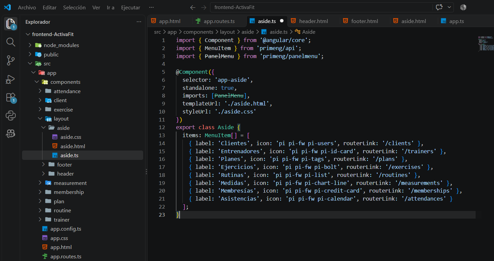

**Paso 6. Levantar el servidor**

```         
npm start
```

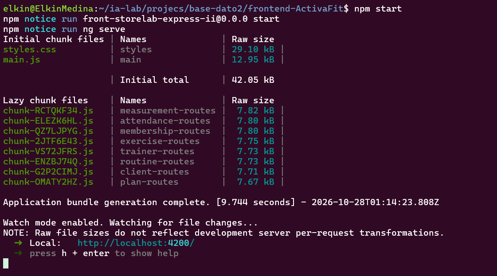

#### Explicación

El enrutador de Angular relaciona una dirección con un componente. Como la aplicación es de una sola página, al cambiar de dirección no se descarga otra página: el enrutador cambia el componente que aparece en `<router-outlet />`, el espacio del centro. Por eso los módulos tienen cuatro componentes cada uno, uno por cada operación del CRUD, y cada operación tiene su propia dirección: listar es `/clients`, crear es `/clients/new`, y editar y eliminar llevan el identificador del registro, `/clients/edit/:id`.

Dejé cada módulo en su propio archivo de rutas y lo cargo con `loadChildren`. Es el mismo resultado que el de la guía, pero sin alias y con la ventaja de que el código de cada módulo solo se descarga cuando alguien entra a él. El menú del aside enlaza con `routerLink` y el `PanelMenu` de PrimeNG navega solo al pulsar. Los componentes todavía no hablan con el backend: eso es lo que sigue.

## CRUD de clientes: ActivaFit

### Narrativa

Hasta ahora las pantallas de Clientes mostraban un texto temporal. En esta unidad las conecté con el backend de Django: un modelo, un servicio con las cinco operaciones HTTP y los tres componentes que lo usan (listar con eliminar, crear y editar). Lo dejé listo para repetirlo en los otros siete módulos.

### Objetivo

Listar, crear, editar y eliminar clientes desde Angular contra la API de Django.

### Requisitos

- Rutas y menú de la unidad anterior funcionando.

- Backend corriendo en [`http://127.0.0.1:8000`](http://127.0.0.1:8000).

- Terminal en la raíz de `frontend-ActivaFit`.

### Construcción

#### Paso 0. Averiguar la URL y los campos reales del backend

Desde `backend-Django`:

```         
grep -rn "router.register\|path(" --include=urls.py . | grep -v .venv | grep -i client
curl -s http://127.0.0.1:8000/client/clients/ | head -c 600
```

El primer comando muestra la URL y el segundo los campos que devuelve la API. Si la URL no es `/client/clients/`, cámbiala en `baseUrl` (Paso 2). Si los campos son otros, ajusta el modelo (Paso 1) y los formularios. Un `401` significa que la API exige token: la pantalla fallará hasta hacer la unidad de Autenticación.

#### Paso 1. Modelo

`src/app/models/business/client.ts`

``` javascript
export type DocumentType = 'CC' | 'CE' | 'TI' | 'PASSPORT';

export interface ClientI {
  id?: number;
  document_type: DocumentType;
  document_number: string;
  name: string;
  phone?: string | null;
  email: string;
  status: string;
}

export interface ClientResponseI extends ClientI {
  created_at?: string;
  updated_at?: string;
}
```

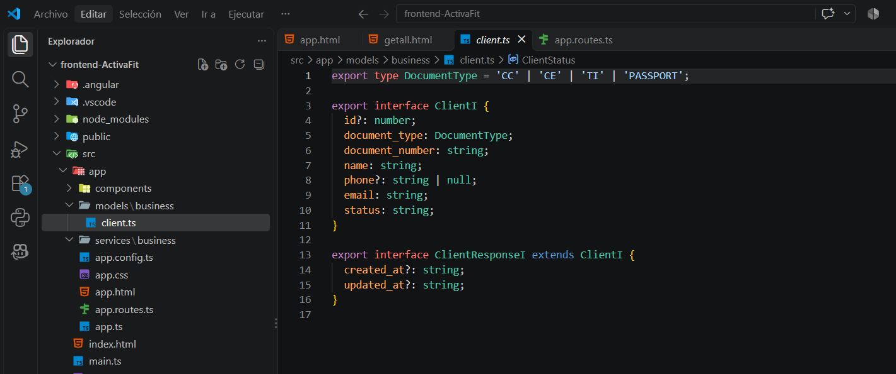

#### Paso 2. Servicio

`src/app/services/business/client.ts`

``` javascript
import { Injectable } from '@angular/core';
import { HttpClient } from '@angular/common/http';
import { BehaviorSubject, Observable, catchError, map, tap, throwError } from 'rxjs';
import { ClientI, ClientResponseI } from '../../models/business/client';

interface PaginatedResponse<T> {
  count: number;
  next: string | null;
  previous: string | null;
  results: T[];
}

@Injectable({ providedIn: 'root' })
export class Client {
  private baseUrl = 'http://127.0.0.1:8000/api/clients';
  private clientsSubject = new BehaviorSubject<ClientResponseI[]>([]);
  public clients$ = this.clientsSubject.asObservable();

  constructor(private http: HttpClient) {}

  getAllClients(): Observable<ClientResponseI[]> {
    return this.http
      .get<PaginatedResponse<ClientResponseI> | ClientResponseI[]>(`${this.baseUrl}/`)
      .pipe(
        map((r) => (Array.isArray(r) ? r : r.results ?? [])),
        tap((clients) => this.clientsSubject.next(clients)),
        catchError((e) => throwError(() => e))
      );
  }

  getClientById(id: number): Observable<ClientResponseI> {
    return this.http.get<ClientResponseI>(`${this.baseUrl}/${id}/`);
  }

  createClient(client: ClientI): Observable<ClientResponseI> {
    return this.http.post<ClientResponseI>(`${this.baseUrl}/`, client)
      .pipe(tap(() => this.refreshClients()));
  }

  updateClient(id: number, client: ClientI): Observable<ClientResponseI> {
    return this.http.put<ClientResponseI>(`${this.baseUrl}/${id}/`, client)
      .pipe(tap(() => this.refreshClients()));
  }

  partialUpdateClient(id: number, client: Partial<ClientI>): Observable<ClientResponseI> {
    return this.http.patch<ClientResponseI>(`${this.baseUrl}/${id}/`, client)
      .pipe(tap(() => this.refreshClients()));
  }

  deleteClient(id: number): Observable<void> {
    return this.http.delete<void>(`${this.baseUrl}/${id}/`)
      .pipe(tap(() => this.refreshClients()));
  }

  refreshClients(): void {
    this.getAllClients().subscribe({
      error: (e) => console.error('Error refreshing clients:', e),
    });
  }
}
```

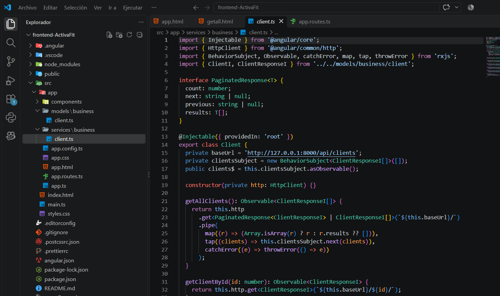

#### Paso 3. Listar y eliminar

`src/app/components/client/getall/getall.ts`

``` javascript
import { Component, OnDestroy, OnInit } from '@angular/core';
import { CommonModule } from '@angular/common';
import { RouterModule } from '@angular/router';
import { TableModule } from 'primeng/table';
import { Button } from 'primeng/button';
import { ConfirmDialog } from 'primeng/confirmdialog';
import { Toast } from 'primeng/toast';
import { Tooltip } from 'primeng/tooltip';
import { ConfirmationService, MessageService } from 'primeng/api';
import { Observable, Subscription } from 'rxjs';
import { Client } from '../../../services/business/client';
import { ClientResponseI } from '../../../models/business/client';

@Component({
  selector: 'app-getall',
  imports: [CommonModule, RouterModule, TableModule, Button, ConfirmDialog, Toast, Tooltip],
  providers: [ConfirmationService, MessageService],
  templateUrl: './getall.html',
  styleUrl: './getall.css',
})
export class Getall implements OnInit, OnDestroy {
  clients$: Observable<ClientResponseI[]>;
  loading = false;
  private subscription = new Subscription();

  constructor(
    private clientService: Client,
    private confirmationService: ConfirmationService,
    private messageService: MessageService
  ) {
    this.clients$ = this.clientService.clients$;
  }

  ngOnInit(): void {
    this.loadClients();
  }

  ngOnDestroy(): void {
    this.subscription.unsubscribe();
  }

  loadClients(): void {
    this.loading = true;
    this.subscription.add(
      this.clientService.getAllClients().subscribe({
        next: () => (this.loading = false),
        error: () => {
          this.messageService.add({ severity: 'error', summary: 'Error', detail: 'No se pudieron cargar los clientes' });
          this.loading = false;
        },
      })
    );
  }

  confirmDelete(client: ClientResponseI): void {
    this.confirmationService.confirm({
      message: `¿Está seguro de que desea eliminar a ${client.name}?`,
      header: 'Confirmar Eliminación',
      icon: 'pi pi-exclamation-triangle',
      acceptLabel: 'Sí, eliminar',
      rejectLabel: 'Cancelar',
      acceptButtonStyleClass: 'p-button-danger',
      accept: () => this.deleteClient(client.id!),
    });
  }

  deleteClient(id: number): void {
    this.subscription.add(
      this.clientService.deleteClient(id).subscribe({
        next: () => this.messageService.add({ severity: 'success', summary: 'Éxito', detail: 'Cliente eliminado correctamente' }),
        error: () => this.messageService.add({ severity: 'error', summary: 'Error', detail: 'No se pudo eliminar el cliente' }),
      })
    );
  }
}
```

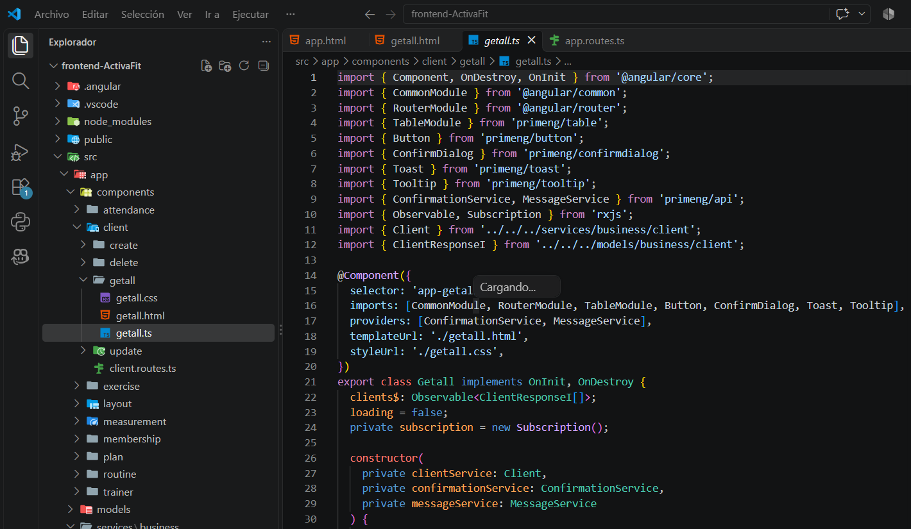

`src/app/components/client/getall/getall.html`

``` html
<div class="rounded-2xl border border-white/10 bg-[#0A0F1B] p-4 text-white shadow-xl sm:p-6">
  <div class="mb-6 flex flex-col justify-between gap-4 sm:flex-row sm:items-center">
    <div>
      <h2 class="text-2xl font-black tracking-tight sm:text-3xl">
        Gestión de <span class="text-lime-300">Clientes</span>
      </h2>
      <p class="mt-1 text-sm text-slate-400">Administra la información de tus clientes.</p>
    </div>

    <p-button
      label="Nuevo cliente"
      icon="pi pi-plus"
      [routerLink]="['/clients/new']"
      styleClass="!rounded-xl !border-none !bg-lime-300 !font-bold !text-slate-950 hover:!bg-lime-200"
    />
  </div>

  <p-table
    [value]="(clients$ | async) ?? []"
    [loading]="loading"
    [paginator]="true"
    [rows]="10"
    [rowsPerPageOptions]="[5, 10, 25, 50]"
    [showCurrentPageReport]="true"
    currentPageReportTemplate="Mostrando {first} a {last} de {totalRecords} registros"
    dataKey="id"
    styleClass="p-datatable-striped"
    [tableStyle]="{ 'min-width': '50rem' }"
  >
    <ng-template #header>
      <tr>
        <th pSortableColumn="id">ID <p-sorticon field="id" /></th>
        <th pSortableColumn="documentType">Tipo doc. <p-sorticon field="documentType" /></th>
        <th pSortableColumn="documentNumber">Documento <p-sorticon field="documentNumber" /></th>
        <th pSortableColumn="name">Nombre <p-sorticon field="name" /></th>
        <th pSortableColumn="phone">Teléfono <p-sorticon field="phone" /></th>
        <th pSortableColumn="email">Correo <p-sorticon field="email" /></th>
        <th pSortableColumn="status">Estado <p-sorticon field="status" /></th>
        <th class="text-center">Acciones</th>
      </tr>
    </ng-template>

    <ng-template #body let-client>
      <tr>
        <td class="font-semibold text-lime-300">{{ client.id }}</td>
        <td>{{ client.documentType }}</td>
        <td>{{ client.documentNumber }}</td>
        <td class="font-semibold">{{ client.name }}</td>
        <td>{{ client.phone }}</td>
        <td>{{ client.email }}</td>
        <td>
          <span
            class="inline-flex rounded-full px-3 py-1 text-xs font-bold"
            [ngClass]="client.status ? 'bg-lime-300/10 text-lime-300' : 'bg-red-400/10 text-red-400'"
          >
            {{ client.status ? 'Activo' : 'Inactivo' }}
          </span>
        </td>
        <td>
          <div class="flex justify-center gap-2">
            <p-button
              icon="pi pi-pencil"
              [routerLink]="['/clients/edit', client.id]"
              [rounded]="true"
              [text]="true"
              severity="warn"
              pTooltip="Editar cliente"
              tooltipPosition="top"
            />
            <p-button
              icon="pi pi-trash"
              (onClick)="confirmDelete(client)"
              [rounded]="true"
              [text]="true"
              severity="danger"
              pTooltip="Eliminar cliente"
              tooltipPosition="top"
            />
          </div>
        </td>
      </tr>
    </ng-template>

    <ng-template #emptymessage>
      <tr>
        <td colspan="8" class="py-10 text-center text-slate-400">
          <i class="pi pi-users mb-3 block text-3xl"></i>
          No se encontraron clientes registrados.
        </td>
      </tr>
    </ng-template>
  </p-table>
</div>

<p-confirmdialog />
<p-toast />
```

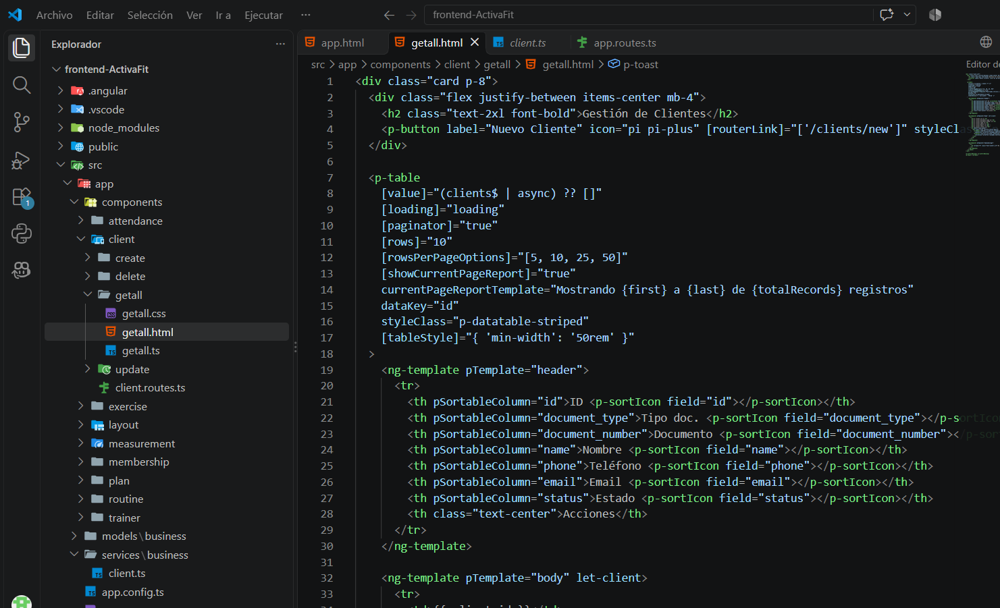

#### Paso 4. Crear

`src/app/components/client/create/create.ts`

``` javascript
import { CommonModule } from '@angular/common';
import { Component } from '@angular/core';
import { FormBuilder, FormGroup, ReactiveFormsModule, Validators } from '@angular/forms';
import { Router } from '@angular/router';
import { ButtonModule } from 'primeng/button';
import { InputTextModule } from 'primeng/inputtext';
import { Select } from 'primeng/select';
import { MessageService } from 'primeng/api';
import { ToastModule } from 'primeng/toast';
import { Client } from '../../../services/business/client';

@Component({
  selector: 'app-create',
  imports: [CommonModule, ReactiveFormsModule, ButtonModule, InputTextModule, Select, ToastModule],
  templateUrl: './create.html',
  styleUrl: './create.css',
  providers: [MessageService],
})
export class Create {
  form: FormGroup;
  loading = false;

  documentTypeOptions = [
    { label: 'Cédula de ciudadanía', value: 'CC' },
    { label: 'Cédula de extranjería', value: 'CE' },
    { label: 'Tarjeta de identidad', value: 'TI' },
    { label: 'Pasaporte', value: 'PASSPORT' },
  ];
  statusOptions = [
    { label: 'Activo', value: 'ACTIVE' },
    { label: 'Inactivo', value: 'INACTIVE' },
  ];

  constructor(
    private fb: FormBuilder,
    private router: Router,
    private clientService: Client,
    private messageService: MessageService
  ) {
    this.form = this.fb.group({
      document_type: ['CC', Validators.required],
      document_number: ['', [Validators.required, Validators.minLength(5), Validators.maxLength(30)]],
      name: ['', [Validators.required, Validators.minLength(2), Validators.maxLength(150)]],
      phone: ['', [Validators.pattern(/^\d{7,30}$/)]],
      email: ['', [Validators.required, Validators.email]],
      status: ['ACTIVE', Validators.required],
    });
  }

  submit(): void {
    if (this.form.invalid) {
      this.form.markAllAsTouched();
      this.messageService.add({ severity: 'warn', summary: 'Advertencia', detail: 'Por favor complete todos los campos requeridos' });
      return;
    }
    this.loading = true;
    const data = { ...this.form.value, phone: this.form.value.phone || null };
    this.clientService.createClient(data).subscribe({
      next: () => {
        this.messageService.add({ severity: 'success', summary: 'Éxito', detail: 'Cliente creado correctamente' });
        setTimeout(() => this.router.navigate(['/clients']), 1000);
      },
      error: () => {
        this.messageService.add({ severity: 'error', summary: 'Error', detail: 'Error al crear el cliente' });
        this.loading = false;
      },
    });
  }

  cancelar(): void {
    this.router.navigate(['/clients']);
  }

  getFieldError(field: string): string {
    const c = this.form.get(field);
    if (c?.errors && c.touched) {
      if (c.errors['required']) return `${field} es requerido`;
      if (c.errors['email']) return 'Email no válido';
      if (c.errors['minlength']) return `${field} debe tener al menos ${c.errors['minlength'].requiredLength} caracteres`;
      if (c.errors['maxlength']) return `${field} admite máximo ${c.errors['maxlength'].requiredLength} caracteres`;
      if (c.errors['pattern']) return 'Formato no válido';
    }
    return '';
  }
}
```

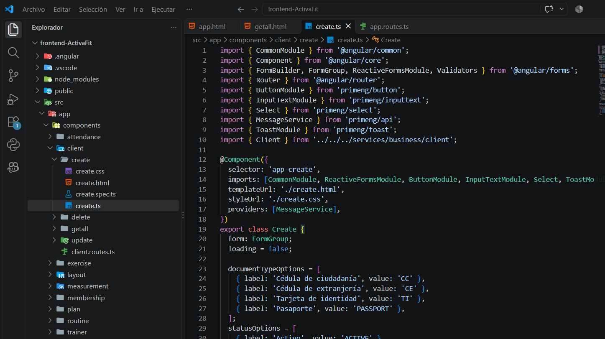

`src/app/components/client/create/create.html`

``` html
<div class="max-w-4xl mx-auto p-6">
  <div class="bg-white rounded-lg shadow-lg p-8">
    <h2 class="text-2xl font-bold mb-6 text-gray-800">Crear Nuevo Cliente</h2>

    <form [formGroup]="form" (ngSubmit)="submit()">
      <div class="grid grid-cols-1 md:grid-cols-2 gap-6">
        <div class="flex flex-col">
          <label class="mb-2 font-semibold text-gray-700">Tipo de documento *</label>
          <p-select formControlName="document_type" [options]="documentTypeOptions" optionLabel="label" optionValue="value" class="w-full"></p-select>
        </div>
        <div class="flex flex-col">
          <label class="mb-2 font-semibold text-gray-700">Número de documento *</label>
          <input pInputText formControlName="document_number" class="w-full" />
          <small class="text-red-500 mt-1" *ngIf="getFieldError('document_number')">{{ getFieldError('document_number') }}</small>
        </div>
        <div class="flex flex-col">
          <label class="mb-2 font-semibold text-gray-700">Nombre *</label>
          <input pInputText formControlName="name" class="w-full" />
          <small class="text-red-500 mt-1" *ngIf="getFieldError('name')">{{ getFieldError('name') }}</small>
        </div>
        <div class="flex flex-col">
          <label class="mb-2 font-semibold text-gray-700">Teléfono</label>
          <input pInputText formControlName="phone" class="w-full" placeholder="3001234567" />
          <small class="text-red-500 mt-1" *ngIf="getFieldError('phone')">{{ getFieldError('phone') }}</small>
        </div>
        <div class="flex flex-col">
          <label class="mb-2 font-semibold text-gray-700">Email *</label>
          <input pInputText type="email" formControlName="email" class="w-full" />
          <small class="text-red-500 mt-1" *ngIf="getFieldError('email')">{{ getFieldError('email') }}</small>
        </div>
        <div class="flex flex-col">
          <label class="mb-2 font-semibold text-gray-700">Estado *</label>
          <p-select formControlName="status" [options]="statusOptions" optionLabel="label" optionValue="value" class="w-full"></p-select>
        </div>
      </div>

      <div class="flex justify-center mt-8 gap-4">
        <button pButton type="submit" label="Guardar" icon="pi pi-save" [loading]="loading" [disabled]="loading"></button>
        <button pButton type="button" severity="secondary" label="Cancelar" icon="pi pi-times" (click)="cancelar()" [disabled]="loading"></button>
      </div>
    </form>
  </div>
</div>

<p-toast></p-toast>
```

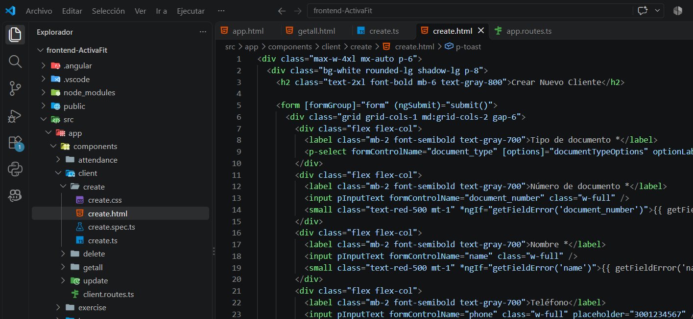

#### Paso 5. Editar

`src/app/components/client/update/update.ts`

``` javascript
import { CommonModule } from '@angular/common';
import { Component, OnDestroy, OnInit, signal } from '@angular/core';
import { FormBuilder, FormGroup, ReactiveFormsModule, Validators } from '@angular/forms';
import { ActivatedRoute, Router } from '@angular/router';
import { ButtonModule } from 'primeng/button';
import { InputTextModule } from 'primeng/inputtext';
import { Select } from 'primeng/select';
import { MessageService } from 'primeng/api';
import { ToastModule } from 'primeng/toast';
import { Subscription, finalize } from 'rxjs';
import { Client } from '../../../services/business/client';

@Component({
  selector: 'app-update',
  imports: [CommonModule, ReactiveFormsModule, ButtonModule, InputTextModule, Select, ToastModule],
  templateUrl: './update.html',
  styleUrl: './update.css',
  providers: [MessageService],
})
export class Update implements OnInit, OnDestroy {
  form: FormGroup;
  loading = signal(false);
  loadingClient = signal(false);
  private clientId: number | null = null;
  private subscription = new Subscription();

  documentTypeOptions = [
    { label: 'Cédula de ciudadanía', value: 'CC' },
    { label: 'Cédula de extranjería', value: 'CE' },
    { label: 'Tarjeta de identidad', value: 'TI' },
    { label: 'Pasaporte', value: 'PASSPORT' },
  ];
  statusOptions = [
    { label: 'Activo', value: 'ACTIVE' },
    { label: 'Inactivo', value: 'INACTIVE' },
  ];

  constructor(
    private fb: FormBuilder,
    private route: ActivatedRoute,
    private router: Router,
    private clientService: Client,
    private messageService: MessageService
  ) {
    this.form = this.fb.group({
      document_type: ['CC', Validators.required],
      document_number: ['', [Validators.required, Validators.minLength(5), Validators.maxLength(30)]],
      name: ['', [Validators.required, Validators.minLength(2), Validators.maxLength(150)]],
      phone: ['', [Validators.pattern(/^\d{7,30}$/)]],
      email: ['', [Validators.required, Validators.email]],
      status: ['ACTIVE', Validators.required],
    });
  }

  ngOnInit(): void {
    const id = Number(this.route.snapshot.paramMap.get('id'));
    if (!id || Number.isNaN(id)) {
      this.messageService.add({ severity: 'error', summary: 'Error', detail: 'ID de cliente no válido' });
      this.router.navigate(['/clients']);
      return;
    }
    this.clientId = id;
    this.loadingClient.set(true);
    this.subscription.add(
      this.clientService.getClientById(id).pipe(finalize(() => this.loadingClient.set(false))).subscribe({
        next: (c) =>
          this.form.patchValue({
            document_type: c.document_type ?? 'CC',
            document_number: c.document_number ?? '',
            name: c.name ?? '',
            phone: c.phone ?? '',
            email: c.email ?? '',
            status: c.status ?? 'ACTIVE',
          }),
        error: () => {
          this.messageService.add({ severity: 'error', summary: 'Error', detail: 'No se pudo cargar el cliente' });
          this.router.navigate(['/clients']);
        },
      })
    );
  }

  ngOnDestroy(): void {
    this.subscription.unsubscribe();
  }

  submit(): void {
    if (!this.clientId) return;
    if (this.form.invalid) {
      this.form.markAllAsTouched();
      this.messageService.add({ severity: 'warn', summary: 'Advertencia', detail: 'Por favor complete todos los campos requeridos' });
      return;
    }
    this.loading.set(true);
    const data = { ...this.form.value, phone: this.form.value.phone || null };
    this.subscription.add(
      this.clientService.partialUpdateClient(this.clientId, data).subscribe({
        next: () => {
          this.messageService.add({ severity: 'success', summary: 'Éxito', detail: 'Cliente actualizado correctamente' });
          setTimeout(() => this.router.navigate(['/clients']), 1000);
        },
        error: () => {
          this.messageService.add({ severity: 'error', summary: 'Error', detail: 'Error al actualizar el cliente' });
          this.loading.set(false);
        },
      })
    );
  }

  cancelar(): void {
    this.router.navigate(['/clients']);
  }

  getFieldError(field: string): string {
    const c = this.form.get(field);
    if (c?.errors && c.touched) {
      if (c.errors['required']) return `${field} es requerido`;
      if (c.errors['email']) return 'Email no válido';
      if (c.errors['minlength']) return `${field} debe tener al menos ${c.errors['minlength'].requiredLength} caracteres`;
      if (c.errors['maxlength']) return `${field} admite máximo ${c.errors['maxlength'].requiredLength} caracteres`;
      if (c.errors['pattern']) return 'Formato no válido';
    }
    return '';
  }
}
```

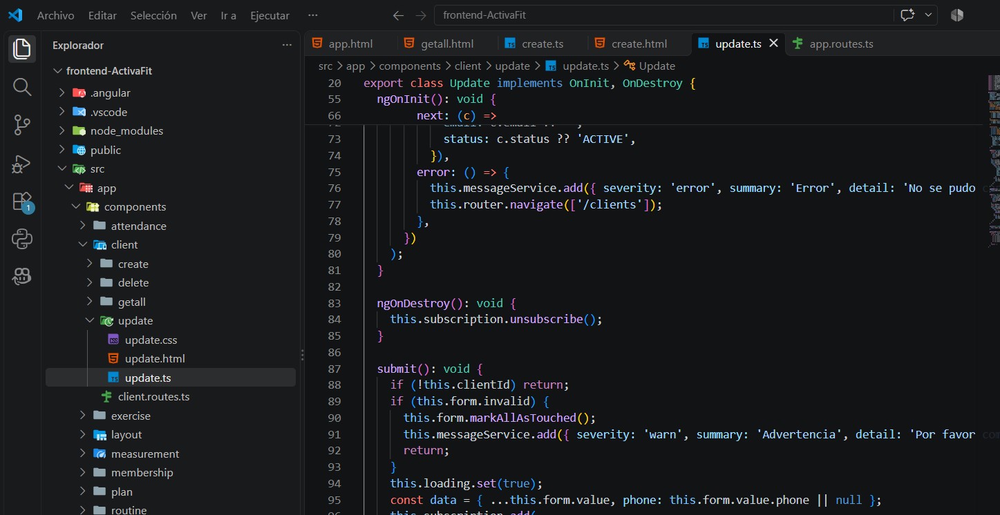

`src/app/components/client/update/update.html`

``` html
<div class="max-w-4xl mx-auto p-6">
  <div class="bg-white rounded-lg shadow-lg p-8">
    <h2 class="text-2xl font-bold mb-6 text-gray-800">Actualizar Cliente</h2>

    <div *ngIf="loadingClient()" class="text-center py-8 text-gray-600">Cargando datos del cliente...</div>

    <form *ngIf="!loadingClient()" [formGroup]="form" (ngSubmit)="submit()" autocomplete="off">
      <div class="grid grid-cols-1 md:grid-cols-2 gap-6">
        <div class="flex flex-col">
          <label class="mb-2 font-semibold text-gray-700">Tipo de documento *</label>
          <p-select formControlName="document_type" [options]="documentTypeOptions" optionLabel="label" optionValue="value" class="w-full"></p-select>
        </div>
        <div class="flex flex-col">
          <label class="mb-2 font-semibold text-gray-700">Número de documento *</label>
          <input pInputText formControlName="document_number" class="w-full" />
          <small class="text-red-500 mt-1" *ngIf="getFieldError('document_number')">{{ getFieldError('document_number') }}</small>
        </div>
        <div class="flex flex-col">
          <label class="mb-2 font-semibold text-gray-700">Nombre *</label>
          <input pInputText formControlName="name" class="w-full" />
          <small class="text-red-500 mt-1" *ngIf="getFieldError('name')">{{ getFieldError('name') }}</small>
        </div>
        <div class="flex flex-col">
          <label class="mb-2 font-semibold text-gray-700">Teléfono</label>
          <input pInputText formControlName="phone" class="w-full" />
          <small class="text-red-500 mt-1" *ngIf="getFieldError('phone')">{{ getFieldError('phone') }}</small>
        </div>
        <div class="flex flex-col">
          <label class="mb-2 font-semibold text-gray-700">Email *</label>
          <input pInputText type="email" formControlName="email" class="w-full" />
          <small class="text-red-500 mt-1" *ngIf="getFieldError('email')">{{ getFieldError('email') }}</small>
        </div>
        <div class="flex flex-col">
          <label class="mb-2 font-semibold text-gray-700">Estado *</label>
          <p-select formControlName="status" [options]="statusOptions" optionLabel="label" optionValue="value" class="w-full"></p-select>
        </div>
      </div>

      <div class="flex justify-center mt-8 gap-4">
        <button pButton type="submit" label="Actualizar" icon="pi pi-save" [loading]="loading()" [disabled]="loading()"></button>
        <button pButton type="button" severity="secondary" label="Cancelar" icon="pi pi-times" (click)="cancelar()" [disabled]="loading()"></button>
      </div>
    </form>
  </div>
</div>

<p-toast></p-toast>
```

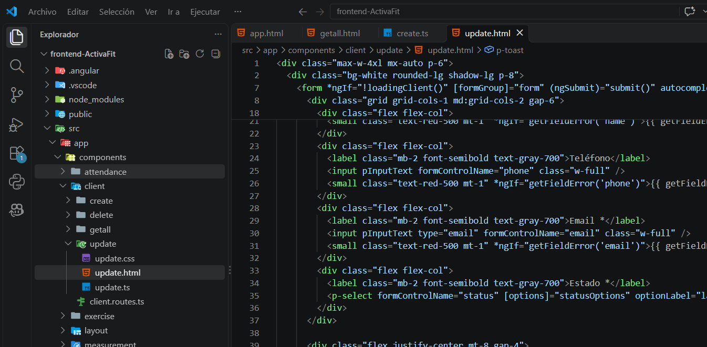

#### Paso 6. Levantar y probar

```         
npm start
```

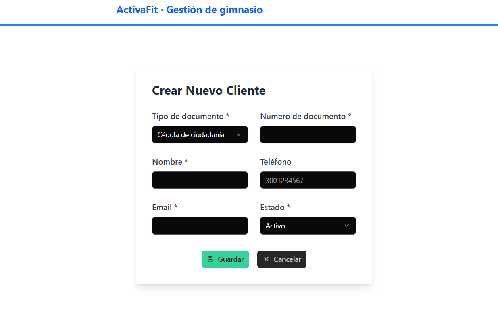

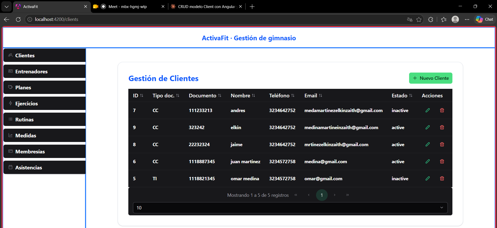

### Explicación

El **modelo** describe la forma del JSON, y el **servicio** es el único que habla con la API. `clients$` es un `BehaviorSubject`: cuando se crea, edita o elimina algo, el servicio vuelve a pedir la lista y la tabla se actualiza sola, sin recargar. Django puede devolver una lista simple o una paginada (`results`), y `getAllClients` acepta las dos. Eliminar no tiene pantalla propia: se hace con el diálogo de confirmación del listado, así que el componente `delete` queda sin usar por ahora. Editar usa `PATCH`, que envía solo lo que el formulario trae.

Las rutas no cambian: ya existen en `client.routes.ts` de la unidad anterior, con `Getall`, `Create`, `Update` y `Delete` sin alias.

## CRUD de planes: ActivaFit

### Narrativa

Con clientes funcionando, repliqué el mismo patrón para el segundo módulo. Un plan es lo que el gimnasio vende: tiene un nombre único, una descripción opcional y un estado. Creé el modelo, un servicio con las operaciones contra `/api/plans/` y los tres componentes de la pantalla (listar con eliminar, crear y editar). Esta vez dejé que los errores del backend se muestren en el aviso rojo, para no abrir F12 cada vez que algo se rechaza.

### Objetivo

Listar, crear, editar y eliminar planes desde Angular contra la API de Django.

### Requisitos

-  Login y CRUD de clientes funcionando.

-  Los componentes `plan/getall`, `plan/create` y `plan/update` ya generados (`ng g c`) y la ruta `/plans` en el menú.

-  Terminal en la raíz de `frontend-ActivaFit`, con el backend corriendo.

### Construcción

#### Paso 0. Comprobar la API

Desde cualquier terminal, con el servidor de Django corriendo:

```         
TOKEN=$(curl -s -X POST http://127.0.0.1:8000/api/auth/login/ -H "Content-Type: application/json" -d '{"username":"admin","password":"1234"}' | python3 -c "import sys,json;print(json.load(sys.stdin)['access'])")
echo ${#TOKEN}
curl -i http://127.0.0.1:8000/api/plans/ -H "Authorization: Bearer $TOKEN" | head -n 12
```

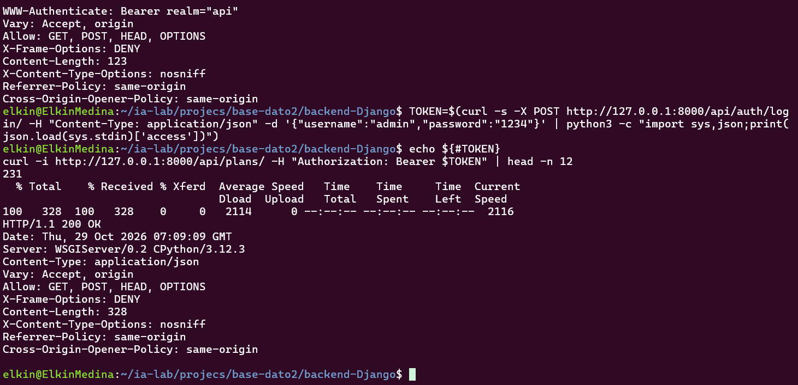

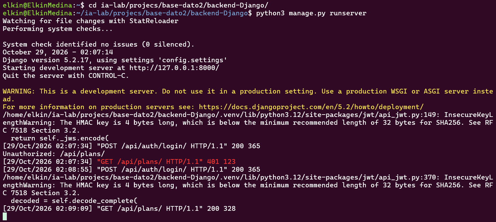

Debe responder `200`. Con `403`, tu usuario no tiene rol sobre `plans`. Los campos que devuelve son `id`, `name`, `description`, `status`, `createdAt` y `updatedAt`.

#### Paso 1. Modelo

``` bash
cd ~/ia-lab/projecs/base-dato2/frontend-ActivaFit

cat > src/app/models/business/plan.ts <<'EOF'
export interface PlanI {
  id?: number;
  name: string;
  description?: string | null;
  status: string;
}

export interface PlanResponseI extends PlanI {
  createdAt?: string;
  updatedAt?: string;
}
EOF
```

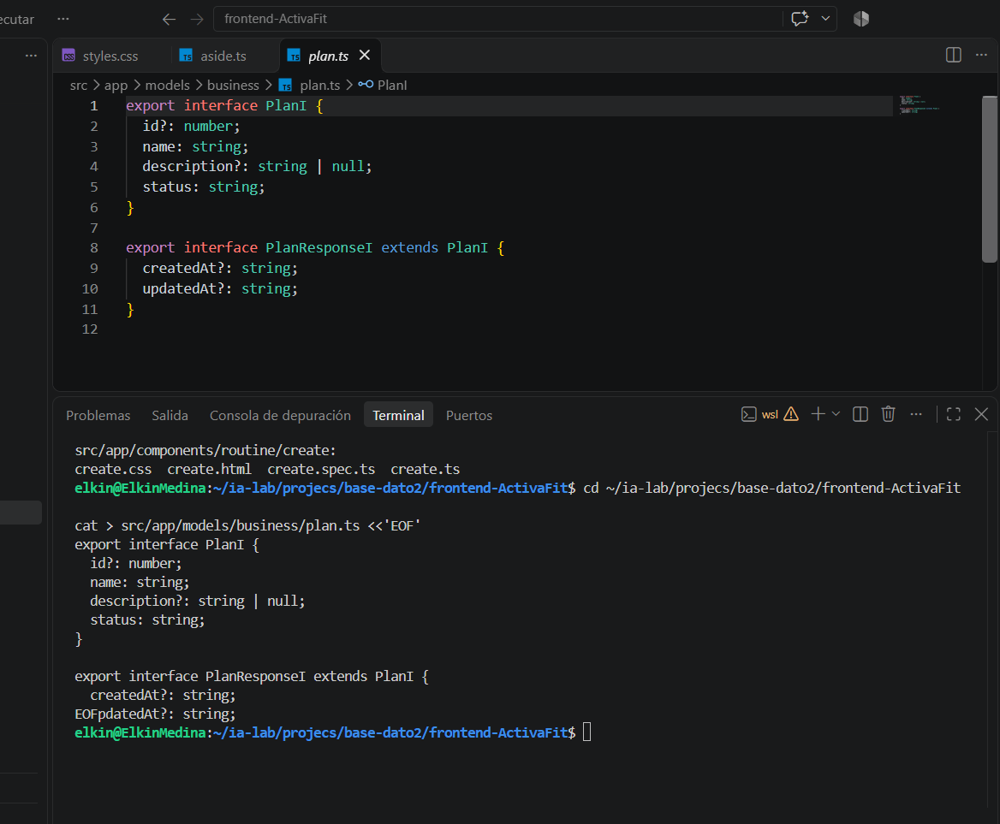

#### Paso 2. Servicio

``` bash
cat > src/app/services/business/plan.ts <<'EOF'
import { Injectable } from '@angular/core';
import { HttpClient } from '@angular/common/http';
import { BehaviorSubject, Observable, catchError, map, tap, throwError } from 'rxjs';
import { PlanI, PlanResponseI } from '../../models/business/plan';
import { API_BASE } from '../auth/auth';

interface PaginatedResponse<T> {
  count: number;
  next: string | null;
  previous: string | null;
  results: T[];
}

@Injectable({ providedIn: 'root' })
export class Plan {
  private baseUrl = API_BASE + '/api/plans';
  private subject = new BehaviorSubject<PlanResponseI[]>([]);
  public items$ = this.subject.asObservable();

  constructor(private http: HttpClient) {}

  getAllPlans(): Observable<PlanResponseI[]> {
    return this.http
      .get<PaginatedResponse<PlanResponseI> | PlanResponseI[]>(this.baseUrl + '/')
      .pipe(
        map((r) => (Array.isArray(r) ? r : r.results ?? [])),
        tap((items) => this.subject.next(items)),
        catchError((e) => throwError(() => e))
      );
  }

  getPlanById(id: number): Observable<PlanResponseI> {
    return this.http.get<PlanResponseI>(this.baseUrl + '/' + id + '/');
  }

  createPlan(item: Partial<PlanI>): Observable<PlanResponseI> {
    return this.http.post<PlanResponseI>(this.baseUrl + '/', item).pipe(tap(() => this.refresh()));
  }

  partialUpdatePlan(id: number, item: Partial<PlanI>): Observable<PlanResponseI> {
    return this.http.patch<PlanResponseI>(this.baseUrl + '/' + id + '/', item).pipe(tap(() => this.refresh()));
  }

  deletePlan(id: number): Observable<void> {
    return this.http.delete<void>(this.baseUrl + '/' + id + '/').pipe(tap(() => this.refresh()));
  }

  refresh(): void {
    this.getAllPlans().subscribe({ error: (e) => console.error('Error refreshing plans:', e) });
  }
}
EOF
```

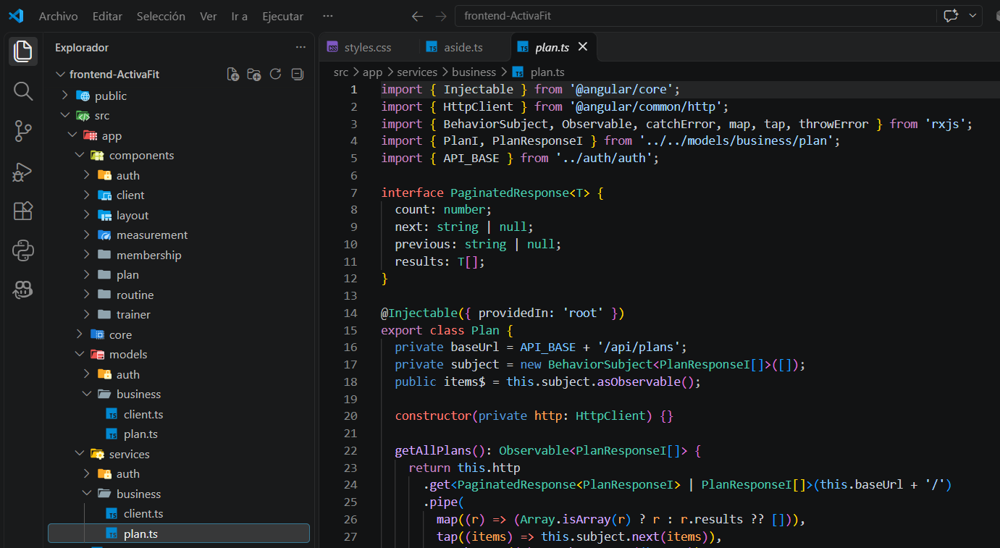

#### Paso 3. Listar y eliminar

``` bash
cat > src/app/components/plan/getall/getall.ts <<'EOF'
import { Component, OnDestroy, OnInit } from '@angular/core';
import { CommonModule } from '@angular/common';
import { RouterModule } from '@angular/router';
import { TableModule } from 'primeng/table';
import { Button } from 'primeng/button';
import { ConfirmDialog } from 'primeng/confirmdialog';
import { Toast } from 'primeng/toast';
import { Tooltip } from 'primeng/tooltip';
import { ConfirmationService, MessageService } from 'primeng/api';
import { Observable, Subscription } from 'rxjs';
import { Plan } from '../../../services/business/plan';
import { PlanResponseI } from '../../../models/business/plan';

@Component({
  selector: 'app-getall',
  imports: [CommonModule, RouterModule, TableModule, Button, ConfirmDialog, Toast, Tooltip],
  providers: [ConfirmationService, MessageService],
  templateUrl: './getall.html',
  styleUrl: './getall.css',
})
export class Getall implements OnInit, OnDestroy {
  items$: Observable<PlanResponseI[]>;
  loading = false;
  private subscription = new Subscription();

  constructor(
    private svc: Plan,
    private confirmationService: ConfirmationService,
    private messageService: MessageService
  ) {
    this.items$ = this.svc.items$;
  }

  ngOnInit(): void {
    this.load();
  }

  ngOnDestroy(): void {
    this.subscription.unsubscribe();
  }

  load(): void {
    this.loading = true;
    this.subscription.add(
      this.svc.getAllPlans().subscribe({
        next: () => (this.loading = false),
        error: (e) => {
          this.messageService.add({
            severity: 'error',
            summary: 'Error',
            detail: e?.status === 403 ? 'No tiene permiso para ver este módulo' : 'No se pudo cargar el listado',
          });
          this.loading = false;
        },
      })
    );
  }

  confirmDelete(row: PlanResponseI): void {
    this.confirmationService.confirm({
      message: '¿Está seguro de que desea eliminar el plan ' + row.name + '?',
      header: 'Confirmar Eliminación',
      icon: 'pi pi-exclamation-triangle',
      acceptLabel: 'Sí, eliminar',
      rejectLabel: 'Cancelar',
      acceptButtonStyleClass: 'p-button-danger',
      accept: () => this.remove(row.id!),
    });
  }

  remove(id: number): void {
    this.subscription.add(
      this.svc.deletePlan(id).subscribe({
        next: () => this.messageService.add({ severity: 'success', summary: 'Éxito', detail: 'Plan eliminado correctamente' }),
        error: () => this.messageService.add({ severity: 'error', summary: 'Error', detail: 'No se pudo eliminar (puede tener membresías)' }),
      })
    );
  }
}
EOF

cat > src/app/components/plan/getall/getall.html <<'EOF'
<div class="card p-8">
  <div class="flex justify-between items-center mb-4">
    <h2 class="text-2xl font-bold">Gestión de Planes</h2>
    <p-button label="Nuevo Plan" icon="pi pi-plus" [routerLink]="['/plans/new']" styleClass="p-button-success"></p-button>
  </div>

  <p-table
    [value]="(items$ | async) ?? []"
    [loading]="loading"
    [paginator]="true"
    [rows]="10"
    [rowsPerPageOptions]="[5, 10, 25, 50]"
    [showCurrentPageReport]="true"
    currentPageReportTemplate="Mostrando {first} a {last} de {totalRecords} registros"
    dataKey="id"
    styleClass="p-datatable-striped"
    [tableStyle]="{ 'min-width': '40rem' }"
  >
    <ng-template #header>
      <tr>
        <th pSortableColumn="id">ID <p-sorticon field="id"></p-sorticon></th>
        <th pSortableColumn="name">Nombre <p-sorticon field="name"></p-sorticon></th>
        <th pSortableColumn="description">Descripción <p-sorticon field="description"></p-sorticon></th>
        <th pSortableColumn="status">Estado <p-sorticon field="status"></p-sorticon></th>
        <th class="text-center">Acciones</th>
      </tr>
    </ng-template>

    <ng-template #body let-row>
      <tr>
        <td>{{ row.id }}</td>
        <td>{{ row.name }}</td>
        <td>{{ row.description ?? '—' }}</td>
        <td>{{ row.status }}</td>
        <td class="text-center">
          <div class="flex justify-center gap-2">
            <p-button icon="pi pi-pencil" [routerLink]="['/plans/edit', row.id]"
              styleClass="p-button-rounded p-button-text p-button-warning" pTooltip="Editar" tooltipPosition="top"></p-button>
            <p-button icon="pi pi-trash" (onClick)="confirmDelete(row)"
              styleClass="p-button-rounded p-button-text p-button-danger" pTooltip="Eliminar" tooltipPosition="top"></p-button>
          </div>
        </td>
      </tr>
    </ng-template>

    <ng-template #emptymessage>
      <tr>
        <td colspan="5" class="text-center p-4">No se encontraron planes</td>
      </tr>
    </ng-template>
  </p-table>
</div>

<p-confirmdialog></p-confirmdialog>
<p-toast></p-toast>
EOF
```

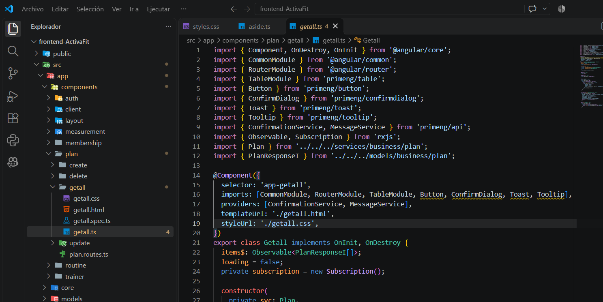

#### Paso 4. Crear

``` bash
cat > src/app/components/plan/create/create.ts <<'EOF'
import { CommonModule } from '@angular/common';
import { Component } from '@angular/core';
import { FormBuilder, FormGroup, ReactiveFormsModule, Validators } from '@angular/forms';
import { Router } from '@angular/router';
import { ButtonModule } from 'primeng/button';
import { InputTextModule } from 'primeng/inputtext';
import { Select } from 'primeng/select';
import { MessageService } from 'primeng/api';
import { ToastModule } from 'primeng/toast';
import { Plan } from '../../../services/business/plan';

@Component({
  selector: 'app-create',
  imports: [CommonModule, ReactiveFormsModule, ButtonModule, InputTextModule, Select, ToastModule],
  templateUrl: './create.html',
  styleUrl: './create.css',
  providers: [MessageService],
})
export class Create {
  form: FormGroup;
  loading = false;
  statusOptions = [
    { label: 'Activo', value: 'active' },
    { label: 'Inactivo', value: 'inactive' },
  ];
  fieldLabels: Record<string, string> = {
    name: 'Nombre',
    description: 'Descripción',
    status: 'Estado',
  };

  constructor(
    private fb: FormBuilder,
    private router: Router,
    private svc: Plan,
    private messageService: MessageService
  ) {
    this.form = this.fb.group({
      name: ['', [Validators.required, Validators.minLength(2), Validators.maxLength(100)]],
      description: ['', [Validators.maxLength(255)]],
      status: ['active', [Validators.required]],
    });
  }

  submit(): void {
    if (this.form.invalid) {
      this.form.markAllAsTouched();
      this.messageService.add({ severity: 'warn', summary: 'Advertencia', detail: 'Por favor complete todos los campos requeridos' });
      return;
    }
    this.loading = true;
    const data: any = { ...this.form.value };
    if (data.description === '') data.description = null;
    this.svc.createPlan(data).subscribe({
      next: () => {
        this.messageService.add({ severity: 'success', summary: 'Éxito', detail: 'Plan creado correctamente' });
        setTimeout(() => this.router.navigate(['/plans']), 1000);
      },
      error: (e) => {
        this.messageService.add({ severity: 'error', summary: 'Error', detail: this.apiError(e, 'Error al crear el plan') });
        this.loading = false;
      },
    });
  }

  cancelar(): void {
    this.router.navigate(['/plans']);
  }

  private apiError(e: any, fallback: string): string {
    const body = e?.error;
    if (body && typeof body === 'object') {
      const msg = Object.entries(body)
        .map(([k, v]) => k + ': ' + (Array.isArray(v) ? v.join(' ') : String(v)))
        .join(' | ');
      if (msg) return msg;
    }
    return fallback;
  }

  getFieldError(field: string): string {
    const c = this.form.get(field);
    const label = this.fieldLabels[field] ?? field;
    if (c?.errors && c.touched) {
      if (c.errors['required']) return label + ' es requerido';
      if (c.errors['minlength']) return label + ' debe tener al menos ' + c.errors['minlength'].requiredLength + ' caracteres';
      if (c.errors['maxlength']) return label + ' admite máximo ' + c.errors['maxlength'].requiredLength + ' caracteres';
    }
    return '';
  }
}
EOF

cat > src/app/components/plan/create/create.html <<'EOF'
<div class="max-w-4xl mx-auto p-6">
  <div class="bg-white rounded-lg shadow-lg p-8">
    <h2 class="text-2xl font-bold mb-6 text-gray-800">Crear Nuevo Plan</h2>

    <form [formGroup]="form" (ngSubmit)="submit()" autocomplete="off">
      <div class="grid grid-cols-1 md:grid-cols-2 gap-6">
        <div class="flex flex-col">
          <label class="mb-2 font-semibold text-gray-700">Nombre *</label>
          <input pInputText formControlName="name" class="w-full" />
          <small class="text-red-500 mt-1" *ngIf="getFieldError('name')">{{ getFieldError('name') }}</small>
        </div>
        <div class="flex flex-col">
          <label class="mb-2 font-semibold text-gray-700">Estado *</label>
          <p-select formControlName="status" [options]="statusOptions" optionLabel="label" optionValue="value" class="w-full"></p-select>
        </div>
        <div class="flex flex-col md:col-span-2">
          <label class="mb-2 font-semibold text-gray-700">Descripción</label>
          <input pInputText formControlName="description" class="w-full" />
          <small class="text-red-500 mt-1" *ngIf="getFieldError('description')">{{ getFieldError('description') }}</small>
        </div>
      </div>

      <div class="flex justify-center mt-8 gap-4">
        <p-button type="submit" label="Guardar" icon="pi pi-save" [loading]="loading" [disabled]="loading"></p-button>
        <p-button type="button" severity="secondary" label="Cancelar" icon="pi pi-times" (onClick)="cancelar()" [disabled]="loading"></p-button>
      </div>
    </form>
  </div>
</div>

<p-toast></p-toast>
EOF
```

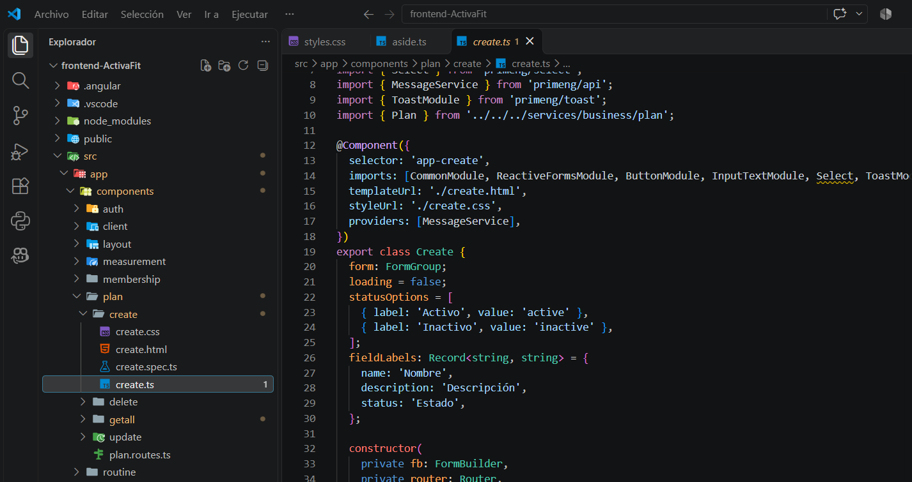

#### Paso 5. Editar

``` bash
cat > src/app/components/plan/update/update.ts <<'EOF'
import { CommonModule } from '@angular/common';
import { Component, OnDestroy, OnInit, signal } from '@angular/core';
import { FormBuilder, FormGroup, ReactiveFormsModule, Validators } from '@angular/forms';
import { ActivatedRoute, Router } from '@angular/router';
import { ButtonModule } from 'primeng/button';
import { InputTextModule } from 'primeng/inputtext';
import { Select } from 'primeng/select';
import { MessageService } from 'primeng/api';
import { ToastModule } from 'primeng/toast';
import { Subscription, finalize } from 'rxjs';
import { Plan } from '../../../services/business/plan';

@Component({
  selector: 'app-update',
  imports: [CommonModule, ReactiveFormsModule, ButtonModule, InputTextModule, Select, ToastModule],
  templateUrl: './update.html',
  styleUrl: './update.css',
  providers: [MessageService],
})
export class Update implements OnInit, OnDestroy {
  form: FormGroup;
  loading = signal(false);
  loadingItem = signal(false);
  private itemId: number | null = null;
  private subscription = new Subscription();
  statusOptions = [
    { label: 'Activo', value: 'active' },
    { label: 'Inactivo', value: 'inactive' },
  ];
  fieldLabels: Record<string, string> = {
    name: 'Nombre',
    description: 'Descripción',
    status: 'Estado',
  };

  constructor(
    private fb: FormBuilder,
    private route: ActivatedRoute,
    private router: Router,
    private svc: Plan,
    private messageService: MessageService
  ) {
    this.form = this.fb.group({
      name: ['', [Validators.required, Validators.minLength(2), Validators.maxLength(100)]],
      description: ['', [Validators.maxLength(255)]],
      status: ['active', [Validators.required]],
    });
  }

  ngOnInit(): void {
    const id = Number(this.route.snapshot.paramMap.get('id'));
    if (!id || Number.isNaN(id)) {
      this.messageService.add({ severity: 'error', summary: 'Error', detail: 'ID no válido' });
      this.router.navigate(['/plans']);
      return;
    }
    this.itemId = id;
    this.loadingItem.set(true);
    this.subscription.add(
      this.svc.getPlanById(id).pipe(finalize(() => this.loadingItem.set(false))).subscribe({
        next: (c) =>
          this.form.patchValue({
            name: c.name ?? '',
            description: c.description ?? '',
            status: c.status ?? 'active',
          }),
        error: () => {
          this.messageService.add({ severity: 'error', summary: 'Error', detail: 'No se pudo cargar el plan' });
          this.router.navigate(['/plans']);
        },
      })
    );
  }

  ngOnDestroy(): void {
    this.subscription.unsubscribe();
  }

  submit(): void {
    if (!this.itemId) return;
    if (this.form.invalid) {
      this.form.markAllAsTouched();
      this.messageService.add({ severity: 'warn', summary: 'Advertencia', detail: 'Por favor complete todos los campos requeridos' });
      return;
    }
    this.loading.set(true);
    const data: any = { ...this.form.value };
    if (data.description === '') data.description = null;
    this.subscription.add(
      this.svc.partialUpdatePlan(this.itemId, data).subscribe({
        next: () => {
          this.messageService.add({ severity: 'success', summary: 'Éxito', detail: 'Plan actualizado correctamente' });
          setTimeout(() => this.router.navigate(['/plans']), 1000);
        },
        error: (e) => {
          this.messageService.add({ severity: 'error', summary: 'Error', detail: this.apiError(e, 'Error al actualizar el plan') });
          this.loading.set(false);
        },
      })
    );
  }

  cancelar(): void {
    this.router.navigate(['/plans']);
  }

  private apiError(e: any, fallback: string): string {
    const body = e?.error;
    if (body && typeof body === 'object') {
      const msg = Object.entries(body)
        .map(([k, v]) => k + ': ' + (Array.isArray(v) ? v.join(' ') : String(v)))
        .join(' | ');
      if (msg) return msg;
    }
    return fallback;
  }

  getFieldError(field: string): string {
    const c = this.form.get(field);
    const label = this.fieldLabels[field] ?? field;
    if (c?.errors && c.touched) {
      if (c.errors['required']) return label + ' es requerido';
      if (c.errors['minlength']) return label + ' debe tener al menos ' + c.errors['minlength'].requiredLength + ' caracteres';
      if (c.errors['maxlength']) return label + ' admite máximo ' + c.errors['maxlength'].requiredLength + ' caracteres';
    }
    return '';
  }
}
EOF

cat > src/app/components/plan/update/update.html <<'EOF'
<div class="max-w-4xl mx-auto p-6">
  <div class="bg-white rounded-lg shadow-lg p-8">
    <h2 class="text-2xl font-bold mb-6 text-gray-800">Actualizar Plan</h2>

    <div *ngIf="loadingItem()" class="text-center py-8 text-gray-600">Cargando datos del plan...</div>

    <form *ngIf="!loadingItem()" [formGroup]="form" (ngSubmit)="submit()" autocomplete="off">
      <div class="grid grid-cols-1 md:grid-cols-2 gap-6">
        <div class="flex flex-col">
          <label class="mb-2 font-semibold text-gray-700">Nombre *</label>
          <input pInputText formControlName="name" class="w-full" />
          <small class="text-red-500 mt-1" *ngIf="getFieldError('name')">{{ getFieldError('name') }}</small>
        </div>
        <div class="flex flex-col">
          <label class="mb-2 font-semibold text-gray-700">Estado *</label>
          <p-select formControlName="status" [options]="statusOptions" optionLabel="label" optionValue="value" class="w-full"></p-select>
        </div>
        <div class="flex flex-col md:col-span-2">
          <label class="mb-2 font-semibold text-gray-700">Descripción</label>
          <input pInputText formControlName="description" class="w-full" />
          <small class="text-red-500 mt-1" *ngIf="getFieldError('description')">{{ getFieldError('description') }}</small>
        </div>
      </div>

      <div class="flex justify-center mt-8 gap-4">
        <p-button type="submit" label="Actualizar" icon="pi pi-save" [loading]="loading()" [disabled]="loading()"></p-button>
        <p-button type="button" severity="secondary" label="Cancelar" icon="pi pi-times" (onClick)="cancelar()" [disabled]="loading()"></p-button>
      </div>
    </form>
  </div>
</div>

<p-toast></p-toast>
EOF
```

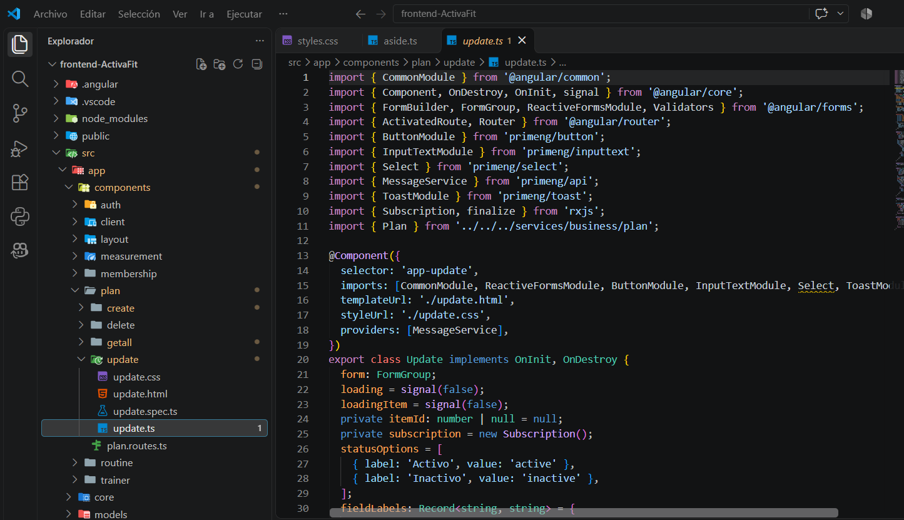

#### Paso 6. Levantar

```         
npm start
```

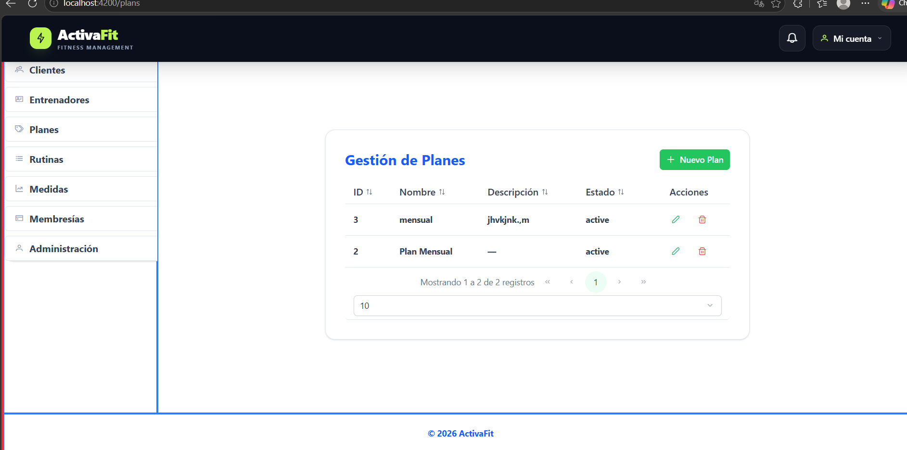

### Explicación

El modelo describe el JSON de un plan y el servicio es el único que habla con `/api/plans/`. Su `items$` es un `BehaviorSubject`: tras crear, editar o eliminar, el servicio vuelve a pedir la lista y la tabla se actualiza sola. Eliminar no tiene pantalla propia, sino un diálogo de confirmación en el listado. Editar envía solo lo que cambió (`PATCH`). Los textos vacíos de la descripción se mandan como `null`, porque el backend así lo espera. Si el backend rechaza algo (por ejemplo, un nombre repetido), el aviso rojo muestra el campo y el motivo.

## CRUD de entrenadores: ActivaFit

### Narrativa

Repetí el patrón de Planes para el tercer módulo. Un entrenador es quien asigna rutinas y registra medidas, así que más adelante será una lista desplegable en esas dos pantallas. Tiene nombre, teléfono, email y especialidad (los tres últimos opcionales) y un estado. Creé el modelo, el servicio contra `/api/trainers/` y los tres componentes de la pantalla.

### Objetivo

Listar, crear, editar y eliminar entrenadores desde Angular contra la API de Django.

### Requisitos

-  Login y CRUD de clientes y planes funcionando.

-  Componentes `trainer/getall`, `trainer/create` y `trainer/update` ya generados y la ruta `/trainers` en el menú.

- Terminal en la raíz de `frontend-ActivaFit`, con el backend corriendo.

### Construcción

#### Paso 0. Comprobar la API

Ejecuta cada comando por separado, porque pegados juntos el `$TOKEN` queda vacío y da `401`:

``` bash
TOKEN=$(curl -s -X POST http://127.0.0.1:8000/api/auth/login/ -H "Content-Type: application/json" -d '{"username":"admin","password":"1234"}' | python3 -c "import sys,json;print(json.load(sys.stdin)['access'])")
```

```         
curl -i http://127.0.0.1:8000/api/trainers/ -H "Authorization: Bearer $TOKEN" | head -n 12
```

Debe responder `200`. Los campos son `id`, `name`, `phone`, `email`, `specialty`, `status`, `createdAt` y `updatedAt`.

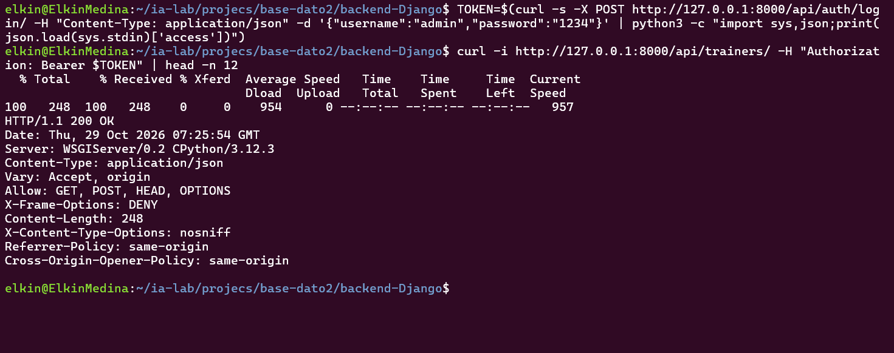

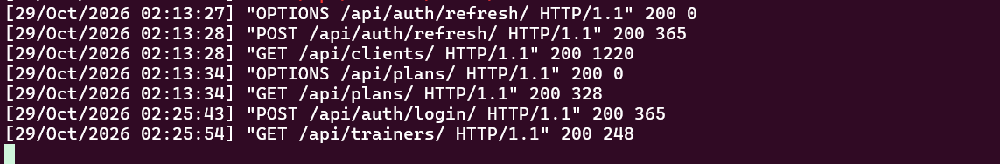

#### Paso 1. Modelo

bash

``` bash
cd ~/ia-lab/projecs/base-dato2/frontend-ActivaFit

cat > src/app/models/business/trainer.ts <<'EOF'
export interface TrainerI {
  id?: number;
  name: string;
  phone?: string | null;
  email?: string | null;
  specialty?: string | null;
  status: string;
}

export interface TrainerResponseI extends TrainerI {
  createdAt?: string;
  updatedAt?: string;
}
EOF
```

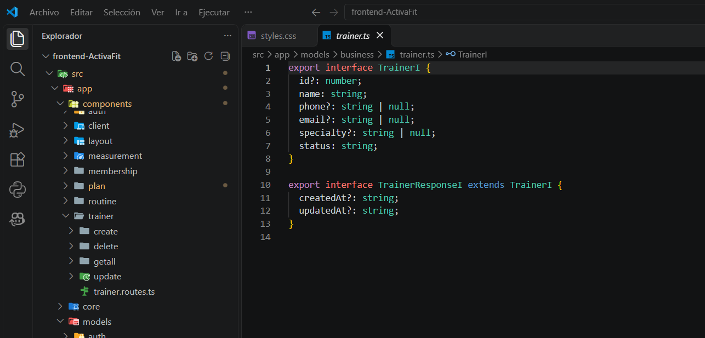

#### Paso 2. Servicio

``` bash
cat > src/app/services/business/trainer.ts <<'EOF'
import { Injectable } from '@angular/core';
import { HttpClient } from '@angular/common/http';
import { BehaviorSubject, Observable, catchError, map, tap, throwError } from 'rxjs';
import { TrainerI, TrainerResponseI } from '../../models/business/trainer';
import { API_BASE } from '../auth/auth';

interface PaginatedResponse<T> {
  count: number;
  next: string | null;
  previous: string | null;
  results: T[];
}

@Injectable({ providedIn: 'root' })
export class Trainer {
  private baseUrl = API_BASE + '/api/trainers';
  private subject = new BehaviorSubject<TrainerResponseI[]>([]);
  public items$ = this.subject.asObservable();

  constructor(private http: HttpClient) {}

  getAllTrainers(): Observable<TrainerResponseI[]> {
    return this.http
      .get<PaginatedResponse<TrainerResponseI> | TrainerResponseI[]>(this.baseUrl + '/')
      .pipe(
        map((r) => (Array.isArray(r) ? r : r.results ?? [])),
        tap((items) => this.subject.next(items)),
        catchError((e) => throwError(() => e))
      );
  }

  getTrainerById(id: number): Observable<TrainerResponseI> {
    return this.http.get<TrainerResponseI>(this.baseUrl + '/' + id + '/');
  }

  createTrainer(item: Partial<TrainerI>): Observable<TrainerResponseI> {
    return this.http.post<TrainerResponseI>(this.baseUrl + '/', item).pipe(tap(() => this.refresh()));
  }

  partialUpdateTrainer(id: number, item: Partial<TrainerI>): Observable<TrainerResponseI> {
    return this.http.patch<TrainerResponseI>(this.baseUrl + '/' + id + '/', item).pipe(tap(() => this.refresh()));
  }

  deleteTrainer(id: number): Observable<void> {
    return this.http.delete<void>(this.baseUrl + '/' + id + '/').pipe(tap(() => this.refresh()));
  }

  refresh(): void {
    this.getAllTrainers().subscribe({ error: (e) => console.error('Error refreshing trainers:', e) });
  }
}
EOF
```

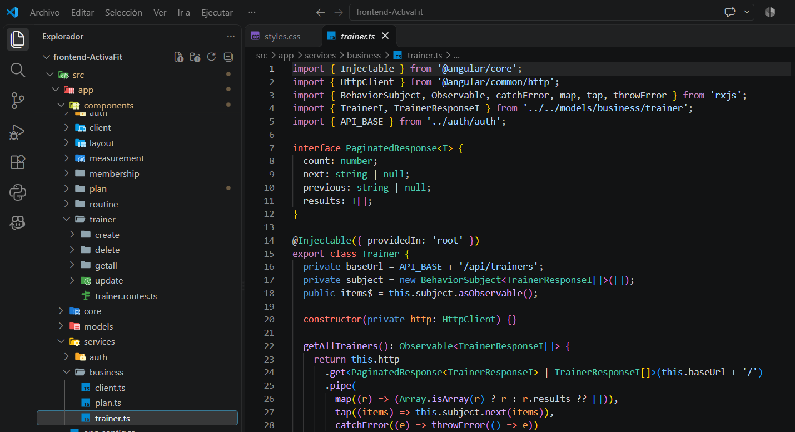

#### Paso 3. Listar y eliminar

``` bash
cat > src/app/components/trainer/getall/getall.ts <<'EOF'
import { Component, OnDestroy, OnInit } from '@angular/core';
import { CommonModule } from '@angular/common';
import { RouterModule } from '@angular/router';
import { TableModule } from 'primeng/table';
import { Button } from 'primeng/button';
import { ConfirmDialog } from 'primeng/confirmdialog';
import { Toast } from 'primeng/toast';
import { Tooltip } from 'primeng/tooltip';
import { ConfirmationService, MessageService } from 'primeng/api';
import { Observable, Subscription } from 'rxjs';
import { Trainer } from '../../../services/business/trainer';
import { TrainerResponseI } from '../../../models/business/trainer';

@Component({
  selector: 'app-getall',
  imports: [CommonModule, RouterModule, TableModule, Button, ConfirmDialog, Toast, Tooltip],
  providers: [ConfirmationService, MessageService],
  templateUrl: './getall.html',
  styleUrl: './getall.css',
})
export class Getall implements OnInit, OnDestroy {
  items$: Observable<TrainerResponseI[]>;
  loading = false;
  private subscription = new Subscription();

  constructor(
    private svc: Trainer,
    private confirmationService: ConfirmationService,
    private messageService: MessageService
  ) {
    this.items$ = this.svc.items$;
  }

  ngOnInit(): void {
    this.load();
  }

  ngOnDestroy(): void {
    this.subscription.unsubscribe();
  }

  load(): void {
    this.loading = true;
    this.subscription.add(
      this.svc.getAllTrainers().subscribe({
        next: () => (this.loading = false),
        error: (e) => {
          this.messageService.add({
            severity: 'error',
            summary: 'Error',
            detail: e?.status === 403 ? 'No tiene permiso para ver este módulo' : 'No se pudo cargar el listado',
          });
          this.loading = false;
        },
      })
    );
  }

  confirmDelete(row: TrainerResponseI): void {
    this.confirmationService.confirm({
      message: '¿Está seguro de que desea eliminar a ' + row.name + '?',
      header: 'Confirmar Eliminación',
      icon: 'pi pi-exclamation-triangle',
      acceptLabel: 'Sí, eliminar',
      rejectLabel: 'Cancelar',
      acceptButtonStyleClass: 'p-button-danger',
      accept: () => this.remove(row.id!),
    });
  }

  remove(id: number): void {
    this.subscription.add(
      this.svc.deleteTrainer(id).subscribe({
        next: () => this.messageService.add({ severity: 'success', summary: 'Éxito', detail: 'Entrenador eliminado correctamente' }),
        error: () => this.messageService.add({ severity: 'error', summary: 'Error', detail: 'No se pudo eliminar (puede tener rutinas o medidas)' }),
      })
    );
  }
}
EOF

cat > src/app/components/trainer/getall/getall.html <<'EOF'
<div class="card p-8">
  <div class="flex justify-between items-center mb-4">
    <h2 class="text-2xl font-bold">Gestión de Entrenadores</h2>
    <p-button label="Nuevo Entrenador" icon="pi pi-plus" [routerLink]="['/trainers/new']" styleClass="p-button-success"></p-button>
  </div>

  <p-table
    [value]="(items$ | async) ?? []"
    [loading]="loading"
    [paginator]="true"
    [rows]="10"
    [rowsPerPageOptions]="[5, 10, 25, 50]"
    [showCurrentPageReport]="true"
    currentPageReportTemplate="Mostrando {first} a {last} de {totalRecords} registros"
    dataKey="id"
    styleClass="p-datatable-striped"
    [tableStyle]="{ 'min-width': '50rem' }"
  >
    <ng-template #header>
      <tr>
        <th pSortableColumn="id">ID <p-sorticon field="id"></p-sorticon></th>
        <th pSortableColumn="name">Nombre <p-sorticon field="name"></p-sorticon></th>
        <th pSortableColumn="phone">Teléfono <p-sorticon field="phone"></p-sorticon></th>
        <th pSortableColumn="email">Email <p-sorticon field="email"></p-sorticon></th>
        <th pSortableColumn="specialty">Especialidad <p-sorticon field="specialty"></p-sorticon></th>
        <th pSortableColumn="status">Estado <p-sorticon field="status"></p-sorticon></th>
        <th class="text-center">Acciones</th>
      </tr>
    </ng-template>

    <ng-template #body let-row>
      <tr>
        <td>{{ row.id }}</td>
        <td>{{ row.name }}</td>
        <td>{{ row.phone ?? '—' }}</td>
        <td>{{ row.email ?? '—' }}</td>
        <td>{{ row.specialty ?? '—' }}</td>
        <td>{{ row.status }}</td>
        <td class="text-center">
          <div class="flex justify-center gap-2">
            <p-button icon="pi pi-pencil" [routerLink]="['/trainers/edit', row.id]"
              styleClass="p-button-rounded p-button-text p-button-warning" pTooltip="Editar" tooltipPosition="top"></p-button>
            <p-button icon="pi pi-trash" (onClick)="confirmDelete(row)"
              styleClass="p-button-rounded p-button-text p-button-danger" pTooltip="Eliminar" tooltipPosition="top"></p-button>
          </div>
        </td>
      </tr>
    </ng-template>

    <ng-template #emptymessage>
      <tr>
        <td colspan="7" class="text-center p-4">No se encontraron entrenadores</td>
      </tr>
    </ng-template>
  </p-table>
</div>

<p-confirmdialog></p-confirmdialog>
<p-toast></p-toast>
EOF
```

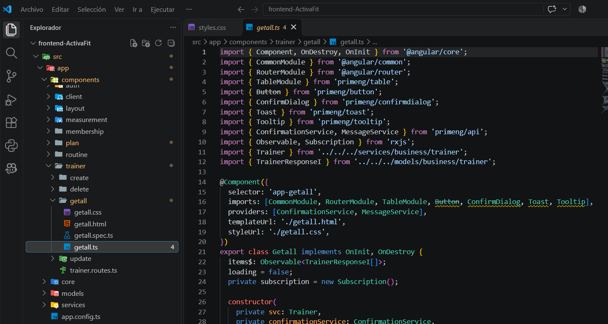

#### Paso 4. Crear

``` bash
cat > src/app/components/trainer/update/update.ts <<'EOF'
import { CommonModule } from '@angular/common';
import { Component, OnDestroy, OnInit, signal } from '@angular/core';
import { FormBuilder, FormGroup, ReactiveFormsModule, Validators } from '@angular/forms';
import { ActivatedRoute, Router } from '@angular/router';
import { ButtonModule } from 'primeng/button';
import { InputTextModule } from 'primeng/inputtext';
import { Select } from 'primeng/select';
import { MessageService } from 'primeng/api';
import { ToastModule } from 'primeng/toast';
import { Subscription, finalize } from 'rxjs';
import { Trainer } from '../../../services/business/trainer';

@Component({
  selector: 'app-update',
  imports: [CommonModule, ReactiveFormsModule, ButtonModule, InputTextModule, Select, ToastModule],
  templateUrl: './update.html',
  styleUrl: './update.css',
  providers: [MessageService],
})
export class Update implements OnInit, OnDestroy {
  form: FormGroup;
  loading = signal(false);
  loadingItem = signal(false);
  private itemId: number | null = null;
  private subscription = new Subscription();
  statusOptions = [
    { label: 'Activo', value: 'active' },
    { label: 'Inactivo', value: 'inactive' },
  ];
  fieldLabels: Record<string, string> = {
    name: 'Nombre',
    phone: 'Teléfono',
    email: 'Email',
    specialty: 'Especialidad',
    status: 'Estado',
  };

  constructor(
    private fb: FormBuilder,
    private route: ActivatedRoute,
    private router: Router,
    private svc: Trainer,
    private messageService: MessageService
  ) {
    this.form = this.fb.group({
      name: ['', [Validators.required, Validators.minLength(2), Validators.maxLength(150)]],
      phone: ['', [Validators.pattern(/^\d{7,30}$/)]],
      email: ['', [Validators.email, Validators.maxLength(150)]],
      specialty: ['', [Validators.maxLength(100)]],
      status: ['active', [Validators.required]],
    });
  }

  ngOnInit(): void {
    const id = Number(this.route.snapshot.paramMap.get('id'));
    if (!id || Number.isNaN(id)) {
      this.messageService.add({ severity: 'error', summary: 'Error', detail: 'ID no válido' });
      this.router.navigate(['/trainers']);
      return;
    }
    this.itemId = id;
    this.loadingItem.set(true);
    this.subscription.add(
      this.svc.getTrainerById(id).pipe(finalize(() => this.loadingItem.set(false))).subscribe({
        next: (c) =>
          this.form.patchValue({
            name: c.name ?? '',
            phone: c.phone ?? '',
            email: c.email ?? '',
            specialty: c.specialty ?? '',
            status: c.status ?? 'active',
          }),
        error: () => {
          this.messageService.add({ severity: 'error', summary: 'Error', detail: 'No se pudo cargar el entrenador' });
          this.router.navigate(['/trainers']);
        },
      })
    );
  }

  ngOnDestroy(): void {
    this.subscription.unsubscribe();
  }

  submit(): void {
    if (!this.itemId) return;
    if (this.form.invalid) {
      this.form.markAllAsTouched();
      this.messageService.add({ severity: 'warn', summary: 'Advertencia', detail: 'Por favor complete todos los campos requeridos' });
      return;
    }
    this.loading.set(true);
    const data: any = { ...this.form.value };
    for (const k of ['phone', 'email', 'specialty']) {
      if (data[k] === '') data[k] = null;
    }
    this.subscription.add(
      this.svc.partialUpdateTrainer(this.itemId, data).subscribe({
        next: () => {
          this.messageService.add({ severity: 'success', summary: 'Éxito', detail: 'Entrenador actualizado correctamente' });
          setTimeout(() => this.router.navigate(['/trainers']), 1000);
        },
        error: (e) => {
          this.messageService.add({ severity: 'error', summary: 'Error', detail: this.apiError(e, 'Error al actualizar el entrenador') });
          this.loading.set(false);
        },
      })
    );
  }

  cancelar(): void {
    this.router.navigate(['/trainers']);
  }

  private apiError(e: any, fallback: string): string {
    const body = e?.error;
    if (body && typeof body === 'object') {
      const msg = Object.entries(body)
        .map(([k, v]) => k + ': ' + (Array.isArray(v) ? v.join(' ') : String(v)))
        .join(' | ');
      if (msg) return msg;
    }
    return fallback;
  }

  getFieldError(field: string): string {
    const c = this.form.get(field);
    const label = this.fieldLabels[field] ?? field;
    if (c?.errors && c.touched) {
      if (c.errors['required']) return label + ' es requerido';
      if (c.errors['email']) return 'Email no válido';
      if (c.errors['minlength']) return label + ' debe tener al menos ' + c.errors['minlength'].requiredLength + ' caracteres';
      if (c.errors['maxlength']) return label + ' admite máximo ' + c.errors['maxlength'].requiredLength + ' caracteres';
      if (c.errors['pattern']) return 'Formato no válido (solo números, entre 7 y 30 dígitos)';
    }
    return '';
  }
}
EOF

cat > src/app/components/trainer/update/update.html <<'EOF'
<div class="max-w-4xl mx-auto p-6">
  <div class="bg-white rounded-lg shadow-lg p-8">
    <h2 class="text-2xl font-bold mb-6 text-gray-800">Actualizar Entrenador</h2>

    <div *ngIf="loadingItem()" class="text-center py-8 text-gray-600">Cargando datos del entrenador...</div>

    <form *ngIf="!loadingItem()" [formGroup]="form" (ngSubmit)="submit()" autocomplete="off">
      <div class="grid grid-cols-1 md:grid-cols-2 gap-6">
        <div class="flex flex-col">
          <label class="mb-2 font-semibold text-gray-700">Nombre *</label>
          <input pInputText formControlName="name" class="w-full" />
          <small class="text-red-500 mt-1" *ngIf="getFieldError('name')">{{ getFieldError('name') }}</small>
        </div>
        <div class="flex flex-col">
          <label class="mb-2 font-semibold text-gray-700">Teléfono</label>
          <input pInputText formControlName="phone" class="w-full" />
          <small class="text-red-500 mt-1" *ngIf="getFieldError('phone')">{{ getFieldError('phone') }}</small>
        </div>
        <div class="flex flex-col">
          <label class="mb-2 font-semibold text-gray-700">Email</label>
          <input pInputText type="email" formControlName="email" class="w-full" />
          <small class="text-red-500 mt-1" *ngIf="getFieldError('email')">{{ getFieldError('email') }}</small>
        </div>
        <div class="flex flex-col">
          <label class="mb-2 font-semibold text-gray-700">Especialidad</label>
          <input pInputText formControlName="specialty" class="w-full" />
          <small class="text-red-500 mt-1" *ngIf="getFieldError('specialty')">{{ getFieldError('specialty') }}</small>
        </div>
        <div class="flex flex-col">
          <label class="mb-2 font-semibold text-gray-700">Estado *</label>
          <p-select formControlName="status" [options]="statusOptions" optionLabel="label" optionValue="value" class="w-full"></p-select>
        </div>
      </div>

      <div class="flex justify-center mt-8 gap-4">
        <p-button type="submit" label="Actualizar" icon="pi pi-save" [loading]="loading()" [disabled]="loading()"></p-button>
        <p-button type="button" severity="secondary" label="Cancelar" icon="pi pi-times" (onClick)="cancelar()" [disabled]="loading()"></p-button>
      </div>
    </form>
  </div>
</div>

<p-toast></p-toast>
EOF
```

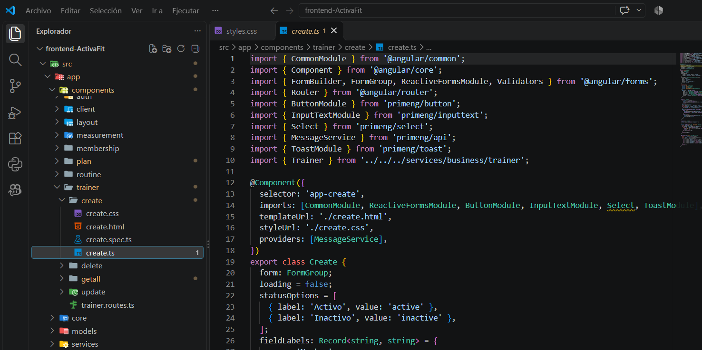

#### Paso 5. Editar

``` bash
cat > src/app/components/trainer/update/update.ts <<'EOF'
import { CommonModule } from '@angular/common';
import { Component, OnDestroy, OnInit, signal } from '@angular/core';
import { FormBuilder, FormGroup, ReactiveFormsModule, Validators } from '@angular/forms';
import { ActivatedRoute, Router } from '@angular/router';
import { ButtonModule } from 'primeng/button';
import { InputTextModule } from 'primeng/inputtext';
import { Select } from 'primeng/select';
import { MessageService } from 'primeng/api';
import { ToastModule } from 'primeng/toast';
import { Subscription, finalize } from 'rxjs';
import { Trainer } from '../../../services/business/trainer';

@Component({
  selector: 'app-update',
  imports: [CommonModule, ReactiveFormsModule, ButtonModule, InputTextModule, Select, ToastModule],
  templateUrl: './update.html',
  styleUrl: './update.css',
  providers: [MessageService],
})
export class Update implements OnInit, OnDestroy {
  form: FormGroup;
  loading = signal(false);
  loadingItem = signal(false);
  private itemId: number | null = null;
  private subscription = new Subscription();
  statusOptions = [
    { label: 'Activo', value: 'active' },
    { label: 'Inactivo', value: 'inactive' },
  ];
  fieldLabels: Record<string, string> = {
    name: 'Nombre',
    phone: 'Teléfono',
    email: 'Email',
    specialty: 'Especialidad',
    status: 'Estado',
  };

  constructor(
    private fb: FormBuilder,
    private route: ActivatedRoute,
    private router: Router,
    private svc: Trainer,
    private messageService: MessageService
  ) {
    this.form = this.fb.group({
      name: ['', [Validators.required, Validators.minLength(2), Validators.maxLength(150)]],
      phone: ['', [Validators.pattern(/^\d{7,30}$/)]],
      email: ['', [Validators.email, Validators.maxLength(150)]],
      specialty: ['', [Validators.maxLength(100)]],
      status: ['active', [Validators.required]],
    });
  }

  ngOnInit(): void {
    const id = Number(this.route.snapshot.paramMap.get('id'));
    if (!id || Number.isNaN(id)) {
      this.messageService.add({ severity: 'error', summary: 'Error', detail: 'ID no válido' });
      this.router.navigate(['/trainers']);
      return;
    }
    this.itemId = id;
    this.loadingItem.set(true);
    this.subscription.add(
      this.svc.getTrainerById(id).pipe(finalize(() => this.loadingItem.set(false))).subscribe({
        next: (c) =>
          this.form.patchValue({
            name: c.name ?? '',
            phone: c.phone ?? '',
            email: c.email ?? '',
            specialty: c.specialty ?? '',
            status: c.status ?? 'active',
          }),
        error: () => {
          this.messageService.add({ severity: 'error', summary: 'Error', detail: 'No se pudo cargar el entrenador' });
          this.router.navigate(['/trainers']);
        },
      })
    );
  }

  ngOnDestroy(): void {
    this.subscription.unsubscribe();
  }

  submit(): void {
    if (!this.itemId) return;
    if (this.form.invalid) {
      this.form.markAllAsTouched();
      this.messageService.add({ severity: 'warn', summary: 'Advertencia', detail: 'Por favor complete todos los campos requeridos' });
      return;
    }
    this.loading.set(true);
    const data: any = { ...this.form.value };
    for (const k of ['phone', 'email', 'specialty']) {
      if (data[k] === '') data[k] = null;
    }
    this.subscription.add(
      this.svc.partialUpdateTrainer(this.itemId, data).subscribe({
        next: () => {
          this.messageService.add({ severity: 'success', summary: 'Éxito', detail: 'Entrenador actualizado correctamente' });
          setTimeout(() => this.router.navigate(['/trainers']), 1000);
        },
        error: (e) => {
          this.messageService.add({ severity: 'error', summary: 'Error', detail: this.apiError(e, 'Error al actualizar el entrenador') });
          this.loading.set(false);
        },
      })
    );
  }

  cancelar(): void {
    this.router.navigate(['/trainers']);
  }

  private apiError(e: any, fallback: string): string {
    const body = e?.error;
    if (body && typeof body === 'object') {
      const msg = Object.entries(body)
        .map(([k, v]) => k + ': ' + (Array.isArray(v) ? v.join(' ') : String(v)))
        .join(' | ');
      if (msg) return msg;
    }
    return fallback;
  }

  getFieldError(field: string): string {
    const c = this.form.get(field);
    const label = this.fieldLabels[field] ?? field;
    if (c?.errors && c.touched) {
      if (c.errors['required']) return label + ' es requerido';
      if (c.errors['email']) return 'Email no válido';
      if (c.errors['minlength']) return label + ' debe tener al menos ' + c.errors['minlength'].requiredLength + ' caracteres';
      if (c.errors['maxlength']) return label + ' admite máximo ' + c.errors['maxlength'].requiredLength + ' caracteres';
      if (c.errors['pattern']) return 'Formato no válido (solo números, entre 7 y 30 dígitos)';
    }
    return '';
  }
}
EOF

cat > src/app/components/trainer/update/update.html <<'EOF'
<div class="max-w-4xl mx-auto p-6">
  <div class="bg-white rounded-lg shadow-lg p-8">
    <h2 class="text-2xl font-bold mb-6 text-gray-800">Actualizar Entrenador</h2>

    <div *ngIf="loadingItem()" class="text-center py-8 text-gray-600">Cargando datos del entrenador...</div>

    <form *ngIf="!loadingItem()" [formGroup]="form" (ngSubmit)="submit()" autocomplete="off">
      <div class="grid grid-cols-1 md:grid-cols-2 gap-6">
        <div class="flex flex-col">
          <label class="mb-2 font-semibold text-gray-700">Nombre *</label>
          <input pInputText formControlName="name" class="w-full" />
          <small class="text-red-500 mt-1" *ngIf="getFieldError('name')">{{ getFieldError('name') }}</small>
        </div>
        <div class="flex flex-col">
          <label class="mb-2 font-semibold text-gray-700">Teléfono</label>
          <input pInputText formControlName="phone" class="w-full" />
          <small class="text-red-500 mt-1" *ngIf="getFieldError('phone')">{{ getFieldError('phone') }}</small>
        </div>
        <div class="flex flex-col">
          <label class="mb-2 font-semibold text-gray-700">Email</label>
          <input pInputText type="email" formControlName="email" class="w-full" />
          <small class="text-red-500 mt-1" *ngIf="getFieldError('email')">{{ getFieldError('email') }}</small>
        </div>
        <div class="flex flex-col">
          <label class="mb-2 font-semibold text-gray-700">Especialidad</label>
          <input pInputText formControlName="specialty" class="w-full" />
          <small class="text-red-500 mt-1" *ngIf="getFieldError('specialty')">{{ getFieldError('specialty') }}</small>
        </div>
        <div class="flex flex-col">
          <label class="mb-2 font-semibold text-gray-700">Estado *</label>
          <p-select formControlName="status" [options]="statusOptions" optionLabel="label" optionValue="value" class="w-full"></p-select>
        </div>
      </div>

      <div class="flex justify-center mt-8 gap-4">
        <p-button type="submit" label="Actualizar" icon="pi pi-save" [loading]="loading()" [disabled]="loading()"></p-button>
        <p-button type="button" severity="secondary" label="Cancelar" icon="pi pi-times" (onClick)="cancelar()" [disabled]="loading()"></p-button>
      </div>
    </form>
  </div>
</div>

<p-toast></p-toast>
EOF
```

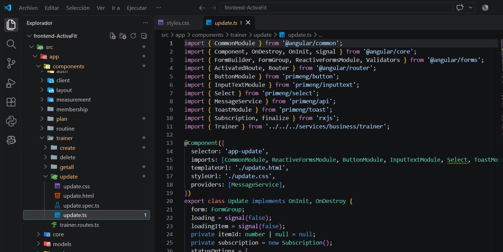

#### Paso 6. Levantar

```         
npm start
```


### Explicación

Es la misma estructura de Planes. Cambian tres cosas. Teléfono, email y especialidad son opcionales, y si quedan vacíos se mandan como `null`, porque el backend así los espera. El email se guarda en minúscula y no se puede repetir. Y el teléfono solo acepta números, entre 7 y 30 dígitos. Si el backend rechaza algo, el aviso rojo muestra el campo y el motivo.
