# ISS-00 · Requisitos previos

**Narrativa**

Antes de escribir una sola línea de Angular, quise comprobar que el equipo estaba listo y que entendía lo que la API me iba a entregar. En esta unidad no construí nada del frontend. Revisé que Node y Angular CLI fueran compatibles, que el backend de ActivaFit respondiera en el puerto 8000 y que el navegador pudiera hablar con él. También leí la forma de lo que devuelve la API, porque casi todos los errores raros de la primera pantalla vienen de ahí: de esperar una lista envuelta en un objeto cuando llega como arreglo, o de tratar como número un importe que llega como texto. Con eso claro, el proyecto de Angular lo creo en la unidad siguiente.

**Objetivo**

Dejar el equipo listo para construir el frontend de ActivaFit: Node y Angular CLI 22, un editor con terminal, el backend respondiendo y el contrato de la API entendido.

**Requisitos**

- Backend de ActivaFit terminado (ISS-00 al ISS-25).

### 0.1. Node.js, npm y compatibilidad con Angular CLI

#### Paso 1. Verificar el entorno de desarrollo

Se ingresó al directorio del proyecto `frontend-ActivaFit` y se ejecutaron los comandos `node --version` y `npm --version` para comprobar las versiones instaladas de Node.js y npm. Se obtuvo Node.js `v22.23.4` y npm `12.2.1`.

Posteriormente, se consultaron los requisitos de compatibilidad de Angular CLI mediante `npm view @angular/cli version engines --json`. La consulta mostró que la versión publicada `22.2.5` requiere Node.js `^22.22.3 || ^24.15.0 || >=26.0.0`, por lo que la versión de Node.js reportada en WSL cumple con el requisito.

Finalmente, se ejecutó `ng version` para verificar las versiones de Angular y sus dependencias. Se detectó una diferencia entre las versiones de Node.js y npm mostradas por WSL y las reportadas por Angular CLI, lo que podría indicar que se están utilizando entornos distintos entre Windows y WSL.

```         
node -version 
npm -version 
npm view @angular/cli version engines --json 
ng version
```

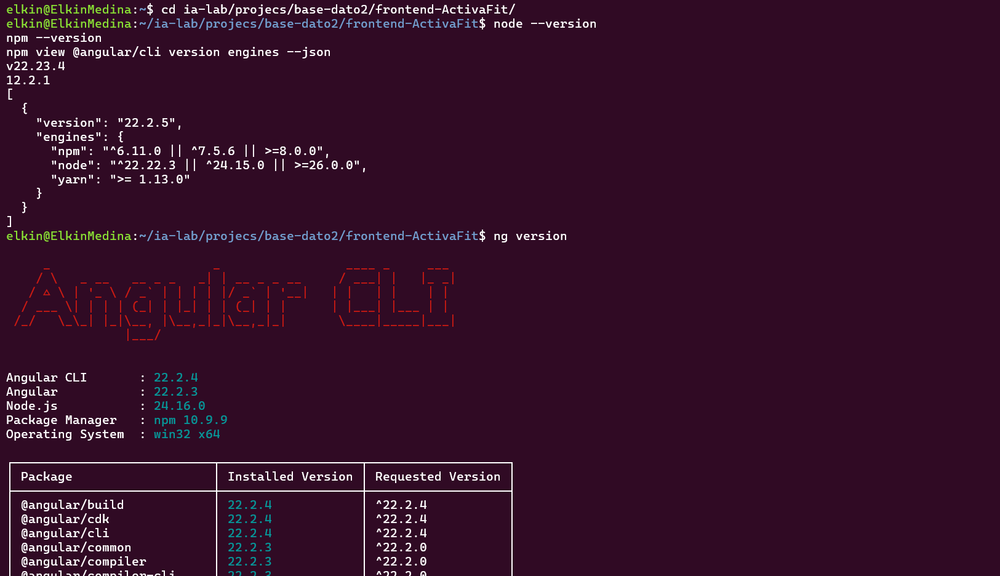

**Paso 1. Crear el proyecto**

Lo creé al lado del backend, en la misma carpeta del proyecto:

``` bash
cd ~/ia-lab/projecs/base-dato2
ng new frontend-ActivaFit
cd frontend-ActivaFit
npm start
```

.Abre la página en [`http://localhost:4200`](http://localhost:4200). La detuve con `Ctrl + C` para seguir con la instalación de Tailwind.

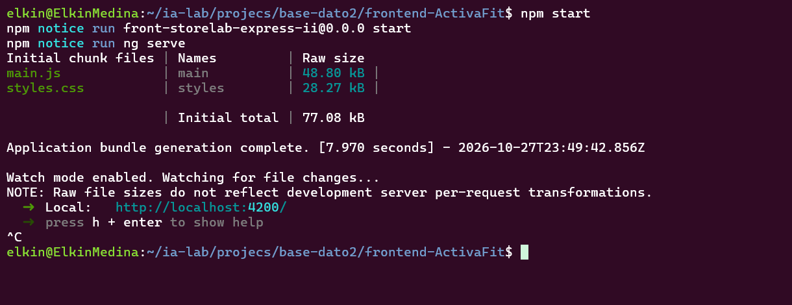

### 0.4 Backend Django y el interruptor `API_ACCESS`

**Criterios de este sub-ítem**

- [x] `python manage.py check` responde sin issues

- [x] `runserver` deja el puerto **8000** escuchando

- [x] `API_ACCESS` del `.env` está leído: `open` para esta comprobación de negocio

El frontend consume la API en [`http://localhost:8000/api`](http://localhost:8000/api). Backend de referencia:

```         
cd ~/ia-lab/projects/dw/pry-django 
source .venv/bin/activate 
python manage.py check 
python manage.py runserver 
```

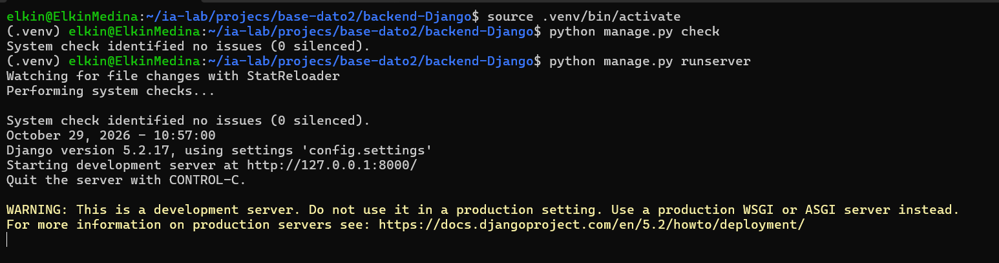

La salida de un arranque nuevo incluye `Starting development server at http://127.0.0.1:8000/`. Si el puerto ya está ocupado por otro `runserver` de este proyecto, se reutiliza esa instancia: un segundo proceso responde `That port is already in use`.

| **Puerto** | **Quién lo ocupa** | **Para qué** |
|:-----------------------|:-----------------------|:-----------------------|
| **8000** | `python manage.py runserver` | API Django (`/api/…`), admin y Swagger |
| **4200** | `npm start` | Aplicación Angular en el navegador |
| **5432** | contenedor `mysql-server` | Motor cuando `DB_ENGINE=mysql` |

Login, refresh, logout, el esquema y Swagger permanecen abiertos en los dos modos. Perfil y permisos propios exigen JWT. Con `rbac`, el CRUD de negocio y el de administración exigen JWT y concesión.

```         
curl -i http://127.0.0.1:8000/api/clients/
```

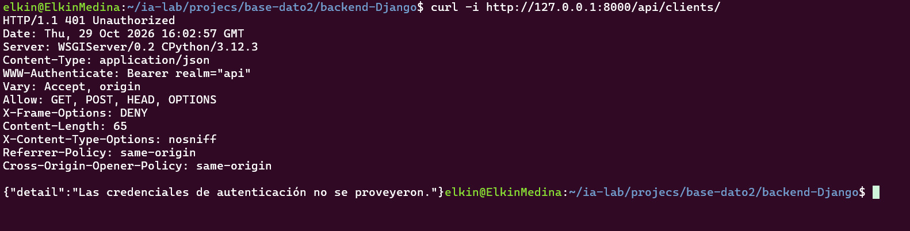

### 0.5 Puertos y CORS

Angular se sirve en el 4200 y la API en el 8000: son orígenes distintos. Mi backend ya permite CORS desde el ISS-07, así que Angular no necesita proxy. Lo compruebo enviando un origen:

``` bash
curl -s -i -H "Origin: http://localhost:4200" http://127.0.0.1:8000/api/schema/swagger-ui/ | grep -i access-control
```

Debe aparecer `access-control-allow-origin: *`. Todas las rutas de la API terminan en `/`.

### 0.6 Comprobar el contrato con `curl`

Como el negocio exige token, primero hago login con mi administrador y guardo el `access` en una variable. Cambio `TU_CLAVE` por la contraseña real. La variable solo existe en esa terminal.

``` bash
TOKEN=$(curl -s -X POST http://127.0.0.1:8000/api/auth/login/ -H "Content-Type: application/json" -d '{"username":"admin","password":"TU_CLAVE"}' | python3 -c 'import json,sys; print(json.load(sys.stdin)["access"])')
```

Y reviso los códigos de cuatro rutas:

``` bash
curl -s -o /dev/null -w "clientes sin token   %{http_code}\n" http://127.0.0.1:8000/api/clients/
curl -s -o /dev/null -w "clientes con token   %{http_code}\n" http://127.0.0.1:8000/api/clients/ -H "Authorization: Bearer $TOKEN"
curl -s -o /dev/null -w "swagger              %{http_code}\n" http://127.0.0.1:8000/api/schema/swagger-ui/
curl -s -o /dev/null -w "membresias vigentes  %{http_code}\n" http://127.0.0.1:8000/api/memberships/active/ -H "Authorization: Bearer $TOKEN"
```

Deben dar `401`, `200`, `200` y `200`. Un `403` con token significa que falta ejecutar `seed_rbac` con mi usuario. Después miro la forma del cuerpo:

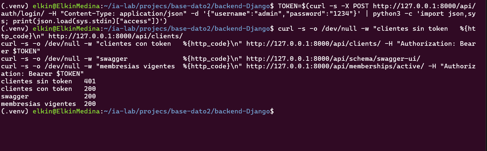

```         
curl -s http://127.0.0.1:8000/api/clients/ -H "Authorization: Bearer $TOKEN" | head -c 400; echo
```

La respuesta empieza por `[`: es un arreglo plano. Si no hay clientes, sale `[]`, que es válido y no significa que la ruta esté mal.

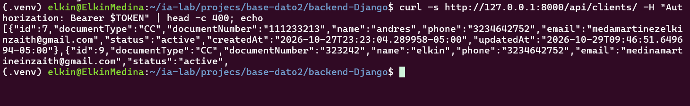

### 0.7 Arreglo plano e importes como texto

Las listas de ActivaFit llegan como arreglo plano, sin paginación, y los importes llegan como texto. Eso define cómo tipo los datos en Angular:

| Dato | Forma en el JSON | Consecuencia en el código |
|------------------------|------------------------|------------------------|
| Lista | `[ ... ]` | `http.get<Client[]>()`: el cuerpo es la lista |
| Importe | `"50000.00"` | Campo `string`; `Number(...)` solo para calcular |
| Fecha | `2026-10-11T22:43:00-05:00` | Se envía en formato ISO-8601 |
| Identificador | entero (`6`) | `id: number`; las claves foráneas también son enteros |
| Campos | `camelCase` (`documentNumber`) | El nombre del campo del formulario es el del JSON |

En mi API los importes son `amount` en los pagos, y `weight`, `height`, `bodyFat` y `bmi` en las medidas. Todos llegan entre comillas.

### 0.8 Login, perfil y permisos

El login devuelve solo el par de tokens, y el perfil y los permisos se piden aparte, con el token. Hago las tres comprobaciones con el `$TOKEN` del administrador:

``` bash
curl -s -X POST http://127.0.0.1:8000/api/auth/login/ -H "Content-Type: application/json" -d '{"username":"admin","password":"TU_CLAVE"}'
curl -s http://127.0.0.1:8000/api/auth/profile/ -H "Authorization: Bearer $TOKEN"
curl -s http://127.0.0.1:8000/api/auth/permissions/ -H "Authorization: Bearer $TOKEN"
```

El login debe traer `access`, `refresh`, `tokenType` y `accessExpiresIn`. El perfil de mi backend trae `id`, `username`, `email`, `firstName`, `lastName` y `status`; no trae `avatar` ni fechas, que sí aparecen en el de la guía. Los permisos llegan como una lista `permissions` con una fila por permiso efectivo, en el formato que usará el frontend:

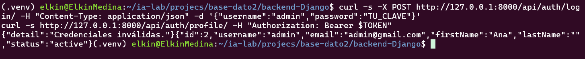

Para el administrador, con la semilla ya ejecutada, salen 83 filas, todas con el rol `admin`. Las cuento así:

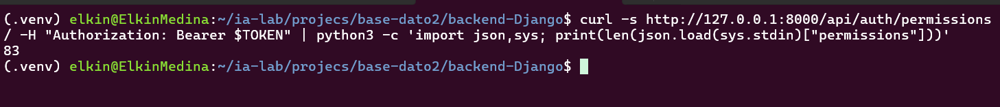

### 0.9 Credenciales de laboratorio

Mi administrador es `admin`, el que ya tiene el rol `admin` con todas las rutas concedidas. Dejo comprobado que la semilla es idempotente, ejecutándola dos veces:

``` bash
python manage.py seed_rbac --username admin 
python manage.py seed_rbac --username admin
```

La segunda vez debe mostrar `Recursos nuevos: 0. Permisos nuevos: 0.` La guía también crea un segundo usuario, `seller`, con solo lecturas, para probar los permisos en la interfaz. Ese usuario lo necesito en el ISS-09 (guards y RBAC), así que lo creo cuando lleguemos ahí.

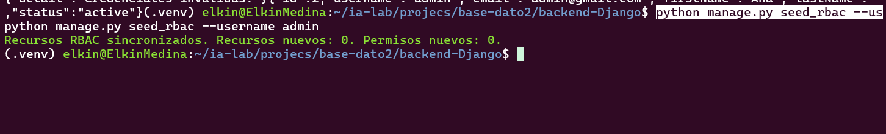

## ISS-01 · Bootstrap Angular 22 con CLI

Con el entorno comprobado, esta unidad creó el frontend de ActivaFit desde cero. Seguí el orden de la guía: primero el proyecto con el CLI de Angular, luego Tailwind para los estilos y al final PrimeNG con el tema Aura para los componentes ya hechos. Cuando todo estuvo instalado, dejé una pantalla mínima que sirve para entender cómo arranca una aplicación de Angular y cómo reacciona la vista cuando cambia un dato. Esa pantalla es un componente de ejemplo con un objeto local, sin llamadas a la API, que me enseñó los tres tipos de signals. En esta unidad todavía no hay login, ni menú, ni conexión con el backend.

**1.2 Tailwind 4 con PostCSS**

```         
npm install tailwindcss @tailwindcss/postcss postcss
```

Después creé el archivo `.postcssrc.json` en la raíz, al lado de `package.json`:

``` json
{
  "plugins": {
    "@tailwindcss/postcss": {}
  }
}
```

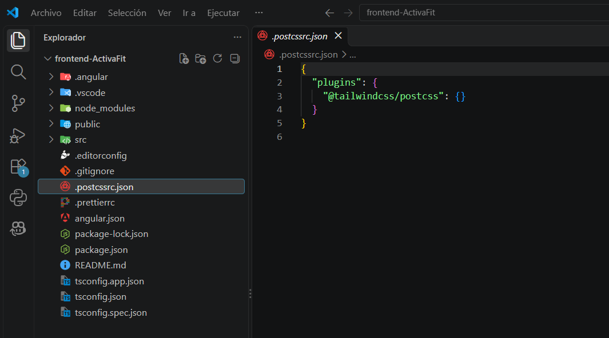

**1.3 Estilos globales**

Reemplacé el contenido de `src/styles.css`, que es la única hoja global del proyecto. La primera línea fija el orden de las capas, y `utilities` queda al final para que las clases de Tailwind ganen sobre las de PrimeNG:

``` css
@layer theme, base, primeng, utilities;

@import 'tailwindcss';
@import 'primeicons/primeicons.css';
```

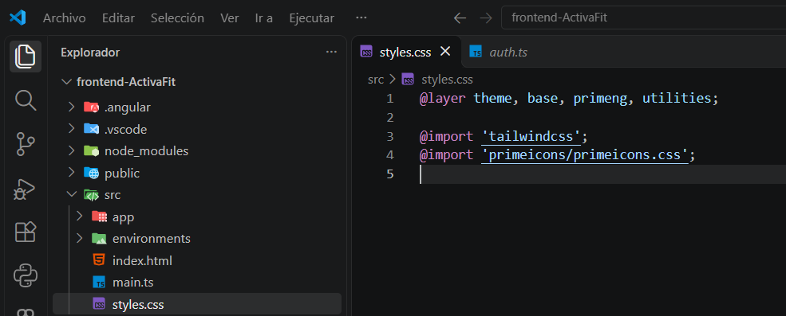

**1.4 PrimeNG 22 con Aura**

``` bash
npm install primeng @primeuix/themes primeicons @angular/cdk
```

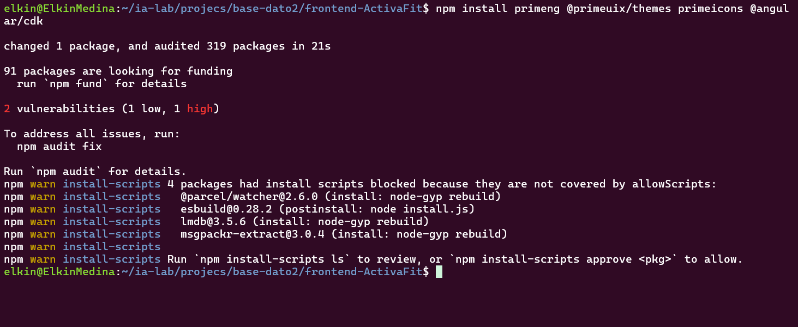

`@angular/cdk` es una dependencia que PrimeNG 22 necesita. Después reemplacé `src/app/app.config.ts`. Registra el tema Aura, el modo oscuro por selector, las capas de CSS en el mismo orden que `styles.css`, y los servicios de avisos y de confirmación que usaré más adelante. No agrego `provideHttpClient()` todavía: llega en el ISS-02. Si el archivo que generó el CLI trae algún proveedor adicional, lo conservo.

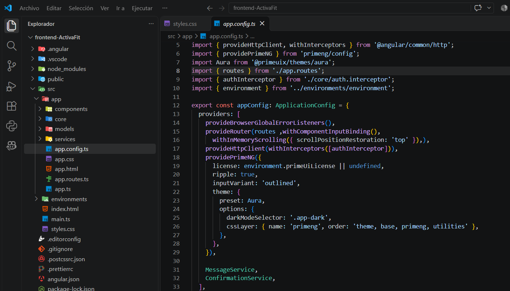

**1.5 La pantalla de arranque**

`src/app/app.routes.ts` se queda como lo generó el CLI, con la lista de rutas vacía. Creé el componente de ejemplo con el CLI:

```         
npx ng g c demo/ejemplo
```

Esto crea `ejemplo.ts`, `ejemplo.html`, `ejemplo.css` y `ejemplo.spec.ts` dentro de `src/app/demo/ejemplo/`. Reemplacé `ejemplo.ts`. El objeto vive en un `signal`; el precio con IVA y el texto del estado son `computed`; y un `effect` escribe en la consola cada vez que el objeto cambia. Para modificar el objeto siempre creo uno nuevo, no lo muto.

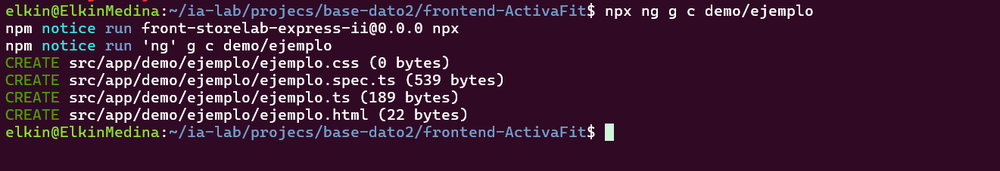

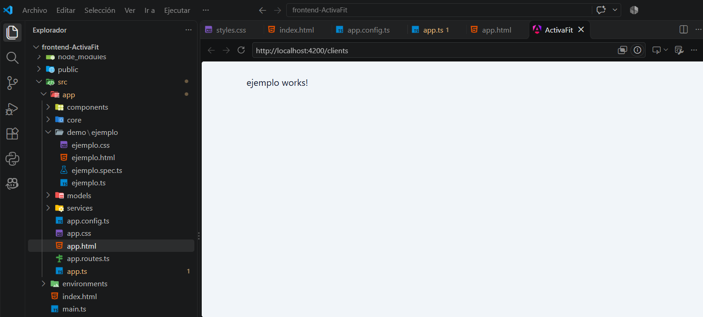

``` javascript
import { Component, computed, effect, signal } from '@angular/core';
import { ButtonModule } from 'primeng/button';
import { CardModule } from 'primeng/card';
import { TagModule } from 'primeng/tag';

interface Producto {
  nombre: string;
  precio: number;
  activo: boolean;
}

const INICIAL: Producto = { nombre: 'Plan mensual', precio: 80000, activo: true };

@Component({
  selector: 'app-ejemplo',
  imports: [ButtonModule, CardModule, TagModule],
  host: { class: 'block' },
  templateUrl: './ejemplo.html',
  styleUrl: './ejemplo.css',
})
export class Ejemplo {
  readonly producto = signal<Producto>({ ...INICIAL });
  readonly precioFinal = computed(() => Math.round(this.producto().precio * 1.19));
  readonly estadoTexto = computed(() => (this.producto().activo ? 'Activo' : 'Inactivo'));

  constructor() {
    effect(() => {
      const actual = this.producto();
      console.log(
        `[ejemplo] ${actual.nombre} · ${actual.precio} · ${actual.activo ? 'activo' : 'inactivo'}`,
      );
    });
  }

  variarPrecio(delta: number): void {
    this.producto.update((actual) => ({ ...actual, precio: actual.precio + delta }));
  }

  cambiarEstado(): void {
    this.producto.update((actual) => ({ ...actual, activo: !actual.activo }));
  }

  cambiarNombre(event: Event): void {
    const nombre = (event.target as HTMLInputElement).value;
    this.producto.update((actual) => ({ ...actual, nombre }));
  }

  reiniciar(): void {
    this.producto.set({ ...INICIAL });
  }
}
```

Reemplacé `ejemplo.html`:

``` html
<p-card header="Objeto plan" subheader="Estado local con signals">
  <div class="space-y-4">
    <div class="flex items-center justify-between">
      <span class="text-lg font-semibold">{{ producto().nombre }}</span>
      <p-tag [value]="estadoTexto()" [severity]="producto().activo ? 'success' : 'danger'" />
    </div>

    <dl class="grid grid-cols-2 gap-2 text-sm">
      <dt class="text-slate-500">Precio</dt>
      <dd>{{ producto().precio }}</dd>
      <dt class="text-slate-500">Precio con IVA (19 %)</dt>
      <dd>{{ precioFinal() }}</dd>
    </dl>

    <label class="block text-sm">
      Nombre
      <input
        type="text"
        class="mt-1 w-full rounded border border-slate-300 p-2"
        [value]="producto().nombre"
        (input)="cambiarNombre($event)"
      />
    </label>
    <p class="text-sm text-slate-500">Vista previa: {{ producto().nombre }}</p>

    @if (producto().activo) {
      <p class="text-sm text-emerald-700">
        Plan activo: así lo devolvería GET /api/plans/ con el filtro de estado.
      </p>
    } @else {
      <p class="text-sm text-amber-700">
        Plan inactivo: es el borrado lógico, la fila sigue en la tabla.
      </p>
    }

    <div class="flex flex-wrap gap-2">
      <p-button label="+1000" (onClick)="variarPrecio(1000)" />
      <p-button label="Cambiar estado" severity="secondary" (onClick)="cambiarEstado()" />
      <p-button label="Reiniciar" severity="contrast" [outlined]="true" (onClick)="reiniciar()" />
    </div>

    <div class="ejemplo-alcance rounded p-2 text-sm">Esta caja usa CSS encapsulado.</div>
  </div>
</p-card>
```

Y `ejemplo.css`, que es la única excepción de CSS propio y sirve para ver el encapsulamiento:

``` css
.ejemplo-alcance {
  border: 1px dashed #64748b;
}
```

Después reemplacé los tres archivos del componente raíz. `app.ts` importa el ejemplo:

``` typescript
import { Component } from '@angular/core';
import { Ejemplo } from './demo/ejemplo/ejemplo';

@Component({
  selector: 'app-root',
  imports: [Ejemplo],
  templateUrl: './app.html',
  styleUrl: './app.css',
})
export class App {}
```

`app.html` solo pone la etiqueta:

``` html
<main class="mx-auto max-w-3xl p-6">
  <app-ejemplo />
</main>
```

**1.6 `index.html`**

Reemplacé `src/index.html`. Pone el idioma en español, el título del frontend y las utilidades de Tailwind en el `<body>`:

``` html
<!doctype html>
<html lang="es">
<head>
  <meta charset="utf-8">
  <title>ActivaFit · Angular 22</title>
  <base href="/">
  <meta name="viewport" content="width=device-width, initial-scale=1">
  <meta name="description" content="Frontend de ActivaFit, sistema de gestión de gimnasio.">
  <link rel="icon" type="image/x-icon" href="favicon.ico">
</head>
<body class="m-0 bg-slate-100 font-sans text-slate-900">
  <app-root></app-root>
</body>
</html>
```

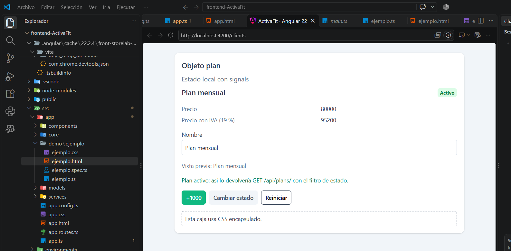

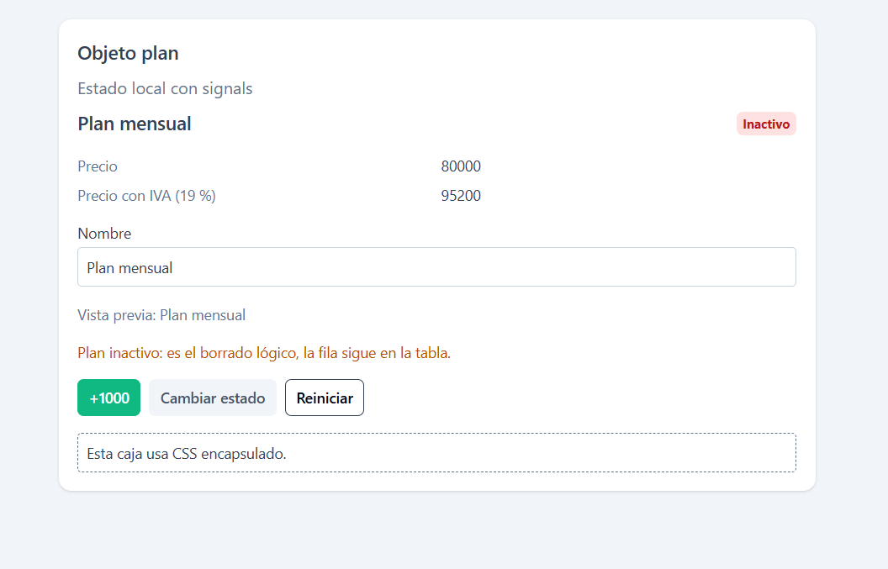

**1.7 Presupuesto de build**

En `angular.json` busqué la sección `budgets` y cambié el límite del tipo `initial`. El CLI lo deja con aviso a 500 kB, y PrimeNG lo supera, así que lo subí a 750 kB. El error sigue en 1 MB. Los demás presupuestos los dejé como estaban:

```         
{
  "type": "initial",
  "maximumWarning": "750kB",
  "maximumError": "1MB"
}
```

**1.8 Primera ejecución**

```         
npm start
```

Abrí [`http://localhost:4200`](http://localhost:4200). Luego, en otra terminal, comprobé el build, las pruebas y la respuesta del servidor:

```         
ng build
npm ls primeng @primeuix/themes primeicons @angular/cdk tailwindcss --depth=0
curl -s -o /dev/null -w "%{http_code}\n" http://127.0.0.1:4200/
```

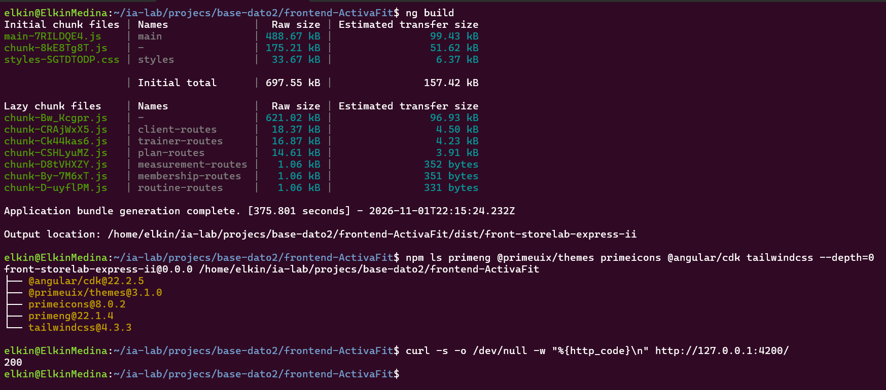

Las comprobaciones automáticas:

```         
ng build                      termina con código 0
npm ls primeng @primeuix/themes primeicons @angular/cdk tailwindcss --depth=0
curl a localhost:4200         200
```

**Paso 3. Probar que Tailwind funciona**

Reemplacé el contenido de `src/app/app.html` por esto:

``` html
  <h1>ActivaFit</h1>
  
  <router-outlet />
```

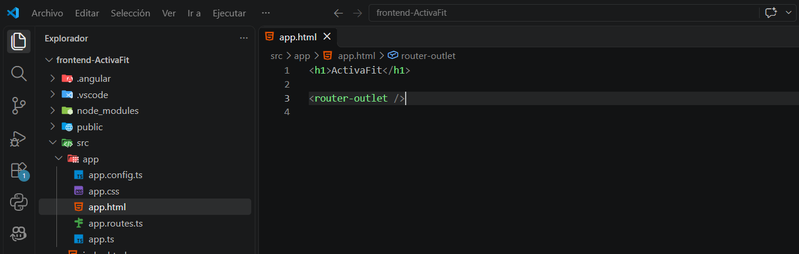

Levanté el servidor con `npm start`. Si el título se ve en texto simple, sin el tamaño grande ni el estilo de un título normal, y con la fuente sin serifas, Tailwind está funcionando.

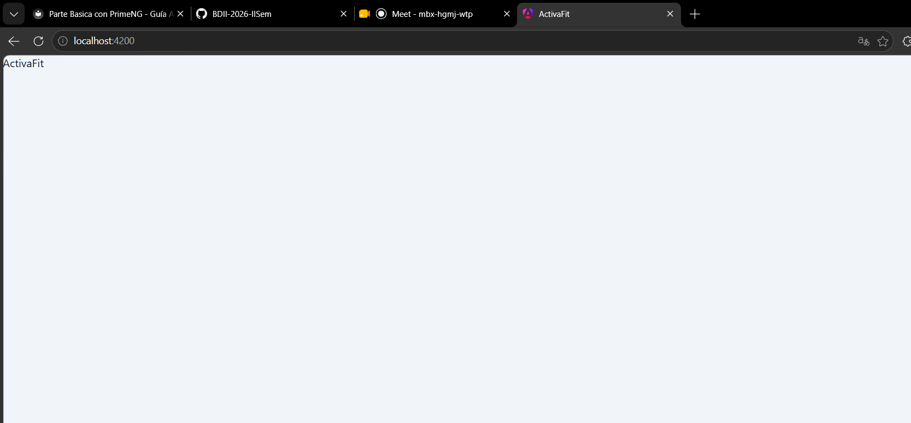

### ISS-01A (Frontend) — Esqueleto Header / Aside / contenido / Footer

**Narrativa**

En el ISS-01 la pantalla era solo un componente de ejemplo. En esta unidad construí la estructura de la aplicación: un encabezado arriba, una columna lateral a la izquierda, el contenido en el centro y un pie de página abajo, a todo el ancho. Prefiero armar primero la pantalla con datos fijos y dejar para después el menú y las llamadas a la API, porque así veo cómo se reparte el espacio sin que nada más interfiera. El encabezado, el aside y el pie son tres componentes de presentación pura: no consultan servicios ni la API, y no saben nada de permisos. Todo se compone en `App`, y para entender cómo aparece cada pieza me quedé con la idea central de esta unidad: un componente solo se ve si el padre lo importa y escribe su etiqueta.

**Objetivo**

Construir la pantalla con Header, Aside, contenido y Footer, con datos fijos y sin llamadas a la API.

**Requisitos**

- ISS-01 del frontend superado.

- `ng s` funcionando en [`http://localhost:4200`](http://localhost:4200).

#### Construcción

**1.1 Qué es un componente y por qué el padre debe importarlo**

Un componente reúne una clase, una plantilla y un archivo de estilos. Los campos que lo definen son estos:

| Campo | Qué responde | Ejemplo en esta unidad |
|------------------------|------------------------|------------------------|
| `selector` | con qué etiqueta se usa en otra plantilla | `app-header` → `<app-header />` |
| `imports` | qué usa su propia plantilla | `[]` en el Header |
| `templateUrl` | dónde está el HTML | `./header.html` |
| `styleUrl` | dónde están los estilos privados | `./header.css` |
| `host` | qué clases lleva el elemento anfitrión | `host: { class: 'block' }` |

Un componente generado existe en el disco, pero no se ve hasta que `App` lo declara en `imports` y escribe su etiqueta. Son dos pasos.

**1.2 Generar las tres piezas de `layout/`**

```         
ng generate component layout/header --skip-tests --defaults
ng generate component layout/aside --skip-tests --defaults
ng generate component layout/footer --skip-tests --defaults
```

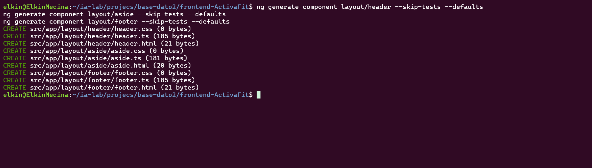

Cada comando crea una carpeta en `src/app/layout/` con su `.ts`, su `.html` y su `.css`. Uso `--skip-tests` porque la pantalla la compruebo desde `app.spec.ts`.

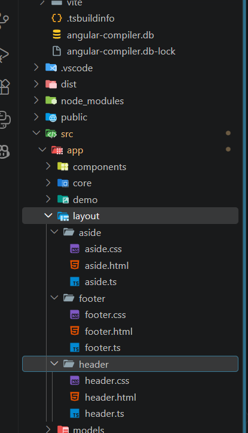

**1.3 Contenido de cada componente**

El Header guarda el título en una propiedad y lo muestra con `{{ title }}`. Reemplacé `src/app/layout/header/header.ts`:

``` javascript
import { Component } from '@angular/core';

@Component({
  selector: 'app-header',
  imports: [],
  host: { class: 'block' },
  templateUrl: './header.html',
  styleUrl: './header.css',
})
export class Header {
  readonly title = 'ActivaFit';
}
```

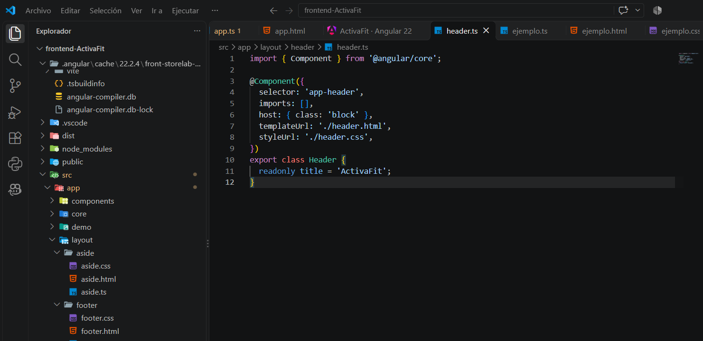

Y `header.html`. `h-16` fija la barra en 64 px, `border-b` la separa del resto y `truncate` evita que un texto largo la rompa:

``` html
<header class="flex h-16 items-center border-b border-slate-200 bg-white px-6">
  <h1 class="truncate text-lg font-semibold text-slate-900">{{ title }}</h1>
</header>
```

El Aside es una navegación oscura con un texto fijo. El ancho no se decide aquí, sino en `App`. Reemplacé `src/app/layout/aside/aside.ts`:

``` javascript
import { Component } from '@angular/core';

@Component({
  selector: 'app-aside',
  imports: [],
  host: { class: 'block h-full' },
  templateUrl: './aside.html',
  styleUrl: './aside.css',
})
export class Aside {}
```

Y `aside.html`:

``` html
<nav aria-label="Navegación principal" class="h-full bg-slate-900 p-4 text-slate-100">
  <p class="text-sm font-semibold">Menú de ActivaFit</p>
  <p class="mt-2 text-xs text-slate-400">
    En el siguiente ISS este bloque pasa a ser un menú de PrimeNG.
  </p>
</nav>
```

El Footer, igual. `src/app/layout/footer/footer.ts`:

``` javascript
import { Component } from '@angular/core';

@Component({
  selector: 'app-footer',
  imports: [],
  host: { class: 'block' },
  templateUrl: './footer.html',
  styleUrl: './footer.css',
})
export class Footer {}
```

Y `footer.html`:

``` html
<footer
  class="flex h-16 items-center justify-center border-t border-slate-200 bg-white px-6 text-sm text-slate-500"
>
  ActivaFit · Gestión de clientes, membresías y asistencias
</footer>
```

Los tres archivos `.css` (`header.css`, `aside.css` y `footer.css`) los dejé con un solo comentario, porque el aspecto lo resuelve Tailwind y no necesito reglas propias:

```         
/* Sin estilos propios: el aspecto se resuelve con Tailwind. */
```

**1.4 Componer las cuatro regiones en `App`**

Reemplacé `src/app/app.ts`. Ahora importa los tres componentes del layout y ya no importa `Ejemplo`:

``` javascript
import { Component } from '@angular/core';
import { Aside } from './layout/aside/aside';
import { Footer } from './layout/footer/footer';
import { Header } from './layout/header/header';

@Component({
  selector: 'app-root',
  imports: [Header, Aside, Footer],
  templateUrl: './app.html',
  styleUrl: './app.css',
})
export class App {
  protected readonly title = 'Inicio';
}
```

Y `src/app/app.html`. Apila Header, zona central y Footer con `flex min-h-screen flex-col`. El Aside mide 16 rem (`w-64`) y no se encoge (`shrink-0`). El contenido lleva `min-w-0` para poder reducirse sin crear scroll horizontal, y `flex-1` en la zona central empuja el Footer al borde inferior cuando hay poco contenido:

``` html
<div class="flex min-h-screen flex-col">
  <app-header />

  <div class="flex flex-1">
    <aside class="w-64 shrink-0">
      <app-aside />
    </aside>

    <main id="contenido" class="min-w-0 flex-1 p-6">
      <h2 class="text-2xl font-semibold">{{ title }}</h2>
      <p class="mt-2 text-slate-600">Bienvenido a ActivaFit.</p>
    </main>
  </div>

  <app-footer />
</div>
```

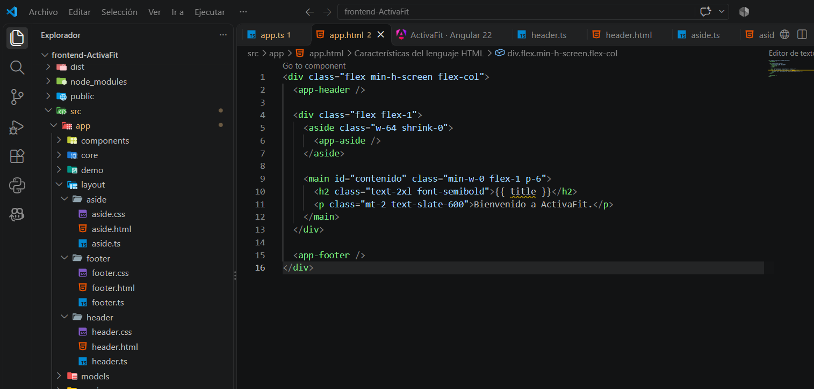

`app.css` sigue vacío y `app.routes.ts` sigue con la lista de rutas vacía: cualquier URL muestra esta misma composición. `RouterOutlet` llega en el ISS-01B. El componente `demo/ejemplo` y su prueba siguen en el proyecto como material de consulta, pero ya no se ven.

**1.5 Comprobar antes de avanzar**

```         
ng s
```

Abrí [`http://localhost:4200`](http://localhost:4200) y revisé las cuatro regiones, el pie en el borde inferior y la pestaña **Network** de las herramientas del navegador.

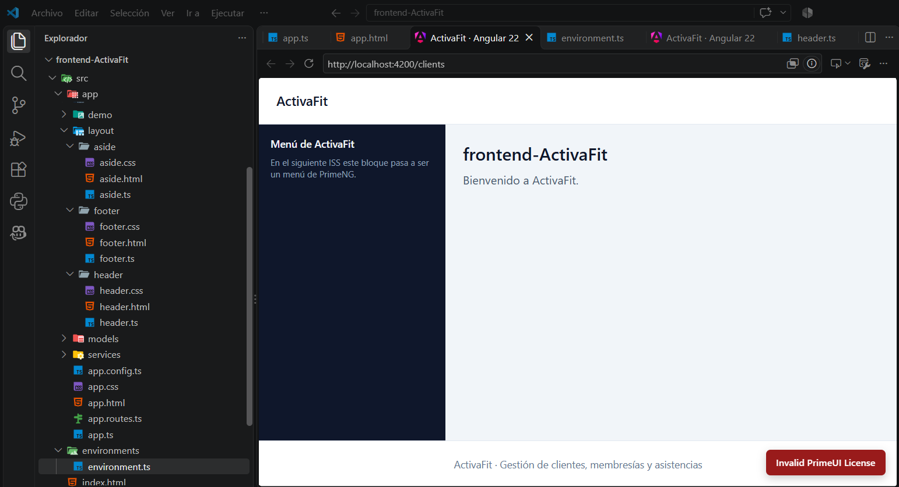

#### Explicación

Un componente generado con el CLI queda en el disco, pero Angular no lo conoce todavía en ninguna pantalla. Para que aparezca hacen falta dos pasos en el componente padre: ponerlo en la lista `imports` y escribir su `selector` como etiqueta en la plantilla. Por eso `App` importa `Header`, `Aside` y `Footer`, y su plantilla usa `<app-header />`, `<app-aside />` y `<app-footer />`. Si me falta cualquiera de los dos pasos, el componente existe pero no se ve, o Angular marca un error de elemento desconocido.

Los tres componentes de layout son de presentación pura: muestran lo que tienen y nada más. No inyectan servicios, no llaman a la API y no conocen permisos. Eso los deja listos para recibir datos del padre en la unidad siguiente.

La distribución depende de pocas clases de Tailwind. `flex min-h-screen flex-col` apila las tres franjas a pantalla completa. `w-64 shrink-0` fija el Aside en 16 rem y evita que se encoja. `min-w-0` deja que el contenido se reduzca sin crear scroll horizontal. Y `flex-1` en la zona central hace que el Footer quede abajo aunque haya poco contenido. El tamaño del build baja respecto al ISS-01 porque `App` ya no importa el componente de ejemplo.

#### Cómo probarlo

No hay una prueba automática principal: se comprueba mirando el navegador. Con `ng s` corriendo, abre [`http://localhost:4200`](http://localhost:4200) y revisa esto:

```         
Header      barra blanca de 64 px de alto con "ActivaFit"
Aside       columna oscura a la izquierda con "Menú de ActivaFit"
Contenido   "Inicio" y "Bienvenido a ActivaFit."
Footer      franja inferior a todo el ancho
```

Después comprueba tres cosas más:

- **El Footer baja solo.** Con poco contenido debe quedar pegado al borde inferior de la ventana.

- **No hay scroll horizontal.** Abre las herramientas del navegador (`F12`), activa la vista móvil y fija el ancho en 390 px. El Aside se mantiene en 256 px y es el contenido el que se reduce, sin desbordar.

- **No hay llamadas a la API.** En la pestaña **Network**, no debe aparecer ninguna petición que contenga `/api`.

Las comprobaciones automáticas:

```         
ng build
ls src/app/layout/header src/app/layout/aside src/app/layout/footer
grep -c '[{}]' src/app/layout/*/*.css
grep -c 'app-ejemplo' src/app/app.html || echo 'no aparece: correcto'
```

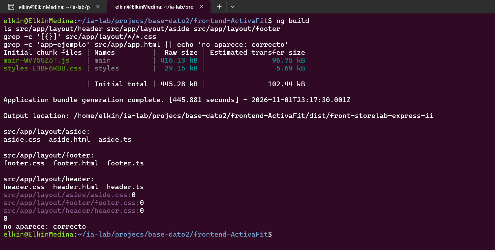

El build debe terminar con código 0. El `ls` debe mostrar los tres archivos de cada carpeta. El `grep` de las llaves debe dar `0` en cada `.css`, porque no tienen reglas. Y el último comando debe imprimir `no aparece: correcto`. Según la guía, puede seguir apareciendo la banda **Invalid PrimeUI License**: es un aviso de licencia de PrimeNG y no un error de compilación.

### ISS-01B (Frontend) — Menú PrimeNG y primera interacción

**Narrativa**

Hasta ahora la pantalla era una maqueta con texto fijo. En esta unidad la hice responder. El menú lateral pasó a ser un menú desplegable de PrimeNG que recibe sus opciones desde afuera, el encabezado ganó un botón de menú, y en pantallas pequeñas el menú aparece en un panel que se desliza desde la izquierda. Lo más importante que aprendí es cómo se reparten los datos entre componentes: lo que el padre entrega al hijo entra por `input()`, lo que el hijo avisa al padre sale por `output()`, y el estado propio de una pantalla vive en un `signal`. El encabezado, el menú y el pie siguen siendo de presentación pura; el único componente con estado es la pantalla `Construir`. También presenté el enrutador: `App` quedó como un punto de entrada con un `<router-outlet />`, y la pantalla se carga por su dirección. Todavía no hay llamadas a la API.

**Objetivo**

Pasar de la maqueta a una pantalla que responde: menú de PrimeNG, botón en el encabezado, Drawer en móvil y selección que cambia el título, sin rutas de negocio ni API.

**Requisitos**

- ISS-01A del frontend superado.

- `ng s` o `npm start` funcionando.

#### Construcción

**1.1 Los conceptos que se agregan**

| Concepto | Qué resuelve | Dónde se ve en esta unidad |
|------------------------|------------------------|------------------------|
| `input()` | dato que el padre entrega al hijo; el hijo no lo modifica | `items` en el Aside, `appName` en el Header |
| `output()` | aviso del hijo al padre | `menuRequested`, `navigated` |
| `signal()` | estado propio de un componente | `title`, `mobileOpen` en `Construir` |
| `[propiedad]` | enlace de la clase a la plantilla | `[model]="items()"` en el menú |
| `(evento)` | acción al recibir un aviso | `(menuRequested)="onMenuToggle()"` |
| `[(visible)]` | ida y vuelta: el Drawer abre y también actualiza el estado al cerrarse | `[(visible)]="mobileOpen"` |
| `MenuItem[]` | forma tipada del menú de PrimeNG: `label`, `icon`, `command` | `items` en `Construir` |

**1.2 El Aside recibe el menú con `input()`**

Primero creé el logo. La guía usa el de StoreLab; yo hice uno sencillo para ActivaFit. Creé la carpeta y el archivo:

```         
mkdir -p public/brand
```

`public/brand/activafit-mark.svg`:

``` css
<svg xmlns="http://www.w3.org/2000/svg" viewBox="0 0 64 64" width="64" height="64">
  <rect width="64" height="64" rx="14" fill="#2563eb"/>
  <path d="M36 10 18 36h12l-4 18 20-28H34z" fill="#ffffff"/>
</svg>
```

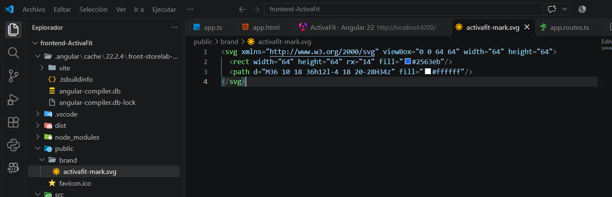

Después reemplacé `src/app/layout/aside/aside.ts`. Es presentación pura: recibe el menú ya construido y avisa de la navegación, sin conocer rutas, permisos ni la API. El bloque de sesión existe pero no se muestra todavía; se completa más adelante.

``` javascript
import { Component, input, output } from '@angular/core';
import { MenuItem } from 'primeng/api';
import { ButtonModule } from 'primeng/button';
import { PanelMenuModule } from 'primeng/panelmenu';

/**
 * Menú lateral de la aplicación.
 *
 * Presentación pura: recibe el menú ya construido por `input()` y avisa de la
 * navegación con `output()`. No conoce rutas, permisos ni la API.
 */
@Component({
  host: { class: 'block h-full' },
  selector: 'app-aside',
  imports: [ButtonModule, PanelMenuModule],
  templateUrl: './aside.html',
  styleUrl: './aside.css',
})
export class Aside {
  readonly appName = input('ActivaFit');

  /** Opciones del menú, en el formato `MenuItem` de PrimeNG. */
  readonly items = input<MenuItem[]>([]);

  /** Datos de sesión con valores por defecto: se completan en la fase de autenticación. */
  readonly showSession = input(false);
  readonly username = input('');
  readonly roleLabel = input('Sin rol');
  readonly permissionCount = input(0);

  /** Aviso al padre: se seleccionó una opción (lo usa el Drawer en móvil). */
  readonly navigated = output<void>();

  /** Aviso al padre: se pidió cerrar sesión. */
  readonly logoutRequested = output<void>();

  /**
   * Un clic dentro del menú puede caer en el propio ítem o en un hijo suyo.
   * `closest` resuelve ambos casos con un solo listener en el `<nav>`.
   */
  onNavigationClick(event: Event): void {
    if ((event.target as HTMLElement).closest('a, button, [role="button"]')) {
      this.navigated.emit();
    }
  }
}
```

Y `aside.html`. Lee el menú con `items()`, con paréntesis, porque es un signal:

``` html
<div class="flex h-full flex-col border-r border-slate-200 bg-white text-slate-900">
  <div class="flex h-16 items-center gap-3 border-b border-slate-200 px-5">
    
    <div class="min-w-0">
      <p class="truncate text-sm font-semibold text-slate-900">{{ appName() }}</p>
      <p class="text-[11px] uppercase tracking-wider text-slate-400">
        Panel administrativo
      </p>
    </div>
  </div>

  <div class="flex-1 overflow-y-auto p-3">
    <nav aria-label="Navegación principal" (click)="onNavigationClick($event)">
      <p-panelmenu [model]="items()" [multiple]="true" />
    </nav>
  </div>

  @if (showSession()) {
    <div class="border-t border-slate-200 p-4">
      <p class="text-sm font-medium text-slate-900">{{ username() || 'Invitado' }}</p>
      <p class="text-xs text-slate-400">{{ roleLabel() }}</p>
      <div class="mt-3 flex items-center justify-between text-xs text-slate-400">
        <span>{{ permissionCount() }} permisos</span>
        <button
          pButton
          type="button"
          text
          rounded
          aria-label="Cerrar sesión"
          (click)="logoutRequested.emit()"
        >
          <i pButtonIcon class="pi pi-sign-out"></i>
        </button>
      </div>
    </div>
  }
</div>
```

`aside.css` queda con su comentario, sin reglas.

**1.3 El Header avisa al padre con `output()`**

Reemplacé `src/app/layout/header/header.ts`:

``` javascript
import { Component, input, output } from '@angular/core';
import { MenuItem } from 'primeng/api';
import { AvatarModule } from 'primeng/avatar';
import { ButtonModule } from 'primeng/button';
import { MenuModule } from 'primeng/menu';
import { TagModule } from 'primeng/tag';

/**
 * Barra superior de la aplicación.
 *
 * Es presentación pura: recibe los datos por `input()` y avisa al padre con
 * `output()`. No inyecta servicios, no consulta la API y no conoce permisos.
 */
@Component({
  host: { class: 'block' },
  selector: 'app-header',
  imports: [AvatarModule, ButtonModule, MenuModule, TagModule],
  templateUrl: './header.html',
  styleUrl: './header.css',
})
export class Header {
  /** Nombre visible de la aplicación. */
  readonly appName = input('ActivaFit');

  /** Datos de sesión con valores por defecto: se completan en la fase de autenticación. */
  readonly username = input('');
  readonly initials = input('IN');
  readonly roleLabel = input('Sin rol');
  readonly authEnabled = input(true);
  readonly showSession = input(false);
  readonly userItems = input<MenuItem[]>([]);

  /** Aviso al padre: el botón de menú se pulsó. El padre decide aside fijo o Drawer. */
  readonly menuRequested = output<void>();
}
```

Y `header.html`. El botón de menú se ve siempre. Antes de la corrección de la guía llevaba `lg:hidden` y desaparecía justo donde el Aside fijo ya es visible; ahora lo que cambia según el ancho es lo que hace, no si se ve.

``` html
<header
  class="sticky top-0 z-30 flex h-16 items-center gap-3 border-b border-slate-200 bg-white px-4 sm:px-6"
>
  <!-- Botón de menú: siempre visible; el padre decide qué hacer (aside fijo o Drawer). -->
  <button
    pButton
    type="button"
    text
    rounded
    aria-label="Mostrar u ocultar el menú"
    (click)="menuRequested.emit()"
  >
    <i pButtonIcon class="pi pi-bars"></i>
  </button>

  <div class="min-w-0 flex-1">
    <p class="truncate text-sm font-semibold text-slate-900">{{ appName() }}</p>
    <p class="truncate text-xs text-slate-500">
      Gestión de clientes, membresías y asistencias
    </p>
  </div>

  @if (showSession() && !authEnabled()) {
    <p-tag value="Fase I · sin auth" severity="warn" [rounded]="true" />
  }
  @if (username()) {
    <p-tag
      [value]="roleLabel()"
      severity="info"
      [rounded]="true"
      class="hidden sm:inline-flex"
    />
  }

  @if (showSession()) {
    <button
      pButton
      type="button"
      severity="secondary"
      outlined
      (click)="userMenuPanel.toggle($event)"
      aria-label="Menú de usuario"
    >
      <p-avatar [label]="initials()" shape="circle" size="normal" />
      <span class="hidden max-w-32 truncate text-sm font-medium text-slate-700 sm:block">
        {{ username() }}
      </span>
      <i class="pi pi-chevron-down pr-1 text-[10px] text-slate-400"></i>
    </button>
    <p-menu #userMenuPanel [model]="userItems()" [popup]="true" appendTo="body" />
  }
</header>
```

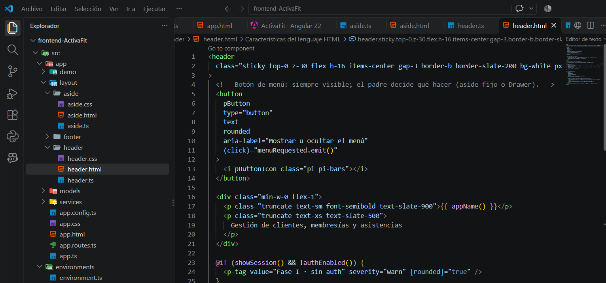

`header.css` también queda solo con su comentario. El Header no abre el Drawer: solo avisa «se pulsó el botón», y el padre decide qué hacer. Por eso es reutilizable.

**1.4 La pantalla `Construir`: estado local y Drawer**

```         
ng generate component features/construir --skip-tests --defaults
```

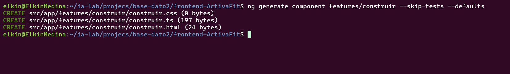

Primero el ayudante que observa el ancho de la pantalla. Creé la carpeta y el archivo:

```         
mkdir -p src/app/core/utils
```

`src/app/core/utils/media-query.ts`:

``` javascript
import { DestroyRef, Signal, inject, signal } from '@angular/core';

/**
 * Observa una media query CSS y la expone como signal de solo lectura.
 */
export function watchMediaQuery(query: string): Signal<boolean> {
  const destroyRef = inject(DestroyRef);

  const media =
    typeof window !== 'undefined' && typeof window.matchMedia === 'function'
      ? window.matchMedia(query)
      : null;

  const matches = signal(media?.matches ?? false);

  if (media) {
    const listener = (event: MediaQueryListEvent): void => matches.set(event.matches);
    media.addEventListener('change', listener);
    destroyRef.onDestroy(() => media.removeEventListener('change', listener));
  }

  return matches.asReadonly();
}
```

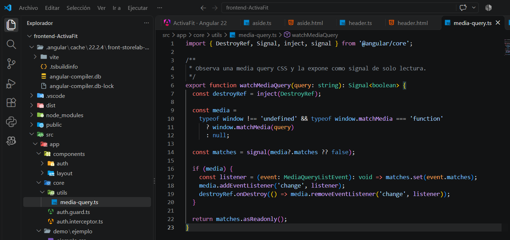

Luego reemplacé `src/app/features/construir/construir.ts`. Es el único componente con estado: guarda el título elegido, si el menú móvil está abierto y si el Aside fijo está oculto. El menú tiene nueve opciones: Inicio y los ocho módulos de ActivaFit. Todas llaman a un solo método, `seleccionar`.

``` javascript
import { Component, signal } from '@angular/core';
import { MenuItem } from 'primeng/api';
import { ButtonModule } from 'primeng/button';
import { CardModule } from 'primeng/card';
import { DrawerModule } from 'primeng/drawer';
import { watchMediaQuery } from '../../core/utils/media-query';
import { Aside } from '../../layout/aside/aside';
import { Footer } from '../../layout/footer/footer';
import { Header } from '../../layout/header/header';

/**
 * Pantalla del prototipo.
 *
 * Es el único componente con estado: guarda el título elegido y el estado del
 * menú. El layout solo recibe datos por `input()`; así se puede reutilizar sin
 * duplicar Header, Aside ni Footer.
 */
@Component({
  host: { class: 'block' },
  selector: 'app-construir',
  imports: [Aside, ButtonModule, CardModule, DrawerModule, Footer, Header],
  templateUrl: './construir.html',
  styleUrl: './construir.css',
})
export class Construir {
  /** `lg` de Tailwind: desde aquí el Aside es fijo y el botón lo alterna. */
  private readonly isDesktop = watchMediaQuery('(min-width: 1024px)');

  /** Escritorio: el Aside fijo se oculta y el contenido se ensancha. */
  readonly sidebarCollapsed = signal(false);

  /** Móvil: el Drawer se abre desde el botón y se cierra al elegir una opción. */
  readonly mobileOpen = signal(false);

  /** Título del contenido. Cambia al elegir una opción del menú, sin HTTP. */
  readonly title = signal('Inicio');

  /**
   * Menú en el formato `MenuItem` de PrimeNG.
   *
   * `command` ejecuta una función al elegir la opción. Todavía no navega: solo
   * cambia el título. Más adelante cada comando apuntará a una ruta real.
   */
  readonly items: MenuItem[] = [
    { label: 'Inicio', icon: 'pi pi-home', command: () => this.seleccionar('Inicio') },
    { label: 'Clientes', icon: 'pi pi-users', command: () => this.seleccionar('Clientes') },
    {
      label: 'Entrenadores',
      icon: 'pi pi-id-card',
      command: () => this.seleccionar('Entrenadores'),
    },
    { label: 'Planes', icon: 'pi pi-tags', command: () => this.seleccionar('Planes') },
    { label: 'Ejercicios', icon: 'pi pi-bolt', command: () => this.seleccionar('Ejercicios') },
    { label: 'Rutinas', icon: 'pi pi-list', command: () => this.seleccionar('Rutinas') },
    {
      label: 'Medidas',
      icon: 'pi pi-chart-line',
      command: () => this.seleccionar('Medidas'),
    },
    {
      label: 'Membresías',
      icon: 'pi pi-credit-card',
      command: () => this.seleccionar('Membresías'),
    },
    {
      label: 'Asistencias',
      icon: 'pi pi-calendar',
      command: () => this.seleccionar('Asistencias'),
    },
  ];

  /**
   * Un solo botón, dos disposiciones: en escritorio alterna el Aside fijo; por
   * debajo de `lg` abre el Drawer (donde el Aside fijo no cabe).
   */
  protected onMenuToggle(): void {
    if (this.isDesktop()) {
      this.sidebarCollapsed.update((collapsed) => !collapsed);
      return;
    }
    this.mobileOpen.set(true);
  }

  /** Una sola puerta de entrada al estado: la usan todos los comandos. */
  protected seleccionar(titulo: string): void {
    this.title.set(titulo);
    this.mobileOpen.set(false);
  }
}
```

Y `construir.html`. El Aside se compone una vez en el layout de escritorio y otra dentro del Drawer, con el mismo `items`:

``` html
<div class="flex min-h-screen flex-col bg-slate-100">
  <app-header (menuRequested)="onMenuToggle()" />

  <div class="flex flex-1">
    <!--
      Escritorio: Aside fijo que el botón del Header puede ocultar.
      Por debajo de lg no se pinta: el menú vive en el Drawer.
    -->
    @if (!sidebarCollapsed()) {
      <aside class="hidden w-72 shrink-0 lg:block">
        <app-aside [items]="items" (navigated)="mobileOpen.set(false)" />
      </aside>
    }

    <main id="contenido" class="min-w-0 flex-1 p-4 sm:p-6">
      <p-card class="block">
        <h1 class="text-2xl font-semibold text-slate-900">{{ title() }}</h1>
        <p class="mt-3 text-slate-600">
          Bienvenido a ActivaFit. Elige una opción del menú para explorar la estructura.
        </p>
        <p class="mt-2 text-sm text-slate-500">
          Esta primera pantalla usa datos locales. Los formularios y la conexión con la API
          Django se incorporan después.
        </p>
      </p-card>
    </main>
  </div>

  <app-footer />
</div>

<!-- Móvil: el mismo Aside, otra disposición. -->
<p-drawer [(visible)]="mobileOpen" header="Menú" position="left" styleClass="w-72">
  <app-aside [items]="items" (navigated)="mobileOpen.set(false)" />
</p-drawer>
```

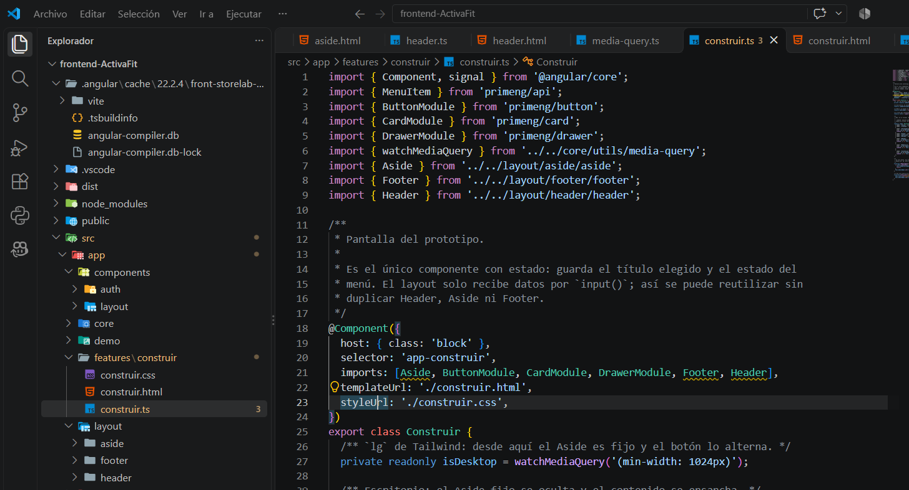

**1.5 `App` pasa a ser el punto de entrada con `router-outlet`**

Reemplacé `src/app/app.ts`. Ahora importa solo `RouterOutlet`; ya no importa `Header`, `Aside` ni `Footer`, porque los compone `Construir`:

``` javascript
import { Component } from '@angular/core';
import { RouterOutlet } from '@angular/router';

/**
 * Componente principal (`<app-root>`).
 *
 * Es solo el punto de entrada: el router elige qué componente se dibuja dentro
 * de `<router-outlet />` según la URL.
 */
@Component({
  host: { class: 'block' },
  selector: 'app-root',
  imports: [RouterOutlet],
  templateUrl: './app.html',
  styleUrl: './app.css',
})
export class App {}
```

`src/app/app.html`:

``` html
<!-- El router dibuja aquí el componente de la ruta activa (app.routes.ts). --> <router-outlet />
```

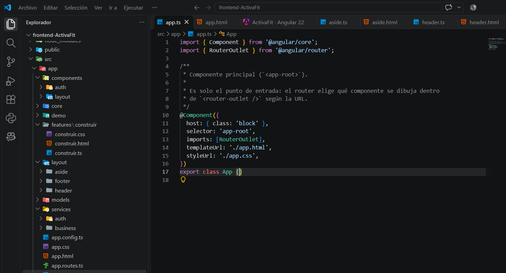

Y `src/app/app.routes.ts`. `loadComponent` descarga `Construir` solo cuando se visita su dirección, así que no entra en el paquete inicial. La raíz y cualquier dirección desconocida redirigen a `construir`:

``` javascript
import { Routes } from '@angular/router';

/**
 * Rutas de la aplicación.
 *
 * `loadComponent` descarga `Construir` solo cuando se visita su URL: el bundle
 * inicial no lo incluye.
 */
export const routes: Routes = [
  {
    path: 'construir',
    loadComponent: () =>
      import('./features/construir/construir').then((m) => m.Construir),
  },
  { path: '', pathMatch: 'full', redirectTo: 'construir' },
  { path: '**', redirectTo: 'construir' },
];
```

**1.6 Comprobar antes de avanzar**

```         
npm start
```

Abrí [`http://localhost:4200`](http://localhost:4200) y recorrí la pantalla en escritorio y en vista móvil. Los comandos de verificación están en la sección de cómo probarlo.

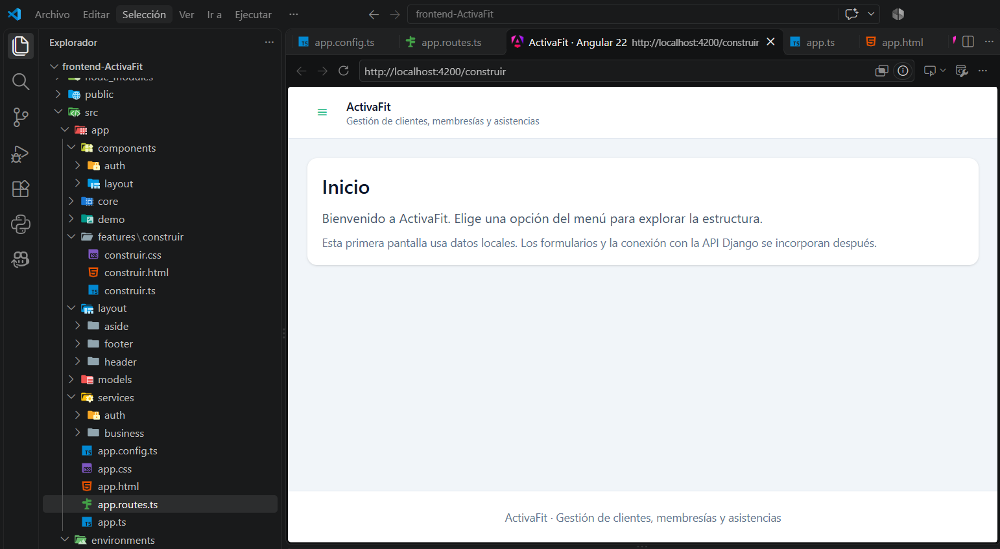

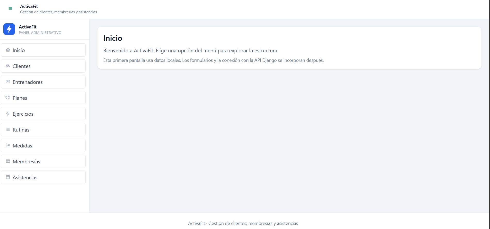

#### Explicación

Los datos entre componentes viajan por tres canales. Lo que el padre le da al hijo entra por `input()`: el Aside no inventa su menú, lo recibe. Lo que el hijo le avisa al padre sale por `output()`: el Header no abre ningún panel, solo dice «se pulsó el botón». Y el estado propio de una pantalla vive en un `signal`: el título, si el Drawer está abierto y si el Aside fijo está oculto. Esa separación hace que el encabezado, el menú y el pie se puedan reutilizar sin duplicarlos.

El flujo de un clic en el menú termina en el mismo estado por dos caminos: el comando de la opción llama a `seleccionar`, que cambia el título y cierra el Drawer, y el clic también burbujea hasta el `<nav>` y emite `navigated`, que cierra el Drawer otra vez. Como ambos hacen `.set(false)`, no pueden quedar desincronizados. Y `App` pasó a ser solo un ancla: el router dibuja al lado del `<router-outlet />` el componente de la ruta activa, y con `loadComponent` la pantalla se descarga en un paquete aparte solo al visitarla. La pantalla de login todavía no existe, así que el prototipo no ofrece ningún enlace a `/login`.

Escritorio (1280 px o más) ├── Aside blanco de 288 px con el logo y las 9 opciones; título "Inicio" ├── pulsar el botón de menú el Aside desaparece y el contenido se ensancha ├── pulsarlo otra vez el Aside vuelve a la izquierda └── elegir "Clientes" el título pasa a "Clientes"; la URL sigue en /construir

Móvil (390 px) ├── no hay Aside; el botón de menú está visible ├── pulsar el botón se abre el Drawer desde la izquierda con las 9 opciones └── elegir "Planes" el título cambia y el Drawer se cierra

Las comprobaciones desde la terminal:

```         
ng build
grep -n "input<MenuItem\[\]>" src/app/layout/aside/aside.ts
grep -n "menuRequested" src/app/layout/header/header.ts
grep -rn "lg:hidden" src/app/layout/header/header.html || echo "sin lg:hidden: correcto"
grep -n "signal(" src/app/features/construir/construir.ts
grep -n "RouterOutlet" src/app/app.ts
grep -n "loadComponent" src/app/app.routes.ts
for f in src/app/layout/*/*.css src/app/features/construir/*.css; do
  grep -q '[{}]' "$f" && echo "REGLAS EN $f"
done
```

El build debe terminar con código 0 y `construir` debe salir como un paquete aparte. Cada `grep` debe mostrar una línea, el de `lg:hidden` debe imprimir `sin lg:hidden: correcto`, y el bucle de los CSS no debe imprimir nada.

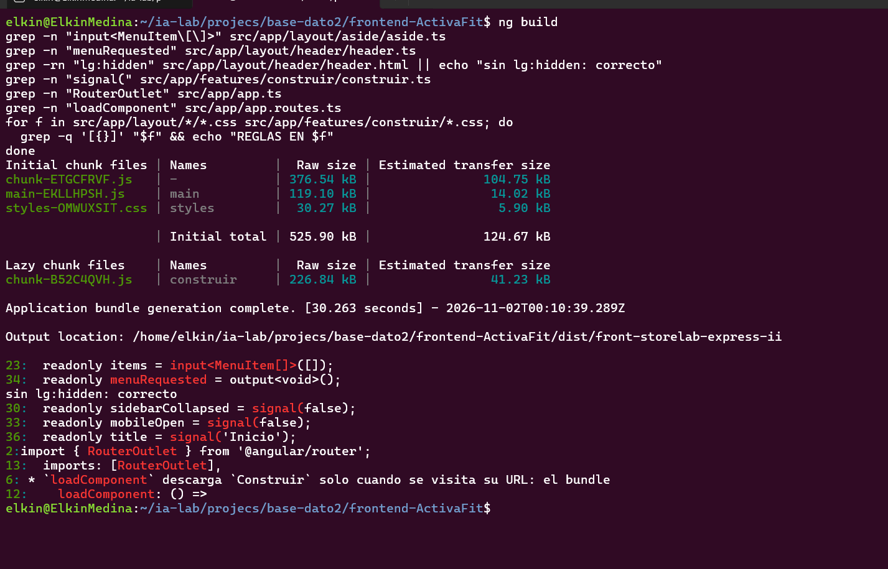

## ISS-02 (Frontend) — Núcleo: environment, modelos, servicios y layout

**Narrativa**

La aplicación ya tenía un menú y un layout, pero todo lo que mostraba era local. En esta unidad construí la capa que la convierte en cliente de la API de ActivaFit: una sola dirección para todo el frontend, los modelos que copian el contrato de la API, un servicio por cada recurso, un servicio de avisos y dos utilidades, y las rutas que meten las pantallas dentro del `Shell`. Ninguna pantalla de negocio está terminada todavía. Las rutas usan un componente provisional para recorrer el layout sin inventar tablas. Lo que sí queda cerrado es el contrato (campos, tipos, rutas y forma de las respuestas), porque cambiarlo después obliga a tocar cada pantalla.

**Objetivo**

Construir el núcleo del frontend: `environment`, modelos, servicios por entidad, avisos, utilidades, rutas y componentes compartidos.

**Requisitos**

- ISS-01B del frontend superado.

- Backend de ActivaFit disponible en [`http://localhost:8000/api`](http://localhost:8000/api).

### Construcción

**02.1 `environment`: una sola URL para todo el frente**

```         
ng generate environments 
```

Esto crea `src/environments/environment.ts` (la base, que usa `ng build`) y `environment.development.ts` (la que Angular importa con `ng serve` y `ng test`). Revisé que quedara el reemplazo en `angular.json`:

```         
grep -n "fileReplacements" angular.json 
```

`src/environments/environment.ts`:

``` javascript
/**
 * `apiUrl` termina en `/api` SIN barra final: cada servicio añade la suya
 * (`${base}/`) porque todas las rutas del contrato terminan en `/`.
 */
export const environment = {
  production: true,
  appName: 'ActivaFit',
  apiUrl: 'http://localhost:8000/api',
  /** Clave Community de PrimeUI. `''` deja el aviso en consola; la app funciona. */
  primeUiLicense: '',
};
```

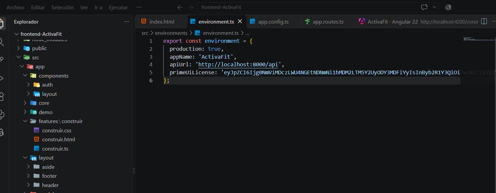

`environment.development.ts` repite el mismo objeto con `production: false`. Si los dos `apiUrl` se separan, la aplicación deja de apuntar al mismo backend. Si el comando no dejó el `fileReplacements` en `angular.json`, lo agrego dentro de `configurations.development` del `build`:

``` javascript
"fileReplacements": [
  {
    "replace": "src/environments/environment.ts",
    "with": "src/environments/environment.development.ts"
  }
]
```

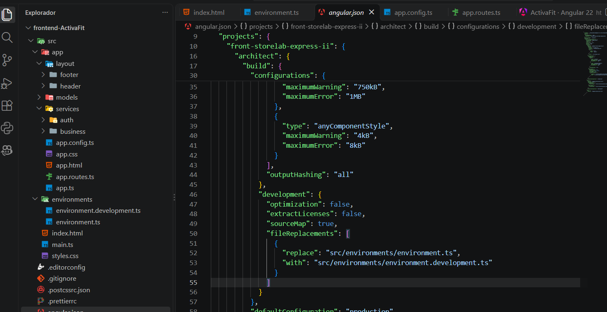

La barra final no es un detalle estético: con `.../api/`, la petición saldría como `.../api//clients/`, que Django no resuelve y responde 404 aunque el recurso exista.

**02.2 Modelos: la forma del contrato, no la de la base**

Generé un archivo por modelo con un bucle:

``` bash
for m in api client trainer plan exercise routine routine-exercise measurement membership payment attendance auth; do
  ng generate interface core/models/$m --type=model --defaults 
done
```

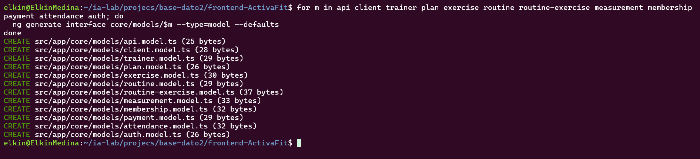

Cada comando deja un `*.model.ts` con una interfaz vacía. Reemplacé su contenido sin cambiar el nombre del archivo. En `src/app/core/models/api.model.ts` va lo que comparten todos:

``` javascript
/** Estado único del contrato: la baja es lógica, nunca borra la fila. */
export type Status = 'active' | 'inactive';

/** Importe tal como viaja: string decimal ("50000.00"). Nunca se opera con float. */
export type Money = string;

/** Métodos de `resources.method` (fase de seguridad). */
export type HttpMethod = 'GET' | 'POST' | 'PUT' | 'PATCH' | 'DELETE';

/** Fechas del contrato: ISO-8601 con zona. */
export interface Timestamps {
  createdAt?: string;
  updatedAt?: string;
}

/** Cuerpo de error: `{ "detail": "..." }` o `{ "campo": ["mensaje"] }`. */
export interface ApiError {
  detail?: string;
}

/** Importe del contrato a número, para sumar o comparar en el dashboard. */
export function toNumber(value: Money | number | null | undefined): number {
  const parsed = Number(value ?? 0);
  return Number.isFinite(parsed) ? parsed : 0;
}
```

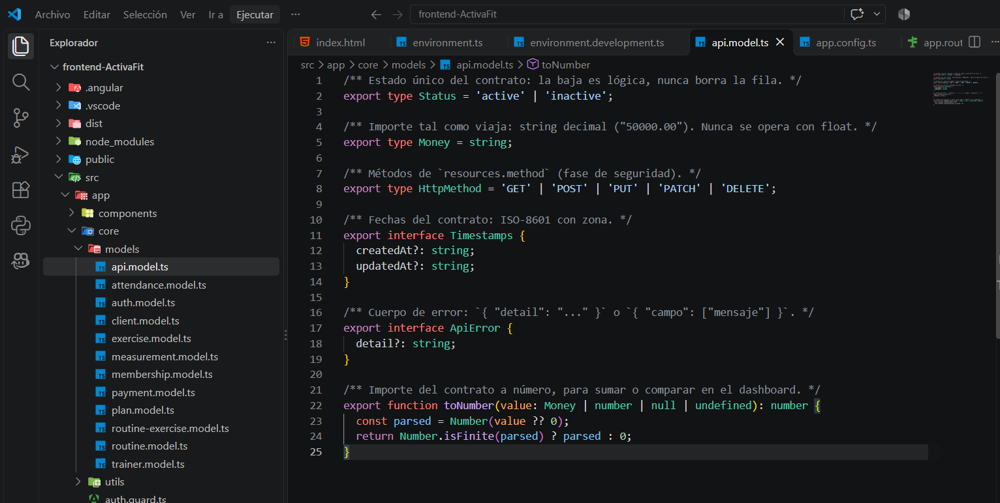

`client.model.ts`, `trainer.model.ts` y `plan.model.ts`. Tipé el correo como `string | null`; si en tu modelo de Django es obligatorio, déjalo como `string`:

``` javascript
import { Status, Timestamps } from './api.model';

/** Tabla `clients` — /api/clients/. */
export interface Client extends Timestamps {
  id: number;
  documentType: string;
  documentNumber: string;
  name: string;
  phone: string | null;
  email: string | null;
  status: Status;
}

/** Cuerpo de `POST` y `PATCH`: sin `id` y sin `status` (lo cambia la baja). */
export interface ClientPayload {
  documentType: string;
  documentNumber: string;
  name: string;
  phone: string | null;
  email: string | null;
}
```

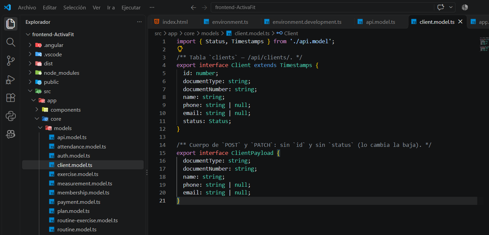

``` javascript
import { Status, Timestamps } from './api.model';

/** Tabla `trainers` — /api/trainers/. */
export interface Trainer extends Timestamps {
  id: number;
  name: string;
  phone: string | null;
  email: string | null;
  specialty: string | null;
  status: Status;
}

export interface TrainerPayload {
  name: string;
  phone: string | null;
  email: string | null;
  specialty: string | null;
}
```

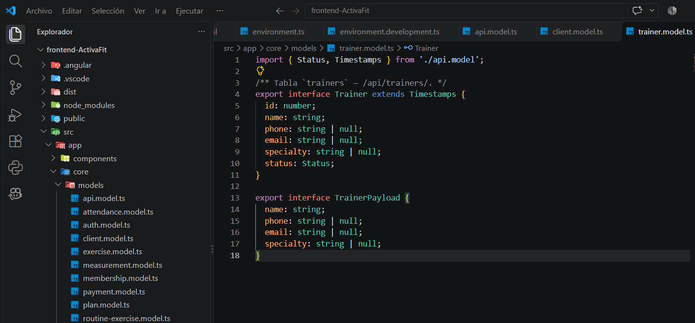

``` javascript
import { Status, Timestamps } from './api.model';

/** Tabla `plans` — /api/plans/. `name` es único. */
export interface Plan extends Timestamps {
  id: number;
  name: string;
  description: string | null;
  status: Status;
}

export interface PlanPayload {
  name: string;
  description: string | null;
}
```

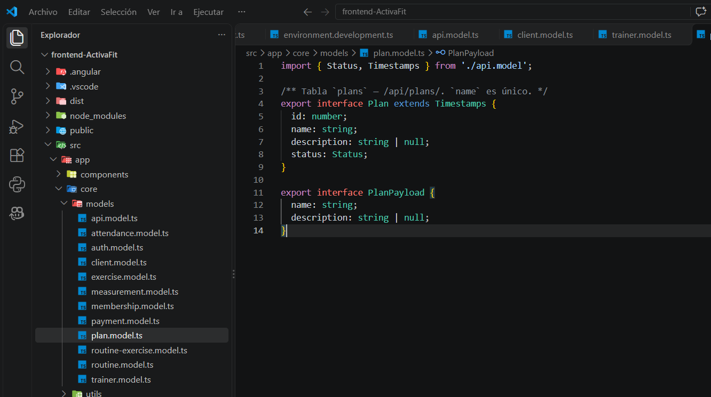

`exercise.model.ts`, `routine.model.ts` y `routine-exercise.model.ts`. `trainerName` y `clientName` solo llegan al leer; al escribir se envían `trainerId` y `clientId`:

``` javascript
import { Status, Timestamps } from './api.model';

/** Tabla `exercises` — /api/exercises/. `name` es único. */
export interface Exercise extends Timestamps {
  id: number;
  name: string;
  description: string | null;
  muscleGroup: string;
  status: Status;
}

export interface ExercisePayload {
  name: string;
  description: string | null;
  muscleGroup: string;
}
```

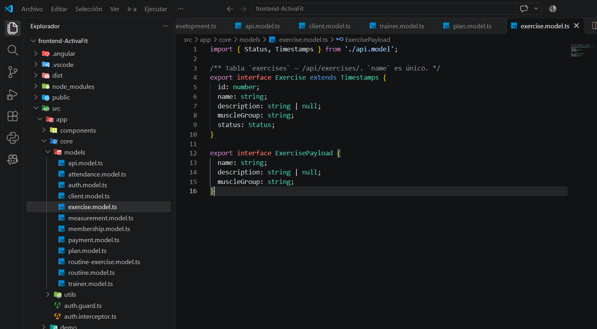

``` javascript
import { Status, Timestamps } from './api.model';

/** Tabla `routines` — /api/routines/. */
export interface Routine extends Timestamps {
  id: number;
  trainerId: number;
  trainerName?: string;
  clientId: number;
  clientName?: string;
  name: string;
  description: string | null;
  status: Status;
}

export interface RoutinePayload {
  trainerId: number;
  clientId: number;
  name: string;
  description: string | null;
}
```

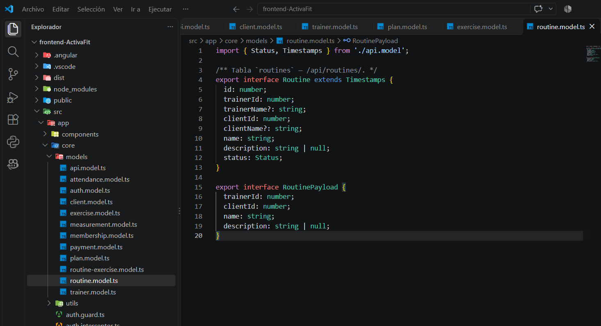

``` javascript
import { Money, Status, Timestamps } from './api.model';

/** Tabla `routine_exercises` — /api/routine-exercises/. */
export interface RoutineExercise extends Timestamps {
  id: number;
  routineId: number;
  exerciseId: number;
  sets: number;
  repetitions: number;
  weight: Money;
  restSeconds: number;
  name: string;
  description: string | null;
  muscleGroup: string;
  status: Status;
}

export interface RoutineExercisePayload {
  routineId: number;
  exerciseId: number;
  sets: number;
  repetitions: number;
  weight: Money;
  restSeconds: number;
  name: string;
  description: string | null;
  muscleGroup: string;
}
```

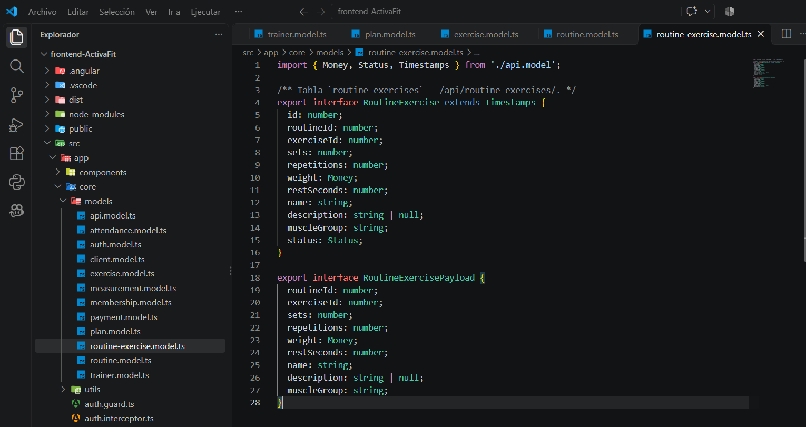

`measurement.model.ts` y `attendance.model.ts` no llevan `status`, porque esas tablas no lo tienen y su borrado es real:

``` javascript
import { Money, Timestamps } from './api.model';

/** Tabla `measurements` — /api/measurements/. Sin `status`: el DELETE borra la fila. */
export interface Measurement extends Timestamps {
  id: number;
  clientId: number;
  clientName?: string;
  trainerId: number;
  trainerName?: string;
  weight: Money;
  height: Money;
  bodyFat: Money | null;
  bmi: Money | null;
}

export interface MeasurementPayload {
  clientId: number;
  trainerId: number;
  weight: Money;
  height: Money;
  bodyFat: Money | null;
  bmi: Money | null;
}
```

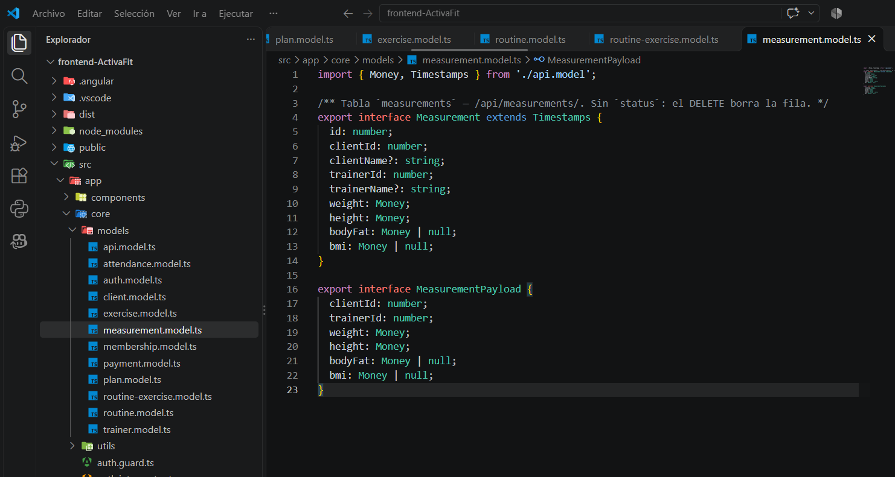

``` javascript
import { Timestamps } from './api.model';

/** Tabla `attendances` — /api/attendances/. Sin `status`: el DELETE borra la fila. */
export interface Attendance extends Timestamps {
  id: number;
  membershipId: number;
  attendanceDate: string;
  type: string;
}

export interface AttendancePayload {
  membershipId: number;
  attendanceDate?: string;
  type: string;
}
```

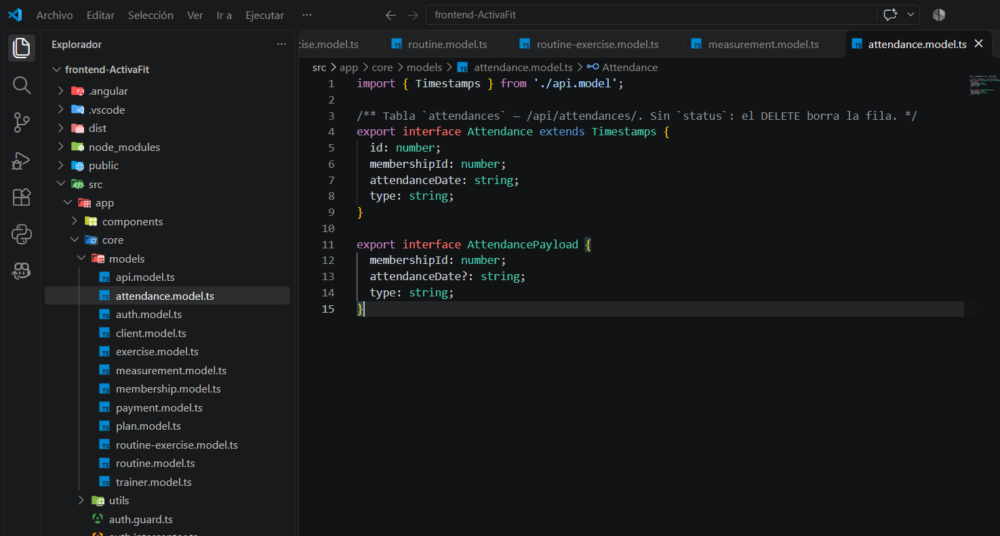

`payment.model.ts` y `membership.model.ts`. Una diferencia que hay que tener presente: al **leer**, la membresía trae `client` y `plan` (los identificadores) con `clientName` y `planName`, pero al **registrar** se envían `clientId` y `planId`:

``` javascript
import { Money, Status } from './api.model';

/** Tabla `payments`: no tiene recurso propio, viaja dentro de la membresía. */
export interface Payment {
  id: number;
  membership: number;
  method: string;
  amount: Money;
  paymentDate: string;
  status: Status;
}

/** Pago que envía el cliente al registrar la membresía. */
export interface PaymentInput {
  method: string;
  amount: Money;
  paymentDate?: string;
}
```

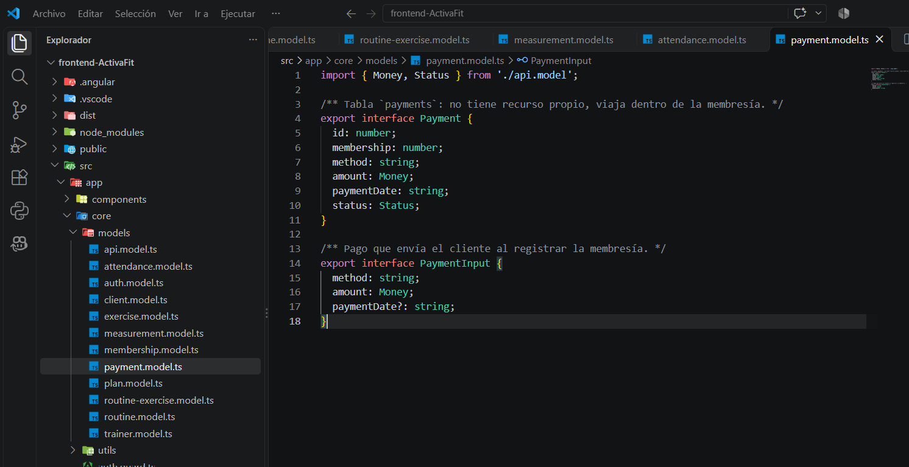

``` javascript
import { Status, Timestamps } from './api.model';
import { Payment, PaymentInput } from './payment.model';

/** Tabla `memberships` — /api/memberships/. El listado ya trae `payments`. */
export interface Membership extends Timestamps {
  id: number;
  client: number;
  clientName?: string;
  plan: number;
  planName?: string;
  startDate: string;
  endDate: string;
  status: Status;
  payments: Payment[];
}

/** POST /api/memberships/: una sola transacción con sus pagos. */
export interface MembershipRegisterPayload {
  clientId: number;
  planId: number;
  startDate: string;
  endDate: string;
  payments: PaymentInput[];
}
```

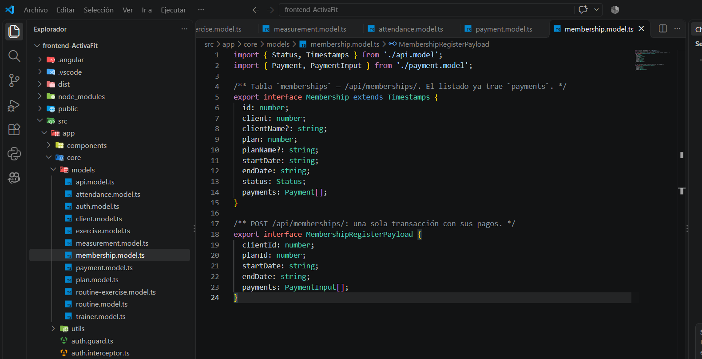

`auth.model.ts` se consume en el ISS-08. El perfil de mi backend trae nombre y apellido, no `avatar` ni fechas:

``` javascript
import { HttpMethod, Status } from './api.model';

/** GET /api/auth/profile/: el usuario llega directo, sin envoltorio `user`. */
export interface User {
  id: number;
  username: string;
  email: string;
  firstName: string;
  lastName: string;
  status: Status;
}

/** Login y refresh comparten cuerpo; el refresh rota en cada uso. */
export interface SessionTokens {
  access: string;
  refresh: string;
  tokenType: 'Bearer';
  accessExpiresIn: number;
}

/** Una fila de `GET /api/auth/permissions/`. La clave es `method + ' ' + path`. */
export interface EffectivePermission {
  method: HttpMethod;
  path: string;
  roleId: number;
  roleName: string;
}
```

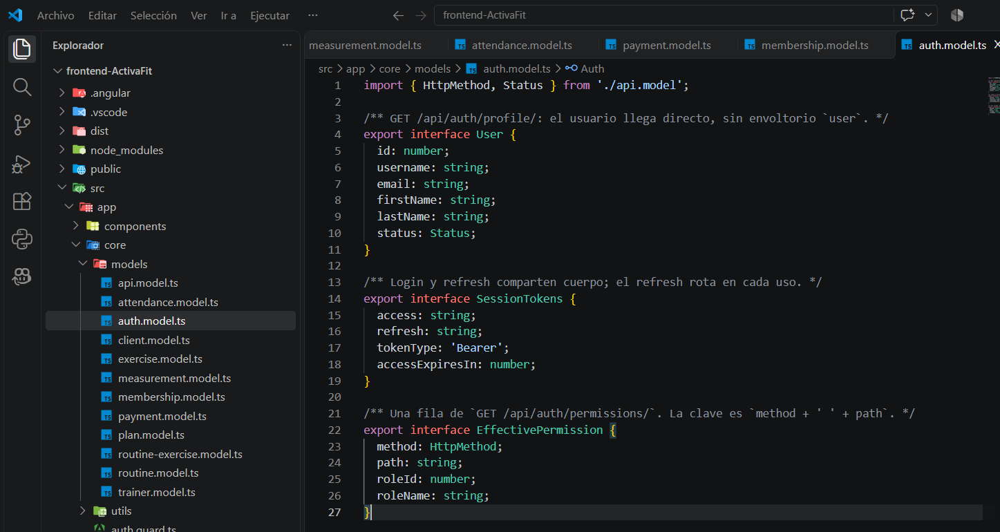

Las decisiones de esta capa: una sola URL en `environment.apiUrl`; listas planas (`Client[]`, no `{ clients: [] }`), así el servicio no desenvuelve nada; importes como `string`, que se muestran tal cual y se suman con `toNumber()`; y `status` como una unión de dos textos, para que `row.status === 'active'` se valide al compilar.

**02.3 Servicios por entidad**

``` bash
ng generate service features/clients/client-api --skip-tests --defaults
ng generate service features/trainers/trainer-api --skip-tests --defaults
ng generate service features/plans/plan-api --skip-tests --defaults
ng generate service features/exercises/exercise-api --skip-tests --defaults
ng generate service features/routines/routine-api --skip-tests --defaults
ng generate service features/routine-exercises/routine-exercise-api --skip-tests --defaults
ng generate service features/measurements/measurement-api --skip-tests --defaults
ng generate service features/memberships/membership-api --skip-tests --defaults
ng generate service features/attendances/attendance-api --skip-tests --defaults
```


`src/app/features/clients/client-api.ts` es el patrón. La dirección base se escribe una sola vez, sin barra final, y hay un método por cada caso del contrato:

``` javascript
import { HttpClient } from '@angular/common/http';
import { Injectable, inject } from '@angular/core';
import { Observable } from 'rxjs';
import { environment } from '../../../environments/environment';
import { Status } from '../../core/models/api.model';
import { Client, ClientPayload } from '../../core/models/client.model';

/** Único punto de contacto con `/api/clients/`. */
@Injectable({ providedIn: 'root' })
export class ClientApi {
  private readonly http = inject(HttpClient);
  /** Sin barra final: el sufijo `/` se agrega en cada método, a la vista. */
  private readonly base = `${environment.apiUrl}/clients`;

  list(): Observable<Client[]> {
    return this.http.get<Client[]>(`${this.base}/`);
  }

  get(id: number): Observable<Client> {
    return this.http.get<Client>(`${this.base}/${id}/`);
  }

  /** El alta envía `status: 'active'`: en la base el registro nace `inactive`. */
  create(payload: ClientPayload & { status: Status }): Observable<Client> {
    return this.http.post<Client>(`${this.base}/`, payload);
  }

  /** PATCH: el formulario envía solo los campos que cambiaron. */
  update(id: number, payload: Partial<ClientPayload>): Observable<Client> {
    return this.http.patch<Client>(`${this.base}/${id}/`, payload);
  }

  /** DELETE: baja lógica, responde 204 sin cuerpo. */
  remove(id: number): Observable<void> {
    return this.http.delete<void>(`${this.base}/${id}/`);
  }
}
```


Otros seis servicios copian esa misma estructura (imports, `@Injectable`, `http` y `base`), cambiando la dirección y los tipos:

| Archivo | `base` | Tipos | Alta |
|------------------|------------------|------------------|------------------|
| `trainer-api.ts` | `/trainers` | `Trainer`, `TrainerPayload` | con `status` |
| `plan-api.ts` | `/plans` | `Plan`, `PlanPayload` | con `status` |
| `exercise-api.ts` | `/exercises` | `Exercise`, `ExercisePayload` | con `status` |
| `routine-api.ts` | `/routines` | `Routine`, `RoutinePayload` | con `status` |
| `routine-exercise-api.ts` | `/routine-exercises` | `RoutineExercise`, `RoutineExercisePayload` | con `status` |
| `measurement-api.ts` | `/measurements` | `Measurement`, `MeasurementPayload` | **sin** `status`; `remove` borra la fila |
| `attendance-api.ts` | `/attendances` | `Attendance`, `AttendancePayload` | **sin** `status`; `remove` borra la fila |

En `measurement-api.ts` y `attendance-api.ts`, `create` recibe solo el payload (sin `& { status: Status }`) y no se importa `Status`. `plan-api.ts` además acepta un filtro opcional, porque la API publica `?status=`:

```         
// plan-api.ts — `status` es opcional como filtro
list(status?: Status): Observable<Plan[]> {
  const options = status ? { params: { status } } : {};
  return this.http.get<Plan[]>(`${this.base}/`, options);
}
```

La membresía no es un CRUD: se registra, se consulta y se anula. Reemplacé `src/app/features/memberships/membership-api.ts` completo:

``` javascript
import { HttpClient } from '@angular/common/http';
import { Injectable, inject } from '@angular/core';
import { Observable } from 'rxjs';
import { environment } from '../../../environments/environment';
import { Membership, MembershipRegisterPayload } from '../../core/models/membership.model';

/** Único punto de contacto con `/api/memberships/`. No hay `update` ni `remove`. */
@Injectable({ providedIn: 'root' })
export class MembershipApi {
  private readonly http = inject(HttpClient);
  private readonly base = `${environment.apiUrl}/memberships`;

  list(): Observable<Membership[]> {
    return this.http.get<Membership[]>(`${this.base}/`);
  }

  get(id: number): Observable<Membership> {
    return this.http.get<Membership>(`${this.base}/${id}/`);
  }

  /** GET /memberships/active/: activas, de clientes y planes activos, y vigentes hoy. */
  active(): Observable<Membership[]> {
    return this.http.get<Membership[]>(`${this.base}/active/`);
  }

  /** POST transaccional: valida cliente, plan y fechas, y crea los pagos. */
  register(payload: MembershipRegisterPayload): Observable<Membership> {
    return this.http.post<Membership>(`${this.base}/`, payload);
  }

  /** DELETE: anula la membresía y sus pagos; conserva las asistencias. */
  voidMembership(id: number): Observable<void> {
    return this.http.delete<void>(`${this.base}/${id}/`);
  }
}
```


Corregir una membresía es anularla y registrarla de nuevo, porque el contrato no publica `PUT` ni `PATCH` sobre ella. Los pagos no tienen servicio propio, porque no hay una ruta `/api/payments/`.

Cada servicio solo traduce el contrato: la dirección, el método y el tipo. No conoce tablas, diálogos ni signals.

```         
pantalla → servicio → HttpClient → GET /api/clients/ → Django 
```

Esa frontera permite usar el mismo servicio en la tabla, el detalle y el dashboard sin repetir la dirección, y probarlo sin montar la pantalla. Falta habilitar `HttpClient` en `src/app/app.config.ts`. Agregué el import arriba y, dentro de `providers`, junto a `MessageService`:

```         
import { provideHttpClient } from '@angular/common/http'; 
```

```         
    provideHttpClient(), // sin interceptores: el de sesión llega en el ISS-08 
```

**02.4 `NotificationService`**

Lo creé a mano, sin el CLI, para que el archivo y la clase mantengan el nombre completo (con el CLI de Angular 22 la clase se llamaría solo `Notification`, que choca con un tipo del navegador). Creé la carpeta y el archivo `src/app/core/services/notification.service.ts`:

```         
mkdir -p src/app/core/services 
```

``` javascript
import { Injectable, inject } from '@angular/core';
import { MessageService } from 'primeng/api';

/** Azúcar sobre MessageService: la duración de un aviso se decide una sola vez. */
@Injectable({ providedIn: 'root' })
export class NotificationService {
  private readonly messages = inject(MessageService);

  success(summary: string, detail?: string): void {
    this.messages.add({ severity: 'success', summary, detail, life: 3000 });
  }

  info(summary: string, detail?: string): void {
    this.messages.add({ severity: 'info', summary, detail, life: 4000 });
  }

  warn(summary: string, detail?: string): void {
    this.messages.add({ severity: 'warn', summary, detail, life: 4500 });
  }

  error(summary: string, detail?: string): void {
    this.messages.add({ severity: 'error', summary, detail, life: 6000 });
  }
}
```


El `<p-toast />` que muestra los avisos se monta una sola vez, en el `Shell`. `warn` es el aviso de la baja lógica: la operación salió bien y el registro sigue existiendo.

**02.5 `toApiMessage`: el error de Django en una frase**

`src/app/core/utils/to-api-message.ts`. Cambié el mensaje de falta de conexión para que no escriba la dirección a mano: así la dirección del backend vive solo en `environment`.

``` javascript
import { HttpErrorResponse } from '@angular/common/http';
import { ApiError } from '../models/api.model';

/** Texto de respaldo cuando el cuerpo no trae nada útil. */
const POR_CODIGO: Record<number, string> = {
  400: 'Revisa los datos del formulario.',
  401: 'La sesión no es válida. Vuelve a iniciar sesión.',
  403: 'No tienes autorización para esta operación.',
  404: 'El registro ya no existe.',
  409: 'Ese dato ya está registrado.',
};

/** Traduce el error HTTP del contrato a un mensaje legible. */
export function toApiMessage(error: unknown): string {
  if (!(error instanceof HttpErrorResponse)) {
    return error instanceof Error ? error.message : 'Error inesperado';
  }
  if (error.status === 0) {
    return 'No se pudo conectar con la API. Verifica que el backend de Django esté en ejecución.';
  }

  const body: unknown = error.error;
  const detail = body && typeof body === 'object' ? (body as ApiError).detail : null;
  if (typeof detail === 'string' && detail.trim()) {
    return detail.trim();
  }

  // 400 de serializer: `{ "campo": ["mensaje"] }` → "campo: mensaje".
  if (body && typeof body === 'object' && !Array.isArray(body)) {
    for (const [campo, valor] of Object.entries(body as Record<string, unknown>)) {
      const mensaje = Array.isArray(valor) ? valor[0] : valor;
      if (typeof mensaje === 'string' && mensaje.trim()) {
        return `${campo}: ${mensaje.trim()}`;
      }
    }
  }

  return POR_CODIGO[error.status] ?? error.message;
}
```


**02.6 `filterRows`: el buscador de la tabla**

PrimeNG 22 ya no ofrece `globalFilter` en la tabla, así que se filtra el arreglo antes de pasárselo a `[value]`. Como es una función pura, se prueba sin montar nada. `src/app/core/utils/filter-rows.ts`:

``` javascript
/**
 * Filtro local para las tablas. `pick` decide qué campos se comparan y `[...rows]`
 * devuelve una copia: el llamador no muta el signal original.
 */
export function filterRows<T>(
  rows: readonly T[],
  query: string,
  pick: (row: T) => Array<string | number | null | undefined>,
): T[] {
  const term = query.trim().toLowerCase();
  if (!term) return [...rows];
  return rows.filter((row) =>
    pick(row).some((value) => (value ?? '').toString().toLowerCase().includes(term)),
  );
}
```

**02.7 Rutas: el layout recibe sus pantallas**

Desde aquí el `Shell` es la ruta raíz: encabezado, menú, `<router-outlet />` y pie se montan una sola vez. El prototipo de `Construir` sigue en su ruta, fuera del `Shell`. Primero generé el componente:

```         
ng generate component layout/shell --skip-tests --defaults 
```


Reemplacé `src/app/layout/shell/shell.ts`. Es el layout de `Construir` pero sin estado de título: el menú ahora navega con `routerLink`, y el contenido es el `<router-outlet />`. Incluye una opción por cada recurso de tu API, más el panel:

``` javascript
import { Component, signal } from '@angular/core';
import { RouterOutlet } from '@angular/router';
import { MenuItem } from 'primeng/api';
import { DrawerModule } from 'primeng/drawer';
import { ToastModule } from 'primeng/toast';
import { watchMediaQuery } from '../../core/utils/media-query';
import { Aside } from '../aside/aside';
import { Footer } from '../footer/footer';
import { Header } from '../header/header';

/**
 * Cáscara de la aplicación: Header, Aside, contenido y Footer, montados una sola
 * vez. El contenido es el `<router-outlet />`; cada ruta hija pone su pantalla.
 */
@Component({
  host: { class: 'block' },
  selector: 'app-shell',
  imports: [Aside, DrawerModule, Footer, Header, RouterOutlet, ToastModule],
  templateUrl: './shell.html',
  styleUrl: './shell.css',
})
export class Shell {
  /** `lg` de Tailwind: desde aquí el Aside es fijo y el botón lo alterna. */
  private readonly isDesktop = watchMediaQuery('(min-width: 1024px)');

  /** Escritorio: el Aside fijo se oculta y el contenido se ensancha. */
  readonly sidebarCollapsed = signal(false);

  /** Móvil: el Drawer se abre desde el botón y se cierra al elegir una opción. */
  readonly mobileOpen = signal(false);

  /** Menú en el formato `MenuItem` de PrimeNG, con una ruta por opción. */
  readonly items: MenuItem[] = [
    { label: 'Panel', icon: 'pi pi-home', routerLink: '/dashboard' },
    { label: 'Clientes', icon: 'pi pi-users', routerLink: '/clientes' },
    { label: 'Entrenadores', icon: 'pi pi-id-card', routerLink: '/entrenadores' },
    { label: 'Planes', icon: 'pi pi-tags', routerLink: '/planes' },
    { label: 'Ejercicios', icon: 'pi pi-bolt', routerLink: '/ejercicios' },
    { label: 'Rutinas', icon: 'pi pi-list', routerLink: '/rutinas' },
    { label: 'Ejercicios de rutina', icon: 'pi pi-sliders-h', routerLink: '/ejercicios-rutina' },
    { label: 'Medidas', icon: 'pi pi-chart-line', routerLink: '/medidas' },
    { label: 'Membresías', icon: 'pi pi-credit-card', routerLink: '/membresias' },
    { label: 'Asistencias', icon: 'pi pi-calendar', routerLink: '/asistencias' },
  ];

  /** Un solo botón, dos disposiciones: Aside fijo en escritorio, Drawer en móvil. */
  protected onMenuToggle(): void {
    if (this.isDesktop()) {
      this.sidebarCollapsed.update((collapsed) => !collapsed);
      return;
    }
    this.mobileOpen.set(true);
  }
}
```


Y `shell.html`. El `<p-toast />` se monta aquí una sola vez para toda la aplicación:

``` html
<div class="flex min-h-screen flex-col bg-slate-100">
  <app-header (menuRequested)="onMenuToggle()" />

  <div class="flex flex-1">
    @if (!sidebarCollapsed()) {
      <aside class="hidden w-72 shrink-0 lg:block">
        <app-aside [items]="items" (navigated)="mobileOpen.set(false)" />
      </aside>
    }

    <main id="contenido" class="min-w-0 flex-1 p-4 sm:p-6">
      <router-outlet />
    </main>
  </div>

  <app-footer />
</div>

<p-drawer [(visible)]="mobileOpen" header="Menú" position="left" styleClass="w-72">
  <app-aside [items]="items" (navigated)="mobileOpen.set(false)" />
</p-drawer>

<p-toast />
```

`shell.css` queda con su comentario, sin reglas. Hasta que cada unidad escriba su pantalla, todas las rutas usan un componente provisional. `src/app/features/placeholder/placeholder.ts`:

``` javascript
import { Component } from '@angular/core';
import { CardModule } from 'primeng/card';
import { TagModule } from 'primeng/tag';

@Component({
  selector: 'app-placeholder',
  imports: [CardModule, TagModule],
  template: `
    <p-tag value="En construcción" severity="warn" [rounded]="true" />
    <p-card header="Pantalla en construcción" class="mt-4">
      <p class="m-0 text-slate-600">El layout ya está montado; esta pantalla llega en su ISS.</p>
    </p-card>
  `,
})
export class Placeholder {}
```


Reemplacé `src/app/app.routes.ts`. `app.html` sigue siendo solo `<router-outlet />`. `loadComponent` mantiene cada pantalla en su propio paquete, así el inicial no arrastra tablas ni formularios:

``` javascript
import { Routes } from '@angular/router';

/** Una sola entrada provisional para todas las pantallas. */
const provisional = () =>
  import('./features/placeholder/placeholder').then((m) => m.Placeholder);

export const routes: Routes = [
  {
    path: 'construir',
    loadComponent: () => import('./features/construir/construir').then((m) => m.Construir),
  },
  {
    path: '',
    loadComponent: () => import('./layout/shell/shell').then((m) => m.Shell),
    children: [
      { path: '', pathMatch: 'full', redirectTo: 'clientes' },
      { path: 'clientes', title: 'Clientes · ActivaFit', loadComponent: provisional },
      { path: 'entrenadores', title: 'Entrenadores · ActivaFit', loadComponent: provisional },
      { path: 'planes', title: 'Planes · ActivaFit', loadComponent: provisional },
      { path: 'ejercicios', title: 'Ejercicios · ActivaFit', loadComponent: provisional },
      { path: 'rutinas', title: 'Rutinas · ActivaFit', loadComponent: provisional },
      { path: 'ejercicios-rutina', title: 'Ejercicios de rutina · ActivaFit', loadComponent: provisional },
      { path: 'medidas', title: 'Medidas · ActivaFit', loadComponent: provisional },
      { path: 'membresias', title: 'Membresías · ActivaFit', loadComponent: provisional },
      { path: 'asistencias', title: 'Asistencias · ActivaFit', loadComponent: provisional },
      { path: 'dashboard', title: 'Panel · ActivaFit', loadComponent: provisional },
    ],
  },
  { path: '**', redirectTo: 'construir' },
];
```


Cada unidad siguiente reemplaza **una** línea del `provisional` por su pantalla real.

**02.8 Componentes compartidos de interfaz**

Las pantallas repiten tres piezas, así que las creo una sola vez. Los generé con la plantilla y el estilo dentro del propio `.ts`, para no dejar archivos `.html` y `.css` sin usar:

``` bash
ng generate component shared/ui/status-tag --skip-tests --inline-template --inline-style --defaults
ng generate component shared/ui/page-header --skip-tests --inline-template --inline-style --defaults
ng generate component shared/ui/empty-state --skip-tests --inline-template --inline-style --defaults
```


`src/app/shared/ui/status-tag/status-tag.ts`:

``` javascript
import { Component, computed, input } from '@angular/core';
import { TagModule } from 'primeng/tag';
import { Status } from '../../../core/models/api.model';

/** Estado de un registro: `active` o `inactive`. No conoce la API. */
@Component({
  selector: 'app-status-tag',
  imports: [TagModule],
  template: `<p-tag [value]="label()" [severity]="severity()" />`,
  host: { class: 'inline-block' },
})
export class StatusTag {
  readonly status = input.required<Status>();
  readonly label = computed(() => (this.status() === 'active' ? 'Activo' : 'Inactivo'));
  readonly severity = computed(() => (this.status() === 'active' ? 'success' : 'danger'));
}
```


`src/app/shared/ui/page-header/page-header.ts`:

``` javascript
import { Component, input } from '@angular/core';

/** Título, descripción y acciones de una pantalla. Proyecta los botones. */
@Component({
  selector: 'app-page-header',
  template: `
    <header class="flex flex-col gap-2 md:flex-row md:items-end md:justify-between">
      <div class="flex flex-col gap-1">
        <h1 class="text-2xl font-semibold text-slate-900">{{ title() }}</h1>
        @if (subtitle()) {
          <p class="text-sm text-slate-500">{{ subtitle() }}</p>
        }
      </div>
      <div class="flex flex-wrap gap-2"><ng-content /></div>
    </header>
  `,
  host: { class: 'block' },
})
export class PageHeader {
  readonly title = input.required<string>();
  readonly subtitle = input('');
}
```


`src/app/shared/ui/empty-state/empty-state.ts`:

``` javascript
import { Component, input } from '@angular/core';

/** Lista vacía o sin coincidencias. Nunca sustituye al mensaje de error. */
@Component({
  selector: 'app-empty-state',
  template: `
    <div class="flex flex-col items-center gap-2 py-10 text-center">
      <i [class]="icon() + ' text-4xl text-slate-300'"></i>
      <p class="font-medium text-slate-600">{{ title() }}</p>
      <p class="text-sm text-slate-500">{{ message() }}</p>
    </div>
  `,
})
export class EmptyState {
  readonly icon = input('pi pi-inbox');
  readonly title = input.required<string>();
  readonly message = input('');
}
```


Los tres son independientes, no inyectan servicios y no consultan la API: uno traduce el estado, otro compone la cabecera y otro cubre el caso sin filas.

**02.9 Arranque**

```         
ng build 
ng serve 
```

### Explicación

Esta unidad no tiene pantallas terminadas: es la capa que las va a sostener. El recorrido de cada dato en ActivaFit es siempre el mismo: la pantalla le pide al servicio, el servicio usa `HttpClient`, y `HttpClient` llama a la API de Django, que responde con un arreglo plano de objetos. La pantalla nunca conoce direcciones ni formatos de la API; el servicio es el único que los conoce.

El `Shell` monta encabezado, menú y pie una sola vez, y deja el centro como un `<router-outlet />`. Con `loadComponent` cada pantalla se descarga solo al visitarla. El `NotificationService` y el `<p-toast />` centralizan los avisos, y `toApiMessage` convierte el error de Django en una frase, con una rama propia para cuando el backend está apagado, que no es un error del servidor sino de red.

Para comprobar el contrato contra tu backend, que siempre exige token, usa el `$TOKEN` del administrador de la unidad de requisitos:

```         
curl -s http://localhost:8000/api/clients/ -H "Authorization: Bearer $TOKEN" | head -c 300; echo 
```

Debe empezar por `[`, un arreglo plano, sin ningún envoltorio. Y comprueba que la dirección del backend solo vive en `environment`:

```         
grep -rn "localhost:8000" src/app --include="*.ts" | grep -v "spec" 
```


No debe mostrar nada. En la pantalla todavía no verás datos: nada llama a la API, y cuando las pantallas lo hagan, tu backend responderá `401` hasta que exista el inicio de sesión.

### Criterios de aceptación

- **AC-02-01:** `environment.apiUrl` es [`http://localhost:8000/api`](http://localhost:8000/api), sin barra final, existe `environment.development.ts` y `angular.json` aplica `fileReplacements`.

- **AC-02-02:** los modelos usan `camelCase`, importes `string`, fechas `string` y `status` como unión; `Measurement` y `Attendance` no llevan `status`.

- **AC-02-03:** `Membership` trae `client`, `plan`, `clientName`, `planName` y `payments`, y el registro usa `clientId` y `planId`.

- **AC-02-04:** cada servicio arma sus direcciones desde `this.base`, que no lleva barra final.

- **AC-02-05:** `list()` devuelve un arreglo plano y la prueba lo comprueba sobre [`http://localhost:8000/api/clients/`](http://localhost:8000/api/clients/).

- **AC-02-06:** `MembershipApi` tiene `active()`, `register()` y `voidMembership()`, y no tiene `update` ni `remove`.

- **AC-02-07:** `toApiMessage` traduce `detail`, errores por campo, la falta de conexión y los códigos 400, 401, 403, 404 y 409.

- **AC-02-08:** `filterRows` no usa el DOM, no muta la entrada y devuelve una copia sin término.

- **AC-02-09:** `NotificationService` expone `success`, `info`, `warn` y `error` sobre `MessageService`.

- **AC-02-10:** `app.routes.ts` monta `Shell` con `loadComponent` y las diez pantallas como hijas.

- **AC-02-11:** existen `app-status-tag`, `app-page-header` y `app-empty-state`, independientes y con `input()`.

- **AC-02-12:** `ng build` termina con código 0.

### ISS-03 (Frontend) — CRUD de clientes con signals

**Narrativa**

Con el núcleo listo, construí la primera pantalla real de ActivaFit: el CRUD de clientes. Esta pantalla fija el patrón que van a seguir las demás: una tabla con buscador, paginación y los tres estados (cargando, vacío y error), y un formulario dentro de un diálogo que sirve igual para crear y para editar. Lo decisivo de la unidad es cómo se reparten las responsabilidades. La lista es la dueña del estado y habla con la API; el formulario no sabe nada de la API, solo recibe un cliente (o ninguno) y emite el cuerpo que el usuario completó. El buscador filtra en memoria sobre lo que ya se cargó, así que escribir en él no genera ninguna petición. Y la baja es lógica: dar de baja no borra la fila, la deja inactiva.

**Objetivo**

Construir el primer CRUD completo contra `/api/clients/`: listar, buscar, crear, editar y dar de baja, con un patrón reutilizable para las entidades siguientes.

**Requisitos**

- ISS-02 del frontend superado (`ClientApi`, modelos, `NotificationService`, `toApiMessage` y `filterRows`).

- Backend de ActivaFit disponible en [`http://localhost:8000/api`](http://localhost:8000/api).

#### Construcción

**03.1 Generar los dos componentes**

```         
ng generate component features/clients/client-list --skip-tests --defaults
ng generate component features/clients/client-form --skip-tests --defaults
```


Quedan `client-list` y `client-form`, cada uno con su `.ts`, `.html` y `.css`, junto al `client-api.ts` del ISS-02. Uso `--skip-tests` porque las pruebas de esta unidad las escribo completas más abajo. Los dos `.css` se quedan sin reglas.

**03.2 Recorrido por incrementos**

La guía recomienda construir la pantalla en ocho pasos, y que cada uno compile y se mire antes del siguiente:

| \# | Incremento | Qué cambia | Qué compruebo |
|------------------|------------------|------------------|------------------|
| 1 | `@for` local | `rows = signal<Client[]>(DEMO)` | la lista pinta datos falsos |
| 2 | `p-table` | `[value]="rows()"` con `#header`, `#body` y `#emptymessage` | las mismas filas con cabecera |
| 3 | `GET` | `ClientApi.list()` en el constructor | Network muestra `/api/clients/` |
| 4 | filtro local | `filter` y `filterRows` en un `computed` | escribir no genera peticiones |
| 5 | formulario | `ReactiveFormsModule` dentro de `p-dialog` | guardar con el nombre vacío no envía |
| 6 | `POST` | `save()` cuando `editing()` es `null` | 201, cierra el diálogo y recarga |
| 7 | `PATCH` | `save()` con un cliente en edición | 200 con el cuerpo editado |
| 8 | `DELETE` | confirmación y `DELETE /clients/{id}/` | 204 y la fila queda «Inactivo» |

Los pasos 3, 6, 7 y 8 hablan con la API: con tu backend responderán 401 hasta el login. Más abajo te explico cómo avanzar sin romperte.

**03.3 `client-list`: el estado en signals**

Reemplacé `src/app/features/clients/client-list/client-list.ts`. La lista es dueña del estado: la tabla y el diálogo se derivan de estos signals. El buscador compara nombre, número de documento, correo y teléfono.

``` javascript
import { Component, computed, inject, signal } from '@angular/core';
import { ConfirmationService } from 'primeng/api';
import { ButtonModule } from 'primeng/button';
import { DialogModule } from 'primeng/dialog';
import { InputTextModule } from 'primeng/inputtext';
import { MessageModule } from 'primeng/message';
import { TableModule } from 'primeng/table';
import { TagModule } from 'primeng/tag';
import { TooltipModule } from 'primeng/tooltip';
import { Client, ClientPayload } from '../../../core/models/client.model';
import { NotificationService } from '../../../core/services/notification.service';
import { filterRows } from '../../../core/utils/filter-rows';
import { toApiMessage } from '../../../core/utils/to-api-message';
import { EmptyState } from '../../../shared/ui/empty-state/empty-state';
import { PageHeader } from '../../../shared/ui/page-header/page-header';
import { StatusTag } from '../../../shared/ui/status-tag/status-tag';
import { ClientApi } from '../client-api';
import { ClientForm } from '../client-form/client-form';

/** Dueña del estado del CRUD: tabla y diálogo se derivan de estos signals. */
@Component({
  host: { class: 'block' },
  selector: 'app-client-list',
  imports: [
    ButtonModule,
    ClientForm,
    DialogModule,
    EmptyState,
    InputTextModule,
    MessageModule,
    PageHeader,
    StatusTag,
    TableModule,
    TagModule,
    TooltipModule,
  ],
  templateUrl: './client-list.html',
  styleUrl: './client-list.css',
})
export class ClientList {
  private readonly api = inject(ClientApi);
  private readonly notify = inject(NotificationService);
  private readonly confirmation = inject(ConfirmationService);

  readonly rows = signal<Client[]>([]);
  readonly loading = signal(true);
  readonly saving = signal(false);
  readonly error = signal<string | null>(null);
  readonly filter = signal('');
  readonly dialogVisible = signal(false);
  readonly editing = signal<Client | null>(null);
  readonly resetKey = signal(0);

  /** `computed`: solo se recalcula si cambian `rows()` o `filter()`. */
  readonly visibleRows = computed(() =>
    filterRows(this.rows(), this.filter(), (c) => [c.name, c.documentNumber, c.email, c.phone]),
  );

  constructor() {
    this.load();
  }

  load(): void {
    this.loading.set(true);
    this.error.set(null);
    this.api.list().subscribe({
      next: (rows) => {
        this.rows.set(rows);
        this.loading.set(false);
      },
      error: (error: unknown) => {
        this.rows.set([]);
        this.error.set(toApiMessage(error));
        this.loading.set(false);
      },
    });
  }

  openCreate(): void {
    this.editing.set(null);
    this.resetKey.update((key) => key + 1);
    this.dialogVisible.set(true);
  }

  openEdit(client: Client): void {
    this.editing.set(client);
    this.resetKey.update((key) => key + 1);
    this.dialogVisible.set(true);
  }

  /** `editing()` decide el verbo; al volver se recarga porque el backend es la verdad. */
  save(payload: ClientPayload): void {
    const current = this.editing();
    this.saving.set(true);
    const request = current
      ? this.api.update(current.id, payload)
      : this.api.create({ ...payload, status: 'active' });
    request.subscribe({
      next: () => {
        this.saving.set(false);
        this.dialogVisible.set(false);
        this.notify.success(current ? 'Cliente actualizado' : 'Cliente creado');
        this.load();
      },
      error: (error: unknown) => {
        this.saving.set(false);
        this.notify.error('No se pudo guardar', toApiMessage(error));
      },
    });
  }

  /** Baja lógica con confirmación: 204 y la fila queda inactiva. */
  remove(client: Client): void {
    this.confirmation.confirm({
      header: 'Dar de baja',
      message: `¿Dar de baja a ${client.name}? Dejará de operar y su historial se conserva.`,
      icon: 'pi pi-exclamation-triangle',
      acceptLabel: 'Dar de baja',
      rejectLabel: 'Cancelar',
      accept: () =>
        this.api.remove(client.id).subscribe({
          next: () => {
            this.notify.warn('Cliente dado de baja');
            this.load();
          },
          error: (error: unknown) =>
            this.notify.error('No se pudo dar de baja', toApiMessage(error)),
        }),
    });
  }
}
```

Un `signal` guarda un estado que cambia; un `computed` guarda un estado derivado y se memoriza hasta que cambia su dependencia, así que nadie llama a un `aplicarFiltro()`. El error de **carga** vacía las filas y va a un mensaje persistente en la página; el error de una **operación** va al aviso emergente. El `<p-toast />` ya está montado en el `Shell` desde el ISS-02, pero falta montar el cuadro de confirmación: en `shell.html`, junto a `<p-toast />`, agrega `<p-confirmdialog />`, y en `shell.ts` importa `ConfirmDialogModule` de `'primeng/confirmdialog'` y agrégalo a `imports`.

**03.4 Plantilla de la lista**

Reemplacé `client-list.html`. La tabla muestra documento, nombre, contacto, estado y acciones. Con `#header`, `#body` y `#emptymessage` como variables de plantilla, que es lo que busca PrimeNG 22: con `pTemplate` la compilación pasa y la tabla se pinta vacía, sin ningún error.

``` html
<app-page-header title="Clientes" subtitle="La baja es lógica: el cliente queda inactivo.">
  <p-tag [value]="rows().length + ' registros'" severity="info" [rounded]="true" />
  <button pButton type="button" (click)="openCreate()">
    <i pButtonIcon class="pi pi-plus"></i><span pButtonLabel>Nuevo cliente</span>
  </button>
</app-page-header>

@if (error()) {
  <p-message severity="error" styleClass="mb-4 w-full">{{ error() }}</p-message>
}

<p-table
  [value]="visibleRows()"
  [loading]="loading()"
  dataKey="id"
  tableStyleClass="min-w-3xl"
  [paginator]="visibleRows().length > 10"
  [rows]="10"
>
  <ng-template #caption>
    <input
      pInputText
      type="search"
      class="w-full"
      aria-label="Buscar clientes"
      placeholder="Buscar por nombre, documento, email o teléfono…"
      [value]="filter()"
      (input)="filter.set($any($event.target).value)"
    />
  </ng-template>

  <ng-template #header>
    <tr>
      <th>Documento</th>
      <th pSortableColumn="name">Nombre <p-sort-icon field="name" /></th>
      <th pSortableColumn="email">Contacto <p-sort-icon field="email" /></th>
      <th>Estado</th>
      <th class="w-32 text-right">Acciones</th>
    </tr>
  </ng-template>

  <ng-template #body let-client>
    <tr>
      <td>
        <p class="text-sm text-slate-700">{{ client.documentNumber }}</p>
        <p class="text-xs text-slate-400">{{ client.documentType }}</p>
      </td>
      <td>
        <p class="font-medium text-slate-800">{{ client.name }}</p>
        <p class="text-xs text-slate-400">#{{ client.id }}</p>
      </td>
      <td>
        <p class="text-sm text-slate-700">{{ client.email || '—' }}</p>
        <p class="text-xs text-slate-400">{{ client.phone || 'Sin teléfono' }}</p>
      </td>
      <td><app-status-tag [status]="client.status" /></td>
      <td class="text-right">
        <button
          pButton
          type="button"
          text
          rounded
          severity="secondary"
          icon="pi pi-pencil"
          aria-label="Editar cliente"
          pTooltip="Editar"
          (click)="openEdit(client)"
        ></button>
        <button
          pButton
          type="button"
          text
          rounded
          severity="danger"
          icon="pi pi-trash"
          aria-label="Dar de baja al cliente"
          pTooltip="Dar de baja"
          [disabled]="client.status === 'inactive'"
          (click)="remove(client)"
        ></button>
      </td>
    </tr>
  </ng-template>

  <ng-template #emptymessage>
    <tr>
      <td colspan="5">
        @if (filter()) {
          <app-empty-state
            icon="pi pi-search"
            title="Sin coincidencias"
            message="Ningún cliente coincide. Borra el filtro para ver todos."
          />
        } @else {
          <app-empty-state
            icon="pi pi-users"
            title="Sin clientes"
            message="Crea el primero con «Nuevo cliente»."
          />
        }
      </td>
    </tr>
  </ng-template>
</p-table>

<p-dialog
  [visible]="dialogVisible()"
  (visibleChange)="dialogVisible.set($event)"
  [header]="editing() ? 'Editar cliente' : 'Nuevo cliente'"
  [modal]="true"
  [draggable]="false"
  [resizable]="false"
  styleClass="w-full max-w-2xl mx-4"
>
  <app-client-form
    [client]="editing()"
    [saving]="saving()"
    [resetKey]="resetKey()"
    (saved)="save($event)"
    (cancelled)="dialogVisible.set(false)"
  />
</p-dialog>
```

**03.5 `client-form`: `input()` y `output()`**

Reemplacé `client-form.ts`. El formulario no conoce la API: recibe un cliente y emite el cuerpo. El `effect()` copia el cliente recibido al formulario cada vez que cambia el cliente o la llave de reinicio, sin necesidad de `ngOnChanges`. El tipo de documento es una lista corta de opciones; si tu profesor pide otras, se editan aquí.

``` javascript
import { Component, effect, inject, input, output } from '@angular/core';
import { NonNullableFormBuilder, ReactiveFormsModule, Validators } from '@angular/forms';
import { ButtonModule } from 'primeng/button';
import { InputTextModule } from 'primeng/inputtext';
import { MessageModule } from 'primeng/message';
import { SelectModule } from 'primeng/select';
import { Client, ClientPayload } from '../../../core/models/client.model';

/** Alta y edición con el mismo formulario. No conoce la API: recibe y emite. */
@Component({
  host: { class: 'block' },
  selector: 'app-client-form',
  imports: [ButtonModule, InputTextModule, MessageModule, ReactiveFormsModule, SelectModule],
  templateUrl: './client-form.html',
  styleUrl: './client-form.css',
})
export class ClientForm {
  /** Cliente a editar; `null` deja el formulario en modo alta. */
  readonly client = input<Client | null>(null);
  /** Se incrementa al abrir el diálogo y fuerza a reiniciar el formulario. */
  readonly resetKey = input(0);
  readonly saving = input(false);

  readonly saved = output<ClientPayload>();
  readonly cancelled = output<void>();

  readonly documentTypes = [
    { label: 'Cédula de ciudadanía (CC)', value: 'CC' },
    { label: 'Tarjeta de identidad (TI)', value: 'TI' },
    { label: 'Cédula de extranjería (CE)', value: 'CE' },
    { label: 'NIT', value: 'NIT' },
    { label: 'Pasaporte (PAS)', value: 'PAS' },
  ];

  private readonly fb = inject(NonNullableFormBuilder);

  readonly form = this.fb.group({
    documentType: ['', [Validators.required, Validators.maxLength(20)]],
    documentNumber: [
      '',
      [Validators.required, Validators.minLength(5), Validators.maxLength(30)],
    ],
    name: ['', [Validators.required, Validators.minLength(2), Validators.maxLength(150)]],
    phone: ['', [Validators.pattern(/^[0-9+()\s-]{7,30}$/)]],
    email: ['', [Validators.required, Validators.email, Validators.maxLength(150)]],
  });

  constructor() {
    // `effect()` reacciona a `client()` y a `resetKey()`: sin `ngOnChanges`.
    effect(() => {
      const current = this.client();
      this.resetKey();
      this.form.reset({
        documentType: current?.documentType ?? '',
        documentNumber: current?.documentNumber ?? '',
        name: current?.name ?? '',
        phone: current?.phone ?? '',
        email: current?.email ?? '',
      });
    });
  }

  submit(): void {
    if (this.form.invalid) {
      this.form.markAllAsTouched();
      return;
    }
    const value = this.form.getRawValue();
    this.saved.emit({
      documentType: value.documentType,
      documentNumber: value.documentNumber.trim(),
      name: value.name.trim(),
      phone: value.phone.trim() || null,
      email: value.email.trim() || null,
    });
  }
}
```

`input(client)` es una entrada reactiva: el padre asigna `[client]="editing()"` y el `effect()` la copia al formulario. `output(saved)` es una salida tipada: el hijo emite el cuerpo y el padre decide el verbo. `resetKey` solo fuerza el reinicio al abrir el diálogo, y `markAllAsTouched()` hace que se vean los mensajes al intentar guardar un formulario inválido.

**03.6 Plantilla del formulario**

Reemplacé `client-form.html`:

``` html
<form [formGroup]="form" (ngSubmit)="submit()" class="grid gap-4">
  <div class="grid gap-4 sm:grid-cols-3">
    <div class="flex flex-col gap-2">
      <label for="client-document-type">Tipo <span class="text-red-500">*</span></label>
      <p-select
        inputId="client-document-type"
        formControlName="documentType"
        [options]="documentTypes"
        optionLabel="label"
        optionValue="value"
        placeholder="Selecciona"
        styleClass="w-full"
      />
      @if (form.controls.documentType.touched && form.controls.documentType.invalid) {
        <p-message severity="error" size="small" variant="simple">
          Elige el tipo de documento.
        </p-message>
      }
    </div>

    <div class="flex flex-col gap-2 sm:col-span-2">
      <label for="client-document-number">
        Número de documento <span class="text-red-500">*</span>
      </label>
      <input
        id="client-document-number"
        pInputText
        formControlName="documentNumber"
        class="w-full"
        placeholder="1234567890"
        autocomplete="off"
      />
      @if (form.controls.documentNumber.touched && form.controls.documentNumber.invalid) {
        <p-message severity="error" size="small" variant="simple">
          El número es obligatorio y debe tener entre 5 y 30 caracteres.
        </p-message>
      }
    </div>
  </div>

  <div class="flex flex-col gap-2">
    <label for="client-name">Nombre <span class="text-red-500">*</span></label>
    <input
      id="client-name"
      pInputText
      formControlName="name"
      class="w-full"
      placeholder="Ana Torres"
      autocomplete="name"
    />
    @if (form.controls.name.touched && form.controls.name.invalid) {
      <p-message severity="error" size="small" variant="simple">
        El nombre es obligatorio y debe tener al menos 2 caracteres.
      </p-message>
    }
  </div>

  <div class="grid gap-4 sm:grid-cols-2">
    <div class="flex flex-col gap-2">
      <label for="client-phone">Teléfono</label>
      <input
        id="client-phone"
        pInputText
        formControlName="phone"
        class="w-full"
        placeholder="300 123 4567"
        autocomplete="tel"
      />
      @if (form.controls.phone.touched && form.controls.phone.invalid) {
        <p-message severity="error" size="small" variant="simple">
          Usa entre 7 y 30 caracteres: números, espacios, +, - y paréntesis.
        </p-message>
      }
    </div>

    <div class="flex flex-col gap-2">
      <label for="client-email">Email <span class="text-red-500">*</span></label>
      <input
        id="client-email"
        type="email"
        pInputText
        formControlName="email"
        class="w-full"
        placeholder="ana@activafit.test"
        autocomplete="email"
      />
      @if (form.controls.email.touched && form.controls.email.invalid) {
        <p-message severity="error" size="small" variant="simple">
          El email es obligatorio y debe tener un formato válido.
        </p-message>
      }
    </div>
  </div>

  <div class="flex justify-end gap-2 border-t border-slate-100 pt-4">
    <button pButton type="button" severity="secondary" outlined (click)="cancelled.emit()">
      <span pButtonLabel>Cancelar</span>
    </button>
    <button pButton type="submit" [loading]="saving()">
      <i pButtonIcon class="pi pi-check"></i><span pButtonLabel>Guardar</span>
    </button>
  </div>
</form>
```


**03.7 Ruta y menú**

En `src/app/app.routes.ts` reemplacé la línea de la hija `clientes`, que apuntaba al componente provisional, por la lista real. La entrada del menú ya estaba en `Shell.items` desde el ISS-02, y es la que hace navegar con `routerLink`:

``` javascript
      {
        path: 'clientes',
        title: 'Clientes · ActivaFit',
        loadComponent: () =>
          import('./features/clients/client-list/client-list').then((m) => m.ClientList),
      },
```


**03.8 Arranque**

```         
ng s
```


Abrí [`http://localhost:4200/clientes`](http://localhost:4200/clientes). Con tu backend, que exige sesión, la pantalla muestra el encabezado, la etiqueta de registros en cero, el buscador, el mensaje de error de sesión y el estado vacío. Eso es lo esperado hasta que exista el login.

#### Explicación

El CRUD reparte las responsabilidades en dos componentes con un límite claro. `ClientList` es la dueña del estado: guarda las filas, el filtro, si el diálogo está abierto y qué cliente se edita, y es la única que habla con la API. `ClientForm` solo recibe un cliente (o ninguno) por `input()` y emite el cuerpo por `output()`. Por eso el mismo formulario sirve para crear y para editar, y por eso es el padre quien decide el verbo: si `editing()` tiene un cliente hace `PATCH`, y si es `null` hace `POST`.

Con el entorno activo y el backend corriendo, crea el token en esta misma terminal, cambiando `TU_CLAVE` por tu contraseña:

```         
TOKEN=$(curl -s -X POST http://localhost:8000/api/auth/login/ -H "Content-Type: application/json" -d '{"username":"admin","password":"1234"}' | python3 -c 'import json,sys; print(json.load(sys.stdin)["access"])')
echo ${#TOKEN}
```

El `echo` debe imprimir un número grande (más de 100). Si imprime `0`, o el login falló: revisa la clave, que el usuario `admin` esté activo y que el backend esté escuchando. Después, la lista de clientes:

```         
curl -s http://localhost:8000/api/clients/ -H "Authorization: Bearer $TOKEN" | head -c 300; echo
```

Debe empezar por `[`. Ahora el alta, guardando el identificador que devuelve la API para no tener que copiarlo a mano:

```         
ID=$(curl -s -X POST http://localhost:8000/api/clients/ -H "Authorization: Bearer $TOKEN" -H "Content-Type: application/json" -d '{"documentType":"CC","documentNumber":"1234567890","name":"Ana Torres","phone":"3001234567","email":"ana@activafit.test","status":"active"}' | python3 -c 'import json,sys; print(json.load(sys.stdin)["id"])')
echo $ID
```

Debe imprimir un número. Con ese número, la baja y la comprobación de que la fila sigue existiendo, inactiva:

```         
curl -i -X DELETE http://localhost:8000/api/clients/$ID/ -H "Authorization: Bearer $TOKEN"
curl -s http://localhost:8000/api/clients/$ID/ -H "Authorization: Bearer $TOKEN"
```


El primero debe devolver un arreglo plano. El segundo debe responder 201 con el cliente creado. En el tercero, cambia `ID` por el identificador del cliente: debe responder 204, y al consultar ese cliente verás `"status":"inactive"`.

### ISS-04 (Frontend) — CRUD de planes

**Narrativa**

Con el CRUD de clientes ya armado, repetí el mismo patrón con una entidad más simple: los planes. Quería fijar la receta antes de llegar a las pantallas con relaciones: servicio, signals, lista, formulario en diálogo y baja lógica. Esta lista solo muestra los planes activos, así que al dar de baja uno, la fila desaparece del listado, aunque en la base de datos sigue existiendo como inactiva. Lo que cambia respecto a los clientes es poco: menos campos (nombre y descripción), y una regla del backend que el formulario no comprueba, que el nombre de un plan es único.

**Objetivo**

Repetir el CRUD del ISS-03 con una entidad simple para fijar el patrón antes de la primera relación.

**Requisitos**

- ISS-03 superado.

- `PlanApi` ya existe desde el ISS-02, con `list(status?)`.

#### Construcción

**04.1 Contrato que manda**

| Operación | Método y ruta | Cuerpo / respuesta |
|------------------------|------------------------|------------------------|
| Listar activos | `GET /api/plans/?status=active` | arreglo plano |
| Obtener uno | `GET /api/plans/{id}/` | objeto |
| Crear | `POST /api/plans/` | `{ name, description, status: "active" }` |
| Editar | `PATCH /api/plans/{id}/` | `{ name, description }` |
| Baja lógica | `DELETE /api/plans/{id}/` | 204, la fila queda `inactive` |

El `name` es único y mide de 2 a 100 caracteres. La `description` es opcional y, vacía, se envía `null`. Sin `status` en el `POST`, el plan nace `inactive` y no aparece en `?status=active`.

**04.2 Componentes**

```         
ng generate component features/plans/plan-list --skip-tests --defaults 
ng generate component features/plans/plan-form --skip-tests --defaults
```

Los dos `.css` quedan sin reglas.


**04.3 Formulario**

Reemplacé `plan-form.ts`. Recibe el plan, la llave de reinicio y `saving`; emite `PlanPayload` y no llama a la API. El `effect` lee `resetKey()` y `plan()`, así el formulario se reinicia cada vez que el padre abre el diálogo.

``` javascript
import { Component, effect, inject, input, output } from '@angular/core';
import { NonNullableFormBuilder, ReactiveFormsModule, Validators } from '@angular/forms';
import { ButtonModule } from 'primeng/button';
import { InputTextModule } from 'primeng/inputtext';
import { MessageModule } from 'primeng/message';
import { TextareaModule } from 'primeng/textarea';
import { Plan, PlanPayload } from '../../../core/models/plan.model';

/** Alta y edición con el mismo formulario. No conoce la API: recibe y emite. */
@Component({
  host: { class: 'block' },
  selector: 'app-plan-form',
  imports: [ButtonModule, InputTextModule, MessageModule, ReactiveFormsModule, TextareaModule],
  templateUrl: './plan-form.html',
  styleUrl: './plan-form.css',
})
export class PlanForm {
  /** Plan a editar; `null` deja el formulario en modo alta. */
  readonly plan = input<Plan | null>(null);
  readonly resetKey = input(0);
  readonly saving = input(false);

  readonly saved = output<PlanPayload>();
  readonly cancelled = output<void>();

  private readonly fb = inject(NonNullableFormBuilder);

  readonly form = this.fb.group({
    name: ['', [Validators.required, Validators.minLength(2), Validators.maxLength(100)]],
    description: ['', [Validators.maxLength(255)]],
  });

  constructor() {
    effect(() => {
      const current = this.plan();
      this.resetKey();
      this.form.reset({
        name: current?.name ?? '',
        description: current?.description ?? '',
      });
    });
  }

  submit(): void {
    if (this.form.invalid) {
      this.form.markAllAsTouched();
      return;
    }
    const value = this.form.getRawValue();
    this.saved.emit({
      name: value.name.trim(),
      description: value.description.trim() || null,
    });
  }
}
```

Y `plan-form.html`. No hay campo de estado ni validador de unicidad: de eso se encarga el backend.

``` html
<form [formGroup]="form" (ngSubmit)="submit()" class="grid gap-4">
  <div class="flex flex-col gap-2">
    <label for="plan-name">Nombre <span class="text-red-500">*</span></label>
    <input
      id="plan-name"
      pInputText
      formControlName="name"
      class="w-full"
      placeholder="Plan mensual"
      autocomplete="off"
    />
    @if (form.controls.name.touched && form.controls.name.invalid) {
      <p-message severity="error" size="small" variant="simple">
        El nombre es obligatorio y debe tener entre 2 y 100 caracteres.
      </p-message>
    }
  </div>

  <div class="flex flex-col gap-2">
    <label for="plan-description">Descripción</label>
    <textarea
      id="plan-description"
      pTextarea
      formControlName="description"
      rows="3"
      class="w-full"
      placeholder="Acceso mensual a todas las salas"
    ></textarea>
    @if (form.controls.description.touched && form.controls.description.invalid) {
      <p-message severity="error" size="small" variant="simple">
        La descripción admite hasta 255 caracteres.
      </p-message>
    }
  </div>

  <div class="flex justify-end gap-2 border-t border-slate-100 pt-4">
    <button pButton type="button" severity="secondary" outlined (click)="cancelled.emit()">
      <span pButtonLabel>Cancelar</span>
    </button>
    <button pButton type="submit" [loading]="saving()">
      <i pButtonIcon class="pi pi-check"></i><span pButtonLabel>Guardar</span>
    </button>
  </div>
</form>
```


**04.4 Lista**

Reemplacé `plan-list.ts`. `load()` pide `api.list('active')`. `deactivate()` abre el cuadro de confirmación y solo el `accept` llama a `remove(id)`. Como la lista vuelve a pedir `?status=active`, la fila deja de pintarse.

``` javascript
import { Component, computed, inject, signal } from '@angular/core';
import { ConfirmationService } from 'primeng/api';
import { ButtonModule } from 'primeng/button';
import { DialogModule } from 'primeng/dialog';
import { InputTextModule } from 'primeng/inputtext';
import { MessageModule } from 'primeng/message';
import { TableModule } from 'primeng/table';
import { TagModule } from 'primeng/tag';
import { TooltipModule } from 'primeng/tooltip';
import { Plan, PlanPayload } from '../../../core/models/plan.model';
import { NotificationService } from '../../../core/services/notification.service';
import { filterRows } from '../../../core/utils/filter-rows';
import { toApiMessage } from '../../../core/utils/to-api-message';
import { EmptyState } from '../../../shared/ui/empty-state/empty-state';
import { PageHeader } from '../../../shared/ui/page-header/page-header';
import { StatusTag } from '../../../shared/ui/status-tag/status-tag';
import { PlanApi } from '../plan-api';
import { PlanForm } from '../plan-form/plan-form';

/** Dueña del estado del CRUD de planes: tabla y diálogo se derivan de estos signals. */
@Component({
  host: { class: 'block' },
  selector: 'app-plan-list',
  imports: [
    ButtonModule,
    DialogModule,
    EmptyState,
    InputTextModule,
    MessageModule,
    PageHeader,
    PlanForm,
    StatusTag,
    TableModule,
    TagModule,
    TooltipModule,
  ],
  templateUrl: './plan-list.html',
  styleUrl: './plan-list.css',
})
export class PlanList {
  private readonly api = inject(PlanApi);
  private readonly notify = inject(NotificationService);
  private readonly confirmation = inject(ConfirmationService);

  readonly rows = signal<Plan[]>([]);
  readonly loading = signal(true);
  readonly saving = signal(false);
  readonly error = signal<string | null>(null);
  readonly filter = signal('');
  readonly dialogVisible = signal(false);
  readonly editing = signal<Plan | null>(null);
  readonly resetKey = signal(0);

  readonly visibleRows = computed(() =>
    filterRows(this.rows(), this.filter(), (p) => [p.name, p.description]),
  );

  constructor() {
    this.load();
  }

  /** Solo planes activos: la baja lógica los saca del listado. */
  load(): void {
    this.loading.set(true);
    this.error.set(null);
    this.api.list('active').subscribe({
      next: (rows) => {
        this.rows.set(rows);
        this.loading.set(false);
      },
      error: (error: unknown) => {
        this.rows.set([]);
        this.error.set(toApiMessage(error));
        this.loading.set(false);
      },
    });
  }

  openCreate(): void {
    this.editing.set(null);
    this.resetKey.update((key) => key + 1);
    this.dialogVisible.set(true);
  }

  openEdit(plan: Plan): void {
    this.editing.set(plan);
    this.resetKey.update((key) => key + 1);
    this.dialogVisible.set(true);
  }

  save(payload: PlanPayload): void {
    const current = this.editing();
    this.saving.set(true);
    const request = current
      ? this.api.update(current.id, payload)
      : this.api.create({ ...payload, status: 'active' });
    request.subscribe({
      next: () => {
        this.saving.set(false);
        this.dialogVisible.set(false);
        this.notify.success(current ? 'Plan actualizado' : 'Plan creado');
        this.load();
      },
      error: (error: unknown) => {
        this.saving.set(false);
        this.notify.error('No se pudo guardar', toApiMessage(error));
      },
    });
  }

  /** Baja lógica con confirmación: 204 y la fila sale del listado activo. */
  deactivate(plan: Plan): void {
    this.confirmation.confirm({
      header: 'Desactivar',
      message: `¿Desactivar el plan «${plan.name}»? Las membresías que ya lo usan se conservan.`,
      icon: 'pi pi-exclamation-triangle',
      acceptLabel: 'Desactivar',
      rejectLabel: 'Cancelar',
      accept: () =>
        this.api.remove(plan.id).subscribe({
          next: () => {
            this.notify.warn('Plan desactivado');
            this.load();
          },
          error: (error: unknown) =>
            this.notify.error('No se pudo desactivar', toApiMessage(error)),
        }),
    });
  }
}
```

Y `plan-list.html`:

``` html
<app-page-header title="Planes" subtitle="La baja es lógica: el plan queda inactivo y sale de este listado.">
  <p-tag [value]="rows().length + ' activos'" severity="info" [rounded]="true" />
  <button pButton type="button" (click)="openCreate()">
    <i pButtonIcon class="pi pi-plus"></i><span pButtonLabel>Nuevo plan</span>
  </button>
</app-page-header>

@if (error()) {
  <p-message severity="error" styleClass="mb-4 w-full">{{ error() }}</p-message>
}

<p-table
  [value]="visibleRows()"
  [loading]="loading()"
  dataKey="id"
  tableStyleClass="min-w-2xl"
  [paginator]="visibleRows().length > 10"
  [rows]="10"
>
  <ng-template #caption>
    <input
      pInputText
      type="search"
      class="w-full"
      aria-label="Buscar planes"
      placeholder="Buscar por nombre o descripción…"
      [value]="filter()"
      (input)="filter.set($any($event.target).value)"
    />
  </ng-template>

  <ng-template #header>
    <tr>
      <th pSortableColumn="name">Nombre <p-sort-icon field="name" /></th>
      <th>Descripción</th>
      <th>Estado</th>
      <th class="w-32 text-right">Acciones</th>
    </tr>
  </ng-template>

  <ng-template #body let-plan>
    <tr>
      <td>
        <p class="font-medium text-slate-800">{{ plan.name }}</p>
        <p class="text-xs text-slate-400">#{{ plan.id }}</p>
      </td>
      <td class="text-sm text-slate-600">{{ plan.description || '—' }}</td>
      <td><app-status-tag [status]="plan.status" /></td>
      <td class="text-right">
        <button
          pButton
          type="button"
          text
          rounded
          severity="secondary"
          icon="pi pi-pencil"
          aria-label="Editar plan"
          pTooltip="Editar"
          (click)="openEdit(plan)"
        ></button>
        <button
          pButton
          type="button"
          text
          rounded
          severity="danger"
          icon="pi pi-trash"
          aria-label="Desactivar plan"
          pTooltip="Desactivar"
          (click)="deactivate(plan)"
        ></button>
      </td>
    </tr>
  </ng-template>

  <ng-template #emptymessage>
    <tr>
      <td colspan="4">
        @if (filter()) {
          <app-empty-state
            icon="pi pi-search"
            title="Sin coincidencias"
            message="Ningún plan coincide. Borra el filtro para ver todos."
          />
        } @else {
          <app-empty-state
            icon="pi pi-tags"
            title="Sin planes"
            message="Crea el primero con «Nuevo plan»."
          />
        }
      </td>
    </tr>
  </ng-template>
</p-table>

<p-dialog
  [visible]="dialogVisible()"
  (visibleChange)="dialogVisible.set($event)"
  [header]="editing() ? 'Editar plan' : 'Nuevo plan'"
  [modal]="true"
  [draggable]="false"
  [resizable]="false"
  styleClass="w-full max-w-lg mx-4"
>
  <app-plan-form
    [plan]="editing()"
    [saving]="saving()"
    [resetKey]="resetKey()"
    (saved)="save($event)"
    (cancelled)="dialogVisible.set(false)"
  />
</p-dialog>
```


**04.5 Ruta**

En `app.routes.ts`, la hija `planes` deja el componente provisional y carga la lista:

``` javascript
      {
        path: 'planes',
        title: 'Planes · ActivaFit',
        loadComponent: () => import('./features/plans/plan-list/plan-list').then((m) => m.PlanList),
      },
```


#### Explicación

El CRUD de planes repite el reparto del ISS-03: la lista es la dueña del estado y la única que habla con la API, y el formulario solo recibe un plan (o ninguno) y emite el cuerpo. La diferencia está en el listado: como pide `?status=active`, dar de baja un plan no solo lo marca inactivo en la base, también lo saca de la pantalla al recargar. Eso es lo que hace distinta la baja de este CRUD de la de clientes, donde la fila inactiva seguía visible.

### ISS-05 (Frontend) — CRUD de rutinas

**Narrativa**

Esta es la primera pantalla donde una entidad depende de otras. Una rutina no existe sola: pertenece a un entrenador y a un cliente, así que el formulario tiene que ofrecer solo entrenadores y clientes activos, y enviar de cada uno únicamente su identificador. Lo importante es entender que hay dos formas del mismo dato. Al **escribir**, mando `trainerId` y `clientId`; al **leer**, la API me devuelve además `trainerName` y `clientName` para mostrarlos sin hacer otra consulta, y esos nombres nunca se reenvían. La lista pide tres cosas a la vez (las rutinas, los entrenadores activos y los clientes activos) y las junta antes de pintar.

**Objetivo**

Listar, buscar, crear, editar y dar de baja rutinas, eligiendo entrenador y cliente activos.

**Requisitos**

- ISS-03 superado (clientes).

- `RoutineApi`, `TrainerApi` y `ClientApi` del ISS-02.

#### Construcción

**05.1 Contrato**

| Operación | Método y ruta | Nota |
|------------------------|------------------------|------------------------|
| Listar activas | `GET /api/routines/?status=active` | cada fila trae `trainerName` y `clientName` |
| Crear | `POST /api/routines/` | `trainerId`, `clientId`, `name`, `description`, `status: "active"` |
| Editar | `PATCH /api/routines/{id}/` | sin `trainerName`, sin `clientName` y sin `status` |
| Baja lógica | `DELETE /api/routines/{id}/` | 204, la fila queda `inactive` |

El nombre mide de 2 a 120 caracteres y la descripción es opcional, hasta 255; vacía, se envía `null`.

**05.2 Dos parches al ISS-02**

En `src/app/features/trainers/trainer-api.ts` reemplacé el método `list` por este:

``` javascript
  /** `status` es un filtro opcional: la API publica `?status=active|inactive`. */
  list(status?: Status): Observable<Trainer[]> {
    const options = status ? { params: { status } } : {};
    return this.http.get<Trainer[]>(`${this.base}/`, options);
  }
```

Y en `src/app/features/routines/routine-api.ts`, el suyo:

``` javascript
  /** `status` es un filtro opcional: la API publica `?status=active|inactive`. */
  list(status?: Status): Observable<Trainer[]> {
    const options = status ? { params: { status } } : {};
    return this.http.get<Trainer[]>(`${this.base}/`, options);
  }
```


`Status` ya estaba importado en los dos archivos, porque lo usa `create`.

**05.3 Componentes**

```         
ng generate component features/routines/routine-list --skip-tests --defaults 
ng generate component features/routines/routine-form --skip-tests --defaults
```


**05.4 Formulario**

Reemplacé `routine-form.ts`. Recibe la rutina, los entrenadores y clientes activos, `resetKey` y `saving`, y emite `RoutinePayload`. No emite los nombres: solo los identificadores.

``` javascript
import { Component, effect, inject, input, output } from '@angular/core';
import { NonNullableFormBuilder, ReactiveFormsModule, Validators } from '@angular/forms';
import { ButtonModule } from 'primeng/button';
import { InputTextModule } from 'primeng/inputtext';
import { MessageModule } from 'primeng/message';
import { SelectModule } from 'primeng/select';
import { TextareaModule } from 'primeng/textarea';
import { Client } from '../../../core/models/client.model';
import { Routine, RoutinePayload } from '../../../core/models/routine.model';
import { Trainer } from '../../../core/models/trainer.model';

/** Alta y edición con el mismo formulario. No conoce la API: recibe y emite. */
@Component({
  host: { class: 'block' },
  selector: 'app-routine-form',
  imports: [
    ButtonModule,
    InputTextModule,
    MessageModule,
    ReactiveFormsModule,
    SelectModule,
    TextareaModule,
  ],
  templateUrl: './routine-form.html',
  styleUrl: './routine-form.css',
})
export class RoutineForm {
  /** Rutina a editar; `null` deja el formulario en modo alta. */
  readonly routine = input<Routine | null>(null);
  /** Solo entrenadores y clientes activos: los pasa el padre. */
  readonly trainers = input<Trainer[]>([]);
  readonly clients = input<Client[]>([]);
  readonly resetKey = input(0);
  readonly saving = input(false);

  readonly saved = output<RoutinePayload>();
  readonly cancelled = output<void>();

  private readonly fb = inject(NonNullableFormBuilder);

  readonly form = this.fb.group({
    trainerId: this.fb.control<number | null>(null, Validators.required),
    clientId: this.fb.control<number | null>(null, Validators.required),
    name: ['', [Validators.required, Validators.minLength(2), Validators.maxLength(120)]],
    description: ['', [Validators.maxLength(255)]],
  });

  constructor() {
    effect(() => {
      const current = this.routine();
      this.resetKey();
      this.form.reset({
        trainerId: current?.trainerId ?? null,
        clientId: current?.clientId ?? null,
        name: current?.name ?? '',
        description: current?.description ?? '',
      });
    });
  }

  submit(): void {
    if (this.form.invalid) {
      this.form.markAllAsTouched();
      return;
    }
    const value = this.form.getRawValue();
    this.saved.emit({
      trainerId: value.trainerId!,
      clientId: value.clientId!,
      name: value.name.trim(),
      description: value.description.trim() || null,
    });
  }
}
```

Y `routine-form.html`. El `p-select` usa `appendTo="body"` para que el panel de opciones no quede recortado por el diálogo.

``` html
<form [formGroup]="form" (ngSubmit)="submit()" class="grid gap-4">
  <div class="grid gap-4 sm:grid-cols-2">
    <div class="flex flex-col gap-2">
      <label for="routine-trainer">Entrenador <span class="text-red-500">*</span></label>
      <p-select
        inputId="routine-trainer"
        formControlName="trainerId"
        [options]="trainers()"
        optionLabel="name"
        optionValue="id"
        placeholder="Selecciona un entrenador"
        appendTo="body"
        styleClass="w-full"
      />
      @if (form.controls.trainerId.touched && form.controls.trainerId.invalid) {
        <p-message severity="error" size="small" variant="simple">Elige un entrenador.</p-message>
      }
    </div>

    <div class="flex flex-col gap-2">
      <label for="routine-client">Cliente <span class="text-red-500">*</span></label>
      <p-select
        inputId="routine-client"
        formControlName="clientId"
        [options]="clients()"
        optionLabel="name"
        optionValue="id"
        placeholder="Selecciona un cliente"
        [filter]="true"
        filterBy="name,documentNumber"
        appendTo="body"
        styleClass="w-full"
      />
      @if (form.controls.clientId.touched && form.controls.clientId.invalid) {
        <p-message severity="error" size="small" variant="simple">Elige un cliente.</p-message>
      }
    </div>
  </div>

  <div class="flex flex-col gap-2">
    <label for="routine-name">Nombre <span class="text-red-500">*</span></label>
    <input
      id="routine-name"
      pInputText
      formControlName="name"
      class="w-full"
      placeholder="Fuerza tren superior"
      autocomplete="off"
    />
    @if (form.controls.name.touched && form.controls.name.invalid) {
      <p-message severity="error" size="small" variant="simple">
        El nombre es obligatorio y debe tener entre 2 y 120 caracteres.
      </p-message>
    }
  </div>

  <div class="flex flex-col gap-2">
    <label for="routine-description">Descripción</label>
    <textarea
      id="routine-description"
      pTextarea
      formControlName="description"
      rows="3"
      class="w-full"
      placeholder="Tres sesiones por semana"
    ></textarea>
    @if (form.controls.description.touched && form.controls.description.invalid) {
      <p-message severity="error" size="small" variant="simple">
        La descripción admite hasta 255 caracteres.
      </p-message>
    }
  </div>

  <div class="flex justify-end gap-2 border-t border-slate-100 pt-4">
    <button pButton type="button" severity="secondary" outlined (click)="cancelled.emit()">
      <span pButtonLabel>Cancelar</span>
    </button>
    <button pButton type="submit" [loading]="saving()">
      <i pButtonIcon class="pi pi-check"></i><span pButtonLabel>Guardar</span>
    </button>
  </div>
</form>
```

**05.5 Lista**

Reemplacé `routine-list.ts`. `load()` une tres peticiones con `forkJoin`. El nombre visible del entrenador y del cliente sale de `trainerName` y `clientName`; si faltan, se busca en los mapas de activos, y si tampoco están, se muestra `Entrenador #id` o `Cliente #id`.

``` javascript
import { Component, computed, inject, signal } from '@angular/core';
import { ConfirmationService } from 'primeng/api';
import { ButtonModule } from 'primeng/button';
import { DialogModule } from 'primeng/dialog';
import { InputTextModule } from 'primeng/inputtext';
import { MessageModule } from 'primeng/message';
import { TableModule } from 'primeng/table';
import { TagModule } from 'primeng/tag';
import { TooltipModule } from 'primeng/tooltip';
import { forkJoin } from 'rxjs';
import { Client } from '../../../core/models/client.model';
import { Routine, RoutinePayload } from '../../../core/models/routine.model';
import { Trainer } from '../../../core/models/trainer.model';
import { NotificationService } from '../../../core/services/notification.service';
import { filterRows } from '../../../core/utils/filter-rows';
import { toApiMessage } from '../../../core/utils/to-api-message';
import { EmptyState } from '../../../shared/ui/empty-state/empty-state';
import { PageHeader } from '../../../shared/ui/page-header/page-header';
import { StatusTag } from '../../../shared/ui/status-tag/status-tag';
import { ClientApi } from '../../clients/client-api';
import { TrainerApi } from '../../trainers/trainer-api';
import { RoutineApi } from '../routine-api';
import { RoutineForm } from '../routine-form/routine-form';

/** Dueña del estado del CRUD de rutinas. */
@Component({
  host: { class: 'block' },
  selector: 'app-routine-list',
  imports: [
    ButtonModule,
    DialogModule,
    EmptyState,
    InputTextModule,
    MessageModule,
    PageHeader,
    RoutineForm,
    StatusTag,
    TableModule,
    TagModule,
    TooltipModule,
  ],
  templateUrl: './routine-list.html',
  styleUrl: './routine-list.css',
})
export class RoutineList {
  private readonly api = inject(RoutineApi);
  private readonly trainersApi = inject(TrainerApi);
  private readonly clientsApi = inject(ClientApi);
  private readonly notify = inject(NotificationService);
  private readonly confirmation = inject(ConfirmationService);

  readonly rows = signal<Routine[]>([]);
  readonly trainers = signal<Trainer[]>([]);
  readonly clients = signal<Client[]>([]);
  readonly loading = signal(true);
  readonly saving = signal(false);
  readonly error = signal<string | null>(null);
  readonly filter = signal('');
  readonly dialogVisible = signal(false);
  readonly editing = signal<Routine | null>(null);
  readonly resetKey = signal(0);

  private readonly trainerNames = computed(
    () => new Map(this.trainers().map((trainer) => [trainer.id, trainer.name])),
  );
  private readonly clientNames = computed(
    () => new Map(this.clients().map((client) => [client.id, client.name])),
  );

  readonly visibleRows = computed(() =>
    filterRows(this.rows(), this.filter(), (r) => [
      r.name,
      r.description,
      this.trainerLabel(r),
      this.clientLabel(r),
    ]),
  );

  constructor() {
    this.load();
  }

  load(): void {
    this.loading.set(true);
    this.error.set(null);
    forkJoin({
      routines: this.api.list('active'),
      trainers: this.trainersApi.list('active'),
      clients: this.clientsApi.list('active'),
    }).subscribe({
      next: ({ routines, trainers, clients }) => {
        this.rows.set(routines);
        this.trainers.set(trainers);
        this.clients.set(clients);
        this.loading.set(false);
      },
      error: (error: unknown) => {
        this.rows.set([]);
        this.error.set(toApiMessage(error));
        this.loading.set(false);
      },
    });
  }

  trainerLabel(routine: Routine): string {
    return (
      routine.trainerName ??
      this.trainerNames().get(routine.trainerId) ??
      `Entrenador #${routine.trainerId}`
    );
  }

  clientLabel(routine: Routine): string {
    return (
      routine.clientName ?? this.clientNames().get(routine.clientId) ?? `Cliente #${routine.clientId}`
    );
  }

  openCreate(): void {
    this.editing.set(null);
    this.resetKey.update((key) => key + 1);
    this.dialogVisible.set(true);
  }

  openEdit(routine: Routine): void {
    this.editing.set(routine);
    this.resetKey.update((key) => key + 1);
    this.dialogVisible.set(true);
  }

  save(payload: RoutinePayload): void {
    const current = this.editing();
    this.saving.set(true);
    const request = current
      ? this.api.update(current.id, payload)
      : this.api.create({ ...payload, status: 'active' });
    request.subscribe({
      next: () => {
        this.saving.set(false);
        this.dialogVisible.set(false);
        this.notify.success(current ? 'Rutina actualizada' : 'Rutina creada');
        this.load();
      },
      error: (error: unknown) => {
        this.saving.set(false);
        this.notify.error('No se pudo guardar', toApiMessage(error));
      },
    });
  }

  /** Baja lógica con confirmación: 204 y la fila sale del listado activo. */
  deactivate(routine: Routine): void {
    this.confirmation.confirm({
      header: 'Desactivar',
      message: `¿Desactivar la rutina «${routine.name}»? Sus ejercicios asignados se conservan.`,
      icon: 'pi pi-exclamation-triangle',
      acceptLabel: 'Desactivar',
      rejectLabel: 'Cancelar',
      accept: () =>
        this.api.remove(routine.id).subscribe({
          next: () => {
            this.notify.warn('Rutina desactivada');
            this.load();
          },
          error: (error: unknown) =>
            this.notify.error('No se pudo desactivar', toApiMessage(error)),
        }),
    });
  }
}
```

Y `routine-list.html`:

``` html
<app-page-header
  title="Rutinas"
  subtitle="Cada rutina pertenece a un entrenador y a un cliente. La baja es lógica."
>
  <p-tag [value]="rows().length + ' activas'" severity="info" [rounded]="true" />
  <button pButton type="button" (click)="openCreate()">
    <i pButtonIcon class="pi pi-plus"></i><span pButtonLabel>Nueva rutina</span>
  </button>
</app-page-header>

@if (error()) {
  <p-message severity="error" styleClass="mb-4 w-full">{{ error() }}</p-message>
}

<p-table
  [value]="visibleRows()"
  [loading]="loading()"
  dataKey="id"
  tableStyleClass="min-w-3xl"
  [paginator]="visibleRows().length > 10"
  [rows]="10"
>
  <ng-template #caption>
    <input
      pInputText
      type="search"
      class="w-full"
      aria-label="Buscar rutinas"
      placeholder="Buscar por nombre, entrenador o cliente…"
      [value]="filter()"
      (input)="filter.set($any($event.target).value)"
    />
  </ng-template>

  <ng-template #header>
    <tr>
      <th pSortableColumn="name">Rutina <p-sort-icon field="name" /></th>
      <th>Entrenador</th>
      <th>Cliente</th>
      <th>Estado</th>
      <th class="w-32 text-right">Acciones</th>
    </tr>
  </ng-template>

  <ng-template #body let-routine>
    <tr>
      <td>
        <p class="font-medium text-slate-800">{{ routine.name }}</p>
        <p class="text-xs text-slate-400">#{{ routine.id }} · {{ routine.description || 'Sin descripción' }}</p>
      </td>
      <td><p-tag [value]="trainerLabel(routine)" severity="info" [rounded]="true" /></td>
      <td class="text-sm text-slate-700">{{ clientLabel(routine) }}</td>
      <td><app-status-tag [status]="routine.status" /></td>
      <td class="text-right">
        <button
          pButton
          type="button"
          text
          rounded
          severity="secondary"
          icon="pi pi-pencil"
          aria-label="Editar rutina"
          pTooltip="Editar"
          (click)="openEdit(routine)"
        ></button>
        <button
          pButton
          type="button"
          text
          rounded
          severity="danger"
          icon="pi pi-trash"
          aria-label="Desactivar rutina"
          pTooltip="Desactivar"
          (click)="deactivate(routine)"
        ></button>
      </td>
    </tr>
  </ng-template>

  <ng-template #emptymessage>
    <tr>
      <td colspan="5">
        @if (filter()) {
          <app-empty-state
            icon="pi pi-search"
            title="Sin coincidencias"
            message="Ninguna rutina coincide. Borra el filtro para ver todas."
          />
        } @else {
          <app-empty-state
            icon="pi pi-list"
            title="Sin rutinas"
            message="Crea la primera con «Nueva rutina»."
          />
        }
      </td>
    </tr>
  </ng-template>
</p-table>

<p-dialog
  [visible]="dialogVisible()"
  (visibleChange)="dialogVisible.set($event)"
  [header]="editing() ? 'Editar rutina' : 'Nueva rutina'"
  [modal]="true"
  [draggable]="false"
  [resizable]="false"
  styleClass="w-full max-w-2xl mx-4"
>
  <app-routine-form
    [routine]="editing()"
    [trainers]="trainers()"
    [clients]="clients()"
    [saving]="saving()"
    [resetKey]="resetKey()"
    (saved)="save($event)"
    (cancelled)="dialogVisible.set(false)"
  />
</p-dialog>
```


**05.6 Ruta y pruebas**

En `app.routes.ts`, la hija `rutinas` carga la lista:

``` javascript
      {         path: 'rutinas',         title: 'Rutinas · ActivaFit',         loadComponent: () =>           import('./features/routines/routine-list/routine-list').then((m) => m.RoutineList),       },
```


#### Explicación

Una rutina se escribe con identificadores y se lee con nombres. Al guardar mando `trainerId` y `clientId`, que es lo único que el backend necesita para crear la relación. Al leer, la API me devuelve además `trainerName` y `clientName`, y la tabla los muestra tal cual, sin una consulta extra por fila. Esos nombres son de solo lectura: si los reenviara en un `PATCH`, el backend los ignoraría o los rechazaría, por eso el formulario nunca los emite.


### ISS-06 (Frontend) — Membresías y pagos en memoria

**Narrativa**

La membresía es la primera pantalla donde el formulario no es un simple formulario. Para registrar una membresía no basta con rellenar campos: hay que elegir un cliente y un plan que existan y estén activos, fijar las fechas, y armar una lista de pagos que crece a medida que el usuario los agrega. Por eso este borrador vive en signals y no en un `FormGroup`: la lista de pagos cambia de tamaño, y quiero ver el total en el momento. Al guardar, el frontend manda todo en un solo `POST` y es el backend quien valida y crea la membresía con sus pagos. Hay un detalle del contrato que conviene recordar: lo que **leo** de una membresía (`client`, `plan`, `payments`) no tiene la misma forma que lo que **envío** (`clientId`, `planId`, `payments` sin identificador). Si los mezclo, la API responde 400.

**Objetivo**

Listar las membresías y registrar una nueva desde un borrador en memoria, con clientes y planes activos, y mantener en el formulario el error de un `POST` rechazado.

**Requisitos**

- ISS-04 superado (planes).

- `MembershipApi`, `PlanApi` y `ClientApi` del ISS-02.

#### Construcción

**06.1 Dos formas del mismo recurso**

El modelo del ISS-02 ya las separa: `Membership` es la lectura y `MembershipRegisterPayload` es la escritura.

|   | Lectura (`GET`) | Escritura (`POST`) |
|------------------|---------------------------|---------------------------|
| Cliente | `client` y `clientName` | `clientId` |
| Plan | `plan` y `planName` | `planId` |
| Fechas | `startDate`, `endDate` | `startDate`, `endDate` |
| Pagos | `payments[]` con `id`, `membership`, `status` | `payments[]` con `method`, `amount`, `paymentDate` |

El servidor no calcula nada: guarda cada pago con el monto y el método que recibe. La membresía nace `active` y valida que el cliente y el plan estén activos, que el cliente no tenga otra membresía vigente que se cruce y que haya al menos un pago.

**06.2 Fechas: fecha sola y fecha con zona**

Las fechas de la membresía son fechas sin hora (`YYYY-MM-DD`) y la del pago lleva hora. Ninguna de las dos debe construirse con `toISOString()`, porque esa cadena pasa por UTC: en Colombia, a las 8 p. m. ya es «mañana» en UTC y la fecha correría un día. Creé el archivo `src/app/features/memberships/membership-date.ts`:

``` javascript
const pad = (n: number): string => String(n).padStart(2, '0');

/** Fecha local como `YYYY-MM-DD`, sin pasar por UTC (que podría correr el día). */
export function toDateOnly(date: Date): string {
  return `${date.getFullYear()}-${pad(date.getMonth() + 1)}-${pad(date.getDate())}`;
}

/** Fecha y hora con la zona del navegador: `YYYY-MM-DDTHH:mm:ss±HH:mm`, nunca con `Z`. */
export function toIsoWithOffset(date: Date): string {
  const offset = -date.getTimezoneOffset();
  const sign = offset >= 0 ? '+' : '-';
  const absolute = Math.abs(offset);
  const time = `${pad(date.getHours())}:${pad(date.getMinutes())}:${pad(date.getSeconds())}`;
  return `${toDateOnly(date)}T${time}${sign}${pad(Math.floor(absolute / 60))}:${pad(absolute % 60)}`;
}
```


**06.3 Un parche a `ClientApi`**

El alta necesita solo clientes activos, y en el ISS-02 `list()` no aceptaba filtro. En `src/app/features/clients/client-api.ts` reemplacé el método `list` por este, igual que el de `PlanApi`:

``` javascript
  /** `status` es un filtro opcional: la API publica `?status=active|inactive`. */
  list(status?: Status): Observable<Client[]> {
    const options = status ? { params: { status } } : {};
    return this.http.get<Client[]>(`${this.base}/`, options);
  }
```

**06.4 Componentes**

```         
ng generate component features/memberships/membership-list --skip-tests --defaults ng generate component features/memberships/membership-form --skip-tests --defaults
```


**06.5 Borrador: `membership-form`**

Reemplacé `membership-form.ts`. No usa `ReactiveFormsModule`: cliente, plan, fechas, pagos y el pago en curso son signals. Recibe los clientes y planes activos por `input()` y el error del servidor, que se queda dentro del formulario. El `effect` solo lee `resetKey()` y reinicia el borrador. `addPayment()` rechaza un pago sin método o con un monto que no sea mayor que 0, y `submit()` comprueba las reglas locales antes de emitir.

``` javascript
import { CurrencyPipe } from '@angular/common';
import { Component, computed, effect, input, output, signal } from '@angular/core';
import { FormsModule } from '@angular/forms';
import { ButtonModule } from 'primeng/button';
import { InputTextModule } from 'primeng/inputtext';
import { MessageModule } from 'primeng/message';
import { SelectModule } from 'primeng/select';
import { Client } from '../../../core/models/client.model';
import { MembershipRegisterPayload } from '../../../core/models/membership.model';
import { Plan } from '../../../core/models/plan.model';
import { toDateOnly, toIsoWithOffset } from '../membership-date';

interface PaymentDraft {
  method: string;
  amount: number;
}

/** Borrador de una membresía con sus pagos. No conoce la API: recibe y emite. */
@Component({
  host: { class: 'block' },
  selector: 'app-membership-form',
  imports: [ButtonModule, CurrencyPipe, FormsModule, InputTextModule, MessageModule, SelectModule],
  templateUrl: './membership-form.html',
  styleUrl: './membership-form.css',
})
export class MembershipForm {
  readonly clients = input<Client[]>([]);
  readonly plans = input<Plan[]>([]);
  readonly saving = input(false);
  /** Error del servidor (por ejemplo, cruce de fechas): se queda dentro del formulario. */
  readonly error = input<string | null>(null);
  readonly resetKey = input(0);

  readonly saved = output<MembershipRegisterPayload>();
  readonly cancelled = output<void>();

  readonly methods = [
    { label: 'Efectivo', value: 'efectivo' },
    { label: 'Tarjeta', value: 'tarjeta' },
    { label: 'Transferencia', value: 'transferencia' },
  ];

  readonly clientId = signal<number | null>(null);
  readonly planId = signal<number | null>(null);
  readonly startDate = signal(toDateOnly(new Date()));
  readonly endDate = signal('');
  readonly payments = signal<PaymentDraft[]>([]);
  readonly method = signal<string | null>(null);
  readonly amount = signal<number | null>(null);
  readonly localError = signal<string | null>(null);

  /** Vista previa: suma lo que el usuario digitó. El valor real lo guarda el servidor. */
  readonly total = computed(() => this.payments().reduce((sum, p) => sum + p.amount, 0));

  constructor() {
    effect(() => {
      this.resetKey();
      this.clientId.set(null);
      this.planId.set(null);
      this.startDate.set(toDateOnly(new Date()));
      this.endDate.set('');
      this.payments.set([]);
      this.method.set(null);
      this.amount.set(null);
      this.localError.set(null);
    });
  }

  addPayment(): void {
    const method = this.method();
    const amount = this.amount();
    if (!method) {
      this.localError.set('Elige el método de pago.');
      return;
    }
    if (amount === null || !Number.isFinite(amount) || amount <= 0) {
      this.localError.set('El monto debe ser mayor que 0.');
      return;
    }
    this.payments.update((list) => [...list, { method, amount }]);
    this.method.set(null);
    this.amount.set(null);
    this.localError.set(null);
  }

  removePayment(index: number): void {
    this.payments.update((list) => list.filter((_, i) => i !== index));
  }

  submit(): void {
    const clientId = this.clientId();
    const planId = this.planId();
    if (clientId === null || planId === null) {
      this.localError.set('Elige el cliente y el plan.');
      return;
    }
    if (!this.startDate() || !this.endDate()) {
      this.localError.set('Indica la fecha de inicio y la de fin.');
      return;
    }
    if (this.endDate() < this.startDate()) {
      this.localError.set('La fecha de fin no puede ser anterior a la de inicio.');
      return;
    }
    if (this.payments().length === 0) {
      this.localError.set('Agrega al menos un pago.');
      return;
    }
    this.localError.set(null);
    const now = toIsoWithOffset(new Date());
    this.saved.emit({
      clientId,
      planId,
      startDate: this.startDate(),
      endDate: this.endDate(),
      payments: this.payments().map((p) => ({
        method: p.method,
        amount: p.amount.toFixed(2),
        paymentDate: now,
      })),
    });
  }
}
```

Y `membership-form.html`:

``` html
<div class="grid gap-4">
  <div class="grid gap-4 sm:grid-cols-2">
    <div class="flex flex-col gap-2">
      <label for="membership-client">Cliente <span class="text-red-500">*</span></label>
      <p-select
        inputId="membership-client"
        [options]="clients()"
        optionLabel="name"
        optionValue="id"
        placeholder="Selecciona un cliente"
        [filter]="true"
        filterBy="name,documentNumber"
        styleClass="w-full"
        [ngModel]="clientId()"
        (ngModelChange)="clientId.set($event)"
      />
    </div>

    <div class="flex flex-col gap-2">
      <label for="membership-plan">Plan <span class="text-red-500">*</span></label>
      <p-select
        inputId="membership-plan"
        [options]="plans()"
        optionLabel="name"
        optionValue="id"
        placeholder="Selecciona un plan"
        styleClass="w-full"
        [ngModel]="planId()"
        (ngModelChange)="planId.set($event)"
      />
    </div>
  </div>

  <div class="grid gap-4 sm:grid-cols-2">
    <div class="flex flex-col gap-2">
      <label for="membership-start">Inicio <span class="text-red-500">*</span></label>
      <input
        id="membership-start"
        type="date"
        pInputText
        class="w-full"
        [value]="startDate()"
        (input)="startDate.set($any($event.target).value)"
      />
    </div>

    <div class="flex flex-col gap-2">
      <label for="membership-end">Fin <span class="text-red-500">*</span></label>
      <input
        id="membership-end"
        type="date"
        pInputText
        class="w-full"
        [value]="endDate()"
        (input)="endDate.set($any($event.target).value)"
      />
    </div>
  </div>

  <div class="rounded border border-slate-200 p-4">
    <p class="mb-3 font-medium text-slate-700">Pagos</p>

    <div class="grid gap-3 sm:grid-cols-[1fr_1fr_auto] sm:items-end">
      <div class="flex flex-col gap-2">
        <label for="payment-method">Método</label>
        <p-select
          inputId="payment-method"
          [options]="methods"
          optionLabel="label"
          optionValue="value"
          placeholder="Método"
          styleClass="w-full"
          [ngModel]="method()"
          (ngModelChange)="method.set($event)"
        />
      </div>

      <div class="flex flex-col gap-2">
        <label for="payment-amount">Monto</label>
        <input
          id="payment-amount"
          type="number"
          min="0"
          step="0.01"
          pInputText
          class="w-full"
          [value]="amount() ?? ''"
          (input)="amount.set($any($event.target).value === '' ? null : +$any($event.target).value)"
        />
      </div>

      <button pButton type="button" severity="secondary" outlined (click)="addPayment()">
        <i pButtonIcon class="pi pi-plus"></i><span pButtonLabel>Agregar pago</span>
      </button>
    </div>

    @if (payments().length === 0) {
      <p class="mt-3 text-sm text-slate-500">Aún no hay pagos. Agrega al menos uno.</p>
    } @else {
      <ul class="mt-3 divide-y divide-slate-100">
        @for (payment of payments(); track $index) {
          <li class="flex items-center justify-between gap-3 py-2 text-sm">
            <span class="capitalize text-slate-700">{{ payment.method }}</span>
            <span class="text-slate-800">
              {{ payment.amount | currency: 'COP' : 'symbol-narrow' : '1.0-2' }}
            </span>
            <button
              pButton
              type="button"
              text
              rounded
              severity="danger"
              icon="pi pi-times"
              aria-label="Quitar pago"
              (click)="removePayment($index)"
            ></button>
          </li>
        }
      </ul>
    }

    <p class="mt-3 text-right text-sm text-slate-600">
      Total pagado (vista previa):
      <strong>{{ total() | currency: 'COP' : 'symbol-narrow' : '1.0-2' }}</strong>
    </p>
  </div>

  @if (localError()) {
    <p-message severity="error" size="small" variant="simple">{{ localError() }}</p-message>
  }
  @if (error()) {
    <p-message severity="error" styleClass="w-full">{{ error() }}</p-message>
  }

  <div class="flex justify-end gap-2 border-t border-slate-100 pt-4">
    <button pButton type="button" severity="secondary" outlined (click)="cancelled.emit()">
      <span pButtonLabel>Cancelar</span>
    </button>
    <button pButton type="button" [loading]="saving()" (click)="submit()">
      <i pButtonIcon class="pi pi-check"></i><span pButtonLabel>Registrar membresía</span>
    </button>
  </div>
</div>
```

**06.6 Lista: `membership-list`**

Reemplacé `membership-list.ts`. Carga tres listas a la vez con `forkJoin`: las membresías, los clientes activos y los planes activos. El nombre visible del cliente es `clientName`, luego el mapa de clientes activos y, si falta, `Cliente #id`. El total pagado de cada membresía se calcula en el frontend, sumando solo los pagos activos. Si el `POST` falla, el mensaje queda dentro del diálogo y no se cierra.

``` javascript
import { CurrencyPipe } from '@angular/common';
import { Component, computed, inject, signal } from '@angular/core';
import { RouterLink } from '@angular/router';
import { ButtonModule } from 'primeng/button';
import { DialogModule } from 'primeng/dialog';
import { InputTextModule } from 'primeng/inputtext';
import { MessageModule } from 'primeng/message';
import { TableModule } from 'primeng/table';
import { TagModule } from 'primeng/tag';
import { forkJoin } from 'rxjs';
import { toNumber } from '../../../core/models/api.model';
import { Client } from '../../../core/models/client.model';
import { Membership, MembershipRegisterPayload } from '../../../core/models/membership.model';
import { Plan } from '../../../core/models/plan.model';
import { NotificationService } from '../../../core/services/notification.service';
import { filterRows } from '../../../core/utils/filter-rows';
import { toApiMessage } from '../../../core/utils/to-api-message';
import { EmptyState } from '../../../shared/ui/empty-state/empty-state';
import { PageHeader } from '../../../shared/ui/page-header/page-header';
import { StatusTag } from '../../../shared/ui/status-tag/status-tag';
import { ClientApi } from '../../clients/client-api';
import { PlanApi } from '../../plans/plan-api';
import { MembershipApi } from '../membership-api';
import { MembershipForm } from '../membership-form/membership-form';

/** Dueña del estado de las membresías. La anulación se hace en el detalle, no aquí. */
@Component({
  host: { class: 'block' },
  selector: 'app-membership-list',
  imports: [
    ButtonModule,
    CurrencyPipe,
    DialogModule,
    EmptyState,
    InputTextModule,
    MembershipForm,
    MessageModule,
    PageHeader,
    RouterLink,
    StatusTag,
    TableModule,
    TagModule,
  ],
  templateUrl: './membership-list.html',
  styleUrl: './membership-list.css',
})
export class MembershipList {
  private readonly api = inject(MembershipApi);
  private readonly clientsApi = inject(ClientApi);
  private readonly plansApi = inject(PlanApi);
  private readonly notify = inject(NotificationService);

  readonly rows = signal<Membership[]>([]);
  readonly clients = signal<Client[]>([]);
  readonly plans = signal<Plan[]>([]);
  readonly loading = signal(true);
  readonly saving = signal(false);
  readonly error = signal<string | null>(null);
  readonly registerError = signal<string | null>(null);
  readonly filter = signal('');
  readonly dialogVisible = signal(false);
  readonly resetKey = signal(0);

  private readonly clientNames = computed(
    () => new Map(this.clients().map((client) => [client.id, client.name])),
  );
  private readonly planNames = computed(
    () => new Map(this.plans().map((plan) => [plan.id, plan.name])),
  );

  readonly visibleRows = computed(() =>
    filterRows(this.rows(), this.filter(), (m) => [
      m.id,
      this.clientLabel(m),
      this.planLabel(m),
      m.startDate,
      m.endDate,
    ]),
  );

  constructor() {
    this.load();
  }

  load(): void {
    this.loading.set(true);
    this.error.set(null);
    forkJoin({
      memberships: this.api.list(),
      clients: this.clientsApi.list('active'),
      plans: this.plansApi.list('active'),
    }).subscribe({
      next: ({ memberships, clients, plans }) => {
        this.rows.set(memberships);
        this.clients.set(clients);
        this.plans.set(plans);
        this.loading.set(false);
      },
      error: (error: unknown) => {
        this.rows.set([]);
        this.error.set(toApiMessage(error));
        this.loading.set(false);
      },
    });
  }

  clientLabel(membership: Membership): string {
    return (
      membership.clientName ??
      this.clientNames().get(membership.client) ??
      `Cliente #${membership.client}`
    );
  }

  planLabel(membership: Membership): string {
    return membership.planName ?? this.planNames().get(membership.plan) ?? `Plan #${membership.plan}`;
  }

  /** Suma solo los pagos activos: una membresía anulada deja de mostrar importe. */
  totalPaid(membership: Membership): number {
    return membership.payments
      .filter((payment) => payment.status === 'active')
      .reduce((sum, payment) => sum + toNumber(payment.amount), 0);
  }

  openRegister(): void {
    this.registerError.set(null);
    this.resetKey.update((key) => key + 1);
    this.dialogVisible.set(true);
  }

  save(payload: MembershipRegisterPayload): void {
    this.saving.set(true);
    this.registerError.set(null);
    this.api.register(payload).subscribe({
      next: () => {
        this.saving.set(false);
        this.dialogVisible.set(false);
        this.notify.success('Membresía registrada');
        this.load();
      },
      error: (error: unknown) => {
        this.saving.set(false);
        this.registerError.set(toApiMessage(error));
      },
    });
  }
}
```

Y `membership-list.html`. El número de la membresía es un enlace a `/membresias/:id`; esa pantalla de detalle no existe todavía, y hasta que se construya, la ruta comodín lleva a `/construir`. Las fechas se muestran como texto, sin pasar por `DatePipe`.

``` html
<app-page-header
  title="Membresías"
  subtitle="Cada membresía une a un cliente con un plan y guarda sus pagos."
>
  <p-tag [value]="rows().length + ' membresías'" severity="info" [rounded]="true" />
  <button pButton type="button" (click)="openRegister()">
    <i pButtonIcon class="pi pi-plus"></i><span pButtonLabel>Nueva membresía</span>
  </button>
</app-page-header>

@if (error()) {
  <p-message severity="error" styleClass="mb-4 w-full">{{ error() }}</p-message>
}

<p-table
  [value]="visibleRows()"
  [loading]="loading()"
  dataKey="id"
  tableStyleClass="min-w-3xl"
  [paginator]="visibleRows().length > 10"
  [rows]="10"
>
  <ng-template #caption>
    <input
      pInputText
      type="search"
      class="w-full"
      aria-label="Buscar membresías"
      placeholder="Buscar por cliente, plan o número…"
      [value]="filter()"
      (input)="filter.set($any($event.target).value)"
    />
  </ng-template>

  <ng-template #header>
    <tr>
      <th>Membresía</th>
      <th>Cliente</th>
      <th>Plan</th>
      <th>Vigencia</th>
      <th class="text-right">Pagado</th>
      <th>Estado</th>
    </tr>
  </ng-template>

  <ng-template #body let-membership>
    <tr>
      <td>
        <a
          class="font-medium text-blue-700 hover:underline"
          [routerLink]="['/membresias', membership.id]"
        >
          #{{ membership.id }}
        </a>
      </td>
      <td class="text-sm text-slate-700">{{ clientLabel(membership) }}</td>
      <td class="text-sm text-slate-700">{{ planLabel(membership) }}</td>
      <td class="text-sm text-slate-600">{{ membership.startDate }} → {{ membership.endDate }}</td>
      <td class="text-right text-sm text-slate-800">
        {{ totalPaid(membership) | currency: 'COP' : 'symbol-narrow' : '1.0-2' }}
      </td>
      <td><app-status-tag [status]="membership.status" /></td>
    </tr>
  </ng-template>

  <ng-template #emptymessage>
    <tr>
      <td colspan="6">
        @if (filter()) {
          <app-empty-state
            icon="pi pi-search"
            title="Sin coincidencias"
            message="Ninguna membresía coincide. Borra el filtro para ver todas."
          />
        } @else {
          <app-empty-state
            icon="pi pi-credit-card"
            title="Sin membresías"
            message="Registra la primera con «Nueva membresía»."
          />
        }
      </td>
    </tr>
  </ng-template>
</p-table>

<p-dialog
  [visible]="dialogVisible()"
  (visibleChange)="dialogVisible.set($event)"
  header="Nueva membresía"
  [modal]="true"
  [draggable]="false"
  [resizable]="false"
  styleClass="w-full max-w-3xl mx-4"
>
  <app-membership-form
    [clients]="clients()"
    [plans]="plans()"
    [saving]="saving()"
    [error]="registerError()"
    [resetKey]="resetKey()"
    (saved)="save($event)"
    (cancelled)="dialogVisible.set(false)"
  />
</p-dialog>
```


**06.7 Ruta**

En `app.routes.ts`, la hija `membresias` deja el componente provisional y carga la lista:

``` javascript
      {
        path: 'membresias',
        title: 'Membresías · ActivaFit',
        loadComponent: () =>
          import('./features/memberships/membership-list/membership-list').then(
            (m) => m.MembershipList,
          ),
      },
```


#### Explicación

El borrador vive en signals porque la lista de pagos cambia de tamaño y quiero ver el total al instante: `total` es un `computed` que suma lo digitado. Es una vista previa. El valor que cuenta es el que guarda el servidor, y la tabla muestra lo que él devolvió, no lo que se digitó en el formulario. Cada pago se agrega con su propio método y monto, y en el cuerpo del `POST` los montos viajan como texto con dos decimales, como los entrega el contrato.


**Narrativa**

Esta parte no trae nada conceptual nuevo: repite, con otras dos entidades, lo que ya hice con planes. El servicio y el modelo ya existen desde el ISS-02, así que solo escribo cada formulario y cada lista, reuso los componentes compartidos y conecto la ruta. Lo único que cambia son los campos y las columnas. Con esto, el menú de ActivaFit deja de mostrar la tarjeta «En construcción» en dos opciones más.

**Antes de empezar**

`TrainerApi.list(status?)` ya lo parcheaste en el ISS-05. Falta el de `ExerciseApi`. En `src/app/features/exercises/exercise-api.ts` reemplacé el método `list` por este:

```         
  /** `status` es un filtro opcional: la API publica `?status=active|inactive`. */   list(status?: Status): Observable<Exercise[]> {     const options = status ? { params: { status } } : {};     return this.http.get<Exercise[]>(`${this.base}/`, options);   }
```

Luego generé los cuatro componentes:

```         
ng generate component features/trainers/trainer-list --skip-tests --defaults ng generate component features/trainers/trainer-form --skip-tests --defaults ng generate component features/exercises/exercise-list --skip-tests --defaults ng generate component features/exercises/exercise-form --skip-tests --defaults
```


`src/app/features/trainers/trainer-form/trainer-form.ts`:


`trainer-form.html`:


`src/app/features/trainers/trainer-list/trainer-list.ts`:


`src/app/features/exercises/exercise-form/exercise-form.ts`:


`src/app/features/exercises/exercise-list/exercise-list.ts`:


### Visualizacion


### Lote 2 — Ejercicios de rutina, Medidas y Asistencias

**Narrativa**

Con esto cierro las pantallas de negocio de ActivaFit. Las tres repiten el patrón de rutinas, pero cada una tiene una particularidad que la distingue. Los ejercicios de rutina cuelgan de dos relaciones a la vez (la rutina y el ejercicio) y son la única de las tres con baja lógica. Las medidas y las asistencias no tienen estado en la base de datos, así que su baja es un borrado real: no hay fila inactiva, y por eso el cuadro de confirmación avisa de que no se puede deshacer y la lista no filtra por estado. Las medidas llevan decimales que viajan como texto con dos decimales, y la asistencia lleva una fecha con hora que, si el usuario no la escribe, la completa el servidor.

**Antes de empezar**

`RoutineExerciseApi.list()` todavía no acepta el filtro de estado. En `src/app/features/routine-exercises/routine-exercise-api.ts` reemplacé el método `list` por este:

``` javascript
  /** `status` es un filtro opcional: la API publica `?status=active|inactive`. */
  list(status?: Status): Observable<RoutineExercise[]> {
    const options = status ? { params: { status } } : {};
    return this.http.get<RoutineExercise[]>(`${this.base}/`, options);
  }
```

Los otros servicios que necesito ya están listos: `RoutineApi` y `ExerciseApi` con `list(status?)`, `ClientApi` y `TrainerApi` con `list(status?)`, y `MembershipApi.list()`. Después generé los seis componentes:

```         
ng generate component features/routine-exercises/routine-exercise-list --skip-tests --defaults 
ng generate component features/routine-exercises/routine-exercise-form --skip-tests --defaults
ng generate component features/measurements/measurement-list --skip-tests --defaults ng generate component features/measurements/measurement-form --skip-tests --defaults ng generate component features/attendances/attendance-list --skip-tests --defaults ng generate component features/attendances/attendance-form --skip-tests --defaults
```


`routine-exercise-form.html`:


`routine-exercise-list.html`:


### Medidas

`src/app/features/measurements/measurement-form/measurement-form.ts`:


`measurement-form.html`:


`measurement-list.html`:


### Asistencias

`src/app/features/attendances/attendance-form/attendance-form.ts`:\


`attendance-form.html`:


`attendance-list.ts`. Carga las asistencias y las membresías, y solo las membresías activas se ofrecen en el formulario.


`attendance-list.html`:


### Visualizacion


](images/clipboard-2328727596.png)


### ISS-07 (Frontend) — Detalle de membresías, pagos y panel

**Narrativa**

Con esta unidad cierro la primera fase del frontend. Ya podía registrar una membresía, pero no abrirla ni anularla. Ahora cada número `#id` de la tabla lleva a una pantalla de detalle con los datos y los pagos exactamente como los devolvió el servidor: no recalculo nada, porque lo que importa es lo que quedó guardado. Desde ahí se puede anular la membresía, y es seguro hacerlo dos veces, porque el backend ya trata la segunda anulación como un no-hacer-nada. Además armé la lista de todos los pagos y el panel del día, que no inventa cifras: las deriva de tres respuestas del servidor.

**Objetivo**

Abrir una membresía, ver sus pagos y anularla. Listar todos los pagos con enlace de vuelta al detalle. Mostrar el panel del día.

**Requisitos**

- ISS-06 superado (lista y registro de membresías).

- `MembershipApi` con `get`, `voidMembership` y `active`, del ISS-02.

#### Construcción

**07.1 Componentes y servicio**

```         
ng generate component features/memberships/membership-detail --skip-tests --defaults
ng generate component features/payments/payment-list --skip-tests --defaults
ng generate component features/dashboard --skip-tests --defaults
ng generate service features/payments/payment-api --skip-tests --defaults
```


**07.2 Detalle de la membresía**

`MembershipDetail` lee el identificador de la dirección y pide `MembershipApi.get(id)`. El total pagado es solo una suma de los pagos activos que se muestran. Anular no hace nada si la membresía ya está `inactive`; si no, confirma, llama a `voidMembership` y vuelve a cargar. Al recargar, el botón desaparece.

`src/app/features/memberships/membership-detail/membership-detail.ts`:

``` javascript
import { CurrencyPipe, DatePipe } from '@angular/common';
import { Component, computed, inject, signal } from '@angular/core';
import { ActivatedRoute, RouterLink } from '@angular/router';
import { ConfirmationService } from 'primeng/api';
import { ButtonModule } from 'primeng/button';
import { CardModule } from 'primeng/card';
import { MessageModule } from 'primeng/message';
import { TableModule } from 'primeng/table';
import { toNumber } from '../../../core/models/api.model';
import { Membership } from '../../../core/models/membership.model';
import { NotificationService } from '../../../core/services/notification.service';
import { toApiMessage } from '../../../core/utils/to-api-message';
import { EmptyState } from '../../../shared/ui/empty-state/empty-state';
import { PageHeader } from '../../../shared/ui/page-header/page-header';
import { StatusTag } from '../../../shared/ui/status-tag/status-tag';
import { MembershipApi } from '../membership-api';

/** Cabecera y pagos de una membresía, tal como los devolvió el servidor. */
@Component({
  host: { class: 'block' },
  selector: 'app-membership-detail',
  imports: [
    ButtonModule,
    CardModule,
    CurrencyPipe,
    DatePipe,
    EmptyState,
    MessageModule,
    PageHeader,
    RouterLink,
    StatusTag,
    TableModule,
  ],
  templateUrl: './membership-detail.html',
  styleUrl: './membership-detail.css',
})
export class MembershipDetail {
  private readonly route = inject(ActivatedRoute);
  private readonly api = inject(MembershipApi);
  private readonly notify = inject(NotificationService);
  private readonly confirmation = inject(ConfirmationService);

  readonly id = Number(this.route.snapshot.paramMap.get('id'));

  readonly membership = signal<Membership | null>(null);
  readonly loading = signal(true);
  readonly error = signal<string | null>(null);

  readonly isVoided = computed(() => this.membership()?.status === 'inactive');

  /** Suma de los pagos activos que se muestran: no es un dato del servidor. */
  readonly totalPaid = computed(() =>
    (this.membership()?.payments ?? [])
      .filter((payment) => payment.status === 'active')
      .reduce((sum, payment) => sum + toNumber(payment.amount), 0),
  );

  constructor() {
    this.load();
  }

  load(): void {
    if (!Number.isInteger(this.id) || this.id <= 0) {
      this.error.set('La dirección no trae un número de membresía válido.');
      this.loading.set(false);
      return;
    }
    this.loading.set(true);
    this.error.set(null);
    this.api.get(this.id).subscribe({
      next: (membership) => {
        this.membership.set(membership);
        this.loading.set(false);
      },
      error: (error: unknown) => {
        this.membership.set(null);
        this.error.set(toApiMessage(error));
        this.loading.set(false);
      },
    });
  }

  /** Anular dos veces no repite el efecto: el servidor ya responde sin cambios. */
  voidMembership(): void {
    const current = this.membership();
    if (!current || current.status === 'inactive') return;
    this.confirmation.confirm({
      header: 'Anular membresía',
      message: `¿Anular la membresía #${current.id}? Se desactivan la membresía y sus pagos; las asistencias se conservan.`,
      icon: 'pi pi-exclamation-triangle',
      acceptLabel: 'Anular',
      rejectLabel: 'Cancelar',
      accept: () =>
        this.api.voidMembership(current.id).subscribe({
          next: () => {
            this.notify.warn('Membresía anulada');
            this.load();
          },
          error: (error: unknown) => this.notify.error('No se pudo anular', toApiMessage(error)),
        }),
    });
  }
}
```

`membership-detail.html`:

``` html
<a routerLink="/membresias" class="mb-3 inline-block text-sm text-blue-700 hover:underline">
  ← Volver a membresías
</a>

<app-page-header
  [title]="'Membresía #' + id"
  subtitle="Cliente, plan, vigencia y pagos tal como los guardó el servidor."
>
  @if (membership() && !isVoided()) {
    <button pButton type="button" severity="danger" (click)="voidMembership()">
      <i pButtonIcon class="pi pi-ban"></i><span pButtonLabel>Anular membresía</span>
    </button>
  }
</app-page-header>

@if (error()) {
  <p-message severity="error" styleClass="mb-4 w-full">{{ error() }}</p-message>
}

@if (loading()) {
  <p class="text-sm text-slate-500">Cargando…</p>
}

@if (membership(); as m) {
  <p-card class="block">
    <dl class="grid gap-4 sm:grid-cols-2 lg:grid-cols-4">
      <div>
        <dt class="text-xs uppercase tracking-wide text-slate-400">Cliente</dt>
        <dd class="font-medium text-slate-800">{{ m.clientName ?? 'Cliente #' + m.client }}</dd>
      </div>
      <div>
        <dt class="text-xs uppercase tracking-wide text-slate-400">Plan</dt>
        <dd class="font-medium text-slate-800">{{ m.planName ?? 'Plan #' + m.plan }}</dd>
      </div>
      <div>
        <dt class="text-xs uppercase tracking-wide text-slate-400">Vigencia</dt>
        <dd class="text-slate-800">{{ m.startDate }} → {{ m.endDate }}</dd>
      </div>
      <div>
        <dt class="text-xs uppercase tracking-wide text-slate-400">Estado</dt>
        <dd><app-status-tag [status]="m.status" /></dd>
      </div>
    </dl>
    <p class="mt-4 text-right text-sm text-slate-600">
      Total pagado (pagos activos):
      <strong>{{ totalPaid() | currency: 'COP' : 'symbol-narrow' : '1.0-2' }}</strong>
    </p>
  </p-card>

  <div class="mt-4">
    <p-table [value]="m.payments" dataKey="id" tableStyleClass="min-w-2xl">
      <ng-template #header>
        <tr>
          <th>Pago</th>
          <th>Método</th>
          <th>Fecha</th>
          <th class="text-right">Monto</th>
          <th>Estado</th>
        </tr>
      </ng-template>

      <ng-template #body let-payment>
        <tr>
          <td class="text-sm text-slate-500">#{{ payment.id }}</td>
          <td class="capitalize text-slate-700">{{ payment.method }}</td>
          <td class="text-sm text-slate-600">{{ payment.paymentDate | date: 'dd/MM/yyyy HH:mm' }}</td>
          <td class="text-right text-slate-800">
            {{ payment.amount | currency: 'COP' : 'symbol-narrow' : '1.0-2' }}
          </td>
          <td><app-status-tag [status]="payment.status" /></td>
        </tr>
      </ng-template>

      <ng-template #emptymessage>
        <tr>
          <td colspan="5">
            <app-empty-state
              icon="pi pi-credit-card"
              title="Sin pagos"
              message="Esta membresía no tiene pagos registrados."
            />
          </td>
        </tr>
      </ng-template>
    </p-table>
  </div>
}
```


**07.3 Pagos aplanados**

No agrego un endpoint: el servicio lee las membresías y aplana sus pagos. `src/app/features/payments/payment-api.ts`:

``` javascript
import { Injectable, inject } from '@angular/core';
import { Observable, map } from 'rxjs';
import { Payment } from '../../core/models/payment.model';
import { MembershipApi } from '../memberships/membership-api';

/** Un pago con el cliente y el plan de su membresía. */
export interface PaymentRow extends Payment {
  clientName?: string;
  planName?: string;
}

/** No hay `/api/payments/`: los pagos se aplanan desde `GET /api/memberships/`. */
@Injectable({ providedIn: 'root' })
export class PaymentApi {
  private readonly memberships = inject(MembershipApi);

  list(): Observable<PaymentRow[]> {
    return this.memberships.list().pipe(
      map((memberships) =>
        memberships.flatMap((membership) =>
          (membership.payments ?? []).map((payment) => ({
            ...payment,
            clientName: membership.clientName,
            planName: membership.planName,
          })),
        ),
      ),
    );
  }
}
```


`src/app/features/payments/payment-list/payment-list.ts`:

``` javascript
import { CurrencyPipe, DatePipe } from '@angular/common';
import { Component, computed, inject, signal } from '@angular/core';
import { RouterLink } from '@angular/router';
import { InputTextModule } from 'primeng/inputtext';
import { MessageModule } from 'primeng/message';
import { TableModule } from 'primeng/table';
import { TagModule } from 'primeng/tag';
import { filterRows } from '../../../core/utils/filter-rows';
import { toApiMessage } from '../../../core/utils/to-api-message';
import { EmptyState } from '../../../shared/ui/empty-state/empty-state';
import { PageHeader } from '../../../shared/ui/page-header/page-header';
import { StatusTag } from '../../../shared/ui/status-tag/status-tag';
import { PaymentApi, PaymentRow } from '../payment-api';

/** Todos los pagos de todas las membresías, con enlace de vuelta al detalle. */
@Component({
  host: { class: 'block' },
  selector: 'app-payment-list',
  imports: [
    CurrencyPipe,
    DatePipe,
    EmptyState,
    InputTextModule,
    MessageModule,
    PageHeader,
    RouterLink,
    StatusTag,
    TableModule,
    TagModule,
  ],
  templateUrl: './payment-list.html',
  styleUrl: './payment-list.css',
})
export class PaymentList {
  private readonly api = inject(PaymentApi);

  readonly rows = signal<PaymentRow[]>([]);
  readonly loading = signal(true);
  readonly error = signal<string | null>(null);
  readonly filter = signal('');

  readonly visibleRows = computed(() =>
    filterRows(this.rows(), this.filter(), (p) => [p.membership, p.clientName, p.planName, p.method]),
  );

  constructor() {
    this.load();
  }

  load(): void {
    this.loading.set(true);
    this.error.set(null);
    this.api.list().subscribe({
      next: (rows) => {
        this.rows.set(rows);
        this.loading.set(false);
      },
      error: (error: unknown) => {
        this.rows.set([]);
        this.error.set(toApiMessage(error));
        this.loading.set(false);
      },
    });
  }
}
```

`payment-list.html`:

``` html
<app-page-header
  title="Pagos"
  subtitle="Todos los pagos de todas las membresías. Cada fila enlaza a su membresía."
>
  <p-tag [value]="rows().length + ' pagos'" severity="info" [rounded]="true" />
</app-page-header>

@if (error()) {
  <p-message severity="error" styleClass="mb-4 w-full">{{ error() }}</p-message>
}

<p-table
  [value]="visibleRows()"
  [loading]="loading()"
  dataKey="id"
  tableStyleClass="min-w-4xl"
  [paginator]="visibleRows().length > 10"
  [rows]="10"
>
  <ng-template #caption>
    <input
      pInputText
      type="search"
      class="w-full"
      aria-label="Buscar pagos"
      placeholder="Buscar por cliente, plan, método o número de membresía…"
      [value]="filter()"
      (input)="filter.set($any($event.target).value)"
    />
  </ng-template>

  <ng-template #header>
    <tr>
      <th>Membresía</th>
      <th>Cliente</th>
      <th>Plan</th>
      <th>Método</th>
      <th>Fecha</th>
      <th class="text-right">Monto</th>
      <th>Estado</th>
    </tr>
  </ng-template>

  <ng-template #body let-payment>
    <tr>
      <td>
        <a
          class="font-medium text-blue-700 hover:underline"
          [routerLink]="['/membresias', payment.membership]"
        >
          #{{ payment.membership }}
        </a>
      </td>
      <td class="text-sm text-slate-700">{{ payment.clientName || '—' }}</td>
      <td class="text-sm text-slate-700">{{ payment.planName || '—' }}</td>
      <td class="capitalize text-slate-700">{{ payment.method }}</td>
      <td class="text-sm text-slate-600">{{ payment.paymentDate | date: 'dd/MM/yyyy HH:mm' }}</td>
      <td class="text-right text-slate-800">
        {{ payment.amount | currency: 'COP' : 'symbol-narrow' : '1.0-2' }}
      </td>
      <td><app-status-tag [status]="payment.status" /></td>
    </tr>
  </ng-template>

  <ng-template #emptymessage>
    <tr>
      <td colspan="7">
        @if (filter()) {
          <app-empty-state
            icon="pi pi-search"
            title="Sin coincidencias"
            message="Ningún pago coincide. Borra el filtro para ver todos."
          />
        } @else {
          <app-empty-state
            icon="pi pi-wallet"
            title="Sin pagos"
            message="Los pagos aparecen al registrar membresías."
          />
        }
      </td>
    </tr>
  </ng-template>
</p-table>
```


**07.4 Panel**

El panel pide tres respuestas y deriva cuatro cifras. El día se compara en hora local, no en UTC, y las fechas de vigencia se comparan como texto `YYYY-MM-DD`, que ordena igual que las fechas. `src/app/features/dashboard/dashboard.ts`:

``` javascript
import { CurrencyPipe } from '@angular/common';
import { Component, computed, inject, signal } from '@angular/core';
import { RouterLink } from '@angular/router';
import { ButtonModule } from 'primeng/button';
import { CardModule } from 'primeng/card';
import { MessageModule } from 'primeng/message';
import { TableModule } from 'primeng/table';
import { forkJoin } from 'rxjs';
import { toNumber } from '../../core/models/api.model';
import { Client } from '../../core/models/client.model';
import { Membership } from '../../core/models/membership.model';
import { toApiMessage } from '../../core/utils/to-api-message';
import { EmptyState } from '../../shared/ui/empty-state/empty-state';
import { PageHeader } from '../../shared/ui/page-header/page-header';
import { ClientApi } from '../clients/client-api';
import { toDateOnly } from '../memberships/membership-date';
import { MembershipApi } from '../memberships/membership-api';

const EXPIRING_DAYS = 7;

/** Misma fecha local, sin pasar por UTC. */
function sameDay(iso: string, reference: Date): boolean {
  const date = new Date(iso);
  return (
    date.getFullYear() === reference.getFullYear() &&
    date.getMonth() === reference.getMonth() &&
    date.getDate() === reference.getDate()
  );
}

function addDays(date: Date, days: number): Date {
  return new Date(date.getFullYear(), date.getMonth(), date.getDate() + days);
}

/** Cuatro cifras derivadas de tres respuestas del servidor. */
@Component({
  host: { class: 'block' },
  selector: 'app-dashboard',
  imports: [
    ButtonModule,
    CardModule,
    CurrencyPipe,
    EmptyState,
    MessageModule,
    PageHeader,
    RouterLink,
    TableModule,
  ],
  templateUrl: './dashboard.html',
  styleUrl: './dashboard.css',
})
export class Dashboard {
  private readonly memberships = inject(MembershipApi);
  private readonly clientsApi = inject(ClientApi);

  readonly rows = signal<Membership[]>([]);
  readonly valid = signal<Membership[]>([]);
  readonly clients = signal<Client[]>([]);
  readonly loading = signal(true);
  readonly error = signal<string | null>(null);
  /** Día de referencia: se renueva en cada carga. */
  private readonly reference = signal(new Date());

  /** Membresías vigentes hoy, según `GET /api/memberships/active/`. */
  readonly validCount = computed(() => this.valid().length);

  private readonly todayPayments = computed(() =>
    this.rows()
      .flatMap((membership) => membership.payments)
      .filter((payment) => payment.status === 'active' && sameDay(payment.paymentDate, this.reference())),
  );
  readonly todayCount = computed(() => this.todayPayments().length);
  readonly todayTotal = computed(() =>
    this.todayPayments().reduce((sum, payment) => sum + toNumber(payment.amount), 0),
  );

  /** Membresías activas que vencen en los próximos 7 días, la más próxima primero. */
  readonly expiring = computed(() => {
    const from = toDateOnly(this.reference());
    const limit = toDateOnly(addDays(this.reference(), EXPIRING_DAYS));
    return this.rows()
      .filter((m) => m.status === 'active' && m.endDate >= from && m.endDate <= limit)
      .sort((a, b) => a.endDate.localeCompare(b.endDate));
  });

  readonly clientsCount = computed(() => this.clients().length);

  constructor() {
    this.load();
  }

  load(): void {
    this.loading.set(true);
    this.error.set(null);
    this.reference.set(new Date());
    forkJoin({
      memberships: this.memberships.list(),
      valid: this.memberships.active(),
      clients: this.clientsApi.list('active'),
    }).subscribe({
      next: ({ memberships, valid, clients }) => {
        this.rows.set(memberships);
        this.valid.set(valid);
        this.clients.set(clients);
        this.loading.set(false);
      },
      error: (error: unknown) => {
        this.rows.set([]);
        this.valid.set([]);
        this.clients.set([]);
        this.error.set(toApiMessage(error));
        this.loading.set(false);
      },
    });
  }

  daysLeft(membership: Membership): string {
    const end = new Date(`${membership.endDate}T00:00:00`);
    const today = this.reference();
    const start = new Date(today.getFullYear(), today.getMonth(), today.getDate());
    const days = Math.round((end.getTime() - start.getTime()) / 86_400_000);
    if (days <= 0) return 'vence hoy';
    return days === 1 ? 'vence mañana' : `vence en ${days} días`;
  }
}
```


`dashboard.html`:

``` html
<app-page-header title="Panel" subtitle="Resumen del día, derivado de tres respuestas del servidor.">
  <button pButton type="button" severity="secondary" outlined [loading]="loading()" (click)="load()">
    <i pButtonIcon class="pi pi-refresh"></i><span pButtonLabel>Recargar</span>
  </button>
</app-page-header>

@if (error()) {
  <p-message severity="error" styleClass="mb-4 w-full">{{ error() }}</p-message>
}

<div class="grid gap-4 sm:grid-cols-2 lg:grid-cols-4">
  <p-card class="block">
    <p class="text-sm text-slate-500">Membresías vigentes</p>
    <p class="mt-1 text-3xl font-semibold text-slate-900">{{ validCount() }}</p>
  </p-card>

  <p-card class="block">
    <p class="text-sm text-slate-500">Cobrado hoy</p>
    <p class="mt-1 text-3xl font-semibold text-slate-900">
      {{ todayTotal() | currency: 'COP' : 'symbol-narrow' : '1.0-0' }}
    </p>
    <p class="text-xs text-slate-400">{{ todayCount() }} pagos activos de hoy</p>
  </p-card>

  <p-card class="block">
    <p class="text-sm text-slate-500">Por vencer en 7 días</p>
    <p class="mt-1 text-3xl font-semibold text-slate-900">{{ expiring().length }}</p>
  </p-card>

  <p-card class="block">
    <p class="text-sm text-slate-500">Clientes activos</p>
    <p class="mt-1 text-3xl font-semibold text-slate-900">{{ clientsCount() }}</p>
  </p-card>
</div>

<h2 class="mb-3 mt-8 text-lg font-semibold text-slate-800">Membresías por vencer</h2>

<p-table [value]="expiring()" [loading]="loading()" dataKey="id" tableStyleClass="min-w-2xl">
  <ng-template #header>
    <tr>
      <th>Membresía</th>
      <th>Cliente</th>
      <th>Plan</th>
      <th>Vence</th>
    </tr>
  </ng-template>

  <ng-template #body let-membership>
    <tr>
      <td>
        <a
          class="font-medium text-blue-700 hover:underline"
          [routerLink]="['/membresias', membership.id]"
        >
          #{{ membership.id }}
        </a>
      </td>
      <td class="text-sm text-slate-700">{{ membership.clientName || 'Cliente #' + membership.client }}</td>
      <td class="text-sm text-slate-700">{{ membership.planName || 'Plan #' + membership.plan }}</td>
      <td class="text-sm text-slate-600">
        {{ membership.endDate }} · {{ daysLeft(membership) }}
      </td>
    </tr>
  </ng-template>

  <ng-template #emptymessage>
    <tr>
      <td colspan="4">
        <app-empty-state
          icon="pi pi-check-circle"
          title="Nada por vencer"
          message="Ninguna membresía activa vence en los próximos 7 días."
        />
      </td>
    </tr>
  </ng-template>
</p-table>
```

**07.5 Rutas y menú**

En `app.routes.ts`, reemplacé la hija `dashboard` y agregué `membresias/:id` y `pagos`. La ruta del detalle va **después** de `membresias` dentro de `children`; el enrutador la alcanza igual, porque `membresias` no tiene hijas y no consume `/membresias/5` entero.

``` javascript
      {
        path: 'membresias/:id',
        title: 'Detalle de membresía · ActivaFit',
        loadComponent: () =>
          import('./features/memberships/membership-detail/membership-detail').then(
            (m) => m.MembershipDetail,
          ),
      },
      {
        path: 'pagos',
        title: 'Pagos · ActivaFit',
        loadComponent: () =>
          import('./features/payments/payment-list/payment-list').then((m) => m.PaymentList),
      },
      {
        path: 'dashboard',
        title: 'Panel · ActivaFit',
        loadComponent: () => import('./features/dashboard/dashboard').then((m) => m.Dashboard),
      },
```


La redirección `{ path: '', pathMatch: 'full', redirectTo: 'clientes' }` no se toca. Con esto ya no queda ninguna ruta usando `provisional`: puedes borrar esa constante del inicio del archivo y la carpeta `features/placeholder`. Y en `src/app/layout/shell/shell.ts` agregué la opción del menú, debajo de Membresías:

```         
    { label: 'Pagos', icon: 'pi pi-wallet', routerLink: '/pagos' },
```

#### Explicación

Nada se recalcula en el detalle: la cabecera y cada pago se muestran tal como llegaron. El total pagado que aparece es solo la suma de los pagos activos que se ven en pantalla, y lo digo en su etiqueta para que nadie lo confunda con un dato del servidor. Anular dos veces es seguro porque el servidor ya lo resuelve: la primera vez desactiva la membresía y sus pagos, y la segunda encuentra la membresía inactiva y no cambia nada. En pantalla, el botón desaparece apenas la membresía queda inactiva, y el método de anular no hace nada si ya lo está.


### ISS-08 (Frontend) — Autenticación JWT y refresh

**Narrativa**

Con la Fase I cerrada, empiezo la sesión del cliente. El backend de ActivaFit solo entrega al hacer login un par de tokens: no dice quién es el usuario ni qué puede hacer. Por eso el login es una cadena de tres pasos. Primero pido el par; con el token de acceso pido, en paralelo, el perfil y los permisos; y solo cuando llegan los dos considero que la sesión está armada. Todo lo que sé de la sesión vive en un solo lugar, el `SessionStore`, con signals para lo mutable y `computed` para lo derivado. Dos interceptores hacen el trabajo sucio: uno agrega el token a cada petición y, si el servidor responde 401, renueva el token una sola vez y reintenta; el otro traduce los demás errores en avisos. Lo difícil de esta unidad es que, cuando dos peticiones fallan al mismo tiempo con 401, deben compartir **un** solo refresh: el refresh rota, así que usarlo dos veces haría que el backend revoque toda la sesión.

**Objetivo**

Construir la sesión del cliente: modelos, `SessionStore`, `AuthService` contra `/api/auth/`, los dos interceptores y las pantallas `/login` y `/perfil`.

**Requisitos**

- ISS-07 superado.

- Backend con el complemento de permisos (`GET /api/auth/permissions/`).

- Un usuario con rol `admin` sembrado con `seed_rbac`.

#### Construcción

**08.1 El contrato: cuatro respuestas, no una**

| Petición | Acceso | Devuelve | Se guarda |
|------------------|------------------|------------------|------------------|
| `POST /api/auth/login/` | abierto | `{access, refresh, tokenType, accessExpiresIn}` | el par |
| `GET /api/auth/profile/` | JWT | el usuario **directo**, sin envoltorio | `user` |
| `GET /api/auth/permissions/` | JWT | `{permissions: […]}`, **envuelto** | `permissions` |
| `POST /api/auth/refresh/` | abierto (`refresh` en el cuerpo) | el mismo cuerpo, con `refresh` nuevo | el par rotado |
| `POST /api/auth/logout/` | abierto (`refresh` en el cuerpo) | `204`, sin cuerpo | se borra todo |

El login **no trae identidad**. El refresh **rota**: invalida el presentado y emite otro, así que reutilizar uno ya rotado responde 401 y el backend revoca toda la familia. La clave de un permiso es `MÉTODO /ruta`, con `:id` en el detalle, por ejemplo `PATCH /api/clients/:id`.

**08.2 `auth.model.ts` ampliado (parche al ISS-02)**

El ISS-02 dejó `User` y `SessionTokens`. Los renombro, porque el par es lo que rota y `User` chocaría con el modelo de usuarios de la administración, y agrego la petición de login. Nada los importaba todavía. Reemplacé `src/app/core/models/auth.model.ts` entero:

``` javascript
import { HttpMethod, Status } from './api.model';

/** Cuerpo del login: `username` o `email`, nunca `identifier`. */
export interface LoginRequest {
  username?: string;
  email?: string;
  password: string;
}

/** Par que emiten el login y el refresh. El refresh rota en cada uso. */
export interface TokenPair {
  access: string;
  refresh: string;
  tokenType: 'Bearer';
  accessExpiresIn: number;
}

/** GET /api/auth/profile/: el usuario llega directo, sin envoltorio. */
export interface SessionUser {
  id: number;
  username: string;
  email: string;
  firstName: string;
  lastName: string;
  status: Status;
}

/** Una fila de `GET /api/auth/permissions/`. La clave es `method + ' ' + path`. */
export interface EffectivePermission {
  method: HttpMethod;
  path: string;
  roleId: number;
  roleName: string;
}
```


**08.3 `SessionStore`: signals, `computed` y persistencia**

Lo creé a mano en `src/app/core/services/session-store.ts`. Es la única fuente de verdad de la sesión, y el backend sigue siendo la autoridad: el almacén solo recuerda lo que el servidor dijo. `isAuthenticated` no se asigna nunca, se deduce del token. `restore()` en el constructor mantiene la sesión tras recargar la página con `F5`. `canPermission('PATCH /api/clients/7')` compara contra `PATCH /api/clients/:id`, ignora la barra final y la query.

``` javascript
import { Injectable, computed, signal } from '@angular/core';
import { EffectivePermission, SessionUser, TokenPair } from '../models/auth.model';

const STORAGE_KEY = 'activafit.session.v1';

interface StoredSession {
  access: string;
  refresh: string;
  user: SessionUser | null;
  permissions: EffectivePermission[];
}

/** Única fuente de verdad de la sesión; el backend sigue siendo la autoridad. */
@Injectable({ providedIn: 'root' })
export class SessionStore {
  private readonly _accessToken = signal<string | null>(null);
  private readonly _refreshToken = signal<string | null>(null);
  private readonly _user = signal<SessionUser | null>(null);
  private readonly _permissions = signal<EffectivePermission[]>([]);

  readonly accessToken = this._accessToken.asReadonly();
  readonly refreshToken = this._refreshToken.asReadonly();
  readonly user = this._user.asReadonly();
  readonly permissions = this._permissions.asReadonly();

  readonly isAuthenticated = computed(() => this._accessToken() !== null);
  readonly permissionCount = computed(() => this._permissions().length);
  /** Roles de la matriz efectiva: no hay un endpoint de roles del usuario. */
  readonly roles = computed(() =>
    [...new Set(this._permissions().map((permission) => permission.roleName))].sort(),
  );

  constructor() {
    this.restore();
  }

  setTokens(tokens: TokenPair): void {
    this._accessToken.set(tokens.access);
    this._refreshToken.set(tokens.refresh);
    this.persist();
  }

  setUser(user: SessionUser, permissions: EffectivePermission[]): void {
    this._user.set(user);
    this._permissions.set(permissions);
    this.persist();
  }

  clear(): void {
    this._accessToken.set(null);
    this._refreshToken.set(null);
    this._user.set(null);
    this._permissions.set([]);
    try {
      localStorage.removeItem(STORAGE_KEY);
    } catch {
      /* sin almacenamiento disponible */
    }
  }

  /** canPermission('PATCH /api/clients/7') contra `PATCH /api/clients/:id`. */
  canPermission(key: string): boolean {
    const separator = key.indexOf(' ');
    if (separator < 0) {
      return false;
    }
    const method = key.slice(0, separator).toUpperCase();
    const path = key.slice(separator + 1);
    return this._permissions().some(
      (permission) => permission.method === method && samePath(permission.path, path),
    );
  }

  private restore(): void {
    try {
      const raw = localStorage.getItem(STORAGE_KEY);
      if (!raw) {
        return;
      }
      const data = JSON.parse(raw) as StoredSession;
      if (!Array.isArray(data.permissions)) {
        this.clear();
        return;
      }
      this._accessToken.set(data.access || null);
      this._refreshToken.set(data.refresh || null);
      this._user.set(data.user ?? null);
      this._permissions.set(data.permissions);
    } catch {
      this.clear();
    }
  }

  private persist(): void {
    const data: StoredSession = {
      access: this._accessToken() ?? '',
      refresh: this._refreshToken() ?? '',
      user: this._user(),
      permissions: this._permissions(),
    };
    try {
      localStorage.setItem(STORAGE_KEY, JSON.stringify(data));
    } catch {
      /* cuota llena: la sesión sigue viva en memoria */
    }
  }
}

/** El `:id` del catálogo reconoce el número real; la query y la barra final se ignoran. */
function samePath(pattern: string, path: string): boolean {
  const trim = (value: string): string => value.split('?')[0].replace(/(.)\/+$/, '$1');
  const body = trim(pattern)
    .replace(/[.*+?^${}()|[\]\\]/g, '\\$&')
    .replace(/\/:[^/]+/g, '/[^/]+');
  return new RegExp(`^${body}$`).test(trim(path));
}
```


**08.4 `AuthService`: el encadenamiento**

`src/app/core/services/auth.service.ts`. Es el único punto de contacto con `/api/auth/`. En `login()`, `tap` guarda el par pero **no emite**: `switchMap` encadena el perfil y los permisos, así que el componente navega con la sesión ya armada. Si esa segunda etapa falla, limpio la sesión. `finalize` en `logout()` permite salir aunque el backend esté caído.

``` javascript
import { HttpClient } from '@angular/common/http';
import { Injectable, inject } from '@angular/core';
import {
  Observable,
  catchError,
  finalize,
  forkJoin,
  map,
  of,
  switchMap,
  tap,
  throwError,
} from 'rxjs';
import { environment } from '../../../environments/environment';
import {
  EffectivePermission,
  LoginRequest,
  SessionUser,
  TokenPair,
} from '../models/auth.model';
import { SessionStore } from './session-store';

/** Único punto de contacto con /api/auth/. El login solo devuelve el par. */
@Injectable({ providedIn: 'root' })
export class AuthService {
  private readonly http = inject(HttpClient);
  private readonly session = inject(SessionStore);
  private readonly base = `${environment.apiUrl}/auth`;

  /** Login + perfil + permisos: no emite hasta que la sesión está completa. */
  login(credentials: LoginRequest): Observable<SessionUser> {
    return this.http.post<TokenPair>(`${this.base}/login/`, credentials).pipe(
      tap((tokens) => this.session.setTokens(tokens)),
      switchMap(() =>
        this.me().pipe(
          catchError((error: unknown) => {
            this.session.clear();
            return throwError(() => error);
          }),
        ),
      ),
    );
  }

  /** GET /auth/profile/ (objeto directo) + GET /auth/permissions/ (envuelto). */
  me(): Observable<SessionUser> {
    return forkJoin({
      user: this.http.get<SessionUser>(`${this.base}/profile/`),
      permissions: this.http.get<{ permissions: EffectivePermission[] }>(
        `${this.base}/permissions/`,
      ),
    }).pipe(
      tap(({ user, permissions }) => this.session.setUser(user, permissions.permissions)),
      map(({ user }) => user),
    );
  }

  /** El refresh rota: el par nuevo reemplaza al anterior. */
  refresh(): Observable<TokenPair> {
    const refresh = this.session.refreshToken();
    if (!refresh) {
      return throwError(() => new Error('La sesión no tiene refresh token'));
    }
    return this.http
      .post<TokenPair>(`${this.base}/refresh/`, { refresh })
      .pipe(tap((tokens) => this.session.setTokens(tokens)));
  }

  logout(): Observable<unknown> {
    const refresh = this.session.refreshToken();
    const request: Observable<unknown> = refresh
      ? this.http.post(`${this.base}/logout/`, { refresh })
      : of(null);
    return request.pipe(
      catchError(() => of(null)),
      finalize(() => this.session.clear()),
    );
  }
}
```


**08.5 Los dos interceptores**

```         
ng generate interceptor core/interceptors/auth --functional --skip-tests --defaults
ng generate interceptor core/interceptors/error --functional --skip-tests --defaults
```


Cada comando deja un archivo con un interceptor que no hace nada. Reemplacé su contenido. `src/app/core/interceptors/auth-interceptor.ts`. El `??=` es el candado del refresh: si ya hay uno en vuelo, las demás peticiones lo comparten en lugar de abrir otro, y `shareReplay` entrega esa respuesta a todas. `finalize` libera el candado aunque el refresh falle.

``` javascript
import { HttpErrorResponse, HttpInterceptorFn } from '@angular/common/http';
import { inject } from '@angular/core';
import { Router } from '@angular/router';
import {
  Observable,
  catchError,
  finalize,
  shareReplay,
  switchMap,
  throwError,
} from 'rxjs';
import { TokenPair } from '../models/auth.model';
import { AuthService } from '../services/auth.service';
import { NotificationService } from '../services/notification.service';
import { SessionStore } from '../services/session-store';

/** Un único refresh en vuelo para todas las peticiones que reciban 401. */
let refreshInFlight: Observable<TokenPair> | null = null;

/** Rutas que emiten o revocan tokens: no llevan Bearer ni se reintentan. */
const TOKEN_ENDPOINTS = ['/auth/login/', '/auth/refresh/', '/auth/logout/'];

export const authInterceptor: HttpInterceptorFn = (req, next) => {
  const session = inject(SessionStore);
  const auth = inject(AuthService);
  const router = inject(Router);
  const notify = inject(NotificationService);

  const isTokenEndpoint = TOKEN_ENDPOINTS.some((endpoint) => req.url.includes(endpoint));
  const access = session.accessToken();
  const request =
    access && !isTokenEndpoint
      ? req.clone({ setHeaders: { Authorization: `Bearer ${access}` } })
      : req;

  return next(request).pipe(
    catchError((error: unknown) => {
      if (!(error instanceof HttpErrorResponse) || error.status !== 401 || isTokenEndpoint) {
        return throwError(() => error);
      }
      if (!session.refreshToken()) {
        redirectToLogin(session, router, notify);
        return throwError(() => error);
      }

      // `??=`: si ya hay un refresh en vuelo se comparte, no se abre otro.
      refreshInFlight ??= auth.refresh().pipe(
        catchError((refreshError: unknown) => {
          redirectToLogin(session, router, notify);
          return throwError(() => refreshError);
        }),
        finalize(() => {
          refreshInFlight = null;
        }),
        shareReplay({ bufferSize: 1, refCount: false }),
      );

      // Reintento con el access nuevo; si vuelve a fallar, no se reejecuta este catchError.
      return refreshInFlight.pipe(
        switchMap(() => {
          const renewed = session.accessToken();
          return next(
            renewed ? req.clone({ setHeaders: { Authorization: `Bearer ${renewed}` } }) : req,
          );
        }),
      );
    }),
  );
};

function redirectToLogin(
  session: SessionStore,
  router: Router,
  notify: NotificationService,
): void {
  session.clear();
  notify.error('Sesión vencida', 'Vuelve a iniciar sesión.');
  const returnUrl = router.url.startsWith('/login') ? '/dashboard' : router.url;
  void router.navigate(['/login'], { queryParams: { returnUrl } });
}
```


`src/app/core/interceptors/error-interceptor.ts`. **Un responsable por código:** el 400 lo pinta el formulario que envió los datos, el 401 lo resuelve el interceptor de sesión, y los demás errores se anuncian aquí, una sola vez por ráfaga.

``` javascript
import { HttpErrorResponse, HttpInterceptorFn } from '@angular/common/http';
import { inject } from '@angular/core';
import { catchError, throwError } from 'rxjs';
import { NotificationService } from '../services/notification.service';

/** Rutas de sesión: su error se explica en el formulario, no en un aviso. */
const AUTH_ENTRY = ['/auth/login/', '/auth/refresh/', '/auth/logout/'];

const MENSAJES: Record<number, [string, string]> = {
  0: ['Sin conexión con la API', 'Verifica que el backend de Django esté en ejecución.'],
  403: ['Acceso denegado', 'Tu rol no tiene el permiso que exige esta operación.'],
  404: ['Registro no encontrado', 'El registro ya no existe.'],
  409: ['Dato duplicado', 'Ese valor ya está registrado.'],
};

let lastToast = { key: '', at: 0 };

export const errorInterceptor: HttpInterceptorFn = (req, next) => {
  const notify = inject(NotificationService);
  return next(req).pipe(
    catchError((error: unknown) => {
      // 400: lo pinta el formulario con toApiMessage. 401: lo resuelve authInterceptor.
      if (
        error instanceof HttpErrorResponse &&
        !AUTH_ENTRY.some((endpoint) => req.url.includes(endpoint))
      ) {
        const message = MENSAJES[error.status];
        if (message) {
          toastOnce(`${error.status}-${req.url}`, () => notify.error(message[0], message[1]));
        } else if (error.status >= 500) {
          toastOnce(`server-${error.status}`, () =>
            notify.error('Error del servidor', 'Revisa la consola de Django.'),
          );
        }
      }
      return throwError(() => error);
    }),
  );
};

/** Un mismo fallo repetido en ráfaga produce un solo aviso. */
function toastOnce(key: string, show: () => void): void {
  const now = Date.now();
  if (lastToast.key === key && now - lastToast.at < 4000) {
    return;
  }
  lastToast = { key, at: now };
  show();
}
```


En `src/app/app.config.ts` reemplacé el `provideHttpClient()` sin argumentos del ISS-02. El orden importa: `authInterceptor` agrega el token y reintenta, y `errorInterceptor` va detrás.

``` javascript
import { provideHttpClient, withInterceptors } from '@angular/common/http';
import { authInterceptor } from './core/interceptors/auth-interceptor';
import { errorInterceptor } from './core/interceptors/error-interceptor';
```

```         
    provideHttpClient(withInterceptors([authInterceptor, errorInterceptor])),
```


**08.6 Login y perfil**

```         
ng generate component features/auth/login --skip-tests --defaults
ng generate component features/auth/profile --skip-tests --defaults
```


`login.ts`. Un solo campo recibe usuario o correo, y el JSON se arma según lo escrito, porque `identifier` **no existe** en el contrato: si lleva `@`, se envía `email`; si no, `username`. El `returnUrl` lo escribe el interceptor, y solo se acepta una ruta interna.

``` javascript
import { Component, inject, signal } from '@angular/core';
import { NonNullableFormBuilder, ReactiveFormsModule, Validators } from '@angular/forms';
import { ActivatedRoute, Router } from '@angular/router';
import { ButtonModule } from 'primeng/button';
import { CardModule } from 'primeng/card';
import { InputTextModule } from 'primeng/inputtext';
import { MessageModule } from 'primeng/message';
import { PasswordModule } from 'primeng/password';
import { LoginRequest } from '../../../core/models/auth.model';
import { AuthService } from '../../../core/services/auth.service';
import { toApiMessage } from '../../../core/utils/to-api-message';

@Component({
  host: { class: 'block' },
  selector: 'app-login',
  imports: [
    ButtonModule,
    CardModule,
    InputTextModule,
    MessageModule,
    PasswordModule,
    ReactiveFormsModule,
  ],
  templateUrl: './login.html',
  styleUrl: './login.css',
})
export class Login {
  private readonly fb = inject(NonNullableFormBuilder);
  private readonly auth = inject(AuthService);
  private readonly router = inject(Router);
  private readonly route = inject(ActivatedRoute);

  readonly loading = signal(false);
  readonly error = signal<string | null>(null);

  readonly form = this.fb.group({
    identifier: ['', [Validators.required]],
    password: ['', [Validators.required]],
  });

  submit(): void {
    if (this.form.invalid) {
      this.form.markAllAsTouched();
      return;
    }
    this.loading.set(true);
    this.error.set(null);
    const { identifier, password } = this.form.getRawValue();
    // Django acepta `username`, `email` o ambos: se envía uno, nunca `identifier`.
    const value = identifier.trim();
    const credentials: LoginRequest = value.includes('@')
      ? { email: value, password }
      : { username: value, password };
    this.auth.login(credentials).subscribe({
      next: () => {
        void this.router.navigateByUrl(this.returnUrl());
      },
      error: (error: unknown) => {
        this.loading.set(false);
        this.error.set(toApiMessage(error));
      },
    });
  }

  /** `returnUrl` lo escribe el interceptor; solo se acepta una ruta interna. */
  private returnUrl(): string {
    const requested = this.route.snapshot.queryParamMap.get('returnUrl') ?? '/dashboard';
    return requested.startsWith('/') && !requested.startsWith('/login') ? requested : '/dashboard';
  }
}
```

`login.html`. Esta pantalla vive **fuera** del `Shell`, así que lleva su propio fondo centrado:

``` html
<div class="flex min-h-screen items-center justify-center bg-slate-100 p-4">
  <p-card class="w-full max-w-md" header="Iniciar sesión" subheader="ActivaFit · Gestión de gimnasio">
    <form [formGroup]="form" (ngSubmit)="submit()" class="grid gap-4">
      <div class="flex flex-col gap-2">
        <label for="login-identifier">Usuario o correo</label>
        <input
          id="login-identifier"
          pInputText
          formControlName="identifier"
          class="w-full"
          autocomplete="username"
        />
        @if (form.controls.identifier.touched && form.controls.identifier.invalid) {
          <p-message severity="error" size="small" variant="simple">
            Escribe tu usuario o tu correo.
          </p-message>
        }
      </div>

      <div class="flex flex-col gap-2">
        <label for="login-password">Contraseña</label>
        <p-password
          inputId="login-password"
          formControlName="password"
          [feedback]="false"
          [toggleMask]="true"
          [fluid]="true"
          autocomplete="current-password"
        />
        @if (form.controls.password.touched && form.controls.password.invalid) {
          <p-message severity="error" size="small" variant="simple">
            Escribe tu contraseña.
          </p-message>
        }
      </div>

      @if (error()) {
        <p-message severity="error" styleClass="w-full">{{ error() }}</p-message>
      }

      <button pButton type="submit" class="w-full" [loading]="loading()">
        <i pButtonIcon class="pi pi-sign-in"></i><span pButtonLabel>Entrar</span>
      </button>
    </form>
  </p-card>
</div>
```

`profile.ts`. Lee del `SessionStore` y ofrece las dos acciones: sincronizar desde el backend y salir.

``` javascript
import { Component, inject, signal } from '@angular/core';
import { Router } from '@angular/router';
import { ButtonModule } from 'primeng/button';
import { CardModule } from 'primeng/card';
import { TagModule } from 'primeng/tag';
import { AuthService } from '../../../core/services/auth.service';
import { NotificationService } from '../../../core/services/notification.service';
import { SessionStore } from '../../../core/services/session-store';
import { PageHeader } from '../../../shared/ui/page-header/page-header';

@Component({
  host: { class: 'block' },
  selector: 'app-profile',
  imports: [ButtonModule, CardModule, PageHeader, TagModule],
  templateUrl: './profile.html',
  styleUrl: './profile.css',
})
export class Profile {
  private readonly auth = inject(AuthService);
  private readonly notify = inject(NotificationService);
  private readonly router = inject(Router);
  readonly session = inject(SessionStore);

  readonly refreshing = signal(false);

  /** Vuelve a pedir /auth/profile/ y /auth/permissions/ sin cerrar sesión. */
  refresh(): void {
    this.refreshing.set(true);
    this.auth.me().subscribe({
      next: () => {
        this.refreshing.set(false);
        this.notify.success('Sesión sincronizada');
      },
      error: () => this.refreshing.set(false),
    });
  }

  logout(): void {
    this.auth.logout().subscribe({
      next: () => {
        this.notify.info('Sesión cerrada');
        void this.router.navigate(['/login']);
      },
    });
  }
}
```

`profile.html`. Las tarjetas solo leen signals:

``` html
<app-page-header title="Mi sesión" subtitle="Usuario, roles y permisos que el backend reconoció.">
  <button pButton type="button" severity="secondary" outlined [loading]="refreshing()" (click)="refresh()">
    <i pButtonIcon class="pi pi-refresh"></i><span pButtonLabel>Refrescar desde el backend</span>
  </button>
  <button pButton type="button" severity="danger" outlined (click)="logout()">
    <i pButtonIcon class="pi pi-sign-out"></i><span pButtonLabel>Salir</span>
  </button>
</app-page-header>

<div class="grid gap-4 lg:grid-cols-2">
  <p-card header="Usuario" class="block">
    <dl class="grid gap-3 text-sm">
      <div>
        <dt class="text-xs uppercase tracking-wide text-slate-400">Usuario</dt>
        <dd class="font-medium text-slate-800">{{ session.user()?.username }}</dd>
      </div>
      <div>
        <dt class="text-xs uppercase tracking-wide text-slate-400">Correo</dt>
        <dd class="text-slate-800">{{ session.user()?.email }}</dd>
      </div>
      <div>
        <dt class="text-xs uppercase tracking-wide text-slate-400">Nombre</dt>
        <dd class="text-slate-800">
          {{ (session.user()?.firstName + ' ' + session.user()?.lastName).trim() || '—' }}
        </dd>
      </div>
    </dl>
  </p-card>

  <p-card header="Roles y permisos" class="block">
    <p class="m-0 text-sm text-slate-500">
      {{ session.user()?.username }} · {{ session.permissionCount() }} permisos
    </p>
    <div class="mt-3 flex flex-wrap gap-2">
      @for (role of session.roles(); track role) {
        <p-tag [value]="role" severity="info" [rounded]="true" />
      } @empty {
        <span class="text-sm text-slate-400">Sin rol: este usuario no tiene permisos concedidos.</span>
      }
    </div>
    <ul class="mt-4 max-h-64 divide-y divide-slate-100 overflow-y-auto text-sm">
      @for (permission of session.permissions(); track permission.method + permission.path) {
        <li class="flex gap-3 py-1.5">
          <span class="w-16 font-mono text-xs text-slate-500">{{ permission.method }}</span>
          <span class="text-slate-700">{{ permission.path }}</span>
        </li>
      }
    </ul>
  </p-card>
</div>
```


**Rutas.** En `app.routes.ts`, `/login` va **fuera** del `Shell` (junto a `construir`, antes de la ruta `''`), y `/perfil` entra como hija, después de `dashboard`:

``` javascript
  {
    path: 'login',
    title: 'Iniciar sesión · ActivaFit',
    loadComponent: () => import('./features/auth/login/login').then((m) => m.Login),
  },
```

``` javascript
      {
        path: 'perfil',
        title: 'Mi sesión · ActivaFit',
        loadComponent: () => import('./features/auth/profile/profile').then((m) => m.Profile),
      },
```

Todavía no hay guards: cerrar `/clientes` y filtrar el menú es el ISS-09. Aquí la protección es un efecto del interceptor: sin sesión, el primer 401 limpia y te manda a `/login?returnUrl=…`. Al `/perfil` entras por la dirección; el menú y el bloque de sesión del Aside se conectan en la unidad siguiente.

](images/clipboard-1117223069.png)

### ISS-09 (Frontend) — Guards y RBAC en la interfaz

**Narrativa**

El ISS-08 dejó la sesión real, pero nada la usaba para decidir: cualquiera con la dirección entraba a cualquier pantalla, y el menú mostraba todo. En esta unidad conecto esa sesión a cuatro decisiones. Primero, cerrar la puerta: sin sesión no se entra. Segundo, decidir qué se abre: cada ruta declara el permiso exacto que necesita. Tercero, filtrar el menú: lo que el usuario no puede abrir no se ofrece. Y cuarto, ocultar las acciones que no tiene concedidas, como crear, editar o dar de baja. Pero hay una idea que no debo olvidar: **ocultar un botón no es seguridad**. La seguridad real sigue en Django, que vuelve a validar cada petición y responde 401 o 403. La interfaz solo evita ofrecerle al usuario cosas que el servidor le va a rechazar.

**Objetivo**

Convertir la sesión en autorización visible: guards de ruta, directiva para botones y menú filtrado, todo leyendo los permisos que el backend ya entrega.

**Requisitos**

- ISS-08 superado, con login y permisos funcionando.

- Backend con `GET /api/auth/permissions/` y la semilla `seed_rbac`.

- Un usuario de solo lectura (paso previo).

#### Construcción

**Paso previo. Crear el usuario de solo lectura**

Con el entorno del backend activo (`backend-Django`), este script crea el usuario `recepcion`, el rol `consulta` y le concede **solo las lecturas del negocio**, sin las de seguridad. Cambia `CLAVE_DE_RECEPCION` por una contraseña de laboratorio que recuerdes.

```         
python manage.py shell <<'PY'
from apps.common.status import RecordStatus
from apps.security.models import Resource, ResourceRole, Role, RoleUser, User

ACTIVO = RecordStatus.ACTIVE
user, _ = User.objects.get_or_create(
    username="recepcion",
    defaults={"email": "recepcion@activafit.test", "status": ACTIVO},
)
user.set_password("1234")
user.status = ACTIVO
user.save()

role, _ = Role.objects.get_or_create(
    name="consulta", defaults={"description": "Solo lecturas", "status": ACTIVO}
)
RoleUser.objects.get_or_create(role=role, user=user, defaults={"status": ACTIVO})

SEGURIDAD = ("api/users", "api/roles", "api/role-users", "api/resources", "api/resource-roles")
lecturas = Resource.objects.filter(method="GET", status=ACTIVO)
for prefijo in SEGURIDAD:
    lecturas = lecturas.exclude(route__startswith=prefijo)
for recurso in lecturas:
    ResourceRole.objects.get_or_create(resource=recurso, role=role, defaults={"status": ACTIVO})

print("permisos de consulta:", ResourceRole.objects.filter(role=role, status=ACTIVO).count())
PY
```


Debe imprimir `permisos de consulta: 19`: 8 colecciones con su lista y su detalle (16) más las 3 lecturas de membresías. Si imprime otro número, la semilla no está completa; corre `python manage.py seed_rbac --username TU_USUARIO` y repite.

**09.1 Generar los guards y la directiva**

En la raíz de `frontend-ActivaFit`:

```         
  ng generate guard core/guards/auth --functional --implements=CanActivate --skip-tests --defaults
  ng generate guard core/guards/guest --functional --implements=CanActivate --skip-tests --defaults
  ng generate guard core/guards/permission --functional --implements=CanActivate --skip-tests --defaults
  ng generate guard core/guards/auth-only --functional --implements=CanActivate --skip-tests --defaults
  ng generate directive shared/directives/has-permission --skip-tests --defaults
ng generate component features/auth/forbidden --skip-tests --defaults
```


**09.2 Los cuatro guards**

Reemplacé el contenido de cada archivo. Todos redirigen con `createUrlTree`, que decide **antes** de activar el componente, en lugar de navegar después. `src/app/core/guards/auth-guard.ts`:

```         
import { inject } from '@angular/core';
import { CanActivateFn, Router } from '@angular/router';
import { SessionStore } from '../services/session-store';

/** ¿Quién eres? Sin sesión no hay ruta: a /login con el destino en `returnUrl`. */
export const authGuard: CanActivateFn = (_route, state) => {
  const session = inject(SessionStore);
  const router = inject(Router);
  if (session.isAuthenticated()) {
    return true;
  }
  return router.createUrlTree(['/login'], { queryParams: { returnUrl: state.url } });
};
```


`src/app/core/guards/guest-guard.ts`:

```         
import { inject } from '@angular/core';
import { CanActivateFn, Router } from '@angular/router';
import { SessionStore } from '../services/session-store';

/** Con sesión abierta, /login no tiene nada que ofrecer: al panel. */
export const guestGuard: CanActivateFn = () => {
  const session = inject(SessionStore);
  const router = inject(Router);
  if (!session.isAuthenticated()) {
    return true;
  }
  return router.createUrlTree(['/dashboard']);
};
```


`src/app/core/guards/permission-guard.ts`:

```         
import { inject } from '@angular/core';
import { CanActivateFn, Router } from '@angular/router';
import { SessionStore } from '../services/session-store';

/** ¿Qué puedes hacer? La ruta lo declara: data: { permission: 'GET /api/clients' }. */
export const permissionGuard: CanActivateFn = (route) => {
  const session = inject(SessionStore);
  const router = inject(Router);
  const permission = route.data?.['permission'] as string | undefined;
  if (!permission || session.canPermission(permission)) {
    return true;
  }
  return router.createUrlTree(['/forbidden'], { queryParams: { permission } });
};
```


`src/app/core/guards/auth-only-guard.ts`:

```         
import { authGuard } from './auth-guard';

/** Mismo cuerpo, otra intención: /perfil exige sesión y ningún permiso. */
export const authOnlyGuard = authGuard;
```


`authOnlyGuard` no duplica código: es el mismo guard con un nombre que declara su intención, para que `/perfil` no reciba un `permissionGuard` por inercia.

**09.3 De dónde salen los permisos**

La única fuente es `GET /api/auth/permissions/`, que ya consume el `SessionStore`. Esa lista se calcula con la misma consulta que autoriza en Django, así que un permiso listado es un permiso concedido. La clave se escribe `MÉTODO /api/recurso`, **sin barra final** y con `:id` en el detalle, y `canPermission()` ya normaliza ese formato. Aquí no hay permisos por rol: el nombre `admin` no autoriza nada ni en Django ni en Angular, y nunca escribo `if (role === 'admin')`. El permiso se pregunta por su clave.

**09.4 Rutas con su permiso exacto**

| Ruta                 | `data.permission`            |
|----------------------|------------------------------|
| `/dashboard`         | `GET /api/memberships`       |
| `/clientes`          | `GET /api/clients`           |
| `/entrenadores`      | `GET /api/trainers`          |
| `/planes`            | `GET /api/plans`             |
| `/ejercicios`        | `GET /api/exercises`         |
| `/rutinas`           | `GET /api/routines`          |
| `/ejercicios-rutina` | `GET /api/routine-exercises` |
| `/medidas`           | `GET /api/measurements`      |
| `/membresias`        | `GET /api/memberships`       |
| `/membresias/:id`    | `GET /api/memberships/:id`   |
| `/pagos`             | `GET /api/memberships`       |
| `/asistencias`       | `GET /api/attendances`       |
| `/perfil`            | ninguno (`authOnlyGuard`)    |
| `/forbidden`         | ninguno                      |

Reemplacé `src/app/app.routes.ts` entero. Para no repetir las dos líneas de cada ruta, uso una función que arma el par `canActivate` y `data`; el resultado es el mismo que escribirlos a mano. `/construir` sigue fuera del `Shell` y sin guards, `/login` lleva `guestGuard`, y el `Shell` entero cuelga de `authGuard`.

```         
import { Routes } from '@angular/router';
import { authGuard } from './core/guards/auth-guard';
import { authOnlyGuard } from './core/guards/auth-only-guard';
import { guestGuard } from './core/guards/guest-guard';
import { permissionGuard } from './core/guards/permission-guard';

/** Una ruta de negocio: guard de permiso y la clave que exige. */
const guarded = (permission: string) => ({
  canActivate: [permissionGuard],
  data: { permission },
});

export const routes: Routes = [
  {
    path: 'construir',
    loadComponent: () => import('./features/construir/construir').then((m) => m.Construir),
  },
  {
    path: 'login',
    title: 'Iniciar sesión · ActivaFit',
    canActivate: [guestGuard],
    loadComponent: () => import('./features/auth/login/login').then((m) => m.Login),
  },
  {
    path: '',
    canActivate: [authGuard],
    loadComponent: () => import('./layout/shell/shell').then((m) => m.Shell),
    children: [
      { path: '', pathMatch: 'full', redirectTo: 'dashboard' },
      {
        path: 'dashboard',
        title: 'Panel · ActivaFit',
        ...guarded('GET /api/memberships'),
        loadComponent: () => import('./features/dashboard/dashboard').then((m) => m.Dashboard),
      },
      {
        path: 'clientes',
        title: 'Clientes · ActivaFit',
        ...guarded('GET /api/clients'),
        loadComponent: () =>
          import('./features/clients/client-list/client-list').then((m) => m.ClientList),
      },
      {
        path: 'entrenadores',
        title: 'Entrenadores · ActivaFit',
        ...guarded('GET /api/trainers'),
        loadComponent: () =>
          import('./features/trainers/trainer-list/trainer-list').then((m) => m.TrainerList),
      },
      {
        path: 'planes',
        title: 'Planes · ActivaFit',
        ...guarded('GET /api/plans'),
        loadComponent: () => import('./features/plans/plan-list/plan-list').then((m) => m.PlanList),
      },
      {
        path: 'ejercicios',
        title: 'Ejercicios · ActivaFit',
        ...guarded('GET /api/exercises'),
        loadComponent: () =>
          import('./features/exercises/exercise-list/exercise-list').then((m) => m.ExerciseList),
      },
      {
        path: 'rutinas',
        title: 'Rutinas · ActivaFit',
        ...guarded('GET /api/routines'),
        loadComponent: () =>
          import('./features/routines/routine-list/routine-list').then((m) => m.RoutineList),
      },
      {
        path: 'ejercicios-rutina',
        title: 'Ejercicios de rutina · ActivaFit',
        ...guarded('GET /api/routine-exercises'),
        loadComponent: () =>
          import('./features/routine-exercises/routine-exercise-list/routine-exercise-list').then(
            (m) => m.RoutineExerciseList,
          ),
      },
      {
        path: 'medidas',
        title: 'Medidas · ActivaFit',
        ...guarded('GET /api/measurements'),
        loadComponent: () =>
          import('./features/measurements/measurement-list/measurement-list').then(
            (m) => m.MeasurementList,
          ),
      },
      {
        path: 'membresias',
        title: 'Membresías · ActivaFit',
        ...guarded('GET /api/memberships'),
        loadComponent: () =>
          import('./features/memberships/membership-list/membership-list').then(
            (m) => m.MembershipList,
          ),
      },
      {
        path: 'membresias/:id',
        title: 'Detalle de membresía · ActivaFit',
        ...guarded('GET /api/memberships/:id'),
        loadComponent: () =>
          import('./features/memberships/membership-detail/membership-detail').then(
            (m) => m.MembershipDetail,
          ),
      },
      {
        path: 'pagos',
        title: 'Pagos · ActivaFit',
        ...guarded('GET /api/memberships'),
        loadComponent: () =>
          import('./features/payments/payment-list/payment-list').then((m) => m.PaymentList),
      },
      {
        path: 'asistencias',
        title: 'Asistencias · ActivaFit',
        ...guarded('GET /api/attendances'),
        loadComponent: () =>
          import('./features/attendances/attendance-list/attendance-list').then(
            (m) => m.AttendanceList,
          ),
      },
      {
        path: 'perfil',
        title: 'Mi sesión · ActivaFit',
        canActivate: [authOnlyGuard],
        loadComponent: () => import('./features/auth/profile/profile').then((m) => m.Profile),
      },
      {
        path: 'forbidden',
        title: 'Acceso denegado · ActivaFit',
        loadComponent: () =>
          import('./features/auth/forbidden/forbidden').then((m) => m.Forbidden),
      },
    ],
  },
  { path: '**', redirectTo: 'dashboard' },
];
```


**09.5 La directiva `*appHasPermission`**

Reemplacé `src/app/shared/directives/has-permission.ts`. Es una directiva estructural: Angular envuelve el elemento en un `<ng-template>` y la directiva decide si lo pinta. El `effect()` se vuelve a ejecutar cuando cambian los permisos de la sesión (login, logout, refresh o «Actualizar permisos»), y `rendered` evita crear y destruir la vista en cada lectura.

```         
import { Directive, TemplateRef, ViewContainerRef, effect, inject, input } from '@angular/core';
import { SessionStore } from '../../core/services/session-store';

/** Estructural: pinta el bloque solo si la sesión tiene el permiso. */
@Directive({ selector: '[appHasPermission]' })
export class HasPermission {
  private readonly templateRef = inject(TemplateRef<unknown>);
  private readonly viewContainer = inject(ViewContainerRef);
  private readonly session = inject(SessionStore);

  readonly permission = input.required<string>({ alias: 'appHasPermission' });
  private rendered = false;

  constructor() {
    effect(() => {
      const allowed = this.session.canPermission(this.permission());
      if (allowed && !this.rendered) {
        this.viewContainer.createEmbeddedView(this.templateRef);
        this.rendered = true;
      } else if (!allowed && this.rendered) {
        this.viewContainer.clear();
        this.rendered = false;
      }
    });
  }
}
```


**09.6 Botones de acción de cada pantalla**

El permiso de cada botón sale del verbo que la pantalla envía:

| Pantalla | Crear | Editar | Baja |
|------------------|------------------|------------------|------------------|
| Clientes | `POST /api/clients` | `PATCH /api/clients/:id` | `DELETE /api/clients/:id` |
| Entrenadores | `POST /api/trainers` | `PATCH /api/trainers/:id` | `DELETE /api/trainers/:id` |
| Planes | `POST /api/plans` | `PATCH /api/plans/:id` | `DELETE /api/plans/:id` |
| Ejercicios | `POST /api/exercises` | `PATCH /api/exercises/:id` | `DELETE /api/exercises/:id` |
| Rutinas | `POST /api/routines` | `PATCH /api/routines/:id` | `DELETE /api/routines/:id` |
| Ejercicios de rutina | `POST /api/routine-exercises` | `PATCH /api/routine-exercises/:id` | `DELETE /api/routine-exercises/:id` |
| Medidas | `POST /api/measurements` | `PATCH /api/measurements/:id` | `DELETE /api/measurements/:id` |
| Asistencias | `POST /api/attendances` | `PATCH /api/attendances/:id` | `DELETE /api/attendances/:id` |
| Membresías | `POST /api/memberships` | — | — |
| Detalle de membresía | — | — | `DELETE /api/memberships/:id` (el botón «Anular») |

El panel y los pagos no tienen acciones que ocultar. A mano, cada botón se envuelve y el componente agrega `HasPermission` a sus `imports`. Por ejemplo, en `client-list.html`:

```         
<ng-container *appHasPermission="'POST /api/clients'">
  <button pButton type="button" (click)="openCreate()">
    <i pButtonIcon class="pi pi-plus"></i><span pButtonLabel>Nuevo cliente</span>
  </button>
</ng-container>
```

Y en `client-list.ts`:

```         
import { HasPermission } from '../../../shared/directives/has-permission';
```

```         
  imports: [     HasPermission,     ButtonModule,...  ],    // … los demás imports que ya tenías  
```

Son 26 botones en diez archivos, así que este script envuelve todos los botones de una vez y agrega el import a cada componente. Ejecútalo desde la raíz de `frontend-ActivaFit`:

```         
python3 - <<'PY'
import re
from pathlib import Path

PANTALLAS = {
    'clients/client-list/client-list': 'clients',
    'trainers/trainer-list/trainer-list': 'trainers',
    'plans/plan-list/plan-list': 'plans',
    'exercises/exercise-list/exercise-list': 'exercises',
    'routines/routine-list/routine-list': 'routines',
    'routine-exercises/routine-exercise-list/routine-exercise-list': 'routine-exercises',
    'measurements/measurement-list/measurement-list': 'measurements',
    'attendances/attendance-list/attendance-list': 'attendances',
}
BOTON = re.compile(r'<button\b.*?</button>', re.S)


def envolver(bloque, permiso):
    return f'<ng-container *appHasPermission="\'{permiso}\'">{bloque}</ng-container>'


def procesar(base, reglas):
    html = Path(f'src/app/features/{base}.html')
    ts = Path(f'src/app/features/{base}.ts')
    texto = html.read_text(encoding='utf-8')
    if 'appHasPermission' in texto:
        print('ya tiene permisos', html)
        return

    def cambiar(m):
        bloque = m.group(0)
        for pista, permiso in reglas:
            if pista in bloque:
                return envolver(bloque, permiso)
        return bloque

    html.write_text(BOTON.sub(cambiar, texto), encoding='utf-8')
    codigo = ts.read_text(encoding='utf-8')
    if 'HasPermission' not in codigo:
        codigo = re.sub(
            r'^(import [^;]*;\n)',
            r"\1import { HasPermission } from '../../../shared/directives/has-permission';\n",
            codigo,
            count=1,
            flags=re.M,
        )
        codigo = codigo.replace('imports: [\n', 'imports: [\n    HasPermission,\n', 1)
        ts.write_text(codigo, encoding='utf-8')
    print('protegido', html)


for base, recurso in PANTALLAS.items():
    procesar(base, [
        ('openCreate()', f'POST /api/{recurso}'),
        ('openEdit(', f'PATCH /api/{recurso}/:id'),
        ('deactivate(', f'DELETE /api/{recurso}/:id'),
        ('remove(', f'DELETE /api/{recurso}/:id'),
    ])
procesar('memberships/membership-list/membership-list', [('openRegister()', 'POST /api/memberships')])
procesar('memberships/membership-detail/membership-detail', [('voidMembership()', 'DELETE /api/memberships/:id')])
PY
```


Debe imprimir diez líneas `protegido ...`. Si lo ejecutas otra vez, imprime `ya tiene permisos` y no cambia nada. Para comprobar el resultado:

```         
grep -rc "appHasPermission" src/app/features --include="*.html" | grep -v ":0"
```


Deben salir diez archivos con su número de ocurrencias: tres en cada lista de las ocho entidades, una en la lista de membresías y una en el detalle.

**09.7 Menú filtrado y sesión en el Shell**

El catálogo del menú vive en un archivo propio, y el filtro es una función pura, sin Angular, para poder probarla. Creé `src/app/layout/shell/nav.config.ts`. Un grupo sin entradas visibles no se pinta. El grupo **Seguridad** llega en el ISS-10, cuando existan sus rutas.

```         
export interface NavEntry {
  label: string;
  icon: string;
  routerLink: string;
  /** Clave que exige la ruta; sin ella, la entrada es siempre visible. */
  permission?: string;
}

export interface NavGroupConfig {
  label: string;
  items: NavEntry[];
}

export const NAV: NavGroupConfig[] = [
  {
    label: 'Operación',
    items: [
      { label: 'Panel', icon: 'pi pi-home', routerLink: '/dashboard', permission: 'GET /api/memberships' },
      { label: 'Clientes', icon: 'pi pi-users', routerLink: '/clientes', permission: 'GET /api/clients' },
      { label: 'Entrenadores', icon: 'pi pi-id-card', routerLink: '/entrenadores', permission: 'GET /api/trainers' },
      { label: 'Planes', icon: 'pi pi-tags', routerLink: '/planes', permission: 'GET /api/plans' },
      { label: 'Ejercicios', icon: 'pi pi-bolt', routerLink: '/ejercicios', permission: 'GET /api/exercises' },
      { label: 'Rutinas', icon: 'pi pi-list', routerLink: '/rutinas', permission: 'GET /api/routines' },
      { label: 'Ejercicios de rutina', icon: 'pi pi-sliders-h', routerLink: '/ejercicios-rutina', permission: 'GET /api/routine-exercises' },
      { label: 'Medidas', icon: 'pi pi-chart-line', routerLink: '/medidas', permission: 'GET /api/measurements' },
      { label: 'Membresías', icon: 'pi pi-credit-card', routerLink: '/membresias', permission: 'GET /api/memberships' },
      { label: 'Pagos', icon: 'pi pi-wallet', routerLink: '/pagos', permission: 'GET /api/memberships' },
      { label: 'Asistencias', icon: 'pi pi-calendar', routerLink: '/asistencias', permission: 'GET /api/attendances' },
    ],
  },
];

/** Filtra el catálogo con el predicado de la sesión; sin Angular, para poder probarlo. */
export function visibleNav(can: (permission: string) => boolean): NavGroupConfig[] {
  return NAV.map((group) => ({
    ...group,
    items: group.items.filter((item) => !item.permission || can(item.permission)),
  })).filter((group) => group.items.length > 0);
}
```


Reemplacé `src/app/layout/shell/shell.ts` entero. El arreglo fijo `items` pasa a ser un `computed` que depende de la sesión, y el menú del usuario trae sus tres acciones. Como `logout()` devuelve un `Observable`, la acción se suscribe.

```         
import { Component, computed, inject, signal } from '@angular/core';
import { Router, RouterOutlet } from '@angular/router';
import { MenuItem } from 'primeng/api';
import { ConfirmDialogModule } from 'primeng/confirmdialog';
import { DrawerModule } from 'primeng/drawer';
import { ToastModule } from 'primeng/toast';
import { AuthService } from '../../core/services/auth.service';
import { NotificationService } from '../../core/services/notification.service';
import { SessionStore } from '../../core/services/session-store';
import { watchMediaQuery } from '../../core/utils/media-query';
import { Aside } from '../aside/aside';
import { Footer } from '../footer/footer';
import { Header } from '../header/header';
import { visibleNav } from './nav.config';

/**
 * Cáscara de la aplicación: Header, Aside, contenido y Footer, montados una sola
 * vez. El menú y el menú de usuario se derivan de la sesión.
 */
@Component({
  host: { class: 'block' },
  selector: 'app-shell',
  imports: [Aside, ConfirmDialogModule, DrawerModule, Footer, Header, RouterOutlet, ToastModule],
  templateUrl: './shell.html',
  styleUrl: './shell.css',
})
export class Shell {
  private readonly auth = inject(AuthService);
  private readonly notify = inject(NotificationService);
  private readonly router = inject(Router);
  readonly session = inject(SessionStore);

  /** `lg` de Tailwind: desde aquí el Aside es fijo y el botón lo alterna. */
  private readonly isDesktop = watchMediaQuery('(min-width: 1024px)');

  readonly sidebarCollapsed = signal(false);
  readonly mobileOpen = signal(false);

  /** Menú filtrado por la matriz de permisos de la sesión. */
  readonly navGroups = computed<MenuItem[]>(() =>
    visibleNav((permission) => this.session.canPermission(permission)).map((group) => ({
      label: group.label,
      items: group.items.map<MenuItem>((item) => ({
        label: item.label,
        icon: item.icon,
        routerLink: item.routerLink,
      })),
    })),
  );

  readonly initials = computed(() =>
    (this.session.user()?.username ?? '').slice(0, 2).toUpperCase() || 'IN',
  );
  readonly roleLabel = computed(() => this.session.roles().join(', ') || 'Sin rol');

  readonly userItems = computed<MenuItem[]>(() => [
    { label: 'Mi sesión', icon: 'pi pi-user', routerLink: '/perfil' },
    { label: 'Actualizar permisos', icon: 'pi pi-refresh', command: () => this.refreshPermissions() },
    { label: 'Cerrar sesión', icon: 'pi pi-sign-out', command: () => this.logout() },
  ]);

  protected onMenuToggle(): void {
    if (this.isDesktop()) {
      this.sidebarCollapsed.update((collapsed) => !collapsed);
      return;
    }
    this.mobileOpen.set(true);
  }

  refreshPermissions(): void {
    this.auth.me().subscribe({
      next: () =>
        this.notify.success('Permisos actualizados', 'Menú y botones leen la matriz otra vez.'),
    });
  }

  logout(): void {
    this.auth.logout().subscribe({
      next: () => {
        this.notify.info('Sesión cerrada');
        void this.router.navigate(['/login']);
      },
    });
  }
}
```


Y `shell.html`. El Header y el Aside ya traían entradas para la sesión desde el ISS-01B; aquí se conectan. El menú se pinta dos veces, en la barra lateral y en el panel móvil, con los mismos datos.

``` html
<div class="flex min-h-screen flex-col bg-slate-100">
  <app-header
    [showSession]="true"
    [username]="session.user()?.username ?? ''"
    [initials]="initials()"
    [roleLabel]="roleLabel()"
    [userItems]="userItems()"
    (menuRequested)="onMenuToggle()"
  />

  <div class="flex flex-1">
    @if (!sidebarCollapsed()) {
      <aside class="hidden w-72 shrink-0 lg:block">
        <app-aside
          [items]="navGroups()"
          [showSession]="true"
          [username]="session.user()?.username ?? ''"
          [roleLabel]="roleLabel()"
          [permissionCount]="session.permissionCount()"
          (navigated)="mobileOpen.set(false)"
          (logoutRequested)="logout()"
        />
      </aside>
    }

    <main id="contenido" class="min-w-0 flex-1 p-4 sm:p-6">
      <router-outlet />
    </main>
  </div>

  <app-footer />
</div>

<p-drawer [(visible)]="mobileOpen" header="Menú" position="left" styleClass="w-72">
  <app-aside
    [items]="navGroups()"
    [showSession]="true"
    [username]="session.user()?.username ?? ''"
    [roleLabel]="roleLabel()"
    [permissionCount]="session.permissionCount()"
    (navigated)="mobileOpen.set(false)"
    (logoutRequested)="logout()"
  />
</p-drawer>

<p-toast />
<p-confirmdialog />
```


**09.8 La página `/forbidden`**

Convierte un 403 en una pista: qué permiso falta. `forbidden.ts`:

```         
import { Component, inject } from '@angular/core';
import { ActivatedRoute, RouterLink } from '@angular/router';
import { ButtonModule } from 'primeng/button';
import { CardModule } from 'primeng/card';

/** Qué permiso falta, leído del query param que dejó el guard. */
@Component({
  host: { class: 'block' },
  selector: 'app-forbidden',
  imports: [ButtonModule, CardModule, RouterLink],
  templateUrl: './forbidden.html',
  styleUrl: './forbidden.css',
})
export class Forbidden {
  readonly permission = inject(ActivatedRoute).snapshot.queryParamMap.get('permission');
}
```

`forbidden.html`:

``` html
<p-card header="Acceso denegado">
  <div class="flex flex-col gap-4">
    <p class="m-0 text-slate-600">Tu sesión no tiene la concesión que exige esta pantalla.</p>
    @if (permission) {
      <div class="rounded-xl bg-slate-900 px-4 py-3">
        <p class="m-0 text-[11px] uppercase text-slate-400">Permiso requerido</p>
        <code class="text-sm text-emerald-300">{{ permission }}</code>
      </div>
    }
    <a pButton routerLink="/dashboard"><span pButtonLabel>Ir al panel</span></a>
  </div>
</p-card>
```

```         
ng build 
ng s
```


#### Explicación

La interfaz toma cuatro decisiones, cada una con su pieza. `authGuard` pregunta quién eres: sin sesión, la ruta redirige a `/login` y guarda el destino. `permissionGuard` pregunta qué puedes hacer: la ruta declara la clave que necesita y, si la sesión no la tiene, termina en `/forbidden`, que muestra ese permiso. El menú se filtra con un `computed`, así que cambia solo cuando cambian los permisos de la sesión. Y `*appHasPermission` pinta o esconde botones con la misma pregunta. Los cuatro leen una sola fuente, la lista de permisos que entrega el backend, y la compara `canPermission()`.

Todo esto es comodidad, no seguridad. Si el usuario `recepcion` escribe a mano la dirección de una pantalla o llama a la API con `curl`, Django lo rechaza igual con un 403. Por eso el criterio central de esta unidad es poder explicar, con dos usuarios y la misma dirección, que ocultar un botón no protege nada: lo que protege es el permiso que Django vuelve a comprobar. Las pantallas de la Fase I no se reescribieron: solo se tocaron sus rutas y se envolvieron sus botones.


Para ver el `/forbidden` y el menú reaccionando, quita **una** lectura al rol `consulta`. En el backend, con el entorno activo:

```         
python manage.py shell -c "from apps.security.models import ResourceRole; print(ResourceRole.objects.filter(role__name='consulta', resource__method='GET', resource__route='api/measurements/').update(status='active'))"
```


Debe imprimir `1`. Con `recepcion` en el navegador, abre el menú del usuario y pulsa **Actualizar permisos**: la entrada **Medidas** desaparece del menú sin recargar. Si entras a `/medidas` escribiendo la dirección, terminas en `/forbidden?permission=GET%20%2Fapi%2Fmeasurements` y la página muestra `GET /api/measurements`. Para restaurar el permiso:

```         
python manage.py shell -c "from apps.security.models import ResourceRole; print(ResourceRole.objects.filter(role__name='consulta', resource__method='GET', resource__route='api/measurements/').update(status='active'))"
```

Y el servidor sigue siendo la autoridad. Con el token de `recepcion`, una petición que la interfaz ya no ofrece:

```         
RTOKEN=$(curl -s -X POST http://localhost:8000/api/auth/login/ -H "Content-Type: application/json" -d '{"username":"recepcion","password":"CLAVE_DE_RECEPCION"}' | python3 -c 'import json,sys; print(json.load(sys.stdin)["access"])')
curl -i -X POST http://localhost:8000/api/clients/ -H "Authorization: Bearer $RTOKEN" -H "Content-Type: application/json" -d '{"documentType":"CC","documentNumber":"1234567890","name":"Prueba"}'
curl -s -o /dev/null -w "lectura: %{http_code}\n" http://localhost:8000/api/clients/ -H "Authorization: Bearer $RTOKEN"
```


El `POST` debe responder `403` con `{"detail":"No tiene autorización para ejecutar esta operación."}`, y la lectura debe responder `200`.

### ISS-10 (Frontend) — Administración del RBAC

**Narrativa**

Con las pantallas protegidas, solo me faltaba poder cambiar los permisos desde la aplicación. Hasta ahora la matriz se escribía a mano en la terminal. En esta unidad construyo las cinco pantallas que escriben las tablas de seguridad: usuarios, roles, recursos, asignaciones (qué rol tiene cada usuario) y concesiones (qué puede hacer cada rol). La consecuencia es la idea que sostiene todo el laboratorio: **la pantalla de concesiones es la administración del RBAC**. No hay un archivo de permisos ni una condición por rol. Conceder una operación es crear una fila, y retirarla es dejar esa fila inactiva. Para diagnosticar un 403, la pantalla de usuarios tiene un diálogo que muestra exactamente qué filas sostienen a una persona.

**Objetivo**

Construir las cinco pantallas de administración que escriben la matriz con la misma API del negocio, protegidas como las demás.

**Requisitos**

- SS-09 superado.

- Usuario `recepcion` con el rol `consulta` (el paso previo del ISS-09).

#### Construcción

**Paso previo en el backend: la ruta `GET /api/users/{id}/permissions/`**

Se hace en `backend-Django`, con el entorno activo. La lógica que ya calcula los permisos de la sesión se saca a una función y la reutiliza una vista nueva que recibe el usuario por la dirección. En `apps/security/rbac_views.py` agrega estos dos imports junto a los demás:

``` python
from django.shortcuts import get_object_or_404

from apps.security.permissions import HasResourceAccess
```

Y reemplaza la clase `EffectivePermissionsAPIView` (dejando encima `ROUTE_PARAM` y `to_frontend_path`) por este bloque. La vista nueva sí pasa por `HasResourceAccess`, porque consultar los permisos de otra persona es una operación de administración:

``` python
def effective_permission_rows(user):
    """Una fila por concesión cuya cadena completa está activa para ese usuario."""
    grants = (
        ResourceRole.objects.filter(
            status=RecordStatus.ACTIVE,
            resource__status=RecordStatus.ACTIVE,
            role__status=RecordStatus.ACTIVE,
            role__assignments__user=user,
            role__assignments__status=RecordStatus.ACTIVE,
        )
        .select_related("resource", "role")
        .order_by("resource__route", "resource__method", "role__name")
    )
    return [
        {
            "method": grant.resource.method,
            "path": to_frontend_path(grant.resource.route),
            "role_id": grant.role_id,
            "role_name": grant.role.name,
        }
        for grant in grants
    ]


class EffectivePermissionsAPIView(APIView):
    permission_classes = [IsAuthenticated]

    @extend_schema(responses=EffectivePermissionsSerializer)
    def get(self, request):
        rows = effective_permission_rows(request.user)
        return Response(EffectivePermissionsSerializer({"permissions": rows}).data)


class UserPermissionsAPIView(APIView):
    permission_classes = [IsAuthenticated, HasResourceAccess]

    @extend_schema(responses=EffectivePermissionsSerializer)
    def get(self, request, pk):
        user = get_object_or_404(User, pk=pk)
        rows = effective_permission_rows(user)
        return Response(EffectivePermissionsSerializer({"permissions": rows}).data)
```


En `apps/security/urls.py` agrega `UserPermissionsAPIView` al import de `rbac_views` y esta ruta dentro de `urlpatterns`, antes de `urlpatterns += router.urls`:

``` python
    path("users/<int:pk>/permissions/", UserPermissionsAPIView.as_view(), name="user-permissions"),
```

Para que el administrador la tenga concedida, en `apps/security/management/commands/seed_rbac.py` agrega esta línea a la lista de rutas de muestra de `build_samples()`, junto a las demás de membresías:

```         
        ("GET", "/api/users/1/permissions/"),
```


Y vuelve a sembrar. La semilla es idempotente, así que solo crea lo que falta:

```         
python manage.py seed_rbac --username TU_USUARIO
```


La primera vez debe mostrar `Recursos nuevos: 1. Permisos nuevos: 1.` Después de eso son 84 recursos en total. El usuario `recepcion` no recibe esa ruta, porque su rol excluye todo lo que empieza por `api/users`. Por último, una prueba al final de `apps/security/tests.py`, que usa `grant` y `create_active_user` que ya están importados:

``` python
class UserPermissionsTests(APITestCase):
    def setUp(self):
        self.admin = create_active_user(username="admin_perm", email="admin_perm@activafit.test")
        grant(self.admin, "GET", "/api/users/1/permissions/")
        self.target = create_active_user(username="objetivo", email="objetivo@activafit.test")
        grant(self.target, "GET", "/api/clients/")
        self.client.force_authenticate(user=self.admin)

    def test_returns_the_permissions_of_another_user(self):
        response = self.client.get(f"/api/users/{self.target.pk}/permissions/")
        self.assertEqual(response.status_code, status.HTTP_200_OK)
        pairs = [(row["method"], row["path"]) for row in response.data["permissions"]]
        self.assertEqual(pairs, [("GET", "/api/clients")])

    def test_requires_the_grant(self):
        self.client.force_authenticate(user=self.target)
        response = self.client.get(f"/api/users/{self.admin.pk}/permissions/")
        self.assertEqual(response.status_code, status.HTTP_403_FORBIDDEN)

    def test_unknown_user_is_404(self):
        response = self.client.get("/api/users/999999/permissions/")
        self.assertEqual(response.status_code, status.HTTP_404_NOT_FOUND)
```


```         
python manage.py test apps.security.tests.UserPermissionsTests
```


Debe dar `Ran 3 tests` y `OK`. Con esto el backend tiene lo que la unidad necesita. El resto es en `frontend-ActivaFit`.

**10.1 La cadena que autoriza**

```         
User ──< RoleUser >── Role ──< ResourceRole >── Resource
        userId, roleId        roleId, resourceId     method + route
        status = active       status = active        status = active
```

Una persona ejecuta `MÉTODO /ruta` si y solo si los cinco eslabones están `active`. Si alguno no lo está, Django responde 403, y sin identidad, 401. Cada pantalla escribe un eslabón:

| Pantalla | Tabla | Qué escribe | Clave de la ruta |
|------------------|------------------|------------------|------------------|
| `/admin/usuarios` | `users` | quién entra | `GET /api/users` |
| `/admin/roles` | `roles` | agrupación de concesiones | `GET /api/roles` |
| `/admin/recursos` | `resources` | una operación `MÉTODO ruta` | `GET /api/resources` |
| `/admin/asignaciones` | `role_users` | a quién se le da un rol | `GET /api/role-users` |
| `/admin/permisos` | `resource_roles` | qué puede hacer cada rol | `GET /api/resource-roles` |

**El nombre de un rol no autoriza nada.** Un rol llamado `admin` sin filas activas en `resource_roles` no ejecuta ninguna operación, y estas pantallas no lo corrigen: administran filas, no jerarquías.

**10.2 Modelos y ayudas de presentación**

```         
for name in user role resource role-user resource-role; do
  ng generate interface core/models/$name --type=model --defaults
done
```


El nombre `User` quedó libre porque en el ISS-08 renombré el de la sesión a `SessionUser`. `src/app/core/models/user.model.ts`:

``` javascript
import { Status, Timestamps } from './api.model';

/** Tabla `users` — /api/users/. La respuesta NUNCA trae `password`. */
export interface User extends Timestamps {
  id: number;
  username: string;
  email: string;
  firstName: string;
  lastName: string;
  status: Status;
}

/** Cuerpo de escritura. `password` va solo en el alta y es de solo escritura. */
export interface UserPayload {
  username: string;
  email: string;
  firstName: string;
  lastName: string;
  status: Status;
  password?: string;
}
```


Los otros cuatro con la forma exacta de tu contrato. Cada archivo repite el import de `api.model` con lo que use:

``` javascript
// role.model.ts — /api/roles/. `name` es único.
import { Status, Timestamps } from './api.model';

export interface Role extends Timestamps {
  id: number;
  name: string;
  description: string | null;
  status: Status;
}

export interface RolePayload {
  name: string;
  description: string | null;
  status: Status;
}
```

``` javascript
// resource.model.ts — /api/resources/. La tupla (method, route) es única.
import { HttpMethod, Status, Timestamps } from './api.model';

export interface Resource extends Timestamps {
  id: number;
  name: string;
  method: HttpMethod;
  route: string;
  status: Status;
}

export interface ResourcePayload {
  name: string;
  method: HttpMethod;
  route: string;
  status: Status;
}
```

``` javascript
// role-user.model.ts — /api/role-users/. `userId` + `roleId` es único.
import { Status, Timestamps } from './api.model';

export interface RoleUser extends Timestamps {
  id: number;
  userId: number;
  username?: string;
  roleId: number;
  roleName?: string;
  status: Status;
}

export interface RoleUserPayload {
  userId: number;
  roleId: number;
  status: Status;
}
```

``` javascript
// resource-role.model.ts — /api/resource-roles/. ESTA fila es el permiso.
import { Status, Timestamps } from './api.model';

export interface ResourceRole extends Timestamps {
  id: number;
  resourceId: number;
  resourceName?: string;
  roleId: number;
  roleName?: string;
  status: Status;
}

export interface ResourceRolePayload {
  roleId: number;
  resourceId: number;
  status: Status;
}
```


Parche a `src/app/core/models/api.model.ts`: agrega al final, para los selectores de estado de las cinco pantallas.

``` javascript
/** `optionLabel="label"` y `optionValue="value"` en los `p-select` de estado. */
export const STATUS_OPTIONS: Array<{ label: string; value: Status }> = [
  { label: 'Activo', value: 'active' },
  { label: 'Inactivo', value: 'inactive' },
];
```


`src/app/core/utils/http-method.ts`: los cinco verbos y su color para el `p-tag`. La lectura informa, la escritura avisa y el borrado alerta.

``` javascript
import { HttpMethod } from '../models/api.model';

/** Opciones del `p-select` de `method`: el valor es el propio verbo. */
export const HTTP_METHODS: HttpMethod[] = ['GET', 'POST', 'PUT', 'PATCH', 'DELETE'];

type Severity = 'info' | 'success' | 'warn' | 'danger' | 'secondary';

const SEVERITY: Record<HttpMethod, Severity> = {
  GET: 'info',
  POST: 'success',
  PUT: 'warn',
  PATCH: 'warn',
  DELETE: 'danger',
};

export const methodSeverity = (method?: HttpMethod): Severity =>
  method ? SEVERITY[method] : 'secondary';
```


**10.3 Un cliente HTTP y cinco servicios**

Las cinco tablas publican el mismo CRUD, así que el cliente se escribe una vez. `src/app/features/admin/crud.ts`:

``` javascript
import { HttpClient } from '@angular/common/http';
import { inject } from '@angular/core';
import { Observable } from 'rxjs';

/** Lo que cualquier pantalla de administración necesita de su recurso. */
export interface CrudApi<T, P> {
  list(): Observable<T[]>;
  create(payload: P): Observable<T>;
  update(id: number, payload: P): Observable<T>;
  remove(id: number): Observable<void>;
}

/** `endpoint` va SIN barra final; cada método añade la suya, como el resto del frente. */
export abstract class CrudService<T, P> implements CrudApi<T, P> {
  protected readonly http = inject(HttpClient);
  protected readonly endpoint: string;

  constructor(endpoint: string) {
    this.endpoint = endpoint;
  }

  list(): Observable<T[]> {
    return this.http.get<T[]>(`${this.endpoint}/`);
  }

  create(payload: P): Observable<T> {
    return this.http.post<T>(`${this.endpoint}/`, payload);
  }

  update(id: number, payload: P): Observable<T> {
    return this.http.patch<T>(`${this.endpoint}/${id}/`, payload);
  }

  /** DELETE es baja lógica: 204 y la fila queda `inactive`. */
  remove(id: number): Observable<void> {
    return this.http.delete<void>(`${this.endpoint}/${id}/`);
  }
}
```


```         
ng generate service features/admin/users/user-api --skip-tests --defaults
ng generate service features/admin/roles/role-api --skip-tests --defaults
ng generate service features/admin/resources/resource-api --skip-tests --defaults
ng generate service features/admin/role-users/role-user-api --skip-tests --defaults
ng generate service features/admin/resource-roles/resource-role-api --skip-tests --defaults
```


`src/app/features/admin/users/user-api.ts` añade la única ruta extra del bloque:

``` javascript
import { Injectable } from '@angular/core';
import { Observable, map } from 'rxjs';
import { environment } from '../../../../environments/environment';
import { EffectivePermission } from '../../../core/models/auth.model';
import { User, UserPayload } from '../../../core/models/user.model';
import { CrudService } from '../crud';

@Injectable({ providedIn: 'root' })
export class UserApi extends CrudService<User, UserPayload> {
  constructor() {
    super(`${environment.apiUrl}/users`);
  }

  /** GET /api/users/{id}/permissions/: el cuerpo llega envuelto en `permissions`. */
  permissions(id: number): Observable<EffectivePermission[]> {
    return this.http
      .get<{ permissions: EffectivePermission[] }>(`${this.endpoint}/${id}/permissions/`)
      .pipe(map((response) => response.permissions));
  }
}
```


Los otros cuatro son el mismo archivo con otro `endpoint` y sus modelos, y cada uno con su `@Injectable({ providedIn: 'root' })` encima:

``` javascript
// role-api.ts
export class RoleApi extends CrudService<Role, RolePayload> {
  constructor() {
    super(`${environment.apiUrl}/roles`);
  }
}

// resource-api.ts
export class ResourceApi extends CrudService<Resource, ResourcePayload> {
  constructor() {
    super(`${environment.apiUrl}/resources`);
  }
}

// role-user-api.ts
export class RoleUserApi extends CrudService<RoleUser, RoleUserPayload> {
  constructor() {
    super(`${environment.apiUrl}/role-users`);
  }
}

// resource-role-api.ts
export class ResourceRoleApi extends CrudService<ResourceRole, ResourceRolePayload> {
  constructor() {
    super(`${environment.apiUrl}/resource-roles`);
  }
}
```


Cada uno importa `Injectable` de `@angular/core`, `environment` con `'../../../../environments/environment'`, su modelo desde `'../../../core/models/...'` y `CrudService` desde `'../crud'`.

**10.4 Usuarios: la pantalla que sirve de patrón**

```         
ng generate component features/admin/users/user-list --skip-tests --defaults
```


`user-list.ts`. El estado y la mecánica son los de los demás listados. Lo propio de esta pantalla es el formulario, cuya contraseña solo existe al crear, y el diálogo de permisos:

``` javascript
import { Component, computed, inject, signal } from '@angular/core';
import { NonNullableFormBuilder, ReactiveFormsModule, Validators } from '@angular/forms';
import { ConfirmationService } from 'primeng/api';
import { ButtonModule } from 'primeng/button';
import { DialogModule } from 'primeng/dialog';
import { InputTextModule } from 'primeng/inputtext';
import { MessageModule } from 'primeng/message';
import { PasswordModule } from 'primeng/password';
import { SelectModule } from 'primeng/select';
import { TableModule } from 'primeng/table';
import { TagModule } from 'primeng/tag';
import { TooltipModule } from 'primeng/tooltip';
import { STATUS_OPTIONS, Status } from '../../../../core/models/api.model';
import { EffectivePermission } from '../../../../core/models/auth.model';
import { User, UserPayload } from '../../../../core/models/user.model';
import { NotificationService } from '../../../../core/services/notification.service';
import { filterRows } from '../../../../core/utils/filter-rows';
import { methodSeverity } from '../../../../core/utils/http-method';
import { toApiMessage } from '../../../../core/utils/to-api-message';
import { EmptyState } from '../../../../shared/ui/empty-state/empty-state';
import { PageHeader } from '../../../../shared/ui/page-header/page-header';
import { StatusTag } from '../../../../shared/ui/status-tag/status-tag';
import { UserApi } from '../user-api';

@Component({
  host: { class: 'block' },
  selector: 'app-user-list',
  imports: [
    ButtonModule,
    DialogModule,
    EmptyState,
    InputTextModule,
    MessageModule,
    PageHeader,
    PasswordModule,
    ReactiveFormsModule,
    SelectModule,
    StatusTag,
    TableModule,
    TagModule,
    TooltipModule,
  ],
  templateUrl: './user-list.html',
  styleUrl: './user-list.css',
})
export class UserList {
  private readonly api = inject(UserApi);
  private readonly notify = inject(NotificationService);
  private readonly confirmation = inject(ConfirmationService);
  private readonly fb = inject(NonNullableFormBuilder);

  readonly statusOptions = STATUS_OPTIONS;
  readonly methodSeverity = methodSeverity;

  readonly rows = signal<User[]>([]);
  readonly loading = signal(true);
  readonly saving = signal(false);
  readonly error = signal<string | null>(null);
  readonly filter = signal('');
  readonly dialogVisible = signal(false);
  readonly editing = signal<User | null>(null);
  readonly permissions = signal<EffectivePermission[]>([]);
  readonly permissionsUser = signal<User | null>(null);
  readonly permissionsLoading = signal(false);

  readonly form = this.fb.group({
    username: ['', [Validators.required, Validators.minLength(3), Validators.maxLength(150)]],
    email: ['', [Validators.required, Validators.email, Validators.maxLength(150)]],
    password: ['', [Validators.required, Validators.minLength(8)]],
    firstName: ['', [Validators.maxLength(150)]],
    lastName: ['', [Validators.maxLength(150)]],
    status: ['active' as Status, [Validators.required]],
  });

  /** `computed`: escribir en el buscador no genera peticiones. */
  readonly visibleRows = computed(() =>
    filterRows(this.rows(), this.filter(), (row) => [row.username, row.email, row.firstName, row.lastName]),
  );

  constructor() {
    this.load();
  }

  load(): void {
    this.loading.set(true);
    this.error.set(null);
    this.api.list().subscribe({
      next: (rows) => {
        this.rows.set(rows);
        this.loading.set(false);
      },
      error: (error: unknown) => {
        this.rows.set([]);
        this.error.set(toApiMessage(error));
        this.loading.set(false);
      },
    });
  }

  openCreate(): void {
    this.editing.set(null);
    this.resetForm(null);
    this.dialogVisible.set(true);
  }

  openEdit(row: User): void {
    this.editing.set(row);
    this.resetForm(row);
    this.dialogVisible.set(true);
  }

  /** En edición la contraseña se deshabilita: el `PATCH` no la lleva. */
  private resetForm(row: User | null): void {
    this.form.reset({
      username: row?.username ?? '',
      email: row?.email ?? '',
      password: '',
      firstName: row?.firstName ?? '',
      lastName: row?.lastName ?? '',
      status: row?.status ?? 'active',
    });
    if (row) {
      this.form.controls.password.disable();
    } else {
      this.form.controls.password.enable();
    }
  }

  submit(): void {
    if (this.form.invalid) {
      this.form.markAllAsTouched();
      return;
    }
    const value = this.form.getRawValue();
    const payload: UserPayload = {
      username: value.username.trim(),
      email: value.email.trim(),
      firstName: value.firstName.trim(),
      lastName: value.lastName.trim(),
      status: value.status,
    };
    if (!this.editing()) {
      payload.password = value.password;
    }
    this.save(payload);
  }

  /** Alta o edición según `editing()`: las otras pantallas repiten este método. */
  private save(payload: UserPayload): void {
    const current = this.editing();
    this.saving.set(true);
    const request = current ? this.api.update(current.id, payload) : this.api.create(payload);
    request.subscribe({
      next: () => {
        this.saving.set(false);
        this.dialogVisible.set(false);
        this.notify.success(current ? 'Usuario actualizado' : 'Usuario creado');
        this.load();
      },
      error: (error: unknown) => {
        this.saving.set(false);
        this.notify.error('No se pudo guardar', toApiMessage(error));
      },
    });
  }

  deactivate(row: User): void {
    this.confirmation.confirm({
      header: 'Desactivar usuario',
      message: `¿Desactivar a «${row.username}»? No podrá iniciar sesión; la fila se conserva.`,
      icon: 'pi pi-exclamation-triangle',
      acceptLabel: 'Desactivar',
      rejectLabel: 'Cancelar',
      accept: () =>
        this.api.remove(row.id).subscribe({
          next: () => {
            this.notify.warn('Usuario desactivado');
            this.load();
          },
          error: (error: unknown) => this.notify.error('No se pudo desactivar', toApiMessage(error)),
        }),
    });
  }

  /** La forma más rápida de diagnosticar un 403: qué filas sostienen a este usuario. */
  openPermissions(row: User): void {
    this.permissionsUser.set(row);
    this.permissions.set([]);
    this.permissionsLoading.set(true);
    this.api.permissions(row.id).subscribe({
      next: (rows) => {
        this.permissions.set(rows);
        this.permissionsLoading.set(false);
      },
      error: (error: unknown) => {
        this.permissionsLoading.set(false);
        this.notify.error('No se pudieron leer los permisos', toApiMessage(error));
      },
    });
  }
}
```

`user-list.html`:

``` html
<app-page-header title="Usuarios" subtitle="Quién puede entrar. La contraseña solo se escribe al crear.">
  <p-tag [value]="rows().length + ' usuarios'" severity="info" [rounded]="true" />
  <button pButton type="button" (click)="openCreate()">
    <i pButtonIcon class="pi pi-plus"></i><span pButtonLabel>Nuevo usuario</span>
  </button>
</app-page-header>

@if (error()) {
  <p-message severity="error" styleClass="mb-4 w-full">{{ error() }}</p-message>
}

<p-table
  [value]="visibleRows()"
  [loading]="loading()"
  dataKey="id"
  tableStyleClass="min-w-3xl"
  [paginator]="visibleRows().length > 10"
  [rows]="10"
>
  <ng-template #caption>
    <input
      pInputText
      type="search"
      class="w-full"
      aria-label="Buscar usuarios"
      placeholder="Buscar por usuario, correo o nombre…"
      [value]="filter()"
      (input)="filter.set($any($event.target).value)"
    />
  </ng-template>

  <ng-template #header>
    <tr>
      <th pSortableColumn="username">Usuario <p-sort-icon field="username" /></th>
      <th>Nombre</th>
      <th>Estado</th>
      <th class="w-40 text-right">Acciones</th>
    </tr>
  </ng-template>

  <ng-template #body let-row>
    <tr>
      <td>
        <p class="font-medium text-slate-800">{{ row.username }}</p>
        <p class="text-xs text-slate-400">#{{ row.id }} · {{ row.email }}</p>
      </td>
      <td class="text-sm text-slate-600">{{ (row.firstName + ' ' + row.lastName).trim() || '—' }}</td>
      <td><app-status-tag [status]="row.status" /></td>
      <td class="text-right">
        <button pButton type="button" text rounded severity="secondary" aria-label="Ver permisos" pTooltip="Ver permisos" (click)="openPermissions(row)"><i pButtonIcon class="pi pi-key"></i></button>
        <button pButton type="button" text rounded severity="secondary" aria-label="Editar usuario" pTooltip="Editar" (click)="openEdit(row)"><i pButtonIcon class="pi pi-pencil"></i></button>
        <button pButton type="button" text rounded severity="danger" aria-label="Desactivar usuario" pTooltip="Desactivar" [disabled]="row.status === 'inactive'" (click)="deactivate(row)"><i pButtonIcon class="pi pi-trash"></i></button>
      </td>
    </tr>
  </ng-template>

  <ng-template #emptymessage>
    <tr>
      <td colspan="4">
        <app-empty-state icon="pi pi-user" title="Sin usuarios" message="Crea el primero con «Nuevo usuario»." />
      </td>
    </tr>
  </ng-template>
</p-table>

<p-dialog
  [visible]="dialogVisible()"
  (visibleChange)="dialogVisible.set($event)"
  [header]="editing() ? 'Editar usuario' : 'Nuevo usuario'"
  [modal]="true"
  [draggable]="false"
  [resizable]="false"
  styleClass="w-full max-w-2xl mx-4"
>
  <form [formGroup]="form" (ngSubmit)="submit()" class="grid gap-4 md:grid-cols-2">
    <div class="flex flex-col gap-2">
      <label for="u-name">Usuario <span class="text-red-500">*</span></label>
      <input id="u-name" pInputText formControlName="username" class="w-full" autocomplete="off" />
      @if (form.controls.username.touched && form.controls.username.invalid) {
        <p-message severity="error" size="small" variant="simple">Entre 3 y 150 caracteres.</p-message>
      }
    </div>
    <div class="flex flex-col gap-2">
      <label for="u-mail">Correo <span class="text-red-500">*</span></label>
      <input id="u-mail" type="email" pInputText formControlName="email" class="w-full" autocomplete="off" />
      @if (form.controls.email.touched && form.controls.email.invalid) {
        <p-message severity="error" size="small" variant="simple">Escribe un correo válido.</p-message>
      }
    </div>
    <div class="flex flex-col gap-2">
      <label for="u-first">Nombre</label>
      <input id="u-first" pInputText formControlName="firstName" class="w-full" />
    </div>
    <div class="flex flex-col gap-2">
      <label for="u-last">Apellido</label>
      <input id="u-last" pInputText formControlName="lastName" class="w-full" />
    </div>
    <div class="flex flex-col gap-2">
      <label for="u-pass">Contraseña {{ editing() ? '(no se cambia aquí)' : '*' }}</label>
      <p-password inputId="u-pass" formControlName="password" [feedback]="false" [toggleMask]="true" [fluid]="true" />
      @if (form.controls.password.touched && form.controls.password.invalid) {
        <p-message severity="error" size="small" variant="simple">Mínimo 8 caracteres.</p-message>
      }
    </div>
    <div class="flex flex-col gap-2">
      <label for="u-status">Estado</label>
      <p-select inputId="u-status" formControlName="status" [options]="statusOptions" optionLabel="label" optionValue="value" [fluid]="true" appendTo="body" />
    </div>
    <div class="flex items-end justify-end gap-2 md:col-span-2">
      <button pButton type="button" severity="secondary" outlined (click)="dialogVisible.set(false)"><span pButtonLabel>Cancelar</span></button>
      <button pButton type="submit" [loading]="saving()"><span pButtonLabel>Guardar</span></button>
    </div>
  </form>
</p-dialog>

<p-dialog
  [visible]="!!permissionsUser()"
  (visibleChange)="permissionsUser.set(null)"
  [header]="'Permisos de ' + (permissionsUser()?.username ?? '')"
  [modal]="true"
  [draggable]="false"
  [resizable]="false"
  styleClass="w-full max-w-2xl mx-4"
>
  <p-table data-testid="permisos" [value]="permissions()" [loading]="permissionsLoading()">
    <ng-template #header>
      <tr><th>Método</th><th>Ruta</th><th>Rol</th></tr>
    </ng-template>
    <ng-template #body let-row>
      <tr>
        <td><p-tag [value]="row.method" [severity]="methodSeverity(row.method)" [rounded]="true" /></td>
        <td><code class="text-xs">{{ row.path }}</code></td>
        <td class="text-sm text-slate-600">{{ row.roleName }}</td>
      </tr>
    </ng-template>
    <ng-template #emptymessage>
      <tr>
        <td colspan="3">
          <app-empty-state icon="pi pi-key" title="Sin permisos" message="Toda llamada le responderá 403." />
        </td>
      </tr>
    </ng-template>
  </p-table>
</p-dialog>
```


`data-testid="permisos"` existe para que la prueba cuente solo las filas del diálogo, y no las de la tabla de usuarios, que también son `tbody tr`.

**10.5 Las otras cuatro pantallas**

```         
ng generate component features/admin/roles/role-list --skip-tests --defaults
ng generate component features/admin/resources/resource-list --skip-tests --defaults
ng generate component features/admin/role-users/role-user-list --skip-tests --defaults
ng generate component features/admin/resource-roles/resource-role-list --skip-tests --defaults
```


Parten de `user-list` (mismo estado, `load()`, `save()`, `deactivate()` y diálogo). Esto es lo que cambia en cada una:

| Pantalla | Servicio | Buscador | Formulario | Columnas |
|---------------|---------------|---------------|---------------|---------------|
| `roles/role-list` | `RoleApi` | `name`, `description` | `name`, `description`, `status` | Rol, Descripción, Estado |
| `resources/resource-list` | `ResourceApi` | `name`, `method`, `route` | `name`, `method`, `route`, `status` | Método (`p-tag`), Ruta, Nombre, Estado |
| `role-users/role-user-list` | `RoleUserApi` | `username`, `roleName` | dos `p-select` | Usuario, Rol, Estado |
| `resource-roles/resource-role-list` | `ResourceRoleApi` | rol y recurso | dos `p-select` | Método, Ruta, Rol, Estado |

**Roles.** El nombre se envía tal como lo escribes (tus roles van en minúscula, como `admin` y `consulta`):

``` javascript
readonly form = this.fb.group({
  name: ['', [Validators.required, Validators.minLength(2), Validators.maxLength(100)]],
  description: ['', [Validators.maxLength(255)]],
  status: ['active' as Status, [Validators.required]],
});

submit(): void {
  if (this.form.invalid) {
    this.form.markAllAsTouched();
    return;
  }
  const value = this.form.getRawValue();
  this.save({
    name: value.name.trim(),
    description: value.description.trim() || null,
    status: value.status,
  });
}
```

El `save()` es el de usuarios con `RoleApi` y `RolePayload`. En la tabla, cada fila muestra `row.name`, `row.description || '—'` y `app-status-tag`.

**Recursos.** Cinco verbos, un nombre y una ruta. Tu API guarda la ruta con el formato de Django, y es la que compara el control de acceso:

``` javascript

readonly methods = HTTP_METHODS;

readonly form = this.fb.group({
  name: ['', [Validators.required, Validators.maxLength(150)]],
  method: ['GET' as HttpMethod, [Validators.required]],
  route: ['', [Validators.required, Validators.maxLength(255), Validators.pattern(/^api\//)]],
  status: ['active' as Status, [Validators.required]],
});

submit(): void {
  if (this.form.invalid) {
    this.form.markAllAsTouched();
    return;
  }
  const value = this.form.getRawValue();
  this.save({
    name: value.name.trim(),
    method: value.method,
    route: value.route.trim(),
    status: value.status,
  });
}
```

En la plantilla, el verbo va en `p-tag` y la ruta en `code`. Un ejemplo de ruta válida es `api/clients/<int:pk>/`, sin barra inicial. La tupla `(method, route)` es única: `GET api/clients/` y `PATCH api/clients/<int:pk>/` son dos recursos distintos.

``` html
<p-select inputId="r-method" formControlName="method" [options]="methods" [fluid]="true" appendTo="body" />
<input id="r-route" pInputText formControlName="route" class="w-full" placeholder="api/clients/<int:pk>/" />

<td><p-tag [value]="row.method" [severity]="methodSeverity(row.method)" [rounded]="true" /></td>
<td><code class="text-xs">{{ row.route }}</code></td>
```

**10.6 Las dos matrices**

Cada una carga el catálogo de sus extremos, para los selectores. Lo propio de `role-user-list.ts`:

``` javascript
private readonly users = inject(UserApi);
private readonly roles = inject(RoleApi);

readonly userCatalog = signal<User[]>([]);
readonly roleCatalog = signal<Role[]>([]);

readonly form = this.fb.group({
  userId: this.fb.control<number | null>(null, Validators.required),
  roleId: this.fb.control<number | null>(null, Validators.required),
});

constructor() {
  this.load();
  this.users.list().subscribe({ next: (rows) => this.userCatalog.set(rows) });
  this.roles.list().subscribe({ next: (rows) => this.roleCatalog.set(rows) });
}

userLabel(row: RoleUser): string {
  return row.username ?? this.userCatalog().find((u) => u.id === row.userId)?.username ?? `#${row.userId}`;
}

roleLabel(row: RoleUser): string {
  return row.roleName ?? this.roleCatalog().find((r) => r.id === row.roleId)?.name ?? `#${row.roleId}`;
}

submit(): void {
  const value = this.form.getRawValue();
  if (!value.userId || !value.roleId) {
    this.form.markAllAsTouched();
    return;
  }
  this.save({ userId: value.userId, roleId: value.roleId, status: 'active' });
}

/** Retirar y volver a conceder es cambiar `status`: no se inserta otra fila. */
reactivate(row: RoleUser): void {
  this.api.update(row.id, { userId: row.userId, roleId: row.roleId, status: 'active' }).subscribe({
    next: () => this.load(),
    error: (error: unknown) => this.notify.error('No se pudo reactivar', toApiMessage(error)),
  });
}
```

`resource-role-list.ts` es igual, con `ResourceRoleApi` y `ResourceApi`. Su selector necesita una etiqueta plana, porque un `Resource` no trae un campo `label`:

``` javascript
<p-select inputId="g-role" formControlName="roleId" [options]="roleCatalog()" optionLabel="name" optionValue="id" [filter]="true" [fluid]="true" appendTo="body" />
<p-select inputId="g-resource" formControlName="resourceId" [options]="resourceOptions()" optionLabel="label" optionValue="id" [filter]="true" [fluid]="true" appendTo="body" />

<td><p-tag [value]="resource(row.resourceId)?.method ?? '—'" [severity]="methodSeverity(resource(row.resourceId)?.method)" [rounded]="true" /></td>
<td><code class="text-xs">{{ resource(row.resourceId)?.route ?? '#' + row.resourceId }}</code></td>
<td class="text-sm font-medium text-slate-700">{{ row.roleName ?? '#' + row.roleId }}</td>
```

En las dos plantillas los selectores llevan `optionValue="id"` y la tabla muestra etiquetas, no números:

``` html
<p-select inputId="g-role" formControlName="roleId" [options]="roleCatalog()" optionLabel="name" optionValue="id" [filter]="true" [fluid]="true" appendTo="body" /> <p-select inputId="g-resource" formControlName="resourceId" [options]="resourceOptions()" optionLabel="label" optionValue="id" [filter]="true" [fluid]="true" appendTo="body" />  <td><p-tag [value]="resource(row.resourceId)?.method ?? '—'" [severity]="methodSeverity(resource(row.resourceId)?.method)" [rounded]="true" /></td> <td><code class="text-xs">{{ resource(row.resourceId)?.route ?? '#' + row.resourceId }}</code></td> <td class="text-sm font-medium text-slate-700">{{ row.roleName ?? '#' + row.roleId }}</td>
```


`optionValue="id"` evita el error clásico. Sin él, el `p-select` entrega el **objeto** y el `POST` viaja como `{"roleId": {"id": 2, "name": "consulta"}, …}`, y la API lo rechaza. El cuerpo correcto es `{"roleId": 2, "resourceId": 7, "status": "active"}`. Los botones de cada fila son «Retirar» (`DELETE`, solo si está activa) y «Reactivar» (`PATCH` con `status: "active"`, solo si está inactiva). Como `roleId + resourceId` y `userId + roleId` son únicos, repetir un alta responde 400 con un mensaje de par duplicado, y el camino correcto es reactivar la fila.

**10.7 Rutas y menú**

En `app.routes.ts`, dentro de `children` del `Shell`, después de `forbidden`, agrega las cinco rutas. Usan el mismo `guarded()` del ISS-09:

``` javascript
      {         path: 'admin/usuarios',         title: 'Usuarios · ActivaFit',         ...guarded('GET /api/users'),         loadComponent: () =>           import('./features/admin/users/user-list/user-list').then((m) => m.UserList),       },       {         path: 'admin/roles',         title: 'Roles · ActivaFit',         ...guarded('GET /api/roles'),         loadComponent: () =>           import('./features/admin/roles/role-list/role-list').then((m) => m.RoleList),       },       {         path: 'admin/recursos',         title: 'Recursos · ActivaFit',         ...guarded('GET /api/resources'),         loadComponent: () =>           import('./features/admin/resources/resource-list/resource-list').then(             (m) => m.ResourceList,           ),       },       {         path: 'admin/asignaciones',         title: 'Asignaciones · ActivaFit',         ...guarded('GET /api/role-users'),         loadComponent: () =>           import('./features/admin/role-users/role-user-list/role-user-list').then(             (m) => m.RoleUserList,           ),       },       {         path: 'admin/permisos',         title: 'Concesiones · ActivaFit',         ...guarded('GET /api/resource-roles'),         loadComponent: () =>           import('./features/admin/resource-roles/resource-role-list/resource-role-list').then(             (m) => m.ResourceRoleList,           ),       },
```

En `nav.config.ts`, el grupo que el ISS-09 dejó pendiente, al final de `NAV`, después del grupo `Operación`:

``` javascript
  {
    label: 'Seguridad',
    items: [
      { label: 'Usuarios', icon: 'pi pi-user', routerLink: '/admin/usuarios', permission: 'GET /api/users' },
      { label: 'Roles', icon: 'pi pi-id-card', routerLink: '/admin/roles', permission: 'GET /api/roles' },
      { label: 'Recursos', icon: 'pi pi-server', routerLink: '/admin/recursos', permission: 'GET /api/resources' },
      { label: 'Asignaciones', icon: 'pi pi-link', routerLink: '/admin/asignaciones', permission: 'GET /api/role-users' },
      { label: 'Concesiones', icon: 'pi pi-key', routerLink: '/admin/permisos', permission: 'GET /api/resource-roles' },
    ],
  },
```


](images/clipboard-3002695616.png)

](images/clipboard-4089889595.png)

](images/clipboard-1589823521.png)

### ISS-11 (Frontend) — Build, calidad y resolución de problemas

**Narrativa**

Llegué al final del recorrido con una aplicación que compila y funciona, pero esas dos cosas no son lo mismo y por eso existe esta unidad. Un `ng build` en verde solo prueba que el código se puede empaquetar: no prueba que el login funcione. Una prueba con `HttpTestingController` solo prueba que mi servicio arma bien la petición: no prueba que Django conceda el permiso. Cada comprobación mide algo distinto, y ninguna sustituye a las demás. Por eso separé lo que **medí** de lo que solo **revisé**: el build de producción, las pruebas automáticas, una revisión de accesibilidad y de pantalla estrecha, y el recorrido completo de las dos fases contra la API real. Al final dejé una tabla de diagnóstico para no volver a empezar por el síntoma cada vez que algo falle.

**Objetivo**

Entregar una aplicación comprobada: build de producción apuntando a la URL correcta, pruebas en verde, accesibilidad revisada, recorrido completo contra el backend real y un catálogo de fallos con su causa.

**Requisitos**

- ISS-10 superado.

- Backend en [`http://localhost:8000`](http://localhost:8000) con `seed_rbac` ejecutado.

- El usuario `admin` y el usuario `recepcion` con rol `consulta`.

#### Construcción

**11.1 `environment.ts` de producción y `fileReplacements`**

`src/environments/environment.ts` es el que usa `ng build`, y `environment.development.ts` es el que usan `ng serve` y `ng test`. Angular los intercambia con `fileReplacements`. Solo hay que comprobar que estén alineados. Sin imprimir tu clave de PrimeUI, que no debe aparecer en ninguna salida que pegues por aquí:

``` bash
grep -n "production\|apiUrl\|appName" src/environments/environment.ts
grep -n "production\|apiUrl\|appName" src/environments/environment.development.ts
diff <(grep -o "^  [a-zA-Z]*:" src/environments/environment.ts) <(grep -o "^  [a-zA-Z]*:" src/environments/environment.development.ts) && echo "mismas propiedades: correcto"
grep -n "fileReplacements" angular.json
```


Debe verse `production: true` en el primero y `production: false` en el segundo. Los dos `apiUrl` deben ser iguales y **sin barra final**: [`http://localhost:8000/api`](http://localhost:8000/api). El `diff` debe imprimir `mismas propiedades: correcto`, y `fileReplacements` debe aparecer dentro de la configuración `development`.

| Comando | Configuración | Archivo de entorno | `apiUrl` |
|------------------|------------------|------------------|------------------|
| `ng serve` | `development` | `environment.development.ts` | [`http://localhost:8000/api`](http://localhost:8000/api) |
| `ng build` | `production` | `environment.ts` | [`http://localhost:8000/api`](http://localhost:8000/api) |

`ng build` usa la configuración de producción por defecto, sin pasar ninguna bandera. Si los dos `apiUrl` divergen, la aplicación compilada consulta una API distinta de la de `ng serve`, y el síntoma es un 401, un 404 o un error de CORS que no aparece en desarrollo. Para apuntar a otro backend se cambia solo ese valor, sin barra final, por ejemplo [`https://api.midominio.com/api`](https://api.midominio.com/api). Ese dominio debe estar autorizado en Django (`ALLOWED_HOSTS` y los orígenes permitidos de CORS), o el 401 se convierte en un error de red que ninguna pantalla explica.

**11.2 `ng build` y presupuestos**

```         
ng build; echo "código: $?"
ls dist/front-storelab-express-ii/browser | head
```


El build debe terminar con código 0. En `dist/<nombre del proyecto>/browser/` quedan `index.html` y los paquetes con su código de verificación. Los presupuestos de tamaño están en `angular.json`; revisa que sigan como los dejaste en el ISS-01:

```         
grep -n -A6 '"budgets"' angular.json
```


Debes ver el tipo `initial` con aviso a `750kB` y error a `1MB`, y el tipo `anyComponentStyle`. Se sube el **aviso**, nunca el error. Si el build falla con `Budget … was exceeded`, el orden de trabajo es este: primero comprobar que las rutas siguen con `loadComponent`, para que cada pantalla viva en su propio paquete; luego revisar que ningún componente importe módulos que no usa; y solo después ajustar el presupuesto. Tus archivos `.css` de componentes no tienen reglas, porque la maquetación es de Tailwind, así que `anyComponentStyle` casi nunca molesta.

|     |
|-----|
|     |

**11.4 Revisión de accesibilidad y responsive**

Se revisa en el navegador, con teclado y con la ventana estrecha, y se anota el hallazgo y la corrección. No es una casilla que se marca: es una comprobación con resultado.

| Punto | Cómo se comprueba | Corrección esperada |
|------------------------|------------------------|------------------------|
| Etiquetas | Cada campo tiene `<label for>` o `aria-label` | agregar el `id` y el `for` que falten |
| Botones de icono | Un lector de pantalla los nombra | `aria-label` y `pTooltip` con el mismo texto |
| Diálogos | `Tab` no se escapa del diálogo y `Esc` lo cierra | `[modal]="true"` |
| Errores | El mensaje está junto al campo, no solo en un aviso emergente | un `p-message` por control con `touched && invalid` |
| Estado | El color no es el único indicador | el `p-tag` lleva texto: «Activo» e «Inactivo» |
| 400 px | El menú lateral desaparece y el botón abre el panel | clases `sm:` y `md:` de Tailwind, sin CSS propio |
| Tabla estrecha | Las columnas siguen legibles | `tableStyleClass="min-w-3xl"` |
| Formularios | Dos columnas solo cuando caben | `grid gap-4 md:grid-cols-2` |

Para los botones de icono hay una comprobación automática. Este script lista los botones que no tienen texto visible ni `aria-label`, es decir, los que un lector de pantalla no puede nombrar. Si todo está bien, no imprime nada:

```         
python3 - <<'PY'
import re
from pathlib import Path

for ruta in sorted(Path('src/app').rglob('*.html')):
    for bloque in re.findall(r'<button\b.*?</button>', ruta.read_text(encoding='utf-8'), re.S):
        if 'pButtonLabel' not in bloque and 'aria-label' not in bloque:
            print('sin etiqueta:', ruta)
            break
PY
```

Los demás puntos se recorren a mano: pulsa `Tab` dentro de un diálogo para ver que el foco no se escapa, pulsa `Esc`, y baja la ventana a 400 píxeles con las herramientas del navegador (`F12`, vista de dispositivo).

**11.5 Recorrido completo de las dos fases con el backend real**

Con el backend en [`http://localhost:8000`](http://localhost:8000) y la semilla ejecutada, estas dos variables sirven para las comprobaciones por consola. Cambia `TU_CLAVE` por tu contraseña de `admin`:

```         
BASE=http://localhost:8000
TOKEN=$(curl -s -X POST $BASE/api/auth/login/ -H "Content-Type: application/json" -d '{"username":"admin","password":"TU_CLAVE"}' | python3 -c 'import json,sys; print(json.load(sys.stdin)["access"])')
curl -s $BASE/api/auth/permissions/ -H "Authorization: Bearer $TOKEN" | head -c 200; echo
```


**Fase I · Negocio.** Se recorre con la sesión de `admin`. Las pantallas son las del ISS-03 al ISS-07; lo único que cambió es que ahora el token viaja en la cabecera.

| \# | Paso | Resultado esperado |
|------------------------|------------------------|------------------------|
| 1 | `/clientes` sin sesión | redirige a `/login?returnUrl=%2Fclientes` |
| 2 | Login con `admin` | el panel, con el menú de Operación y de Seguridad |
| 3 | Clientes: crear, editar, buscar y dar de baja | 201, 200, filtro local y 204 con la fila inactiva |
| 4 | Planes: crear, editar y dar de baja | el nombre repetido responde 400 con su mensaje |
| 5 | Rutinas: alta con entrenador y cliente | el `p-select` envía identificadores numéricos |
| 6 | Entrenadores, ejercicios, ejercicios de rutina, medidas y asistencias | alta, edición y baja, lógica o real según cada tabla |
| 7 | Membresías: registrar con dos pagos | 201, con los pagos dentro de la membresía |
| 8 | Detalle, pagos y panel; anular una membresía | los importes con dos decimales y 204 al anular; una segunda anulación no cambia nada |

**Fase II · Autenticación con RBAC.** Con la misma sesión y después con la de `recepcion`.

| \# | Paso | Resultado esperado |
|------------------------|------------------------|------------------------|
| 9 | Recargar el navegador con la sesión abierta | la sesión persiste desde `localStorage` |
| 10 | `/forbidden` escrito a mano | se ve, porque no lleva guard de permiso |
| 11 | `recepcion` en `/admin/usuarios` | `/forbidden?permission=GET%20%2Fapi%2Fusers` |
| 12 | `recepcion` en `/clientes` | la tabla visible y **ningún** botón de escritura |
| 13 | `POST` a `/api/clients/` con el token de `recepcion` | 403 con `{"detail":"No tiene autorización para ejecutar esta operación."}` |
| 14 | Conceder `POST api/clients/` al rol `consulta` en `/admin/permisos` | 201 y la fila nueva en la tabla |
| 15 | **Actualizar permisos** con la sesión de `recepcion` | aparece «Nuevo cliente» sin recargar |
| 16 | Revocar el refresh y dañar el access | la siguiente acción cierra la sesión con un aviso, sin bucles |
| 17 | Cerrar sesión | vuelve a `/login` y no queda nada en `localStorage` |

El paso 13 se hace con `curl`, no con la interfaz, porque la interfaz ya no ofrece ese botón. Cambia `CLAVE_DE_RECEPCION` por la que elegiste al crear el usuario:

```         
RTOKEN=$(curl -s -X POST $BASE/api/auth/login/ -H "Content-Type: application/json" -d '{"username":"recepcion","password":"CLAVE_DE_RECEPCION"}' | python3 -c 'import json,sys; print(json.load(sys.stdin)["access"])')
curl -i -X POST $BASE/api/clients/ -H "Authorization: Bearer $RTOKEN" -H "Content-Type: application/json" -d '{"documentType":"CC","documentNumber":"1234567890","name":"Prueba"}'
```


Debe responder `HTTP/1.1 403 Forbidden`. Después del paso 15, retira esa concesión desde `/admin/permisos` para dejar el rol `consulta` como estaba: la fila queda «Inactivo» y tras **Actualizar permisos** el botón desaparece.

El paso 16 es el que no se pudo comprobar antes. Con la sesión de `admin` abierta en el navegador, abre `F12` → **Application** → **Local Storage** y copia el valor de `refresh` de la clave `activafit.session.v1`. Revócalo desde la consola:


```         
curl -s -o /dev/null -w "logout: %{http_code}\n" -X POST $BASE/api/auth/logout/ -H "Content-Type: application/json" -d '{"refresh":"PEGA_AQUI_EL_REFRESH"}'
```


Debe imprimir `logout: 204`. Luego, en el mismo `localStorage`, cambia el valor de `access` por `basura` y recarga la lista de clientes. Debes ver en **Network** una petición con 401, **un** `POST /api/auth/refresh/` que también responde 401, y la aplicación te lleva a `/login?returnUrl=…`, con la sesión limpia y sin repetir el refresh en cascada. Eso cierra el criterio AC-08-08 del ISS-08.

**11.6 Problemas frecuentes y su causa**

| Síntoma | Causa | Solución |
|------------------------|------------------------|------------------------|
| Todo responde 401 de golpe | el token de acceso venció y el refresh falla | revisar el refresh guardado, el reloj del sistema y que haya **un** solo refresh en vuelo |
| 403 con el botón a la vista | la clave del permiso no coincide o la matriz cambió después de la última lectura | comparar `data.permission` con `GET /api/auth/permissions/` y pulsar «Actualizar permisos» |
| El botón nunca desaparece | `appHasPermission` se usó sin el `*` | es una directiva **estructural**: `<ng-container *appHasPermission="'…'">` |
| El buscador no filtra | `p-table` ya no trae `globalFilter` | un `computed` con `filterRows` y `[value]="visibleRows()"` |
| Error de red con la API encendida | `apiUrl` con otro puerto o un origen no autorizado | alinear `environment.apiUrl` y los orígenes permitidos en Django |
| Los importes se ven raros | llegan como `"12.50"` y se usan como número | `DecimalPipe` para pintar y `toNumber()` para calcular |
| La matriz guarda `{"roleId": {...}}` | el `p-select` no tenía `optionValue` | `optionValue="id"` en el selector |
| Una concesión repetida responde 400 | el par rol-recurso o usuario-rol ya existía, quizá inactivo | reactivar la fila, no insertar otra |

Los fallos que ya aparecieron en tu propio proyecto durante el recorrido, con su causa:

| Síntoma | Causa | Solución |
|------------------------|------------------------|------------------------|
| `Property 'apiUrl' does not exist on type '{}'` solo en `ng serve` | `environment.development.ts` quedó vacío | copiar el de producción cambiando `production` a `false` |
| `ng build` falla con `Could not resolve '../services/auth/auth'` | quedaron archivos de la guía de Angular 20 dentro de `src/app` | moverlos fuera del proyecto; la sesión vive en `session-store.ts` y `auth.service.ts` |
| Los botones de editar y baja de las filas no se ven | el atributo `icon="…"` ya no pinta el ícono del botón | el ícono va como hijo: `<i pButtonIcon class="pi pi-pencil"></i>` |
| El botón de baja no hace nada | falta `<p-confirmdialog />` en el `Shell` | agregarlo junto a `<p-toast />` e importar `ConfirmDialogModule` |
| `ng generate` dice `Path "/angular.json" does not exist` | el CLI global y el del proyecto no coinciden, o estás fuera de la raíz | `npx ng generate …` desde la raíz de `frontend-ActivaFit` |
| `Property 'pipe' … union type` en `logout()` | la variable `request` mezcla dos tipos de `Observable` | declararla como `Observable<unknown>` |

Hay cuatro comprobaciones concretas que conviene saber hacer. La clave de un permiso se escribe sin barra final y con `:id` en el detalle, y se compara con lo que devuelve el backend:

```         
// la ruta exige:                       data: { permission: 'GET /api/users' }
// el backend devuelve en la sesión:    { method: 'GET', path: '/api/users', … }
localStorage.getItem('activafit.session.v1');
```


Para el filtro local, el arreglo se filtra **antes** de entrar en la tabla:

```         
<input pInputText [value]="filter()" (input)="filter.set($any($event.target).value)" />
<p-table [value]="visibleRows()">…</p-table>
```

Los importes llegan como texto con dos decimales, así que se pintan con el pipe y se suman con `toNumber()`. `DecimalPipe` se importa de `@angular/common` y va en la lista `imports` del componente, o la plantilla no compila. Sumar los textos directamente concatena: `"12.50" + "1.50"` da `"12.501.50"`, y el total sale absurdo sin ningún error de red:

```         
<td class="text-right">{{ row.weight | number: '1.2-2' }}</td>
```

Y el selector envía lo que `optionValue` indica; sin él viaja el objeto entero:

```         
<p-select formControlName="roleId" [options]="roles()" optionLabel="name" optionValue="id" />
```
